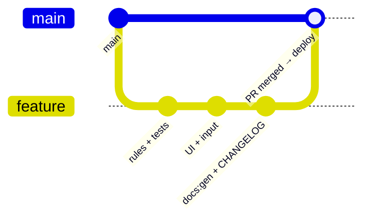

# Contributing

How to run the project, where things live, and step-by-step recipes for the most common changes.

---

## Setup

```bash
npm install
npm run dev          # http://localhost:5173
npm test             # unit tests
npm run build        # type-check + production build
npm run docs:gen     # regenerate docs/CONTENT_REFERENCE.md after data changes
```

Add `?debug` to the URL to get `window.__tactics` in the console; add `&fast` to speed up animations.

---

## Workflow



1. Branch from `main`.
2. Put rules in `src/core` with tests; keep DOM and Three.js out of `src/core` and `src/data`.
3. Make sure new UI works with **mouse, keyboard, touch, pen and controller**, and on **phone, tablet and desktop** (see [Controls & Camera](docs/CONTROLS_AND_CAMERA.md)).
4. Run `npm run docs:gen` if you touched `src/data` or `src/core/Trials.ts`.
5. Add a CHANGELOG entry; add an ADR for architectural changes (template below).
6. Open a PR. CI must be green. Merging to `main` deploys to GitHub Pages.

---

## Recipes

### Add an ability

| Step | File | What to do |
| :---: | :--- | :--- |
| 1 | `src/data/jobs.ts` | Add an `Ability` to the job's `abilities` (unique `id` with the job prefix, e.g. `kn_`) |
| 2 | `src/core/CombatEngine.ts` | Only if it needs special rules: a reaction goes in `checkReaction`, a support in `getForecast` |
| 3 | `src/core/Grid.ts` / `JobSystem.ts` | Only for movement abilities (`getReachableTiles` / `recalculateDerivedStats`) |
| 4 | `tests/core.test.ts` | The data-integrity test already fails if engine code names an id that doesn't exist; add a behaviour test |
| 5 | — | `npm run docs:gen` |

### Add a job

| Step | File | What to do |
| :---: | :--- | :--- |
| 1 | `src/core/types.ts` | Add the role to `Job['role']` if it's new |
| 2 | `src/data/jobs.ts` | Add the job (stats, move/jump, abilities, `prerequisites`) |
| 3 | `src/core/JobSystem.ts` | Starting gear in `createUnit`, starting JP entry |
| 4 | `src/graphics/CharacterArt.ts` | A `lookFor` palette (ally and enemy), headgear in `headFront` and `drawSide`, and the weapon in `weapon()`. Check every view and frame with a contact sheet; the portrait comes from the same look |
| 5 | `src/main.ts` | Optional: veteran enemy passives in `equipEnemyPassives` |
| 6 | `src/core/Trials.ts` | Add to `TRIAL_JOBS` and `TITLES` to appear in the Trials |
| 7 | — | Tests, `npm run docs:gen`, update [Job System](docs/JOB_SYSTEM.md) |

### Add a map

| Step | File | What to do |
| :---: | :--- | :--- |
| 0 | Workshop | Easiest: sculpt it in the Workshop, then **Export .json** and use the tiles as a reference |
| 1 | `src/data/maps.ts` | Write `createXxxMap(): MapData` with `MapBuilder` (`rect`, `set`, `each`), 16×16 or larger, north (z = 0) for enemies, and pass `playerSpawns` (6 tiles) to `build()`. Register it in `MAPS` |
| 2 | `index.html` | Add an `<option>` to `#map-select` |
| 3 | `src/renderer/Atmosphere.ts` | Optional: a preset keyed by the map id (else the theme's preset is used) |
| 4 | `src/core/Trials.ts` | Optional: add to `TRIAL_MAP_ROTATION` |
| 5 | — | The deploy, size and reachability tests in `tests/core.test.ts` must pass; run `npm run balance` for its chapter |

### Add or change a battle effect

| Step | File | What to do |
| :---: | :--- | :--- |
| 1 | — | Find one in the pixelfx catalog ([docs/CATALOG.md](https://github.com/patch-gg/pixelfx/blob/main/docs/CATALOG.md)); prefer short one-shots |
| 2 | `src/vendor/pixelfx/fx/` | Copy the effect file unchanged (and its category's `_lib.js`), read it, add it to `registry.js` |
| 3 | `src/renderer/BattleFx.ts` | Add or change the cue: anchor, mirror, `speed`, `startAt` (the impact time from the constants at the top of the effect file, minus ~0.15 s), `wrap` for effects that recolour the unit |
| 4 | — | Look at it in game on High and Low, beside a 48px unit, before shipping |

### Add a chapter

| Step | File | What to do |
| :---: | :--- | :--- |
| 1 | `src/data/campaign.ts` | Add a `CampaignChapter`: map, dialogue, `enemyRoster` (mark one `isBoss`), `rewardItemIds`, optional `recruit` |
| 2 | `src/data/campaign.ts` | Point a previous chapter's `choices[].nextChapterId` at it |
| 3 | — | Tests check every map, item, job and chapter reference; `npm run docs:gen` redraws the campaign diagram |

### Add an item

Add it to `ITEMS` in `src/data/items.ts`, then give it a source: `STARTING_ARMORY`, `RARE_DROP_POOL`, a chapter's `rewardItemIds`, or a choice's `rewardItemIds`. Run `npm run docs:gen`.

### Add a UI control

* Use a `<button>` (or add the class to `ensureFocusable` in `src/input/FocusNav.ts`) so Tab, arrows and the d-pad reach it.
* Give icon-only buttons an `aria-label`.
* If it opens a layer, add the layer's id to `UIManager.activeLayer()` and handle it in `TacticsGame.cancelAction()` so Esc / B / two-finger tap closes it.
* Check the three layouts in `src/style.css` (≤1100px, ≤700px, ≤520px tall) and 44px targets under `(pointer: coarse)`.

---

## Conventions

| Topic | Convention |
| :--- | :--- |
| Language | TypeScript strict; no `any` in `src/core` |
| Randomness | Pass `rng` into anything tests need to control |
| State | Battle-only effects are statuses or flags, never writes to `baseStats` |
| Ids | Ability ids use the job prefix (`sq_`, `kn_`, `ar_`, `bm_`, `wm_`, `dr_`, `ni_`, `geo_`, `tm_`) |
| Commits | Imperative summary line; explain *why* in the body |
| Docs | Mermaid for diagrams, tables for reference data; generated files are never edited by hand |

### ADR template

```markdown
# ADR 00NN: Title

## Status
Proposed | Accepted (version, date) | Superseded by ADR 00MM

## Context
What problem, and what constraints.

## Decision
What we chose, concretely.

## Consequences
What gets easier, what gets harder, what we'll watch.
```
