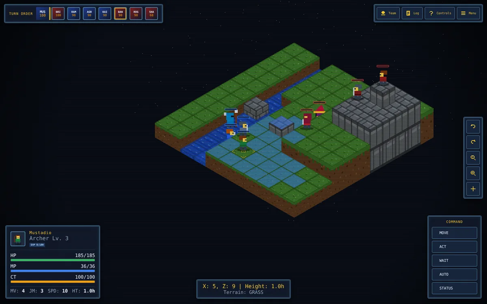
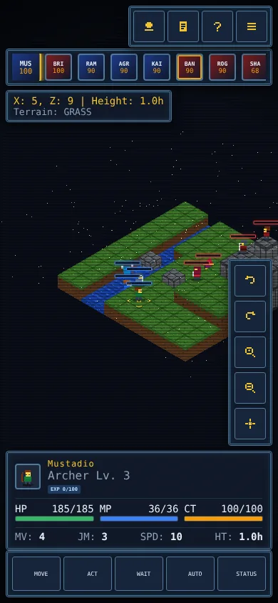
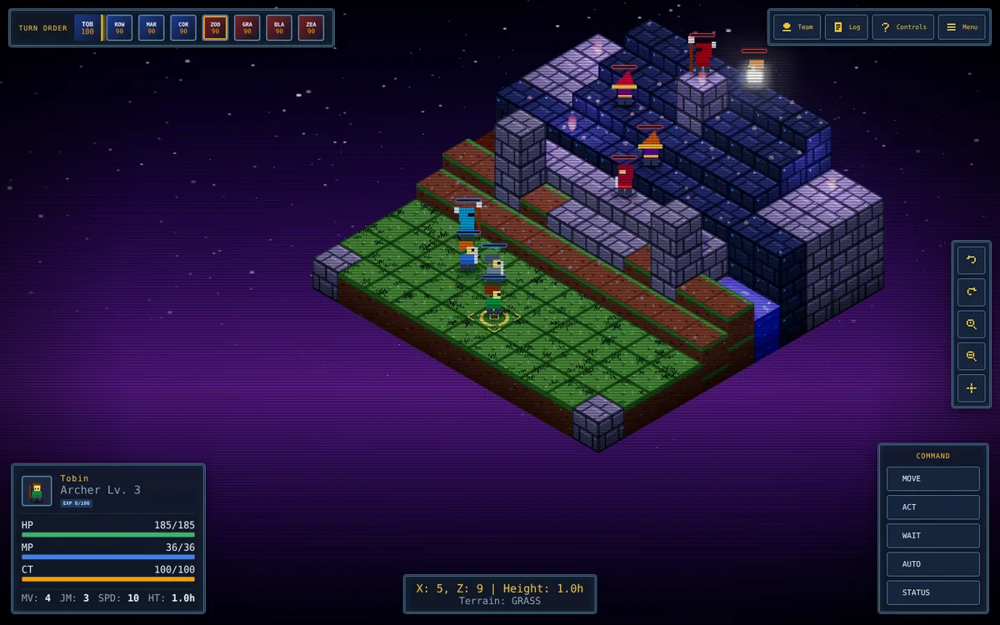
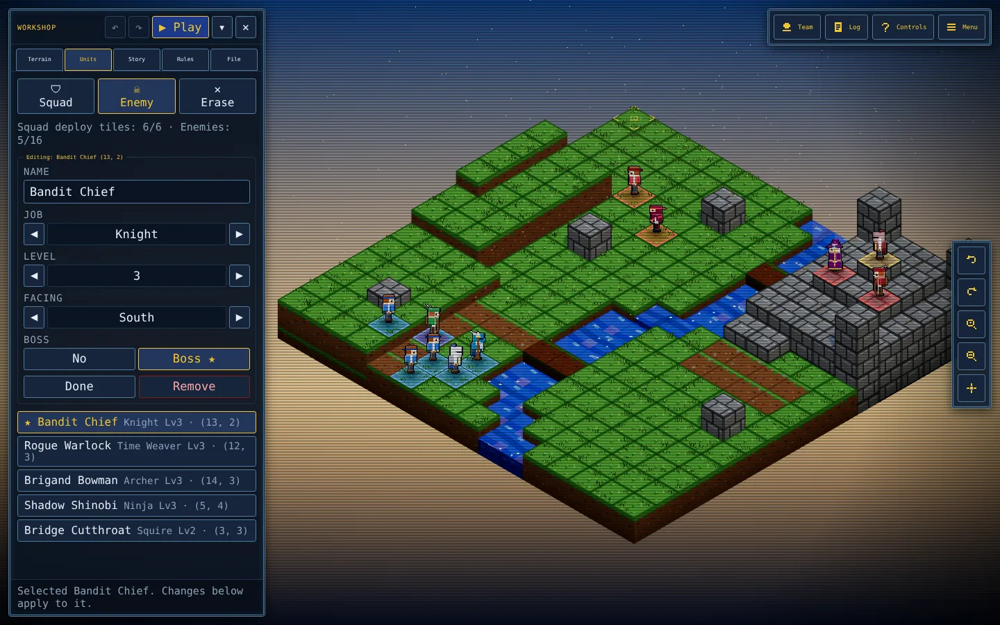
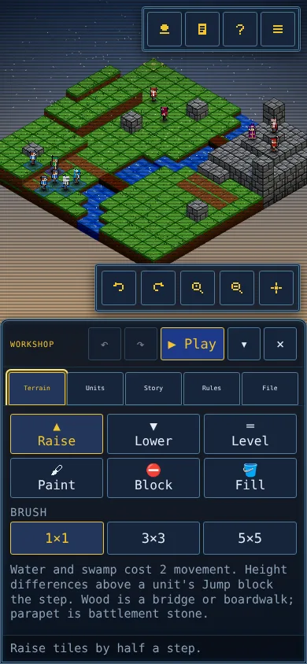
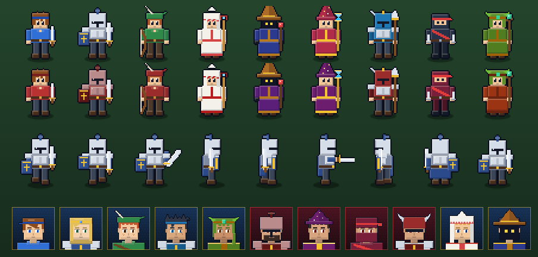
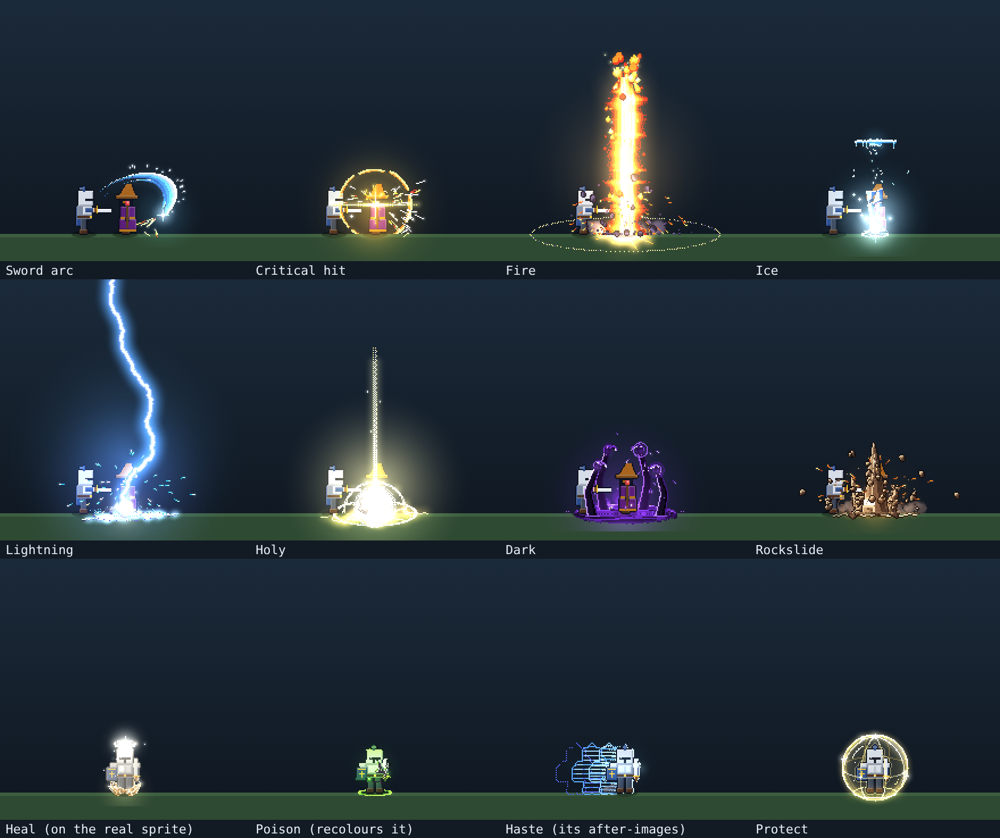
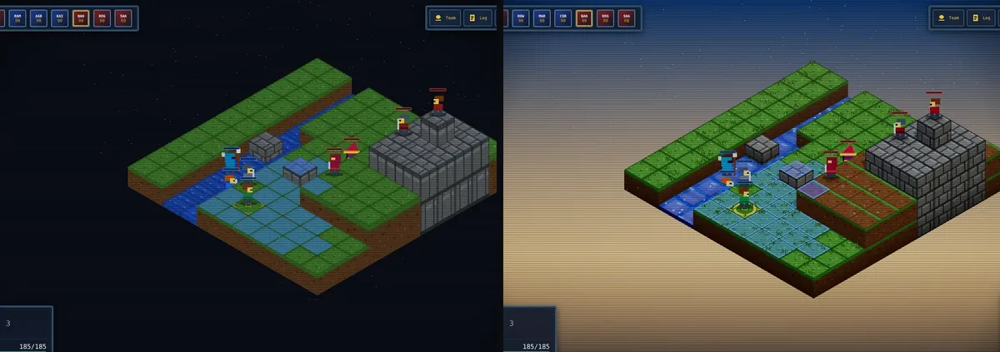
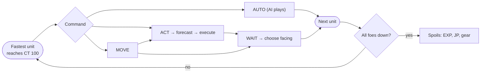

# Chess RPG Tactics

[](https://github.com/CptNope/Chess-RPG-Tactics/actions/workflows/deploy.yml)


[](LICENSE)

A turn-based tactics RPG for the browser in the spirit of *Final Fantasy Tactics* and *Tactics Ogre*: isometric 3D battlefields with height, facing-based combat, nine mix-and-match jobs, a branching campaign with bosses, and an endless post-game. It runs on phones, tablets and desktops, with mouse, keyboard, touch, pen or a controller.

### ▶ [Play it now](https://cptnope.github.io/Chess-RPG-Tactics/)



---

## Features

| | |
| :--- | :--- |
| **Tactics** | Speed-based turn order (CT), front / flank / back attacks, height advantage, terrain movement costs, area spells |
| **Squad building** | 9 jobs, 41 abilities, five ability slots (primary, secondary, reaction, support, movement), EXP and per-job JP |
| **Campaign** | A branching campaign (four chapters, three per playthrough) on 16×16 battlefields, with a recruit, boss fights with enrage phases, and gear rewards |
| **Post-game** | New Game+ and the endless, seeded **Trials of the Zodiac** with a Warden boss every fifth floor |
| **Enemy AI** | Plans every move: finishes wounded units, heals allies, aims area spells at clusters. **AUTO** lets it play your turn |
| **Play anywhere** | Phone (portrait and landscape), tablet and desktop layouts; mouse, keyboard, touch, pen and controller |
| **Graphics** | Per-map skies, fog and lighting, soft shadows, flowing water, torches, bloom; Auto / High / Medium / Low quality that adapts to your device |
| **Workshop** | Build your own battles: sculpt terrain, place enemies and bosses, write dialogue, pick an objective (rout, defeat the boss, survive N rounds), then play it or share it as a link |
| **Art & sound** | Animated 48px pixel-art units (walk, strike, flinch), drawn character portraits, hand-animated pixel-art spell and hit effects, synthesized music and SFX; no image files |

<p>
  
  
</p>

<p>
  
  
</p>





<details><summary><b>0.8 vs 0.9 graphics</b></summary>



</details>

---

## How a battle flows



New to the game? Read the **[Gameplay Guide](docs/GAMEPLAY_GUIDE.md)**.

---

## Controls

Press **H**, the **?** button, or **View/Back** on a controller for the in-game list.

| | Select | Back | Pan | Zoom | Rotate |
| :--- | :--- | :--- | :--- | :--- | :--- |
| **Mouse** | Click | × / Cancel | Drag | Wheel | ⟲ ⟳ buttons |
| **Keyboard** | Arrows + Enter | Esc | W A S D | + / − | Q / E |
| **Touch** | Tap | Two-finger tap | Drag | Pinch | Twist |
| **Pen** | Tap (hover previews) | Eraser / barrel button | Drag | — | ⟲ ⟳ buttons |
| **Controller** | D-pad + A | B | Right stick | LT / RT | LB / RB |

Keyboard shortcuts: `1` Move · `2` Act · `3` Wait · `4`/`T` Auto · `R` re-center · `J` Team · `L` Log · `H` Controls. Full matrix: **[Controls & Camera](docs/CONTROLS_AND_CAMERA.md)**.

---

## Run it locally

```bash
npm install
npm run dev          # http://localhost:5173
npm test             # 28 rule tests
npm run build        # type-check + production build
npm run docs:gen     # regenerate the content reference
```

`?debug` exposes the running game as `window.__tactics`; `?debug&fast` also speeds up animations.

Every push to `main` builds, tests and deploys to GitHub Pages; pull requests run the same checks without deploying.

---

## Documentation

| | |
| :--- | :--- |
| 🎮 **[Gameplay Guide](docs/GAMEPLAY_GUIDE.md)** | How to play, campaign map, bosses, Trials, the Workshop, tips |
| 📖 **[Content Reference](docs/CONTENT_REFERENCE.md)** | Every job, ability, item, map, chapter and Trial floor (generated from the game data) |
| 🕹️ **[Controls & Camera](docs/CONTROLS_AND_CAMERA.md)** | All five input methods, gestures, layouts, camera math |
| 🏗️ **[Architecture](docs/ARCHITECTURE.md)** | Modules, state machine, action pipeline, input flow, saves, build |
| ⚔️ **[Combat](docs/COMBAT_SYSTEM.md)** · 🛡️ **[Jobs](docs/JOB_SYSTEM.md)** · 🧠 **[Enemy AI](docs/ENEMY_AI.md)** | System deep dives |
| 🧪 **[Testing](docs/TESTING.md)** | CI, unit tests, play-tests, release checklist |
| 🗺️ **[Roadmap](docs/ROADMAP.md)** | Release history, Now / Next / Later, known issues |
| 🤝 **[Contributing](CONTRIBUTING.md)** | Setup and recipes for adding jobs, maps, chapters, items |
| 🏛️ **[ADRs](docs/README.md#architectural-decision-records)** | 19 architectural decisions |
| 📜 **[Changelog](CHANGELOG.md)** | Every release |

---

## Project layout

```text
src/
  main.ts        game flow, action pipeline, input dispatch
  core/          rules: turns, grid, combat, jobs, AI, Trials, saves (no DOM)
  data/          jobs, items, maps, campaign
  renderer/      Three.js scene, gestures, VFX
  ui/ input/     HUD, menus, focus navigation, controller
  audio/ graphics/
tests/           Vitest rule tests
scripts/         build check, docs generator
docs/            guides, ADRs, images
```

---

## License

Released under the [MIT License](LICENSE) © 2026 Jeremy Anderson. You're free to use, modify and share the code; keep the copyright notice.

| Third-party | License |
| :--- | :--- |
| [three.js](https://threejs.org) | MIT |
| [pixelfx](https://github.com/patch-gg/pixelfx) spell and hit effects (vendored in `src/vendor/pixelfx`, which adapts parts of [Sprite Fusion's VFX](https://www.spritefusion.com/pixel-art-vfx)) | MIT |
| [Press Start 2P](https://fonts.google.com/specimen/Press+Start+2P), [VT323](https://fonts.google.com/specimen/VT323) fonts (Google Fonts) | SIL Open Font License 1.1 |

All characters, story, unit art, portraits, maps, music and sound are original to this project and generated in code; the spell and hit effects are pixelfx's (above). *Chess RPG Tactics* is a fan-made homage to the tactics-RPG genre and is not affiliated with or endorsed by Square Enix or the makers of *Final Fantasy Tactics* or *Tactics Ogre*.
