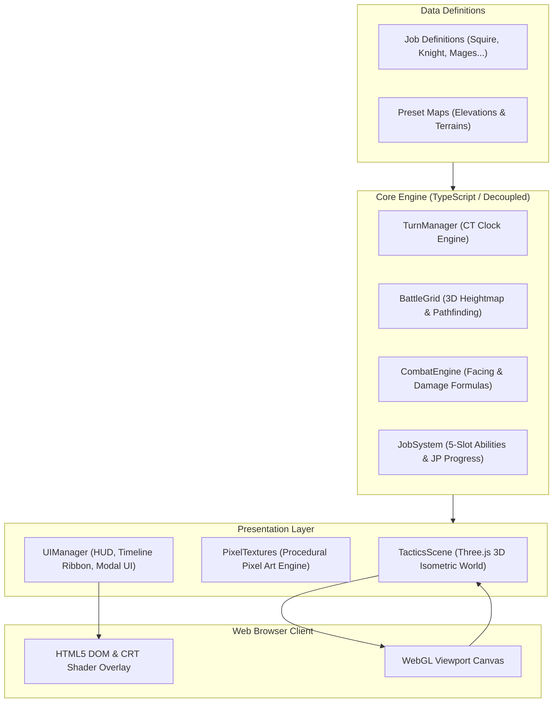
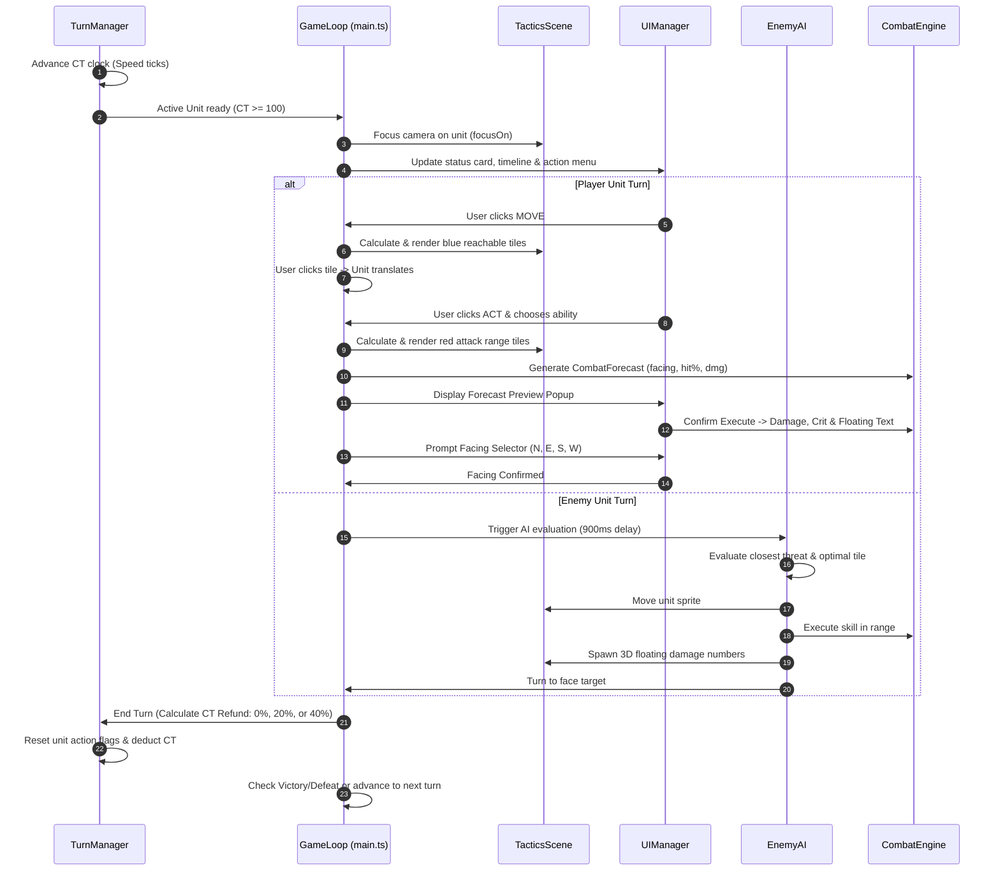
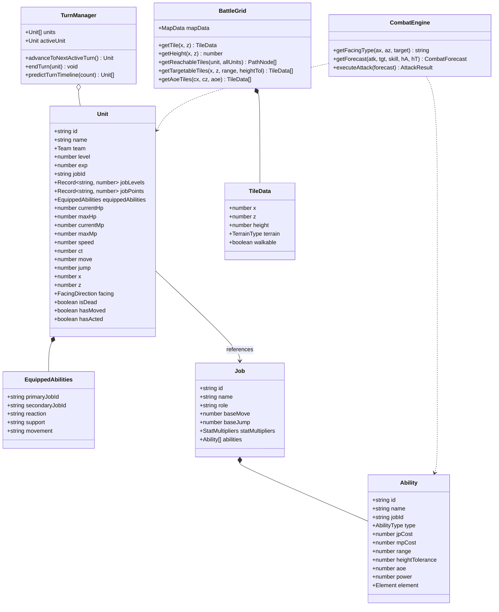

# System Architecture & Technical Specifications

This document outlines the architectural design, component relationships, data flow, and lifecycle execution of **Chess RPG Tactics**.

---

## 1. High-Level Component Topology

---

## 2. Active Turn Lifecycle Sequence

The game does not use synchronous team turns. Instead, it ticks the CT clock based on unit speed until someone reaches $CT \ge 100$.

---

## 3. Core Class & Entity Relationship Diagram

---

## 4. Key Subsystem Responsibilities

| Subsystem | Primary Responsibility | Key Files |
| :--- | :--- | :--- |
| **Grid & Pathfinding** | Manages 3D voxel heightmaps, step walkability, and Dijkstra BFS with Jump constraints. | `src/core/Grid.ts`, `src/data/maps.ts` |
| **CT Speed Clock** | Simulates tick-based Charge Time accumulation ($CT \mathrel{+}= Speed$) and turn prediction. | `src/core/TurnManager.ts` |
| **Combat Mechanics** | Determines spatial vectors (Front/Flank/Back), height bonuses, hit rolls, and critical strikes. | `src/core/CombatEngine.ts` |
| **Job Progression** | Handles base stat scaling, 5-slot ability equipping, and JP ability mastery. | `src/core/JobSystem.ts`, `src/data/jobs.ts` |
| **3D Isometric Scene** | Manages Three.js scene, orthographic camera, 90° rotation, smooth zoom, and billboard planes. | `src/renderer/TacticsScene.ts` |
| **Pixel Art Generator** | Procedurally draws 16x16 tile textures and 4-directional 32x32 character sprites. | `src/graphics/PixelTextures.ts` |
| **HUD & Interface** | Controls turn order ribbon, status card, command menus, and floating combat numbers. | `src/ui/UIManager.ts`, `src/style.css` |
| **Game Orchestration** | Glues input handling, event loops, battle state checks, and enemy AI turns. | `src/main.ts` |
