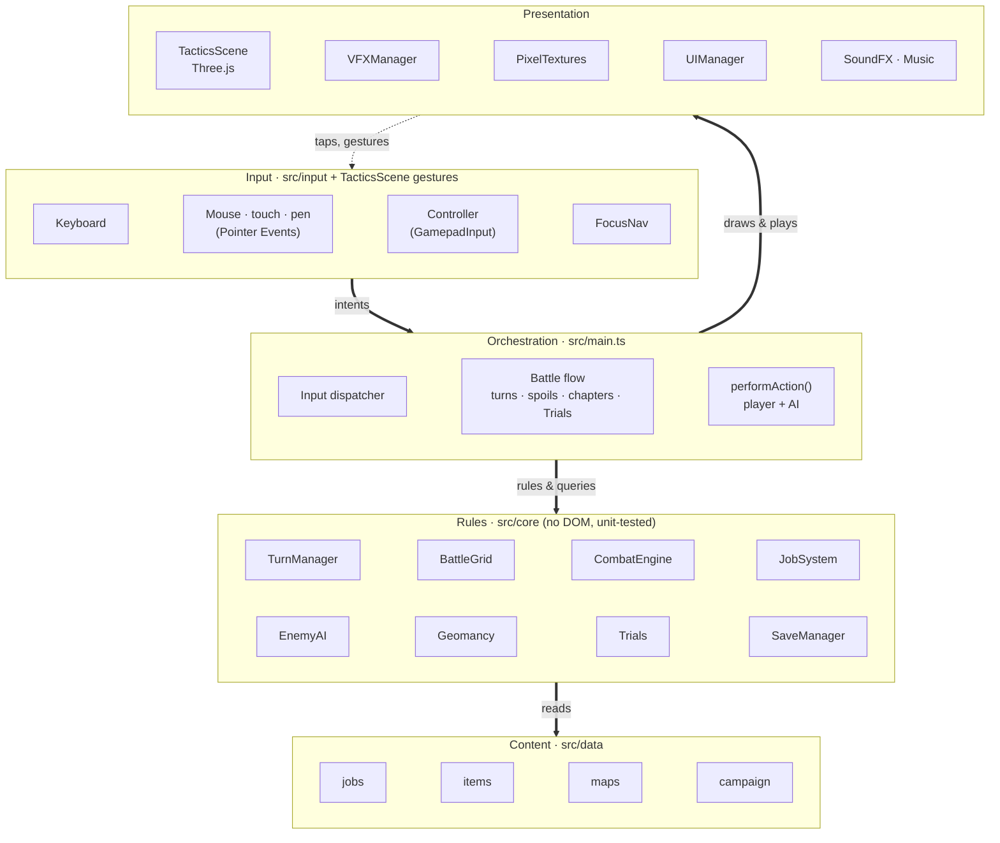
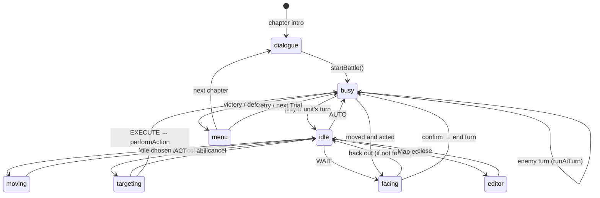
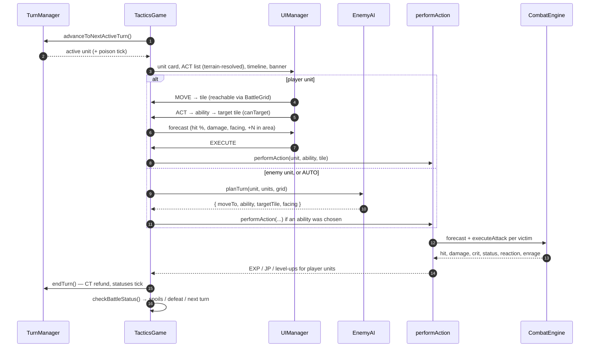
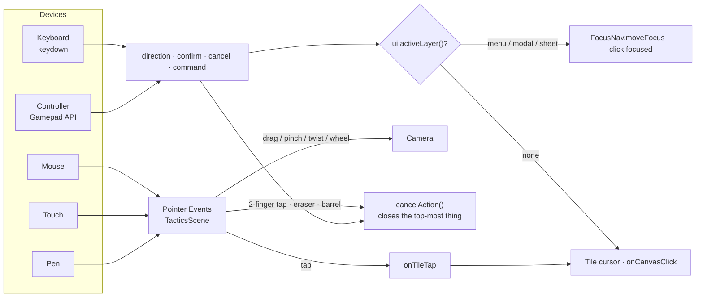
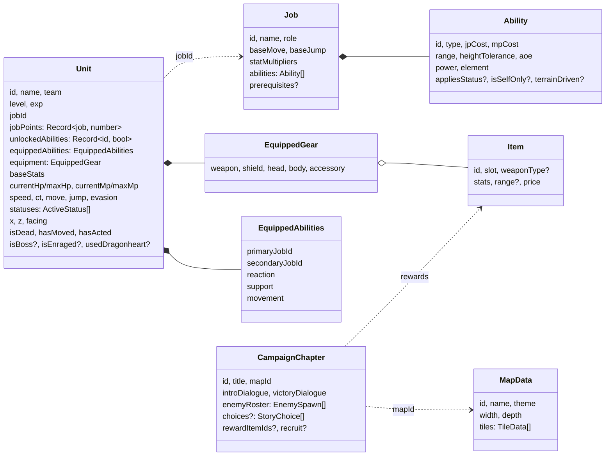
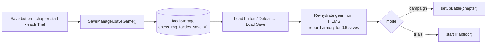
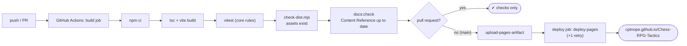

# Architecture

How Chess RPG Tactics is put together: modules, the game's state machine, how a turn and an action flow through the code, input, persistence, and the build.

> Stack: **TypeScript + Vite + Three.js** (orthographic 3D), DOM/CSS HUD, Web Audio, no runtime framework. ~8k lines of TypeScript, one 120 KB app chunk plus a 476 KB Three.js chunk.

---

## 1. Layers and modules



| Module | File(s) | Responsibility | Depends on |
| :--- | :--- | :--- | :--- |
| **TacticsGame** | `src/main.ts` | Owns all state; turn flow, action pipeline, input dispatch, spoils, chapters, Trials, save/load | everything |
| **TurnManager** | `src/core/TurnManager.ts` | CT clock, turn order prediction, CT refunds, status ticking, poison | JobSystem |
| **BattleGrid** | `src/core/Grid.ts` | Tile lookup, Dijkstra movement (Jump, terrain cost, Teleport), `canTarget` range rule | types |
| **CombatEngine** | `src/core/CombatEngine.ts` | Facing, forecast, hit/crit rolls, statuses, reactions, boss enrage | JobSystem |
| **JobSystem** | `src/core/JobSystem.ts` | Unit creation, effective stats, EXP/levels, bosses, passives lookup | data |
| **EnemyAI** | `src/core/EnemyAI.ts` | Scores every tile × ability × target; also powers AUTO | Grid, CombatEngine, Geomancy |
| **Geomancy** | `src/core/Geomancy.ts` | Terrain → spell mapping | types |
| **Trials** | `src/core/Trials.ts` | Seeded floor generator, drops | data |
| **SaveManager** | `src/core/SaveManager.ts` | Save/load, best Trial floor, custom maps | — |
| **TacticsScene** | `src/renderer/TacticsScene.ts` | Three.js scene, camera, tiles, sprites, highlights, gestures, cursor | Grid, VFX, PixelTextures |
| **VFXManager** | `src/renderer/VFXManager.ts` | Weather, spell particles, screen shake (reduced-motion aware) | — |
| **PixelTextures** | `src/graphics/PixelTextures.ts` | Procedural tile textures and 4-facing unit sprites (cached) | — |
| **UIManager** | `src/ui/UIManager.ts` | HUD, menus, Team screen, modals, focus management, input-aware hints | JobSystem, FocusNav |
| **GamepadInput** | `src/input/GamepadInput.ts` | Standard-mapping polling, repeat, rumble | — |
| **FocusNav** | `src/input/FocusNav.ts` | Arrow / d-pad focus movement between visible controls | — |
| **Audio** | `src/audio/*.ts` | SFX and three procedural music tracks | — |

**Rule of thumb:** `src/core` and `src/data` never touch the DOM or Three.js. That is what lets `tests/core.test.ts` and `scripts/gen-docs.ts` import them directly in Node.

---

## 2. Game state machine

`TacticsGame.currentMode` gates every input. `battleOver` short-circuits turn advancement.



| Mode | Battlefield taps | Arrows / d-pad | Confirm (Enter / A) | Cancel (Esc / B) |
| :--- | :--- | :--- | :--- | :--- |
| `dialogue` | — | — | Next line | — |
| `idle` | Inspect unit | Move cursor | On own unit → command menu; else inspect | Blur focus |
| `moving` | Move if reachable | Move cursor | Move to cursor | Back to idle |
| `targeting` | Forecast if in range | Move cursor | Forecast at cursor | Back to idle |
| `facing` | — | Move focus on compass | Pick / confirm | Back out unless forced |
| `editor` | Edit tile | Move cursor | Edit cursor tile | Close editor |
| `busy` / `menu` | — | Modal focus only | Modal buttons | — |

---

## 3. A turn, end to end



---

## 4. The action pipeline

Player actions, enemy actions and AUTO all go through one function, `TacticsGame.performAction()`. Before 0.7.0 the player and enemy paths were separate copies and drifted apart.


---

## 5. Input architecture

Every device ends up as one of three intents (direction, confirm, cancel) or a named command. Which one wins depends on whether a menu layer is active.



`html[data-input]` records the last-used device (`mouse`, `touch`, `pen`, `keyboard`, `gamepad`). CSS and UI read it for hotkey badges, the dialogue hint and the order of cards on the Controls screen. Full mapping: [Controls & Camera](CONTROLS_AND_CAMERA.md).

---

## 6. Data model



---

## 7. Persistence



| Key | Contents |
| :--- | :--- |
| `chess_rpg_tactics_save_v1` | `{ version, timestamp, currentChapterId, units, armory, mode, trialsFloor, campaignCleared }` |
| `chess_rpg_tactics_best_trial_v1` | Highest Trial floor cleared |
| `chess_rpg_tactics_custom_maps_v1` | Sculpted maps from the editor |

All storage calls are wrapped in `try/catch`, so private browsing or an embedded iframe without storage degrades to "save failed" instead of crashing.

---

## 8. Rendering notes

| Concern | Approach |
| :--- | :--- |
| Camera | Orthographic, 4 fixed azimuths (90° steps), smooth lerp. Zoom fits the *shorter* screen side, so portrait phones see the full map width |
| Tiles | One box mesh per tile, shared materials per terrain, cached `tileMeshList` for raycasts |
| Units | Billboard planes with procedurally drawn, cached 32×32 sprite textures per job/facing/team |
| Overlays | DOM HP/CT bars and floating numbers projected from 3D positions each frame |
| Frame loop | `requestAnimationFrame` → poll gamepad → hover tile info (only on change) → `scene.render()` |
| Motion | `prefers-reduced-motion` cuts screen shake to 15% and swaps sliding banners for fades |

---

## 9. Build, test, deploy



Deploying from a separate job, with a retry, avoids the "No artifacts named github-pages" race that broke the 2026-11-18 deploy (see [ADR 0015](adr/0015-action-pipeline-ai-progression-trials.md)). Testing details: [TESTING.md](TESTING.md).

---

## 10. Source tree

```text
src/
├── main.ts                 TacticsGame: state, flow, action pipeline, input dispatch
├── style.css               HUD styles, responsive breakpoints, focus rings
├── core/                   Pure rules (Node-testable)
│   ├── types.ts            Shared types
│   ├── TurnManager.ts      CT clock
│   ├── Grid.ts             Pathfinding + targeting
│   ├── CombatEngine.ts     Forecasts, rolls, reactions, enrage
│   ├── JobSystem.ts        Stats, EXP, bosses
│   ├── EnemyAI.ts          Turn planner (also AUTO)
│   ├── Geomancy.ts         Terrain spells
│   ├── Trials.ts           Seeded post-game floors
│   └── SaveManager.ts      localStorage
├── data/                   Content: jobs, items, maps, campaign
├── renderer/               TacticsScene (Three.js + gestures), VFXManager
├── graphics/               PixelTextures
├── ui/                     UIManager
├── input/                  GamepadInput, FocusNav
└── audio/                  SoundEffects, MusicSynthesizer
tests/core.test.ts          28 rule tests
scripts/                    check-dist.mjs, gen-docs.ts
docs/                       This documentation + ADRs
```
