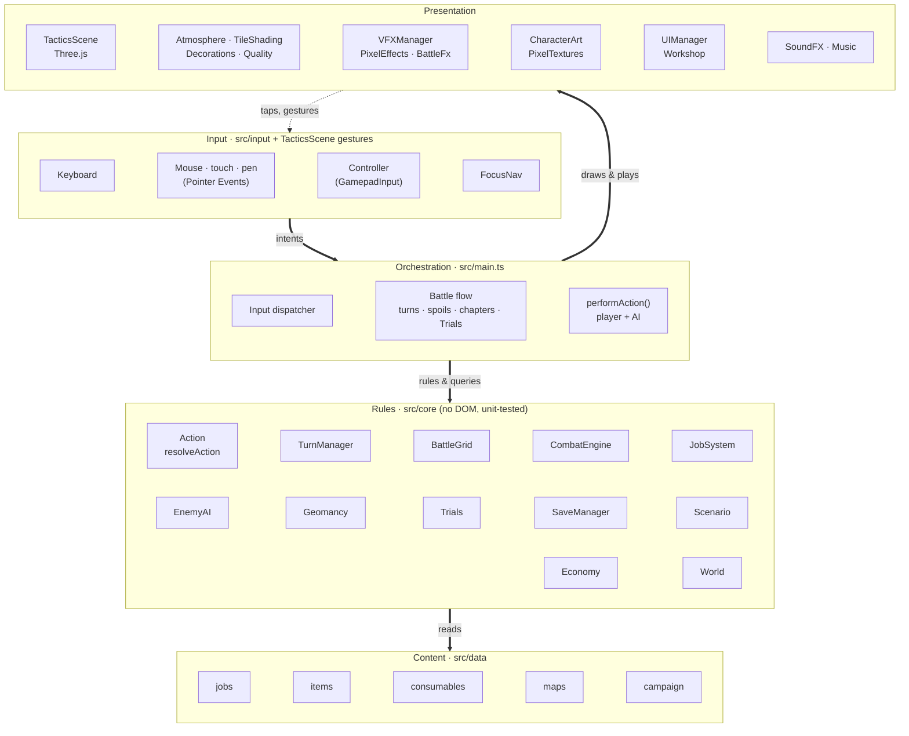
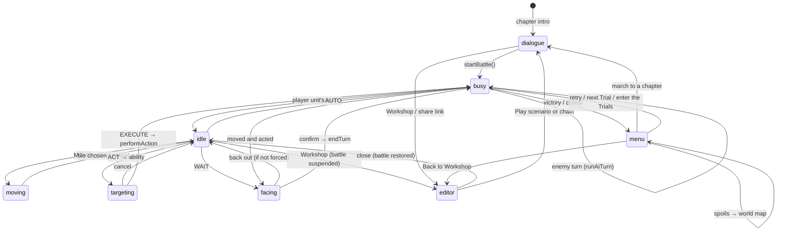
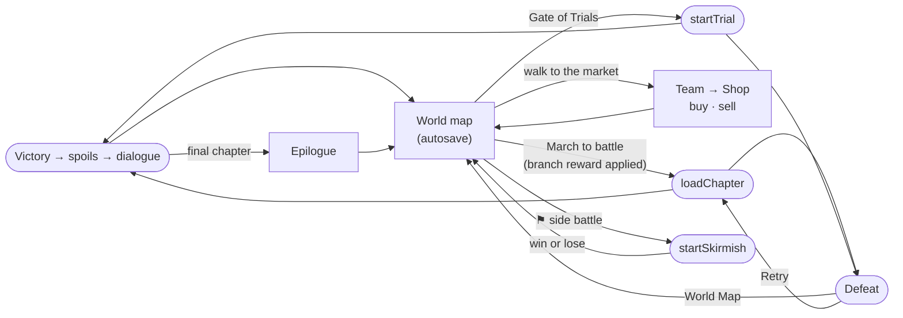
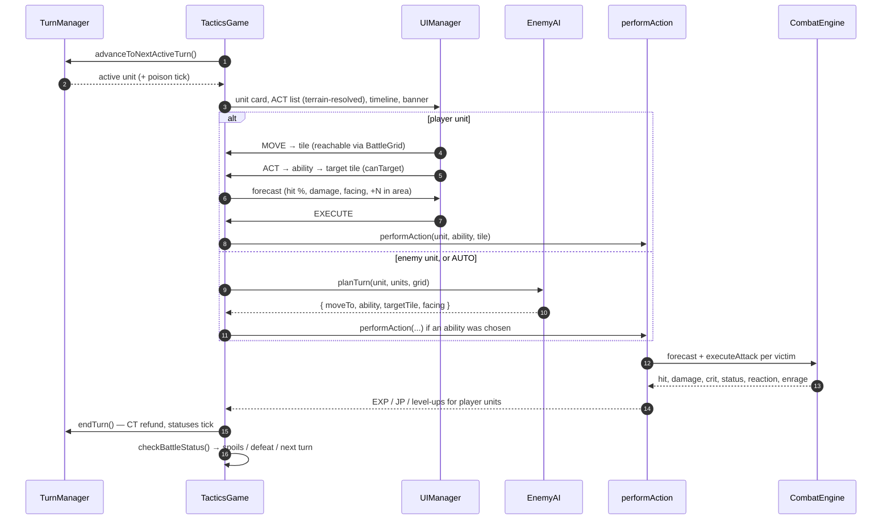
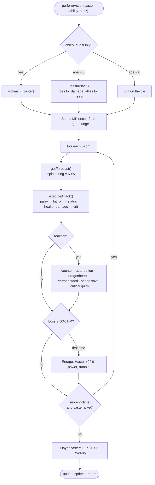
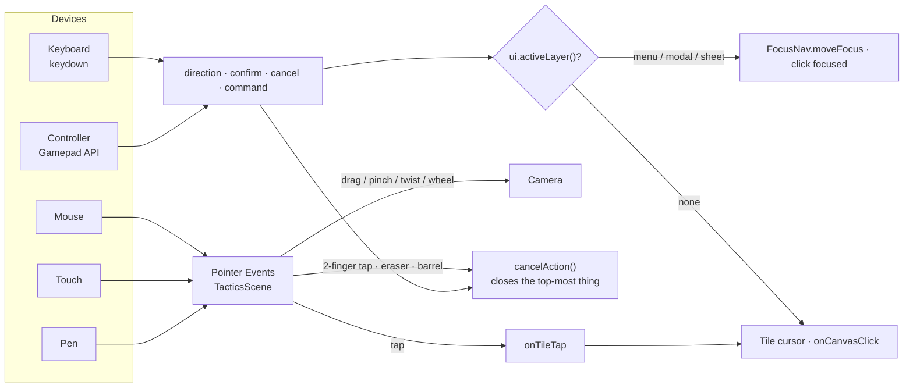
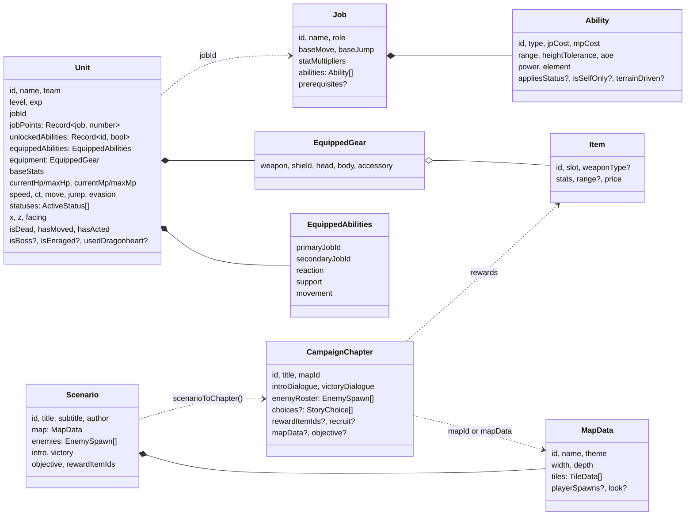
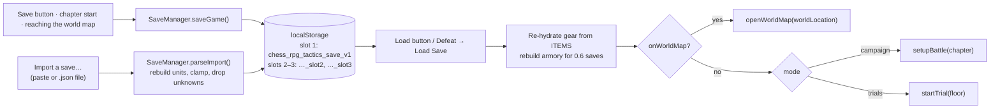
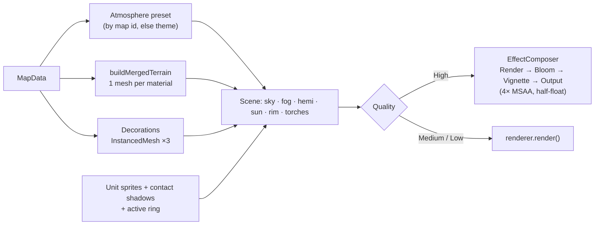
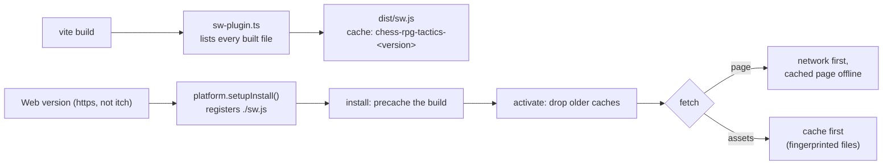

# Architecture

How Chess RPG Tactics is put together: modules, the game's state machine, how a turn and an action flow through the code, input, persistence, and the build.

> Stack: **TypeScript + Vite + Three.js** (orthographic 3D), DOM/CSS HUD, Web Audio, no runtime framework. ~8k lines of TypeScript, a ~190 KB app chunk (including Three's post-processing passes) plus a 485 KB Three.js chunk.

---

## 1. Layers and modules



| Module | File(s) | Responsibility | Depends on |
| :--- | :--- | :--- | :--- |
| **platform** | `src/platform.ts` | Where the game runs (itch.io, embedded, web): store links, share-link base, fullscreen, page-scroll guard | — |
| **TacticsGame** | `src/main.ts` | Owns all state; turn flow, action pipeline, input dispatch, spoils, chapters, Trials, save/load | everything |
| **Action** | `src/core/Action.ts` | Resolves an ability step by step with no drawing or waiting: costs, the caster's facing, a call begun, one roll per target, JP and EXP under the rules (`resolveAction`, `runAction`, `victimsFor`, `forecastFor`). Shared by the game and the balance sim (0.41) | CombatEngine, JobSystem, EnemyAI, Sides, Rules |
| **Sides** | `src/core/Sides.ts` | Friend or foe: `isFoe`, `isAlly`, `allianceOf` (a unit's alliance, else its team), `joinSide` (Tame), `sidesStanding` (0.41) | types |
| **Rng** | `src/core/Rng.ts` | The seeded generator every battle rolls with, and new seeds (0.41) | — |
| **Rules** | `src/core/Rules.ts` | `BattleRules`: what a battle is played under (today: which teams earn JP and EXP); `CAMPAIGN_RULES` (0.41) | types |
| **TurnManager** | `src/core/TurnManager.ts` | CT clock, turn order prediction, CT refunds, status ticking, poison | JobSystem |
| **BattleGrid** | `src/core/Grid.ts` | Tile lookup, Dijkstra movement (Jump, terrain cost, Teleport), `findPath` for walking, `canTarget` range rule | types |
| **CombatEngine** | `src/core/CombatEngine.ts` | Facing, forecast, hit/crit rolls, statuses, reactions, boss enrage | JobSystem |
| **JobSystem** | `src/core/JobSystem.ts` | Unit creation, effective stats, EXP/levels, bosses, passives lookup | data |
| **EnemyAI** | `src/core/EnemyAI.ts` | Scores every tile × ability × target; also powers AUTO | Grid, CombatEngine, Geomancy |
| **Geomancy** | `src/core/Geomancy.ts` | Terrain → spell mapping | types |
| **Trials** | `src/core/Trials.ts` | Seeded floor generator, drops | data |
| **SaveManager** | `src/core/SaveManager.ts` | Save/load, best Trial floor | — |
| **Difficulty** | `src/core/Difficulty.ts` | Easy / Normal / Hard: enemy level shift, boss HP, enemy raise cap | JobSystem |
| **Economy** | `src/core/Economy.ts` | Bounties, shop tiers, resale value, what can't be sold | data |
| **World** | `src/core/World.ts` | The world map's places and roads; which battles are open, cleared or locked; routes; cleared-chapter lists for old saves | data |
| **WorldMap** | `src/ui/WorldMap.ts` | Draws the map (a painted 320×180 canvas with real buttons over it), walks the party marker, shows what the current place offers. Talks to the game through a small `WorldHost` interface | World, CharacterArt |
| **Skirmish** | `src/core/Skirmish.ts` | Side battles: the three places, when each opens, enemy level from the squad and past wins, the generated roster, the gil bonus | data, Trials (seeded RNG) |
| **Tutorial** | `src/ui/Tutorial.ts` | First-time tips: which have been seen (per device), showing one at a time without taking focus | — |
| **Monsters** | `src/data/monsters.ts`, `src/graphics/MonsterArt.ts` | Monster jobs (flagged `monster`, with `innate` statuses and immunities) and their sprites and portraits (0.26) | types; CharacterArt's painter |
| **Recruits** | `src/core/Recruits.ts` | The market's recruiting board (seeded by battles won), hiring, who can be dismissed, and the party of six (0.25) | jobs data, JobSystem |
| **Summons** | `src/core/Summons.ts` | Grand summons: starting a call, the call due at a turn's start, breaking it, its marked area, how many foes' calls land on a tile, Cinderwing's raise (0.24) | jobs data |
| **Performances** | `src/core/Performance.ts` | Bard songs and Dancer dances: Encore turns, Resonance's reach, starting, ending and the encore due at a turn's start (0.22) | jobs data |
| **Travelling merchant** | `src/core/Merchant.ts` | Where Wenna is and what she sells, worked out from progress the save already keeps (won chapters, side-battle wins, shelf, armory), plus the wares sold on this visit (0.21) | — |
| **Camp scenes** | `src/data/camp.ts` | A short scene after each story battle, which one is waiting, and the seen list for old saves (0.21) | — |
| **Text size** | `src/ui/TextSize.ts` | Normal / Large / Larger, saved per device; sets `data-text-size` on `<html>`, which picks the `--ts` multiplier every UI font size uses (0.20) | — |
| **consumables** | `src/data/consumables.ts` | The eight supplies; turns one into an `Ability` for the engine; clamps saved inventories | types |
| **Scenario** | `src/core/Scenario.ts` | Workshop scenario format: create, copy, sanitise untrusted input, validate, turn into a chapter, share-link encoding, library | data |
| **Chain** | `src/core/Chain.ts` | Scenario chains (0.42): the format, `sanitizeChain`, `validateChain`, editing helpers, `chainStep` (next / retry / complete), `#c=` links, the chain library and saved progress | Scenario |
| **TacticsScene** | `src/renderer/TacticsScene.ts` | Three.js scene, camera, tiles, sprites, highlights, gestures, cursor; the summon dim, call markers and summon camera (0.24) | Grid, VFX, PixelTextures |
| **Atmosphere** | `src/renderer/Atmosphere.ts` | Per-map presets: sky gradient, fog, hemisphere/sun/rim lights, exposure, bloom, torch colour | — |
| **TileShading** | `src/renderer/TileShading.ts` | Terrain materials with injected shader tweaks (bevels, cliff AO, water, swamp); merged terrain meshes | — |
| **Decorations** | `src/renderer/Decorations.ts` | Instanced grass, reeds and pebbles with wind sway | TileShading |
| **GraphicsQuality** | `src/renderer/GraphicsQuality.ts` | High / Medium / Low profiles, device detection, saved setting | — |
| **VFXManager** | `src/renderer/VFXManager.ts` | Weather particles and screen shake (reduced-motion aware) | — |
| **PixelEffects** | `src/renderer/PixelEffects.ts` | Plays pixelfx effects as camera-facing billboards at sprite pixel density (back/front layers, colour + additive light); builds effect actors from unit sprites | vendor/pixelfx |
| **BattleFx** | `src/renderer/BattleFx.ts` | The cue table: which effect plays for each hit, element, geomancy spell, status, heal, enrage and level-up, where it stands and how far to skip its wind-up; a summon's creature and when it lands (0.24) | PixelEffects |
| **Summon effects** | `src/renderer/fx/summons/` | Nine creature effects written against pixelfx, drawn over the board (`overlay`), each with its `impact` time; `_lib.js` holds the summoning circle, shaded bodies, light pillars and shock rings (0.24) | vendor/pixelfx |
| **pixelfx** (vendored) | `src/vendor/pixelfx/` | Third-party MIT library: effect drawing core + the 21 effects the game uses, unchanged; `registry.js` is ours | — |
| **CharacterArt** | `src/graphics/CharacterArt.ts` | Pixel painter + outline pass: 48×48 unit sprites (3 views × 6 frames) and 64×64 portraits | — |
| **PixelTextures** | `src/graphics/PixelTextures.ts` | Procedural tile textures; wraps CharacterArt sprites as cached textures | CharacterArt |
| **UIManager** | `src/ui/UIManager.ts` | HUD, menus, Team screen, modals, focus management, input-aware hints | JobSystem, FocusNav |
| **Workshop** | `src/ui/Workshop.ts` | Map & scenario editor panel; edits a scenario and its preview on the live scene; the Chains tab strings scenarios into mini campaigns (0.42); talks to the game through a host interface | Scenario, Chain, TacticsScene |
| **GamepadInput** | `src/input/GamepadInput.ts` | Standard-mapping polling, repeat, rumble | — |
| **FocusNav** | `src/input/FocusNav.ts` | Arrow / d-pad focus movement between visible controls | — |
| **Audio** | `src/audio/*.ts` | SFX and three procedural music tracks | — |

**Rule of thumb:** `src/core` and `src/data` never touch the DOM or Three.js. That is what lets `tests/core.test.ts` and `scripts/gen-docs.ts` import them directly in Node.

---

## 2. Game state machine

`TacticsGame.currentMode` gates every input. `battleOver` short-circuits turn advancement.



| Mode | Battlefield taps | Arrows / d-pad | Confirm (Enter / A) | Cancel (Esc / B) |
| :--- | :--- | :--- | :--- | :--- |
| `dialogue` | — | — | Next line | — |
| `idle` | Inspect unit | Move cursor | On own unit → command menu; else inspect | Blur focus |
| `moving` | Move if reachable | Move cursor | Move to cursor | Back to idle |
| `targeting` | Forecast if in range | Move cursor | Forecast at cursor | Back to idle |
| `facing` | — | Move focus on compass | Pick / confirm | Back out unless forced |
| `editor` | Apply the Workshop tool | Move cursor (or panel focus) | Apply tool at cursor | Leave panel, then close Workshop |
| `busy` / `menu` | — | Modal focus only | Modal buttons | — |

The **world map** is not a mode of its own: it is shown while `currentMode` is `menu` and `world.isOpen` is true. `UIManager.activeLayer()` lists it under the modals, so the Team screen, the system menu and result screens take focus over it, and the 3D scene isn't rendered while it covers the battlefield.



---

## 3. A turn, end to end



---

## 4. The action pipeline

Player actions, enemy actions and AUTO all go through one function, `TacticsGame.performAction()`. Before 0.7.0 the player and enemy paths were separate copies and drifted apart.

Since 0.41 the rules part lives in `src/core/Action.ts`. `resolveAction` is a generator: a **start** step (costs paid, caster turned, a call begun), then one **hit** step per target, each rolled only when the next step is asked for, and it returns what the caster earned. `performAction` plays the effects, banners and waits around those steps, so a second target isn't rolled before the first is shown. The balance sim runs the same resolver headless (`runAction`). The flow below is the same either way; the rolls come from the battle's seeded dice (`core/Rng.ts`).



---

## 5. Input architecture

Every device ends up as one of three intents (direction, confirm, cancel) or a named command. Which one wins depends on whether a menu layer is active.



`html[data-input]` records the last-used device (`mouse`, `touch`, `pen`, `keyboard`, `gamepad`). CSS and UI read it for hotkey badges, the dialogue hint and the order of cards on the Controls screen. Full mapping: [Controls & Camera](CONTROLS_AND_CAMERA.md).

---

## 6. Data model



---

## 7. Persistence



| Key | Contents |
| :--- | :--- |
| `chess_rpg_tactics_save_v1`, `…_slot2`, `…_slot3` | Save slots 1–3 (slot 1 is the key every earlier version used): `{ version, timestamp, currentChapterId, units, armory, mode, trialsFloor, campaignCleared, gil, inventory, clearedChapters, onWorldMap, worldLocation, skirmishWins, difficulty }`. Every field after `units` is optional and filled in on load, so saves from any earlier version still open |
| `chess_rpg_tactics_tips_v1` | First-battle tips seen, and whether tips are off (per device) |
| `chess_rpg_tactics_speed_v1` | `fast` when the Fast battle speed is on (per device) |
| `chess_rpg_tactics_best_trial_v1` | Highest Trial floor cleared |
| `chess_rpg_tactics_workshop_v1` | Workshop library: up to 50 scenarios, newest first, each re-sanitised on load |
| `chess_rpg_tactics_chains_v1` | Scenario chains: up to 20, newest first, each battle stored with packed tiles and re-sanitised on load (0.42) |
| `chess_rpg_tactics_chain_progress_v1` | `{ chainId: next battle }`: where each chain picks up. Cleared when a chain is finished or deleted (0.42) |
| `chess_rpg_tactics_graphics_v1` | Graphics setting (auto / high / medium / low) |
| URL `#s=…` | A shared scenario: packed tiles, deflate-raw, base64url. Read once on load, then removed from the address bar |
| URL `#c=…` | A shared chain, encoded the same way with every battle inside. Saved to the chain library and opened on the Chains tab (0.42) |

Workshop battles save the campaign chapter you'll return to (`mode: 'campaign'`), never the custom scenario. All storage calls are wrapped in `try/catch`, so private browsing or an embedded iframe without storage degrades to "save failed" instead of crashing.

---

## 8. Rendering



| Concern | Approach |
| :--- | :--- |
| Camera | Orthographic, 4 fixed azimuths (90° steps), smooth lerp. Zoom fits the *shorter* screen side so portrait phones see the full map width |
| Terrain | Each tile is a box whose top and side faces are bucketed by material and merged: ~10 terrain draw calls for a whole map. Picking raycasts the merged meshes and steps 0.02 into the surface along the face normal to find the column |
| Materials | Built-in Lambert/Phong materials with `onBeforeCompile` injections, so lights, shadows and fog still work. One shared `uTime` uniform drives water, swamp, grass sway and highlights |
| Lighting | Hemisphere + directional sun (PCF shadows framed to the map) + rim light; ACES filmic tone mapping; per-map exposure |
| Atmosphere | Canvas-painted gradient sky with a seeded star field; `THREE.Fog` from ~44 to ~92 units (the camera sits 45 units out) |
| Units | Billboard planes with procedural 48×48 sprites (CharacterArt), radial-gradient contact shadows, and a ring under the active unit. The frame follows the action: breathing idle, walk while tweening between tiles (with a hop over height changes), strike during a lunge, flinch on recoil |
| Workshop view | `setScreenInset(left, bottom)` shifts the orthographic frustum so the map stays centred beside the side panel or above the bottom sheet |
| Effects | pixelfx frames (30 fps steps) on billboards 1.35 units per 48 px; back and front layers offset along the view direction so they never slide on screen; colour textures blend normally, light textures add (and bloom on High). Body effects get the unit's own sprite as their actor |
| Walking | `findPath` → `scene.walkPath()` queued before the tile changes; the sprite walks each segment (9 frames, +4 for a climb or drop), faces the step and hops ledges |
| Post | High only: `UnrealBloomPass` (strength per map), a vignette `ShaderPass`, `OutputPass` |
| Quality | High 2048 shadows, bloom, 4× MSAA, DPR ≤ 2 · Medium 1024 shadows, half decorations, DPR ≤ 1.5 · Low no shadow maps or torches, DPR 1. Auto drops a tier after two 3-second windows under 40 fps |
| Overlays | DOM HP/CT bars and floating numbers projected from 3D positions each frame |
| Frame loop | `requestAnimationFrame` → poll gamepad → watch frame rate → hover tile info (on change) → `scene.render()` |
| Motion | `prefers-reduced-motion` cuts screen shake to 15% and swaps sliding banners for fades |

---

## 9. Build, test, deploy


Deploying from a separate job, with a retry, avoids the "No artifacts named github-pages" race that broke the 2026-11-18 deploy (see [ADR 0015](adr/0015-action-pipeline-ai-progression-trials.md)). Testing details: [TESTING.md](TESTING.md).

---

### Installable app and offline play (0.19)



Pages come from the network when it's there, so a new release is picked up at once; its new fingerprinted assets aren't in the old cache and are fetched. Once the new worker activates (next launch) it replaces the old cache. Inside itch.io, inside another page's iframe, and on http (the dev server) nothing is registered.

## 10. Source tree

```text
src/
├── main.ts                 TacticsGame: state, flow, action pipeline, input dispatch
├── style.css               HUD styles, responsive breakpoints, focus rings
├── core/                   Pure rules (Node-testable)
│   ├── types.ts            Shared types
│   ├── TurnManager.ts      CT clock
│   ├── Grid.ts             Pathfinding + targeting
│   ├── CombatEngine.ts     Forecasts, rolls, reactions, enrage
│   ├── JobSystem.ts        Stats, EXP, bosses
│   ├── EnemyAI.ts          Turn planner (also AUTO)
│   ├── Geomancy.ts         Terrain spells
│   ├── Trials.ts           Seeded post-game floors
│   ├── SaveManager.ts      localStorage
│   ├── Economy.ts          Gil, shop tiers, resale
│   ├── Difficulty.ts       Easy / Normal / Hard
│   ├── World.ts            World map rules: places, roads, open battles
│   ├── Skirmish.ts         Side battles: generated, replayable, scaled to the squad
│   ├── Merchant.ts         The travelling merchant: where she is, what she sells
│   ├── Performance.ts      Songs and dances that play again each turn
│   ├── Summons.ts          Grand summons that land on the caller's next turn
│   ├── Recruits.ts         The recruiting board, hiring and the party of six
│   ├── Action.ts           Resolving an action step by step, shared with the balance sim
│   ├── Sides.ts            Friend or foe (isFoe / isAlly), alliances
│   ├── Rng.ts              The seeded dice every battle rolls with
│   ├── Rules.ts            BattleRules: what a battle is played under
│   ├── Scenario.ts         Workshop format, sanitising, share links, library
│   └── Chain.ts            Scenario chains: format, checks, links, library, progress
├── data/                   Content: jobs, monsters, items, consumables, maps, campaign, camp scenes, Master signatures
├── renderer/               TacticsScene (Three.js + gestures), VFXManager, PixelEffects,
│                           BattleFx, Atmosphere, TileShading, Decorations, GraphicsQuality,
│                           fx/ (our own effects: Haste, and the nine summon creatures)
├── vendor/pixelfx/         Third-party pixel effects (MIT), unchanged + our registry
├── graphics/               PixelTextures, CharacterArt (sprites + portraits), MonsterArt
├── ui/                     UIManager, Workshop, WorldMap, Tutorial, TextSize
├── input/                  GamepadInput, FocusNav
└── audio/                  SoundEffects, MusicSynthesizer
tests/                      core, scenario, jobs-gear, progression, items-world, side-mastery, slots-difficulty, chemist, ai, world-events, performers, signatures, summons, recruits, monsters (239 rule tests)
scripts/                    check-dist.mjs, gen-docs.ts, balance-sim.ts, sw-plugin.ts (offline worker), package-itch.mjs
public/                     manifest.webmanifest, icons/ (installable app)
docs/                       This documentation + ADRs
```
