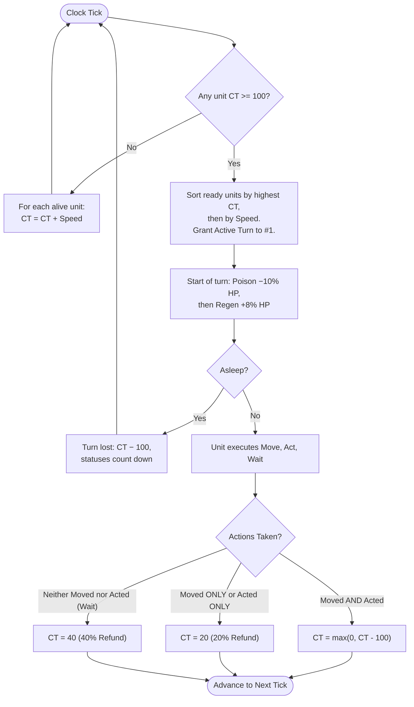
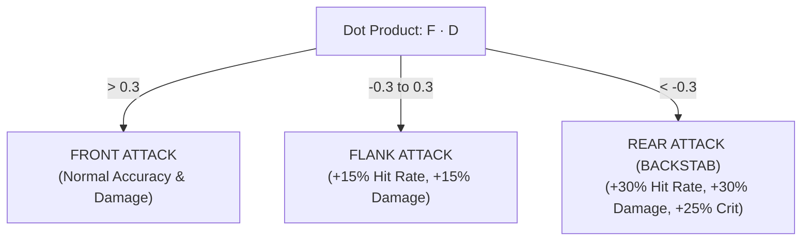
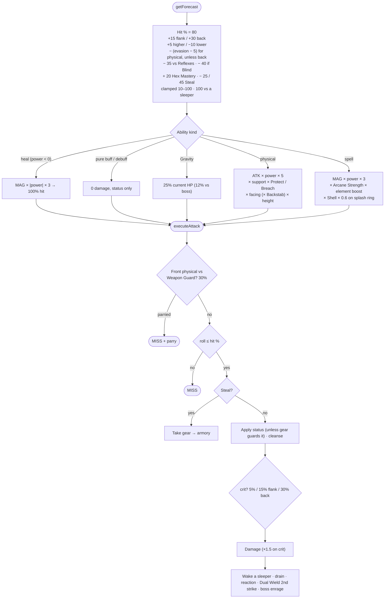
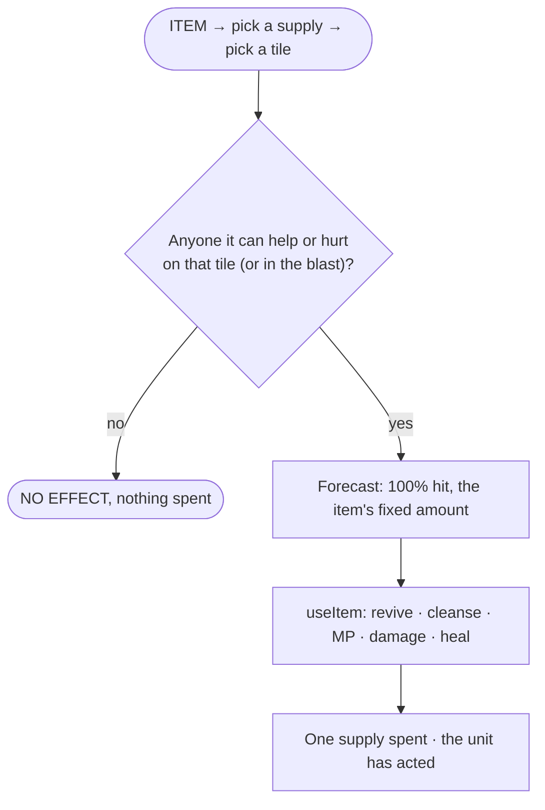

# Combat Engine & Mechanics Specification

This document details the mathematical formulas, geometric calculations, and turn structures governing **Chess RPG Tactics**.

---

## 1. The Charge Time (CT) Engine

Combat turns are determined strictly by individual unit **Speed** rather than round-robin team turns.

### CT Refund Reference Table

| Action Taken During Turn | End-of-Turn CT | Effective Turn Acceleration | Tactical Utility |
| :--- | :--- | :--- | :--- |
| **Move + Action** | $CT - 100$ | $0\%$ bonus | Maximum immediate impact (reposition & strike). |
| **Move Only** (No Action) | $20$ | $+20\%$ faster next turn | Repositioning defensively while queuing next strike sooner. |
| **Action Only** (No Move) | $20$ | $+20\%$ faster next turn | Firing spells or arrows from entrenched high ground. |
| **Pure Wait** (No Move, No Action) | $40$ | $+40\%$ faster next turn | Holding defensive posture; turns cycle in nearly half time! |

---

## 2. Directional Facing Geometry

Every unit faces one of four cardinal directions: **North (`N`)**, **East (`E`)**, **South (`S`)**, or **West (`W`)**.

When an attacker at $(x_a, z_a)$ targets a defender at $(x_t, z_t)$:

$$\vec{D} = (x_a - x_t, z_a - z_t), \quad \hat{D} = \frac{\vec{D}}{\|\vec{D}\|}$$

The defender's unit gaze vector $\vec{F}$ is defined as:
* $\vec{F}_N = (0, -1)$
* $\vec{F}_S = (0, 1)$
* $\vec{F}_E = (1, 0)$
* $\vec{F}_W = (-1, 0)$

The facing dot product is computed as:

$$\cos \theta = \vec{F} \cdot \hat{D}$$

### Facing Combat Modifiers

| Facing Angle | Dot Product Range | Hit Rate Modifier | Damage Multiplier | Base Critical Chance |
| :--- | :--- | :--- | :--- | :--- |
| **Front** | $\cos \theta > 0.3$ | $+0\%$ | $1.00\times$ | $5\%$ |
| **Flank (Side)** | $-0.3 \le \cos \theta \le 0.3$ | $+15\%$ | $1.15\times$ | $15\%$ |
| **Rear (Back)** | $\cos \theta < -0.3$ | $+30\%$ | $1.30\times$ | $30\%$ |

---

## 3. Elevation & Height Advantage

Tiles in the world carry a discrete height value $H$ (in units). The height difference between attacker and target is:

$$\Delta H = H_{\text{attacker}} - H_{\text{target}}$$

* **High Ground Advantage ($\Delta H > 0$)**:
  * Accuracy: $+5\%$ bonus hit chance.
  * Damage: $+10\%$ bonus damage multiplier.
  * Archery Range: Archers gain $+1$ effective tile range for every $2.0$ height units above target.
* **Low Ground Penalty ($\Delta H < 0$)**:
  * Accuracy: $-10\%$ penalty.
  * Melee Restriction: Melee attacks fail if $|\Delta H| > 1.5$ height units.
* **Guns ignore height (0.36)**: an ability with `ignoresHeight` (a gun's Attack, every Gunner action, Thunder Volley) reaches any tile in range whatever the height, and is scored as if $\Delta H = 0$, so neither bonus nor penalty applies.

---

## 4. Damage & Healing Formulas

*Rebalanced in 0.7.0: gear and job multipliers now count, magic is flatter, and HP is higher.*

Effective power combines the unit's base stat, its current job's multiplier and its gear:

$$\text{ATK} = \text{base attack} \times \text{job atk mult} + \text{gear ATK}$$
$$\text{MAG} = \text{base magic} \times \text{job mag mult} + \text{gear MAG}$$

*Focus* multiplies ATK by $1.25$ for 4 turns; an enraged boss multiplies ATK and MAG by $1.20$.

### Physical Abilities
$$\text{Base Damage} = \text{ATK} \times \text{Power} \times 5$$

$$\text{Final Damage} = \text{Base Damage} \times M_{\text{facing}} \times M_{\text{height}} \times M_{\text{crit}}$$

* $M_{\text{facing}} \in \{1.00, 1.15, 1.30\}$
* $M_{\text{height}} = 1.10$ if $\Delta H > 0$ else $1.00$
* $M_{\text{crit}} = 1.50$ on critical strike
* Hit chance from the front or flank is reduced by the target's gear evasion above the base 5. Back attacks ignore evasion.
* **Attack Boost** (`geo_attack_up`) multiplies physical damage by $1.20$.

### Magical Abilities
$$\text{Base Damage} = \text{MAG} \times |\text{Power}| \times 3$$

* Facing and height bonuses apply to **physical** damage only; spells land the same from any side.
* If the attacker has the Support Ability **Arcane Strength** (`bm_arcane_strength`), magical damage is multiplied by $1.25\times$.
* **Area spells** (Area 1: Fire, Blizzard, Thunder, Dragon Breath, Earth Slash) hit every foe within 1 tile of the aimed tile. Units on the ring take $60\%$ damage. Heals and buffs never hit foes, and damage never hits allies.
* **Gravity** removes $25\%$ of current HP ($12\%$ against bosses).
* Healing spells (e.g. *Cure*) carry negative power ($\text{Power} = -1.4$), delivering targeted HP restoration.

### Modifiers added in 0.13.0

| Modifier | Applies to | Effect |
| :--- | :--- | :--- |
| **Breach** on the target | Physical damage | ×1.25 (Rend Armor inflicts it) |
| **Shell** on the target | Spell damage | ×0.70 (the spell counterpart of Protect) |
| **Blind** on the attacker | Physical hit chance | −40 |
| **Sleep** on the target | Hit chance | 100% (sleepers can't dodge); any damage wakes them |
| Element **boost** trait on the attacker's gear | That element's damage, and holy healing | ×1.25 |
| **Brawler** (`mo_brawler`) | Attack with knuckles or bare hands | ×1.30 |
| **Backstab** (`th_backstab`) | Physical flank / back | a further ×1.15 / ×1.30 |
| **Hex Mastery** (`or_hex_mastery`) | Abilities that inflict an ailment | +20 hit |
| Master **signature** (0.23) | That signature | +30 hit (before the 10–100 clamp) |
| `scalesWith: 'attack'` | Chakra and Lay on Hands (heals); Holy Blade, Rebuke and the Spellblade's edges (damage) | uses ATK instead of MAG. Heals keep the ×3 scale; damage uses the weapon scale (×5). Being elemental, these strikes ignore Protect, facing and height, and are cut by Shell |
| **Zeal** (`pa_zeal`) | Holy damage and healing | ×1.20 |
| **Arcane Edge** (`sb_arcane_edge`) | Attack | + MAG × 1.5 |
| `drain` | Soul Drain | the caster heals for 50% of the damage dealt |
| `cleanse` | Purify, Chakra | removes every ailment (Poison, Slow, Immobilize, Blind, Silence, Sleep, Breach) |
| `steal` | Steal | no damage; −25 hit (−45 vs a boss), 0% when the target has no gear |

**Regen** heals 8% max HP at the start of each turn, after Poison. **Encore** (0.22) marks a performer whose song or dance plays again at the start of each of its turns ([Performances](JOB_SYSTEM.md#performances-022)); everyone in a performance takes its full effect, with no splash reduction, and Sleep or Silence on the performer ends it. **Silence** removes every ability that costs MP from the unit's ACT menu. **Conserve** (`su_conserve`) halves MP costs, rounding up; the halved cost is what the menu shows and what's spent.

---

## 5. Terrain Movement Costs (0.7.0)

Entering **water** or **swamp** costs 2 Move. *Water Walk* (`ni_water_walk`) removes the penalty. *Teleport* (`tm_teleport`) blinks to any open tile within Move + 1, ignoring height.

## 6. Bosses (0.7.0)

Boss units have $+60\%$ HP and $+15\%$ ATK/MAG. The first time a boss drops to $50\%$ HP it **enrages**: permanent Haste, $+20\%$ damage, and Slow/Immobilize are cleansed.

## 7. Reactions Reference

| Reaction | Job | Trigger |
| :--- | :--- | :--- |
| Weapon Guard (`kn_parry`) | Knight | 30% to parry physical attacks from the front |
| Counter Tackle (`sq_counter`) | Squire | Adjacent physical hit: strike back for $\text{ATK} \times 3.5$ |
| Auto-Potion (`wm_auto_potion`) | White Mage | Heal 30 HP after being hit |
| Speed Save (`ar_speed_save`) | Archer | +2 Speed after being hit |
| Dragonheart (`dr_dragonheart`) | Dragoon | Survive a fatal blow with 1 HP + Protect, **once per battle** |
| Arcane Retaliation (`bm_magic_counter`) | Black Mage | 50%: strike back for $\text{MAG} \times 3$ |
| Critical Quick (`tm_critical_quick`) | Time Weaver | At $\le 35\%$ HP after a hit, CT jumps to 100 |
| Earthen Ward (`geo_earthen_ward`) | Geomancer | Hit while on stone/dirt/parapet: gain Protect |
| Iron Will (`mo_iron_will`) | Monk | First drop to $\le 50\%$ HP in a battle: Focus + Protect |
| Quick Hands (`th_quick_hands`) | Thief | 40%: gain Haste |
| Mana Spring (`su_mana_spring`) | Summoner | Recover 15% max MP |
| Hex Ward (`or_hex_ward`) | Oracle | 35%: Blind the attacker |
| Divine Grace (`pa_divine_grace`) | Paladin | 30%: recover 15% max HP |
| Runic (`sb_runic`) | Spellblade | Struck by a spell: recover 20% max MP |
| Healing Refrain (`bd_refrain`) | Bard | 50%: gain Regen (not while it already has it) |
| Captivate (`dn_captivate`) | Dancer | Adjacent attacker, 35%: the attacker falls asleep (gear that guards Sleep stops it) |

Before 0.7.0, Counter Tackle, Arcane Retaliation and Critical Quick were checked against ability ids that did not exist, so they never fired. A unit test now fails if engine code references an unknown ability id.

---

## 8. Resolving one hit

| Facing | Hit bonus | Damage | Crit chance | Ignores evasion |
| :--- | :---: | :---: | :---: | :---: |
| Front | +0 | ×1.00 | 5% | — |
| Flank | +15 | ×1.15 | 15% | — |
| Back | +30 | ×1.30 | 30% | ✓ |

| Height | Hit | Damage |
| :--- | :---: | :---: |
| Attacker higher | +5 | ×1.10 (physical) |
| Level | — | — |
| Attacker lower | −10 | — |
| Gun shot (`ignoresHeight`, 0.36) | — | — |

---

## 9. Items (0.15.0)

The **ITEM** command spends one supply from the squad's shared inventory as the unit's action. An item is turned into an ordinary `Ability` (`consumableAbility`) and goes through the same `getForecast` → `executeAttack` calls, where `ability.item` routes it to `CombatEngine.useItem`.

| Supply | Flag | Effect | Reach | Targets |
| :--- | :--- | :--- | :---: | :--- |
| Potion | `fixedHeal: 80` | +80 HP | 2 | A living ally (or yourself) |
| Hi-Potion | `fixedHeal: 200` | +200 HP | 2 | A living ally |
| Ether | `fixedMp: 40` | +40 MP | 2 | A living ally |
| Remedy | `cleanse` | Removes every ailment | 2 | A living ally |
| Phoenix Feather | `revive: 0.25` | Raises at 25% max HP, statuses cleared, CT 0 | 2 | A **fallen** ally, on a tile nobody else stands on |
| Blast Flask | `fixedDamage: 70`, area 1 | 70 fire damage to each foe in the blast | 3 | Foes; never allies |
| Frost Flask (0.19) | `fixedDamage: 45`, `appliesStatus: 'slow'`, area 1 | 45 ice damage and Slow (unless gear wards it off) to each foe still standing | 3 | Foes; never allies |
| Elixir (0.19) | `fixedHeal: 9999`, `fixedMp: 999` | Full HP and MP | 2 | A living ally |

**Pharmacology** (Chemist support, 0.19): items used by a unit with it equipped work ×1.5 (heal, MP, damage and the revive share, capped at 100%) and reach one tile further. `JobSystem.itemPotency(unit)` is the one place that says so; the forecast shows the boosted number.

Rules that differ from abilities:

* **Always hits.** No hit roll, no crit, no facing or height modifier, no Protect / Shell / Breach, no element boost. The amount is the same whoever uses it.
* **No reactions.** Weapon Guard, Counter and the rest don't answer an item. A Blast Flask still **wakes** a sleeper and can trigger a boss's **enrage**.
* **The whole blast is fixed:** unlike area spells, the ring takes the full 70.
* **Revives** are the only actions that can target the fallen: the Phoenix Feather, and since 0.16 the White Mage's **Raise** (`revive: 0.33`, 18 MP, reach 3), which is an ordinary ability resolved the same way (no roll, no reaction) and earns JP and EXP like any spell. **A boss can't be raised** by either, and neither can a unit on a tile someone is standing on. A raised unit keeps its position and facing and acts when its CT next fills.
* **No JP and no EXP for using an item**, so healing with potions doesn't train a job the way casting Cure does. A Blast Flask that fells a foe still earns the kill's EXP.
* **The AI never uses items**, for either side: AUTO won't spend your supplies, and enemies carry none. It does cast Raise; the enemy side is limited to one raise per battle (`ENEMY_RAISE_CAP`), AUTO for your own units is not.

