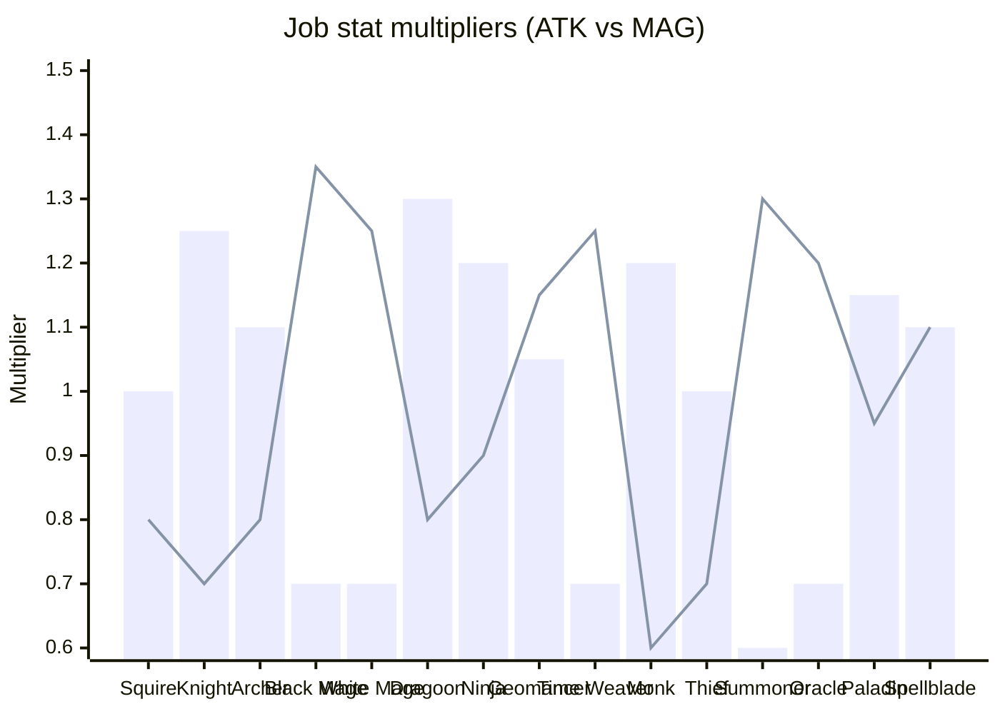
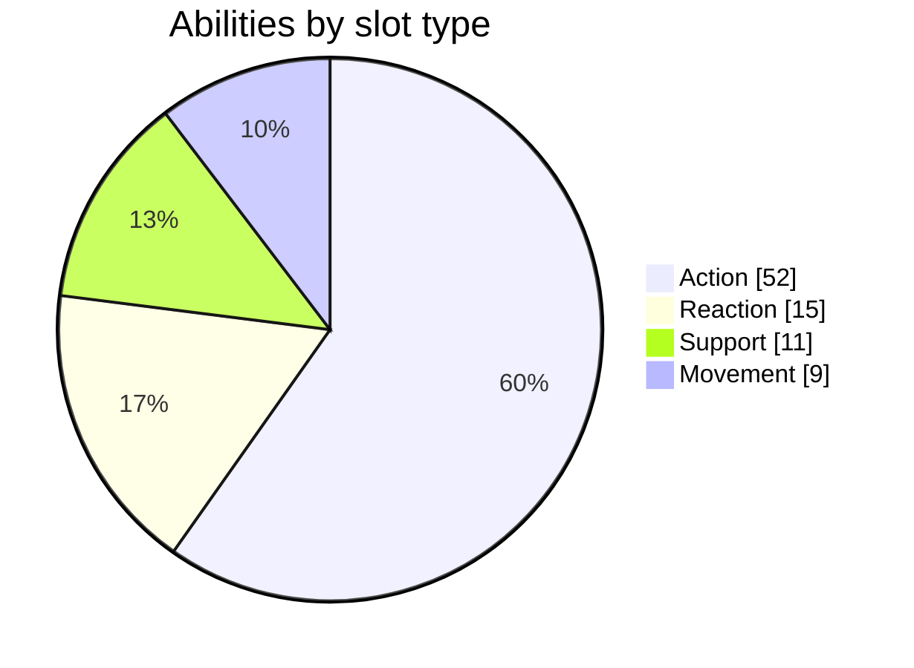
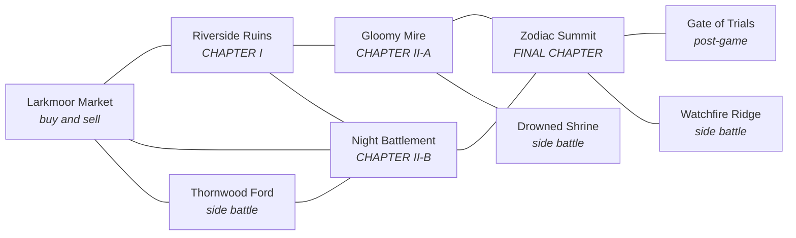
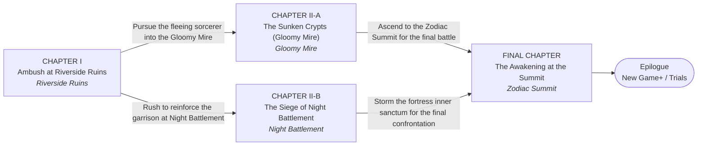

# Content Reference

> **Generated file — do not edit by hand.** Run `npm run docs:gen` after changing anything in `src/data/` or the Trials generator. CI fails if this file is out of date.

Every number here is read straight from the game data, so it always matches what ships.

**Contents:** [Jobs](#jobs) · [Job levels](#job-levels--requirements) · [Job mastery](#job-mastery) · [Abilities](#abilities) · [Status effects](#status-effects) · [Geomancy](#geomancy-terrain-spells) · [Items](#items) · [Supplies](#supplies) · [Shop](#shop--gil) · [World map](#world-map) · [Side battles](#side-battles) · [Armory](#armory--drops) · [Battlefields](#battlefields) · [Campaign](#campaign) · [Trials of the Zodiac](#trials-of-the-zodiac)

## Jobs

15 jobs. Stat multipliers scale a unit's base stats while it holds that job (base HP = 120 + 18 × level).

| Job | Role | Move | Jump | HP | MP | ATK | MAG | SPD | Abilities |
| :--- | :--- | :---: | :---: | :---: | :---: | :---: | :---: | :---: | :---: |
| **Squire** `squire` | Vanguard | 4 | 2 | 1.00× | 0.80× | 1.00× | 0.80× | 1.00× | 6 |
| **Knight** `knight` | Vanguard | 3 | 2 | 1.30× | 0.70× | 1.25× | 0.70× | 0.95× | 5 |
| **Archer** `archer` | Marksman | 3 | 3 | 0.95× | 0.80× | 1.10× | 0.80× | 1.05× | 5 |
| **Black Mage** `black_mage` | Mage | 3 | 2 | 0.80× | 1.40× | 0.70× | 1.35× | 0.95× | 7 |
| **White Mage** `white_mage` | Healer | 3 | 2 | 0.85× | 1.30× | 0.70× | 1.25× | 1.00× | 8 |
| **Dragoon** `dragoon` | Lancer | 3 | 4 | 1.20× | 0.80× | 1.30× | 0.80× | 1.00× | 4 |
| **Ninja** `ninja` | Skirmisher | 4 | 3 | 0.90× | 0.70× | 1.20× | 0.90× | 1.25× | 5 |
| **Geomancer** `geomancer` | Terramancer | 4 | 3 | 1.05× | 1.00× | 1.05× | 1.15× | 1.00× | 5 |
| **Time Weaver** `time_mage` | Chronomancer | 3 | 2 | 0.85× | 1.35× | 0.70× | 1.25× | 1.05× | 6 |
| **Monk** `monk` | Brawler | 4 | 3 | 1.20× | 0.60× | 1.20× | 0.60× | 1.05× | 6 |
| **Thief** `thief` | Rogue | 5 | 3 | 0.90× | 0.70× | 1.00× | 0.70× | 1.25× | 6 |
| **Summoner** `summoner` | Summoner | 3 | 2 | 0.80× | 1.50× | 0.60× | 1.30× | 0.90× | 7 |
| **Oracle** `oracle` | Hexer | 3 | 2 | 0.90× | 1.20× | 0.70× | 1.20× | 1.00× | 6 |
| **Paladin** `paladin` | Templar | 3 | 2 | 1.25× | 0.90× | 1.15× | 0.95× | 0.95× | 6 |
| **Spellblade** `spellblade` | Battlemage | 4 | 3 | 1.05× | 1.10× | 1.10× | 1.10× | 1.00× | 5 |

*Bars = ATK multiplier, line = MAG multiplier.*

## Job levels & requirements

A job levels up with the lifetime JP a unit earns in it (spending JP never lowers it).

| Job level | 1 | 2 | 3 | 4 | 5 | 6 | 7 | 8 (Master) |
| :--- | ---: | ---: | ---: | ---: | ---: | ---: | ---: | ---: |
| Lifetime JP | 0 | 100 | 250 | 450 | 700 | 1000 | 1400 | 1900 |

| Job | Requires |
| :--- | :--- |
| **Squire** | — (open to everyone) |
| **Knight** | Squire Lv 2 |
| **Archer** | Squire Lv 2 |
| **Black Mage** | — (open to everyone) |
| **White Mage** | — (open to everyone) |
| **Dragoon** | Knight Lv 2 |
| **Ninja** | Archer Lv 2 |
| **Geomancer** | — (open to everyone) |
| **Time Weaver** | Black Mage Lv 2 |
| **Monk** | Squire Lv 3 |
| **Thief** | Archer Lv 2 |
| **Summoner** | White Mage Lv 2 + Black Mage Lv 2 |
| **Oracle** | Time Weaver Lv 2 |
| **Paladin** | Knight Lv 3 + White Mage Lv 2 |
| **Spellblade** | Knight Lv 2 + Black Mage Lv 2 |

Every unit starts at Squire Lv 2. A unit created in an advanced job (a recruit, an enemy) is given the levels that job needs.

## Job mastery

A permanent bonus for sticking with a job. A unit earns the first amount at job level 5 (700 lifetime JP) and the second, which replaces it, at level 8 (Master, 1900 JP). It keeps the bonus in every job, and bonuses from different jobs add up.

| Job | Lv 5 (Veteran) | Lv 8 (Master) |
| :--- | :--- | :--- |
| **Squire** | +10 HP | +25 HP |
| **Knight** | +15 HP | +35 HP |
| **Archer** | +1 ATK | +2 ATK |
| **Black Mage** | +1 MAG | +2 MAG |
| **White Mage** | +8 MP | +20 MP |
| **Dragoon** | +1 Jump | +2 Jump |
| **Ninja** | +4 Evasion | +8 Evasion |
| **Geomancer** | +6 MP | +15 MP |
| **Time Weaver** | +1 Speed | +2 Speed |
| **Monk** | +1 ATK | +2 ATK |
| **Thief** | +3 Evasion | +6 Evasion |
| **Summoner** | +1 MAG | +2 MAG |
| **Oracle** | +8 MP | +20 MP |
| **Paladin** | +12 HP | +30 HP |
| **Spellblade** | +1 MAG | +2 MAG |

## Abilities

87 learnable abilities: 52 actions, 15 reactions, 11 supports, 9 movement. Every unit also has **Attack** (range 1, power 1; spears and bows extend its range).

### Squire

*The foundational warrior discipline. Balanced and versatile with basic survival techniques.*

| Ability | Slot | JP | MP | Range | Height | Area | Power | Element | Effect | Description |
| :--- | :--- | ---: | ---: | :---: | :---: | :---: | :---: | :--- | :--- | :--- |
| **Throw Stone** `sq_stone` | Action | 50 | 0 | 4 | 2 | — | 0.6 | physical | — | Hurls a loose rock at a distant target to chip damage. |
| **Focus** `sq_focus` | Action | 100 | 0 | 0 | 0 | — | — | physical | inflicts **focus**, self only | Channel concentration: physical damage +25% for 4 turns. |
| **Counter Tackle** `sq_counter` | Reaction | 120 | — | — | — | — | — | — | — | Retaliates with a blunt shoulder check when struck by melee attacks. |
| **JP Boost** `sq_jp_boost` | Support | 150 | — | — | — | — | — | — | — | Gain 50% additional Job Points from all battlefield actions. |
| **Move +1** `sq_move_plus` | Movement | 200 | — | — | — | — | — | — | — | Increases unit movement radius by 1 tile. |
| **Rally** `sq_rally` | Action | 180 | 0 | 1 | 1.5 | 1 | — | physical | inflicts **focus** | A battle cry: you and adjacent allies gain Focus (+25% physical damage) for 4 turns. |

### Knight

*Heavily armored protector proficient in breaking opponent equipment and holding defensive lines.*

| Ability | Slot | JP | MP | Range | Height | Area | Power | Element | Effect | Description |
| :--- | :--- | ---: | ---: | :---: | :---: | :---: | :---: | :--- | :--- | :--- |
| **Rend Armor** `kn_rend_armor` | Action | 150 | 5 | 1 | 1.5 | — | 1.1 | physical | inflicts **breach** | Shatters foe armor plating: Breach (+25% physical damage taken) for 3 turns. |
| **Shield Bash** `kn_shield_bash` | Action | 180 | 8 | 1 | 1.5 | — | 1.3 | physical | — | Slams shield into target, knocking them back and dealing physical shock. |
| **Weapon Guard** `kn_parry` | Reaction | 200 | — | — | — | — | — | — | — | Chance to deflect incoming front-facing physical attacks with blade. |
| **Armor Mastery** `kn_heavy_armor` | Support | 250 | — | — | — | — | — | — | — | Trained to fight in plate: HP from armor, helms and shields +50%. |
| **Bulwark** `kn_bulwark` | Action | 160 | 6 | 0 | 0 | — | — | physical | inflicts **protect**, self only | Brace behind your shield: Protect on yourself (-30% physical damage taken). |

### Archer

*Long-range marksman capitalizing on elevation advantages and calculated trick shots.*

| Ability | Slot | JP | MP | Range | Height | Area | Power | Element | Effect | Description |
| :--- | :--- | ---: | ---: | :---: | :---: | :---: | :---: | :--- | :--- | :--- |
| **Aim +2** `ar_aim` | Action | 100 | 0 | 5 | 3 | — | 1.4 | physical | — | Takes extra time to line up shot for devastating critical puncture. |
| **Leg Shot** `ar_leg_shot` | Action | 160 | 6 | 4 | 2.5 | — | 0.9 | physical | inflicts **immobilize** | Pinpoints tendon to immobilize enemy movement for 2 turns. |
| **Speed Save** `ar_speed_save` | Reaction | 200 | — | — | — | — | — | — | — | Boosts Speed stat whenever sustaining damage in battle. |
| **Jump +1** `ar_jump_plus` | Movement | 180 | — | — | — | — | — | — | — | Allows scaling higher ledges and cliffs effortlessly. |
| **Arrow Rain** `ar_arrow_rain` | Action | 220 | 10 | 5 | 3 | 1 | 0.7 | physical | — | Looses a volley that falls on the target and everyone beside it. |

### Black Mage

*Master of destructive elemental incantations spanning fire, frost, and lightning.*

| Ability | Slot | JP | MP | Range | Height | Area | Power | Element | Effect | Description |
| :--- | :--- | ---: | ---: | :---: | :---: | :---: | :---: | :--- | :--- | :--- |
| **Fire** `bm_fire` | Action | 80 | 10 | 4 | 2 | 1 | 1.3 | fire | — | Engulfs target tile and surrounding foes in searing flame. |
| **Blizzard** `bm_blizzard` | Action | 80 | 10 | 4 | 2 | 1 | 1.3 | ice | — | Summons chilling shards of ice to impale enemy formation. |
| **Thunder** `bm_thunder` | Action | 80 | 10 | 4 | 3.5 | 1 | 1.35 | lightning | — | Strikes target from high clouds with crackling lightning bolt. |
| **Poison Cloud** `bm_poison` | Action | 140 | 8 | 3 | 2 | — | 0.5 | dark | inflicts **poison** | Enshrouds foe in venomous miasma, dealing 10% max HP damage every turn. |
| **Arcane Retaliation** `bm_magic_counter` | Reaction | 200 | — | — | — | — | — | — | — | When struck, lashes back at the attacker with a burst of raw magic. |
| **Arcane Strength** `bm_arcane_strength` | Support | 250 | — | — | — | — | — | — | — | Increases all magical damage output by 25%. |
| **Firestorm** `bm_firestorm` | Action | 300 | 28 | 4 | 3 | 2 | 1.15 | fire | — | A sweeping blaze over a wide area (radius 2). |

### White Mage

*Devoted healer using sanctified incantations to mend wounds, cure status, and protect allies.*

| Ability | Slot | JP | MP | Range | Height | Area | Power | Element | Effect | Description |
| :--- | :--- | ---: | ---: | :---: | :---: | :---: | :---: | :--- | :--- | :--- |
| **Cure** `wm_cure` | Action | 70 | 8 | 4 | 2 | — | Heal 1.4 | holy | — | Restores health to an injured ally with warm holy light. |
| **Protect** `wm_protect` | Action | 120 | 12 | 3 | 2 | — | — | holy | inflicts **protect** | Erects an arcane barrier, softening physical blows by 30% for 3 turns. |
| **Raise** `wm_raise` | Action | 260 | 18 | 3 | 2 | — | — | holy | — | Calls a fallen ally back to their feet with a third of their HP. Bosses cannot be raised. |
| **Auto-Potion** `wm_auto_potion` | Reaction | 200 | — | — | — | — | — | — | — | Instantly drinks a restorative potion when taking direct damage. |
| **Regen Walk** `wm_regen_move` | Movement | 220 | — | — | — | — | — | — | — | Restores 10% of maximum HP on every tile movement step. |
| **Shell** `wm_shell` | Action | 120 | 8 | 4 | 2 | — | — | holy | inflicts **shell** | A ward against spells: Shell (-30% magic damage taken) for 3 turns. |
| **Purify** `wm_purify` | Action | 100 | 6 | 4 | 2 | — | — | holy | cleanses ailments | Washes away poison, blindness, silence, sleep, slow, binding and Breach. |
| **Healing Circle** `wm_heal_circle` | Action | 240 | 18 | 3 | 2 | 1 | Heal 1 | holy | — | Restores HP to the target and every ally beside it. |

### Dragoon

*Skyward knight wielding polearms. Masters of crushing vertical plunge attacks and draconic arts.*

| Ability | Slot | JP | MP | Range | Height | Area | Power | Element | Effect | Description |
| :--- | :--- | ---: | ---: | :---: | :---: | :---: | :---: | :--- | :--- | :--- |
| **Dragon Plunge** `dr_jump` | Action | 120 | 6 | 3 | 4 | — | 1.6 | physical | — | Leaps high into the skies and crashes down on target with crushing kinetic force. |
| **Dragon Breath** `dr_fire_breath` | Action | 180 | 14 | 2 | 2 | 1 | 1.3 | fire | — | Channels dragon wyrm spirit to spew cones of searing fire. |
| **Dragonheart** `dr_dragonheart` | Reaction | 250 | — | — | — | — | — | — | — | Survives a fatal blow with 1 HP and enters Reraise state. |
| **Ignore Elevation** `dr_ignore_height` | Movement | 350 | — | — | — | — | — | — | — | Allows scaling any sheer cliff or watchtower wall regardless of elevation height. |

### Ninja

*Lethal shadow operative boasting immense speed, evasion, shuriken throwing, and dual-wielding.*

| Ability | Slot | JP | MP | Range | Height | Area | Power | Element | Effect | Description |
| :--- | :--- | ---: | ---: | :---: | :---: | :---: | :---: | :--- | :--- | :--- |
| **Throw Shuriken** `ni_shuriken` | Action | 100 | 0 | 4 | 2.5 | — | 1.1 | physical | — | Flicks sharp four-pointed steel stars across distance to lacerate opponents. |
| **Reflexes / Vanish** `ni_shadow_clone` | Reaction | 220 | — | — | — | — | — | — | — | Splits into smoke decoys upon being targeted, granting 40% evasion against attacks. |
| **Dual Wield** `ni_dual_wield` | Support | 350 | — | — | — | — | — | — | — | Equips a weapon in both hands; basic attacks strike twice in rapid succession! |
| **Water Walk** `ni_water_walk` | Movement | 150 | — | — | — | — | — | — | — | Treads effortlessly on water surface and murky bogs without movement penalty. |
| **Smoke Bomb** `ni_smoke_bomb` | Action | 180 | 6 | 3 | 2.5 | 1 | — | dark | inflicts **blind** | A burst of choking smoke: Blind (-40% physical accuracy) on the target and foes beside it. |

### Geomancer

*Terramancer who draws power from the ground underfoot. The same spell becomes fire, ice or venom depending on where they stand.*

| Ability | Slot | JP | MP | Range | Height | Area | Power | Element | Effect | Description |
| :--- | :--- | ---: | ---: | :---: | :---: | :---: | :---: | :--- | :--- | :--- |
| **Elemental** `geo_elemental` | Action | 0 | 0 | 3 | 2.5 | — | 1.15 | physical | changes with terrain | Channels the terrain you stand on: grass = Hell Ivy (immobilize), stone = Rockslide, dirt = Sandstorm (slow), water = Torrent (ice), swamp = Quicksand (poison), wood = Wildfire (fire). |
| **Earth Slash** `geo_earth_slash` | Action | 160 | 8 | 2 | 2 | 1 | 1.1 | physical | — | Splits the ground in a shockwave that strikes the target and every foe beside it. |
| **Earthen Ward** `geo_earthen_ward` | Reaction | 180 | — | — | — | — | — | — | — | When struck while standing on stone, dirt or parapet, the ground hardens into armor (Protect for 3 turns). |
| **Attack Boost** `geo_attack_up` | Support | 220 | — | — | — | — | — | — | — | Increases all physical damage dealt by 20%. |
| **Mountain Stride** `geo_stride` | Movement | 200 | — | — | — | — | — | — | — | Sure-footed climbing: Jump +2. |

### Time Weaver

*Chronomancer manipulating space-time fabric to accelerate allies, slow foes, and bend gravity.*

| Ability | Slot | JP | MP | Range | Height | Area | Power | Element | Effect | Description |
| :--- | :--- | ---: | ---: | :---: | :---: | :---: | :---: | :--- | :--- | :--- |
| **Haste** `tm_haste` | Action | 120 | 12 | 4 | 2 | — | — | time | inflicts **haste** | Accelerates personal time flux, boosting Speed by +50% for 3 turns. |
| **Slow** `tm_slow` | Action | 120 | 12 | 4 | 2 | — | — | time | inflicts **slow** | Weaves temporal drag around foe, cutting their Speed by 33% for 3 turns. |
| **Gravity** `tm_gravity` | Action | 180 | 16 | 4 | 3 | — | 1.2 | time | — | Bends gravitational weight, shearing away 25% of target current HP directly. |
| **Critical Quick** `tm_critical_quick` | Reaction | 220 | — | — | — | — | — | — | — | When struck down to 35% HP or less, instantly charges CT to 100 to act next. |
| **Teleport** `tm_teleport` | Movement | 350 | — | — | — | — | — | — | — | Folds spacetime to instantly blink to any tile within range, bypassing cliffs and walls! |
| **Regen** `tm_regen` | Action | 140 | 10 | 4 | 2 | — | — | time | inflicts **regen** | Speeds the body's healing: Regen (8% HP at the start of each turn) for 4 turns. |

### Monk

*Bare-knuckle martial artist. Hits hard up close, throws chi at range, and heals the party without spending MP.*

| Ability | Slot | JP | MP | Range | Height | Area | Power | Element | Effect | Description |
| :--- | :--- | ---: | ---: | :---: | :---: | :---: | :---: | :--- | :--- | :--- |
| **Aura Wave** `mo_aura_wave` | Action | 60 | 0 | 3 | 2 | — | 0.85 | physical | — | Throws a blast of chi at a foe up to 3 tiles away. |
| **Chakra** `mo_chakra` | Action | 150 | 0 | 0 | 0 | 1 | Heal 0.7 | physical | cleanses ailments, scales with ATK | Breath and focus: you and adjacent allies recover HP (from ATK) and shake off ailments. Free. |
| **Pummel** `mo_pummel` | Action | 200 | 6 | 1 | 1.5 | — | 1.45 | physical | — | A flurry of heavy blows on an adjacent foe. |
| **Iron Will** `mo_iron_will` | Reaction | 200 | — | — | — | — | — | — | — | The first time you drop to half HP in a battle, you gain Focus and Protect. |
| **Brawler** `mo_brawler` | Support | 250 | — | — | — | — | — | — | — | Unarmed or knuckle Attacks deal +30% damage. |
| **Ki Flow** `mo_ki_flow` | Movement | 220 | — | — | — | — | — | — | — | Every tile walked restores 6% HP and MP (up to 30%). |

### Thief

*Fast and slippery. Steals gear straight off enemies, blinds and hobbles them, and strikes hardest from behind.*

| Ability | Slot | JP | MP | Range | Height | Area | Power | Element | Effect | Description |
| :--- | :--- | ---: | ---: | :---: | :---: | :---: | :---: | :--- | :--- | :--- |
| **Steal** `th_steal` | Action | 50 | 0 | 1 | 1.5 | — | — | physical | steals gear | Lifts a piece of gear off an adjacent foe and adds it to your armory. Easier from the side or behind. |
| **Sand Toss** `th_sand_toss` | Action | 120 | 0 | 2 | 2 | — | 0.35 | physical | inflicts **blind** | A handful of grit in the eyes: light damage and Blind (-40% physical accuracy). |
| **Hamstring** `th_hamstring` | Action | 180 | 4 | 1 | 1.5 | — | 0.9 | physical | inflicts **slow** | A low cut that slows the target for 3 turns. |
| **Quick Hands** `th_quick_hands` | Reaction | 200 | — | — | — | — | — | — | — | When struck, a 40% chance to gain Haste. |
| **Backstab** `th_backstab` | Support | 260 | — | — | — | — | — | — | — | Flank hits deal a further +15% and back hits +30%. |
| **Fleet Foot** `th_fleet` | Movement | 240 | — | — | — | — | — | — | — | Move +1 and Jump +1. |

### Summoner

*Calls elemental spirits that strike or mend a wide area. The biggest spells in the game, paid for with a deep MP pool.*

| Ability | Slot | JP | MP | Range | Height | Area | Power | Element | Effect | Description |
| :--- | :--- | ---: | ---: | :---: | :---: | :---: | :---: | :--- | :--- | :--- |
| **Salamander** `su_salamander` | Action | 120 | 24 | 4 | 3 | 2 | 1 | fire | — | Calls a fire spirit that scorches a wide area (radius 2). |
| **Undine** `su_undine` | Action | 160 | 24 | 4 | 3 | 2 | 1 | ice | — | Calls a water spirit whose freezing tide floods a wide area (radius 2). |
| **Storm Roc** `su_storm_roc` | Action | 220 | 28 | 4 | 3 | 2 | 1.1 | lightning | — | Calls a great thunderbird over a wide area (radius 2). |
| **Sylph** `su_sylph` | Action | 200 | 26 | 4 | 3 | 2 | Heal 0.7 | holy | inflicts **regen** | Calls a wind spirit that heals allies in a wide area and leaves them with Regen. |
| **Golem** `su_golem` | Action | 260 | 22 | 3 | 3 | 2 | — | physical | inflicts **protect** | Calls a stone guardian: Protect on every ally in a wide area. |
| **Mana Spring** `su_mana_spring` | Reaction | 180 | — | — | — | — | — | — | — | When struck, recover 15% of max MP. |
| **Conserve** `su_conserve` | Support | 300 | — | — | — | — | — | — | — | Every MP cost is halved (rounded up). |

### Oracle

*Reader of omens who wins fights before they start: blinds, silences and lulls foes to sleep, and drains their life.*

| Ability | Slot | JP | MP | Range | Height | Area | Power | Element | Effect | Description |
| :--- | :--- | ---: | ---: | :---: | :---: | :---: | :---: | :--- | :--- | :--- |
| **Dim Sight** `or_dim_sight` | Action | 60 | 6 | 4 | 2.5 | — | — | dark | inflicts **blind** | Clouds the eyes: Blind (-40% physical accuracy) for 3 turns. |
| **Hush** `or_hush` | Action | 120 | 8 | 4 | 2.5 | — | — | dark | inflicts **silence** | Steals the voice: Silence (no MP abilities) for 3 turns. |
| **Lullaby** `or_lullaby` | Action | 200 | 14 | 4 | 2.5 | 1 | — | dark | inflicts **sleep** | Sings the target and foes beside it to sleep. Sleepers lose their turns until struck. |
| **Soul Drain** `or_soul_drain` | Action | 220 | 12 | 4 | 2.5 | — | 1 | dark | drains 50% | Dark magic that heals you for half the damage dealt. |
| **Hex Ward** `or_hex_ward` | Reaction | 200 | — | — | — | — | — | — | — | When struck, a 35% chance to Blind the attacker. |
| **Hex Mastery** `or_hex_mastery` | Support | 260 | — | — | — | — | — | — | — | Ailments you inflict land 20% more often. |

### Paladin

*An advanced job. A knight sworn to the light: strikes with holy steel, heals by touch and wards the line against spells.*

| Ability | Slot | JP | MP | Range | Height | Area | Power | Element | Effect | Description |
| :--- | :--- | ---: | ---: | :---: | :---: | :---: | :---: | :--- | :--- | :--- |
| **Holy Blade** `pa_holy_blade` | Action | 80 | 6 | 1 | 1.5 | — | 1.05 | holy | scales with ATK | A consecrated strike: holy damage from ATK that Protect and facing do not change. |
| **Lay on Hands** `pa_lay_on_hands` | Action | 120 | 8 | 1 | 1.5 | — | Heal 1.3 | holy | scales with ATK | Heals an adjacent ally (or yourself) with strength of arm rather than magic. |
| **Rebuke** `pa_rebuke` | Action | 180 | 10 | 3 | 2.5 | — | 0.45 | holy | inflicts **silence**, scales with ATK | A bolt of judgment up to 3 tiles away: light holy damage and Silence. |
| **Aegis** `pa_aegis` | Action | 160 | 10 | 1 | 1.5 | 1 | — | holy | inflicts **shell** | Raises a ward: Shell on you and adjacent allies. |
| **Divine Grace** `pa_divine_grace` | Reaction | 200 | — | — | — | — | — | — | — | When struck, a 30% chance to recover 15% of max HP. |
| **Zeal** `pa_zeal` | Support | 260 | — | — | — | — | — | — | — | Holy damage and healing you deal +20%. |

### Spellblade

*An advanced job. A duelist who channels spells through a sword: elemental strikes that hit with weapon strength.*

| Ability | Slot | JP | MP | Range | Height | Area | Power | Element | Effect | Description |
| :--- | :--- | ---: | ---: | :---: | :---: | :---: | :---: | :--- | :--- | :--- |
| **Flame Edge** `sb_flame_edge` | Action | 60 | 6 | 1 | 1.5 | — | 1.1 | fire | scales with ATK | Wreathes the blade in fire: fire damage from ATK. |
| **Frost Edge** `sb_frost_edge` | Action | 150 | 8 | 1 | 1.5 | — | 0.9 | ice | inflicts **slow**, scales with ATK | A freezing cut: ice damage from ATK, and Slow. |
| **Thunder Lunge** `sb_thunder_lunge` | Action | 180 | 8 | 2 | 2 | — | 1 | lightning | scales with ATK | A crackling thrust that reaches 2 tiles: lightning damage from ATK. |
| **Runic** `sb_runic` | Reaction | 200 | — | — | — | — | — | — | — | When struck by a spell, the blade drinks it in: recover 20% of max MP. |
| **Arcane Edge** `sb_arcane_edge` | Support | 260 | — | — | — | — | — | — | — | Your Attack carries your magic: bonus damage from MAG. |

## Status effects

| Status | Kind | Lasts (turns) | Effect |
| :--- | :--- | :---: | :--- |
| **haste** | Buff | 3 | Speed ×1.5 (bosses get a permanent Haste when enraged) |
| **slow** | Ailment | 3 | Speed ×0.67 (minimum 2) |
| **protect** | Buff | 3 | Physical damage taken ×0.7 |
| **immobilize** | Ailment | 2 | Move becomes 0 |
| **poison** | Ailment | 3 | Lose 10% max HP at the start of each turn |
| **focus** | Buff | 4 | Physical power ×1.25 |
| **shell** | Buff | 3 | Spell damage taken ×0.7 |
| **regen** | Buff | 4 | Recover 8% max HP at the start of each turn (Regen from gear lasts the whole battle) |
| **blind** | Ailment | 3 | Physical accuracy −40 |
| **silence** | Ailment | 3 | Abilities that cost MP are sealed |
| **sleep** | Ailment | 2 | Turns pass without acting; any damage wakes the unit, and sleepers cannot dodge (100% hit) |
| **breach** | Ailment | 3 | Physical damage taken ×1.25 |

Gear with a **guard** trait blocks the ailments it lists; cleansing abilities (Purify, Chakra) remove every ailment.

## Geomancy terrain spells

The Geomancer's **Elemental** becomes a different spell depending on the caster's tile.

| Caster stands on | Spell | Element | Status | Power scale |
| :--- | :--- | :--- | :--- | :---: |
| grass | **Hell Ivy** | dark | immobilize | 0.85× |
| stone | **Rockslide** | physical | — | 1.15× |
| parapet | **Rockslide** | physical | — | 1.15× |
| dirt | **Sandstorm** | physical | slow | 0.85× |
| water | **Torrent** | ice | — | 1.05× |
| swamp | **Quicksand** | dark | poison | 0.80× |
| wood | **Wildfire** | fire | — | 1.10× |

## Items

54 items across five gear slots.

### Weapon (21)

| Item | Type | Range | Stats | Traits | Price | How to get |
| :--- | :--- | :---: | :--- | :--- | ---: | :--- |
| **Iron Broadsword** `iron_sword` | sword | 1 | ATTACK +4 | — | 100 | Starting gear |
| **Platinum Blade** `platinum_blade` | sword | 1 | ATTACK +9, HP +15 | — | 350 | Choose "Storm the fortress inner sanctum for the final confrontation!" · Trials drop |
| **Holy Dragon Lance** `dragon_lance` | spear | 2 | ATTACK +8, JUMP +1 | — | 400 | Starting gear |
| **Longbow of the Gale** `hunting_bow` | bow | 5 | ATTACK +6 | — | 250 | Starting gear |
| **Chrono Scepter** `chrono_rod` | staff | 1 | ATTACK +3, MAGIC +7, MP +20 | — | 300 | Starting gear |
| **Twin Shadow Daggers** `assassin_daggers` | dagger | 1 | ATTACK +7, SPEED +1, EVASION +10 | — | 320 | Choose "Pursue the fleeing sorcerer into the Gloomy Mire!" · Trials drop |
| **Gaia Staff** `gaia_staff` | staff | 1 | MAGIC +5, ATTACK +3, HP +10 | — | 300 | Win CHAPTER II-A · Trials drop |
| **Windslayer Bow** `sniper_bow` | bow | 6 | ATTACK +7, SPEED +1 | — | 420 | Choose "Ascend to the Zodiac Summit for the final battle!" · Trials drop |
| **Zodiac Blade** `zodiac_blade` | sword | 1 | ATTACK +13, MAGIC +4, SPEED +1 | — | 900 | Win FINAL CHAPTER |
| **Iron Knuckles** `iron_knuckles` | knuckles | 1 | ATTACK +5 | — | 120 | Starting gear |
| **Tiger Claws** `tiger_claws` | knuckles | 1 | ATTACK +10, SPEED +1 | — | 480 | Trials drop |
| **Cutpurse Knife** `thief_knife` | dagger | 1 | ATTACK +5, SPEED +1, EVASION +5 | — | 140 | Starting gear |
| **Moonfang** `moonfang` | dagger | 1 | ATTACK +9, SPEED +1, EVASION +12 | — | 520 | Trials drop |
| **Halberd** `halberd` | spear | 2 | ATTACK +11 | — | 460 | Trials drop |
| **Dawnbringer** `dawn_blade` | sword | 1 | ATTACK +10, HP +10 | holy +25% | 640 | Trials drop |
| **Siege Crossbow** `siege_crossbow` | bow | 4 | ATTACK +11, SPEED -1 | — | 480 | Trials drop |
| **Flame Rod** `flame_rod` | staff | 1 | ATTACK +2, MAGIC +6 | fire +25% | 380 | Win CHAPTER I · Trials drop |
| **Frost Rod** `frost_rod` | staff | 1 | ATTACK +2, MAGIC +6 | ice +25% | 380 | Trials drop |
| **Storm Rod** `storm_rod` | staff | 1 | ATTACK +2, MAGIC +6 | lightning +25% | 380 | Trials drop |
| **Sage's Staff** `sage_staff` | staff | 1 | MAGIC +9, MP +30 | guards silence | 560 | Trials drop |
| **Runeblade** `runeblade` | sword | 1 | ATTACK +8, MAGIC +6, MP +15 | — | 560 | Trials drop |

### Shield (5)

| Item | Stats | Traits | Price | How to get |
| :--- | :--- | :--- | ---: | :--- |
| **Bronze Buckler** `buckler` | EVASION +12 | — | 80 | Starting gear |
| **Kite Shield** `kite_shield` | EVASION +22, HP +15 | — | 220 | Choose "Rush to reinforce the garrison at Night Battlement!" · Trials drop |
| **Aegis Barrier** `aegis_shield` | EVASION +32, HP +30, MP +15 | — | 450 | Choose "Storm the fortress inner sanctum for the final confrontation!" · Trials drop |
| **Mirror Shield** `mirror_shield` | EVASION +18, MP +10 | starts with shell | 420 | Win CHAPTER II-B · Trials drop |
| **Oathkeeper** `oath_shield` | EVASION +20, HP +20 | guards sleep, blind | 500 | Trials drop |

### Head (8)

| Item | Stats | Traits | Price | How to get |
| :--- | :--- | :--- | ---: | :--- |
| **Steel Bascinet** `iron_helm` | HP +30 | — | 120 | Starting gear |
| **Pointed Wizard Hat** `wizard_hat` | HP +15, MP +25, MAGIC +3 | — | 150 | Starting gear |
| **Shadow Headband** `shinobi_band` | HP +20, SPEED +1, EVASION +5 | — | 180 | Starting gear |
| **Crystal Helm** `crystal_helm` | HP +30, MP +10, EVASION +3 | — | 380 | Win CHAPTER II-B · Trials drop |
| **Leather Cap** `leather_cap` | HP +15 | — | 60 | Starting gear |
| **Barbute** `barbute` | HP +45, ATTACK +2 | — | 340 | Trials drop |
| **Sage's Circlet** `sage_circlet` | HP +10, MP +15, MAGIC +5 | — | 360 | Trials drop |
| **Circlet of Clarity** `clarity_circlet` | HP +15, MP +10 | guards blind, silence, sleep | 440 | Trials drop |

### Body (9)

| Item | Stats | Traits | Price | How to get |
| :--- | :--- | :--- | ---: | :--- |
| **Reinforced Hauberk** `chainmail` | HP +50 | — | 180 | Starting gear |
| **Platinum Plate Mail** `platinum_armor` | HP +90, SPEED -1 | — | 450 | Choose "Rush to reinforce the garrison at Night Battlement!" · Trials drop |
| **Astral Silk Robe** `silk_robe` | HP +30, MP +45, MAGIC +5 | — | 260 | Starting gear |
| **Nightwalker Tunic** `shinobi_garb` | HP +35, SPEED +1, EVASION +12 | — | 300 | Starting gear |
| **Wyrmscale Mail** `dragon_mail` | HP +55, ATTACK +2, EVASION +4 | — | 520 | Win FINAL CHAPTER · Trials drop |
| **Leather Vest** `leather_vest` | HP +25, EVASION +3 | — | 90 | Starting gear |
| **Brawler's Gi** `brawler_gi` | HP +40, ATTACK +3, EVASION +6 | — | 380 | Trials drop |
| **Summoner's Robe** `summoner_robe` | HP +25, MP +60, MAGIC +6 | — | 440 | Trials drop |
| **Templar Mail** `templar_mail` | HP +75, SPEED -1 | starts with shell | 560 | Trials drop |

### Accessory (11)

| Item | Stats | Traits | Price | How to get |
| :--- | :--- | :--- | ---: | :--- |
| **Battle Greaves** `battle_boots` | JUMP +1 | — | 150 | Starting gear |
| **Featherlight Boots** `feather_boots` | MOVE +1 | — | 350 | Starting gear |
| **Hermes Slippers** `hermes_shoes` | SPEED +2 | — | 400 | Choose "Ascend to the Zodiac Summit for the final battle!" · Trials drop |
| **Gauntlet of Might** `power_wrist` | ATTACK +4 | — | 200 | Win CHAPTER I · Trials drop |
| **Ring of Arcana** `mage_ring` | MAGIC +4, MP +25 | — | 220 | Choose "Pursue the fleeing sorcerer into the Gloomy Mire!" · Trials drop |
| **Zodiac Ribbon** `ribbon` | HP +20, MP +20, SPEED +1, EVASION +5 | guards poison, slow, immobilize, blind, silence, sleep, breach | 800 | Win FINAL CHAPTER · Trials drop |
| **Verdant Charm** `verdant_charm` | HP +10 | starts with regen | 600 | Win CHAPTER II-A · Trials drop |
| **Warding Amulet** `warding_amulet` | HP +10 | starts with protect + shell | 520 | Trials drop |
| **Purity Bangle** `purity_bangle` | HP +10 | guards poison, slow, immobilize, breach | 420 | Trials drop |
| **Sprinter's Anklet** `sprinter_anklet` | MOVE +1, JUMP +1 | — | 620 | Trials drop |
| **Berserker Band** `berserker_band` | ATTACK +7, EVASION -5 | — | 460 | Trials drop |

## Supplies

Used in battle with the **ITEM** command; one is spent each time. The squad shares them and can carry 9 of each. A new squad starts with 3 × Potion and 1 × Phoenix Feather. Items always hit and do a fixed amount.

| Supply | Effect | Reach | Area | Buy | Sell | Stocked |
| :--- | :--- | :---: | :---: | ---: | ---: | :--- |
| **Potion** `potion` | Restores 80 HP | 2 | — | 40 | 20 | Always |
| **Remedy** `remedy` | Cures every ailment | 2 | — | 60 | 30 | Always |
| **Blast Flask** `blast_flask` | 70 fire damage to each foe hit | 3 | 1 | 110 | 55 | After the first victory |
| **Ether** `ether` | Restores 40 MP | 2 | — | 120 | 60 | After the first victory |
| **Hi-Potion** `hi_potion` | Restores 200 HP | 2 | — | 150 | 75 | After the first victory |
| **Phoenix Feather** `phoenix_feather` | Raises a fallen ally at 25% HP | 2 | — | 250 | 125 | Always |

## Shop & gil

A new game starts with **300 gil**. A defeated enemy pays 20 + 10 × its level (×3 for a boss); winning adds 150 in the campaign or 100 + 20 × floor in the Trials. Stealing gear you already own fences it for half its price. Workshop battles pay nothing.

| Stage | Price cap | Items on the shelves |
| :--- | ---: | ---: |
| Before the first victory | 380 | 29 |
| Chapter I won | 480 | 42 |
| Chapter II won | 580 | 48 |
| Campaign cleared / Trials | none | 51 |

Never sold (won only): Zodiac Blade, Zodiac Ribbon, Wyrmscale Mail.

Trading happens at the market on the world map. It buys spare gear and supplies back for half price; gear a unit is wearing and the three relics above can't be sold.

## World map

Where the squad stands between missions. Roads join the places; the squad walks the shortest way along them.

| Place | Kind | What happens there | Roads to |
| :--- | :--- | :--- | :--- |
| **Larkmoor Market** | market | Buy and sell gear and supplies | Riverside Ruins, Night Battlement, Thornwood Ford |
| **Riverside Ruins** | mission | CHAPTER I: Ambush at Riverside Ruins | Larkmoor Market, Gloomy Mire, Night Battlement |
| **Gloomy Mire** | mission | CHAPTER II-A: The Sunken Crypts (Gloomy Mire) | Riverside Ruins, Zodiac Summit, Drowned Shrine |
| **Night Battlement** | mission | CHAPTER II-B: The Siege of Night Battlement | Larkmoor Market, Riverside Ruins, Zodiac Summit, Thornwood Ford |
| **Zodiac Summit** | mission | FINAL CHAPTER: The Awakening at the Summit | Gloomy Mire, Night Battlement, Gate of Trials, Watchfire Ridge |
| **Gate of Trials** | trials | Enter the Trials of the Zodiac (after the story) | Zodiac Summit |
| **Thornwood Ford** | skirmish | Side battle: Thornwood Bandits | Larkmoor Market, Night Battlement |
| **Drowned Shrine** | skirmish | Side battle: Mire Cultists | Gloomy Mire |
| **Watchfire Ridge** | skirmish | Side battle: Night Raiders | Zodiac Summit |

## Side battles

Optional battles at places on the world map (⚑). They can be fought any number of times and never move the story on. Enemies are the squad's average level (rounded down), one level higher for each earlier win there up to +2, with a leader one level above the rest; four of them, five once the place is at full strength. A win pays the usual bounties plus 160 gil the first time and 80 after.

| Place | Battlefield | Enemies | Drawn from | Goal | Opens after |
| :--- | :--- | :--- | :--- | :--- | :--- |
| **Thornwood Ford** | Riverside Ruins | Thornwood Bandits | Cutpurse (Thief), Poacher (Archer), Footpad (Squire), Bruiser (Monk), Deserter (Knight) | Defeat every enemy | CHAPTER I |
| **Drowned Shrine** | Gloomy Mire | Mire Cultists | Hexer (Black Mage), Augur (Oracle), Caller (Summoner), Seer (Time Weaver), Acolyte (White Mage), Shade (Ninja) | Defeat every enemy | CHAPTER II-A or CHAPTER II-B |
| **Watchfire Ridge** | Night Battlement | Night Raiders | Raider (Knight), Lancer (Dragoon), Marksman (Archer), Shade (Ninja), Duelist (Spellblade), Warden (Geomancer) | Survive 6 rounds | CHAPTER II-A or CHAPTER II-B |

## Armory & drops

| Pool | Items |
| :--- | :--- |
| Starting armory (17) | Iron Broadsword, Holy Dragon Lance, Longbow of the Gale, Chrono Scepter, Bronze Buckler, Steel Bascinet, Pointed Wizard Hat, Shadow Headband, Reinforced Hauberk, Astral Silk Robe, Nightwalker Tunic, Battle Greaves, Featherlight Boots, Iron Knuckles, Cutpurse Knife, Leather Cap, Leather Vest |
| Trials rare drops (36) | Platinum Blade, Kite Shield, Aegis Barrier, Platinum Plate Mail, Hermes Slippers, Gauntlet of Might, Ring of Arcana, Twin Shadow Daggers, Gaia Staff, Windslayer Bow, Crystal Helm, Wyrmscale Mail, Zodiac Ribbon, Tiger Claws, Moonfang, Halberd, Dawnbringer, Siege Crossbow, Flame Rod, Frost Rod, Storm Rod, Sage's Staff, Mirror Shield, Barbute, Sage's Circlet, Circlet of Clarity, Brawler's Gi, Summoner's Robe, Templar Mail, Verdant Charm, Warding Amulet, Purity Bangle, Sprinter's Anklet, Berserker Band, Runeblade, Oathkeeper |

## Battlefields

| Map | Id | Size | Theme | Height range | Terrain mix | Impassable tiles | Squad deploys on |
| :--- | :--- | :---: | :--- | :---: | :--- | :---: | :--- |
| **Riverside Ruins** | `river_ruins` | 16×16 | day | 0.6–3.4 | grass 68%, stone 14%, water 11%, dirt 6%, wood 2% | 7 | (5, 14) (6, 14) (4, 13) (6, 13) (5, 15) (3, 14) |
| **Night Battlement** | `night_fortress` | 16×16 | night | 0.5–4.5 | stone 61%, parapet 17%, water 12%, dirt 9%, wood 1% | 4 | (6, 14) (8, 14) (7, 15) (5, 15) (9, 15) (7, 13) |
| **Gloomy Mire** | `gloomy_swamp` | 16×16 | swamp | 0.4–3 | swamp 41%, grass 36%, wood 14%, dirt 5%, stone 2%, water 2% | 5 | (6, 14) (7, 14) (8, 14) (7, 15) (6, 15) (8, 15) |
| **Zodiac Summit** | `zodiac_summit` | 16×16 | night | 1–5 | parapet 35%, grass 24%, stone 16%, dirt 12%, water 11%, wood 2% | 6 | (6, 14) (8, 14) (7, 15) (5, 15) (9, 15) (7, 13) |

## Campaign

| Chapter | Map | Enemies | Boss | Recruit | Win reward | Branch rewards |
| :--- | :--- | :---: | :--- | :--- | :--- | :--- |
| **CHAPTER I**: Ambush at Riverside Ruins | Riverside Ruins | 5 | Bandit Chief (Knight L3) | — | Gauntlet of Might, Flame Rod | Ring of Arcana + Twin Shadow Daggers / Platinum Plate Mail + Kite Shield |
| **CHAPTER II-A**: The Sunken Crypts (Gloomy Mire) | Gloomy Mire | 5 | Arch-Warlock (Time Weaver L4) | Bria (Geomancer) | Gaia Staff, Verdant Charm | Hermes Slippers + Windslayer Bow |
| **CHAPTER II-B**: The Siege of Night Battlement | Night Battlement | 5 | Dragoon Commander (Dragoon L3) | Bria (Geomancer) | Crystal Helm, Mirror Shield | Aegis Barrier + Platinum Blade |
| **FINAL CHAPTER**: The Awakening at the Summit | Zodiac Summit | 6 | Zodiac Champion (Dragoon L5) | — | Zodiac Blade, Zodiac Ribbon, Wyrmscale Mail | — |

<b>CHAPTER I</b> enemy roster

| Enemy | Job | Level | Tile | Boss |
| :--- | :--- | :---: | :---: | :---: |
| Bandit Chief | Knight | 3 | (13, 2) | ★ |
| Rogue Warlock | Time Weaver | 3 | (12, 3) |  |
| Brigand Bowman | Archer | 3 | (14, 3) |  |
| Shadow Shinobi | Ninja | 3 | (5, 4) |  |
| Bridge Cutthroat | Thief | 2 | (3, 3) |  |

<b>CHAPTER II-A</b> enemy roster

| Enemy | Job | Level | Tile | Boss |
| :--- | :--- | :---: | :---: | :---: |
| Arch-Warlock | Time Weaver | 4 | (2, 0) | ★ |
| Bog Poisoner | Black Mage | 4 | (3, 1) |  |
| Swamp Shinobi | Ninja | 4 | (7, 4) |  |
| Mire Skirmisher | Ninja | 4 | (12, 2) |  |
| Reed Stalker | Archer | 3 | (6, 7) |  |

<b>CHAPTER II-B</b> enemy roster

| Enemy | Job | Level | Tile | Boss |
| :--- | :--- | :---: | :---: | :---: |
| Dragoon Commander | Dragoon | 3 | (7, 1) | ★ |
| Rampart Sniper | Archer | 3 | (4, 8) |  |
| Tower Sniper | Archer | 3 | (10, 8) |  |
| Iron Vanguard | Knight | 3 | (7, 7) |  |
| Gate Brawler | Monk | 3 | (8, 7) |  |

<b>FINAL CHAPTER</b> enemy roster

| Enemy | Job | Level | Tile | Boss |
| :--- | :--- | :---: | :---: | :---: |
| Zodiac Champion | Dragoon | 5 | (7, 2) | ★ |
| Zealot Medic | White Mage | 5 | (8, 0) |  |
| Grand Chronomancer | Time Weaver | 5 | (5, 3) |  |
| Black Archmage | Black Mage | 5 | (10, 3) |  |
| Shadow Assassin | Ninja | 5 | (7, 6) |  |
| Altar Sentinel | Knight | 4 | (9, 6) |  |

## Trials of the Zodiac

Unlocked after the campaign. Each floor is generated from its number with a seeded RNG, so floor *N* is always the same battle. Enemy level = 3 + floor; a Warden boss appears every 5th floor; each clear drops one armory item you do not own yet.

| Floor | Seal | Map | Enemies | Level | Boss | Jobs |
| :---: | :--- | :--- | :---: | :---: | :---: | :--- |
| 1 | Seal of Aries | Riverside Ruins | 4 | 4 |  | Knight, Archer, Ninja |
| 2 | Seal of Taurus | Gloomy Mire | 4 | 5 |  | Black Mage, Spellblade, Monk |
| 3 | Seal of Gemini | Night Battlement | 4 | 6 |  | Summoner, Archer, Thief |
| 4 | Seal of Cancer | Zodiac Summit | 4 | 7 |  | Spellblade, Paladin, Geomancer |
| 5 | Seal of Leo: The Warden Wakes | Riverside Ruins | 5 | 8 | ★ | Dragoon, Spellblade, Monk, Paladin |
| 6 | Seal of Virgo | Gloomy Mire | 5 | 9 |  | Paladin, Thief, Summoner, Monk, Ninja |
| 7 | Seal of Libra | Night Battlement | 5 | 10 |  | Summoner, Spellblade, Ninja |
| 8 | Seal of Scorpio | Zodiac Summit | 5 | 11 |  | Black Mage, Spellblade, Squire, Geomancer, Dragoon |
| 9 | Seal of Sagittarius | Riverside Ruins | 6 | 12 |  | Summoner, Monk, Dragoon, Oracle, Geomancer, White Mage |
| 10 | Seal of Capricorn: The Warden Wakes | Gloomy Mire | 6 | 13 | ★ | Dragoon, Ninja, Monk, Archer, Geomancer |
| 11 | Seal of Aquarius | Night Battlement | 6 | 14 |  | Knight, Paladin, Dragoon, Black Mage |
| 12 | Seal of Pisces | Zodiac Summit | 6 | 15 |  | Squire, Thief, White Mage, Knight, Ninja |
| 13 | Seal of Aries | Riverside Ruins | 6 | 16 |  | Summoner, Spellblade, White Mage, Black Mage, Squire, Dragoon |
| 14 | Seal of Taurus | Gloomy Mire | 6 | 17 |  | Spellblade, Ninja, Geomancer, White Mage, Oracle |
| 15 | Seal of Gemini: The Warden Wakes | Night Battlement | 6 | 18 | ★ | Dragoon, Spellblade, Geomancer, Thief, Black Mage |

*Floors continue forever; the table shows the first 15.*
