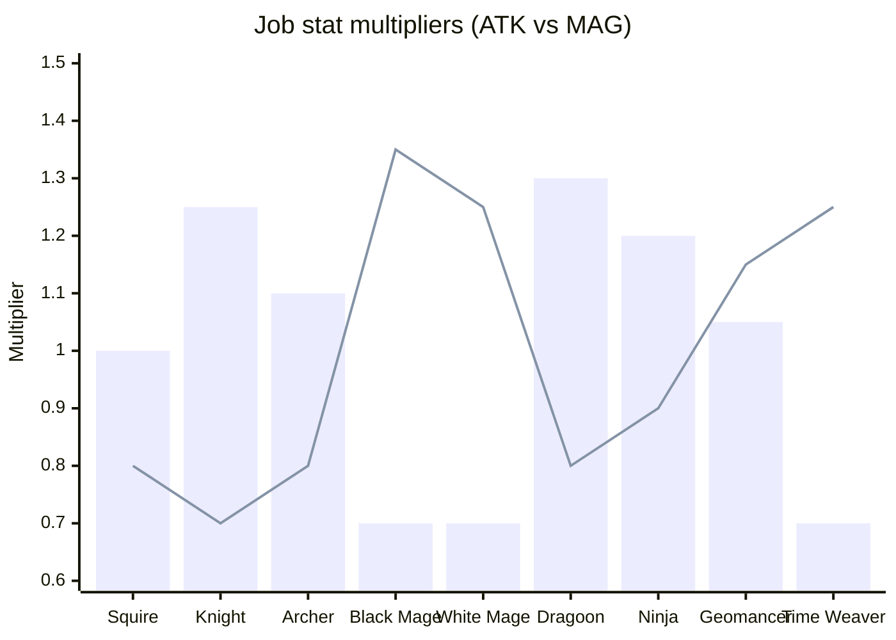
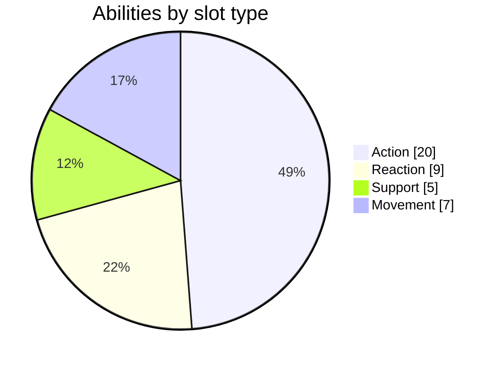
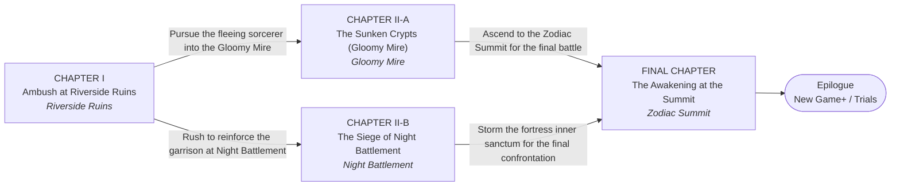

# Content Reference

> **Generated file — do not edit by hand.** Run `npm run docs:gen` after changing anything in `src/data/` or the Trials generator. CI fails if this file is out of date.

Every number here is read straight from the game data, so it always matches what ships.

**Contents:** [Jobs](#jobs) · [Abilities](#abilities) · [Status effects](#status-effects) · [Geomancy](#geomancy-terrain-spells) · [Items](#items) · [Armory](#armory--drops) · [Battlefields](#battlefields) · [Campaign](#campaign) · [Trials of the Zodiac](#trials-of-the-zodiac)

## Jobs

9 jobs. Stat multipliers scale a unit's base stats while it holds that job (base HP = 120 + 18 × level).

| Job | Role | Move | Jump | HP | MP | ATK | MAG | SPD | Abilities |
| :--- | :--- | :---: | :---: | :---: | :---: | :---: | :---: | :---: | :---: |
| **Squire** `squire` | Vanguard | 4 | 2 | 1.00× | 0.80× | 1.00× | 0.80× | 1.00× | 5 |
| **Knight** `knight` | Vanguard | 3 | 2 | 1.30× | 0.70× | 1.25× | 0.70× | 0.95× | 4 |
| **Archer** `archer` | Marksman | 3 | 3 | 0.95× | 0.80× | 1.10× | 0.80× | 1.05× | 4 |
| **Black Mage** `black_mage` | Mage | 3 | 2 | 0.80× | 1.40× | 0.70× | 1.35× | 0.95× | 6 |
| **White Mage** `white_mage` | Healer | 3 | 2 | 0.85× | 1.30× | 0.70× | 1.25× | 1.00× | 4 |
| **Dragoon** `dragoon` | Lancer | 3 | 4 | 1.20× | 0.80× | 1.30× | 0.80× | 1.00× | 4 |
| **Ninja** `ninja` | Skirmisher | 4 | 3 | 0.90× | 0.70× | 1.20× | 0.90× | 1.25× | 4 |
| **Geomancer** `geomancer` | Terramancer | 4 | 3 | 1.05× | 1.00× | 1.05× | 1.15× | 1.00× | 5 |
| **Time Weaver** `time_mage` | Chronomancer | 3 | 2 | 0.85× | 1.35× | 0.70× | 1.25× | 1.05× | 5 |

*Bars = ATK multiplier, line = MAG multiplier.*

## Abilities

41 learnable abilities: 20 actions, 9 reactions, 5 supports, 7 movement. Every unit also has **Attack** (range 1, power 1; spears and bows extend its range).

### Squire

*The foundational warrior discipline. Balanced and versatile with basic survival techniques.*

| Ability | Slot | JP | MP | Range | Height | Area | Power | Element | Effect | Description |
| :--- | :--- | ---: | ---: | :---: | :---: | :---: | :---: | :--- | :--- | :--- |
| **Throw Stone** `sq_stone` | Action | 50 | 0 | 4 | 2 | — | 0.6 | physical | — | Hurls a loose rock at a distant target to chip damage. |
| **Focus** `sq_focus` | Action | 100 | 0 | 0 | 0 | — | — | physical | inflicts **focus**, self only | Channel concentration: physical damage +25% for 4 turns. |
| **Counter Tackle** `sq_counter` | Reaction | 120 | — | — | — | — | — | — | — | Retaliates with a blunt shoulder check when struck by melee attacks. |
| **JP Boost** `sq_jp_boost` | Support | 150 | — | — | — | — | — | — | — | Gain 50% additional Job Points from all battlefield actions. |
| **Move +1** `sq_move_plus` | Movement | 200 | — | — | — | — | — | — | — | Increases unit movement radius by 1 tile. |

### Knight

*Heavily armored protector proficient in breaking opponent equipment and holding defensive lines.*

| Ability | Slot | JP | MP | Range | Height | Area | Power | Element | Effect | Description |
| :--- | :--- | ---: | ---: | :---: | :---: | :---: | :---: | :--- | :--- | :--- |
| **Rend Armor** `kn_rend_armor` | Action | 150 | 5 | 1 | 1.5 | — | 1.1 | physical | — | Shatters foe armor plating, permanently reducing their physical defense. |
| **Shield Bash** `kn_shield_bash` | Action | 180 | 8 | 1 | 1.5 | — | 1.3 | physical | — | Slams shield into target, knocking them back and dealing physical shock. |
| **Weapon Guard** `kn_parry` | Reaction | 200 | — | — | — | — | — | — | — | Chance to deflect incoming front-facing physical attacks with blade. |
| **Equip Heavy Armor** `kn_heavy_armor` | Support | 250 | — | — | — | — | — | — | — | Allows non-knight classes to equip plate mail and heavy helms. |

### Archer

*Long-range marksman capitalizing on elevation advantages and calculated trick shots.*

| Ability | Slot | JP | MP | Range | Height | Area | Power | Element | Effect | Description |
| :--- | :--- | ---: | ---: | :---: | :---: | :---: | :---: | :--- | :--- | :--- |
| **Aim +2** `ar_aim` | Action | 100 | 0 | 5 | 3 | — | 1.4 | physical | — | Takes extra time to line up shot for devastating critical puncture. |
| **Leg Shot** `ar_leg_shot` | Action | 160 | 6 | 4 | 2.5 | — | 0.9 | physical | inflicts **immobilize** | Pinpoints tendon to immobilize enemy movement for 2 turns. |
| **Speed Save** `ar_speed_save` | Reaction | 200 | — | — | — | — | — | — | — | Boosts Speed stat whenever sustaining damage in battle. |
| **Jump +1** `ar_jump_plus` | Movement | 180 | — | — | — | — | — | — | — | Allows scaling higher ledges and cliffs effortlessly. |

### Black Mage

*Master of destructive elemental incantations spanning fire, frost, and lightning.*

| Ability | Slot | JP | MP | Range | Height | Area | Power | Element | Effect | Description |
| :--- | :--- | ---: | ---: | :---: | :---: | :---: | :---: | :--- | :--- | :--- |
| **Fire** `bm_fire` | Action | 80 | 10 | 4 | 2 | 1 | 1.3 | fire | — | Engulfs target tile and surrounding foes in searing flame. |
| **Blizzard** `bm_blizzard` | Action | 80 | 10 | 4 | 2 | 1 | 1.3 | ice | — | Summons chilling shards of ice to impale enemy formation. |
| **Thunder** `bm_thunder` | Action | 80 | 10 | 4 | 3.5 | 1 | 1.35 | lightning | — | Strikes target from high clouds with crackling lightning bolt. |
| **Poison Cloud** `bm_poison` | Action | 140 | 8 | 3 | 2 | — | 0.5 | dark | inflicts **poison** | Enshrouds foe in venomous miasma, dealing 10% max HP damage every turn. |
| **Arcane Retaliation** `bm_magic_counter` | Reaction | 200 | — | — | — | — | — | — | — | When struck, lashes back at the attacker with a burst of raw magic. |
| **Arcane Strength** `bm_arcane_strength` | Support | 250 | — | — | — | — | — | — | — | Increases all magical damage output by 25%. |

### White Mage

*Devoted healer using sanctified incantations to mend wounds, cure status, and protect allies.*

| Ability | Slot | JP | MP | Range | Height | Area | Power | Element | Effect | Description |
| :--- | :--- | ---: | ---: | :---: | :---: | :---: | :---: | :--- | :--- | :--- |
| **Cure** `wm_cure` | Action | 70 | 8 | 4 | 2 | — | Heal 1.4 | holy | — | Restores health to an injured ally with warm holy light. |
| **Protect** `wm_protect` | Action | 120 | 12 | 3 | 2 | — | — | holy | inflicts **protect** | Erects an arcane barrier, softening physical blows by 30% for 3 turns. |
| **Auto-Potion** `wm_auto_potion` | Reaction | 200 | — | — | — | — | — | — | — | Instantly drinks a restorative potion when taking direct damage. |
| **Regen Walk** `wm_regen_move` | Movement | 220 | — | — | — | — | — | — | — | Restores 10% of maximum HP on every tile movement step. |

### Dragoon

*Skyward knight wielding polearms. Masters of crushing vertical plunge attacks and draconic arts.*

| Ability | Slot | JP | MP | Range | Height | Area | Power | Element | Effect | Description |
| :--- | :--- | ---: | ---: | :---: | :---: | :---: | :---: | :--- | :--- | :--- |
| **Dragon Plunge** `dr_jump` | Action | 120 | 6 | 3 | 4 | — | 1.6 | physical | — | Leaps high into the skies and crashes down on target with crushing kinetic force. |
| **Dragon Breath** `dr_fire_breath` | Action | 180 | 14 | 2 | 2 | 1 | 1.3 | fire | — | Channels dragon wyrm spirit to spew cones of searing fire. |
| **Dragonheart** `dr_dragonheart` | Reaction | 250 | — | — | — | — | — | — | — | Survives a fatal blow with 1 HP and enters Reraise state. |
| **Ignore Elevation** `dr_ignore_height` | Movement | 350 | — | — | — | — | — | — | — | Allows scaling any sheer cliff or watchtower wall regardless of elevation height. |

### Ninja

*Lethal shadow operative boasting immense speed, evasion, shuriken throwing, and dual-wielding.*

| Ability | Slot | JP | MP | Range | Height | Area | Power | Element | Effect | Description |
| :--- | :--- | ---: | ---: | :---: | :---: | :---: | :---: | :--- | :--- | :--- |
| **Throw Shuriken** `ni_shuriken` | Action | 100 | 0 | 4 | 2.5 | — | 1.1 | physical | — | Flicks sharp four-pointed steel stars across distance to lacerate opponents. |
| **Reflexes / Vanish** `ni_shadow_clone` | Reaction | 220 | — | — | — | — | — | — | — | Splits into smoke decoys upon being targeted, granting 40% evasion against attacks. |
| **Dual Wield** `ni_dual_wield` | Support | 350 | — | — | — | — | — | — | — | Equips a weapon in both hands; basic attacks strike twice in rapid succession! |
| **Water Walk** `ni_water_walk` | Movement | 150 | — | — | — | — | — | — | — | Treads effortlessly on water surface and murky bogs without movement penalty. |

### Geomancer

*Terramancer who draws power from the ground underfoot. The same spell becomes fire, ice or venom depending on where they stand.*

| Ability | Slot | JP | MP | Range | Height | Area | Power | Element | Effect | Description |
| :--- | :--- | ---: | ---: | :---: | :---: | :---: | :---: | :--- | :--- | :--- |
| **Elemental** `geo_elemental` | Action | 0 | 0 | 3 | 2.5 | — | 1.15 | physical | changes with terrain | Channels the terrain you stand on: grass = Hell Ivy (immobilize), stone = Rockslide, dirt = Sandstorm (slow), water = Torrent (ice), swamp = Quicksand (poison), wood = Wildfire (fire). |
| **Earth Slash** `geo_earth_slash` | Action | 160 | 8 | 2 | 2 | 1 | 1.1 | physical | — | Splits the ground in a shockwave that strikes the target and every foe beside it. |
| **Earthen Ward** `geo_earthen_ward` | Reaction | 180 | — | — | — | — | — | — | — | When struck while standing on stone, dirt or parapet, the ground hardens into armor (Protect for 3 turns). |
| **Attack Boost** `geo_attack_up` | Support | 220 | — | — | — | — | — | — | — | Increases all physical damage dealt by 20%. |
| **Mountain Stride** `geo_stride` | Movement | 200 | — | — | — | — | — | — | — | Sure-footed climbing: Jump +2. |

### Time Weaver

*Chronomancer manipulating space-time fabric to accelerate allies, slow foes, and bend gravity.*

| Ability | Slot | JP | MP | Range | Height | Area | Power | Element | Effect | Description |
| :--- | :--- | ---: | ---: | :---: | :---: | :---: | :---: | :--- | :--- | :--- |
| **Haste** `tm_haste` | Action | 120 | 12 | 4 | 2 | — | — | time | inflicts **haste** | Accelerates personal time flux, boosting Speed by +50% for 3 turns. |
| **Slow** `tm_slow` | Action | 120 | 12 | 4 | 2 | — | — | time | inflicts **slow** | Weaves temporal drag around foe, cutting their Speed by 33% for 3 turns. |
| **Gravity** `tm_gravity` | Action | 180 | 16 | 4 | 3 | — | 1.2 | time | — | Bends gravitational weight, shearing away 25% of target current HP directly. |
| **Critical Quick** `tm_critical_quick` | Reaction | 220 | — | — | — | — | — | — | — | When struck down to 35% HP or less, instantly charges CT to 100 to act next. |
| **Teleport** `tm_teleport` | Movement | 350 | — | — | — | — | — | — | — | Folds spacetime to instantly blink to any tile within range, bypassing cliffs and walls! |

## Status effects

| Status | Lasts (turns) | Effect |
| :--- | :---: | :--- |
| **haste** | 3 | Speed ×1.5 (bosses get a permanent Haste when enraged) |
| **slow** | 3 | Speed ×0.67 (minimum 2) |
| **protect** | 3 | Physical damage taken ×0.7 |
| **immobilize** | 2 | Move becomes 0 |
| **poison** | 3 | Lose 10% max HP at the start of each turn |
| **focus** | 4 | Physical power ×1.25 |

## Geomancy terrain spells

The Geomancer's **Elemental** becomes a different spell depending on the caster's tile.

| Caster stands on | Spell | Element | Status | Power scale |
| :--- | :--- | :--- | :--- | :---: |
| grass | **Hell Ivy** | dark | immobilize | 0.85× |
| stone | **Rockslide** | physical | — | 1.15× |
| parapet | **Rockslide** | physical | — | 1.15× |
| dirt | **Sandstorm** | physical | slow | 0.85× |
| water | **Torrent** | ice | — | 1.05× |
| swamp | **Quicksand** | dark | poison | 0.80× |
| wood | **Wildfire** | fire | — | 1.10× |

## Items

27 items across five gear slots.

### Weapon (9)

| Item | Type | Range | Stats | Price | How to get |
| :--- | :--- | :---: | :--- | ---: | :--- |
| **Iron Broadsword** `iron_sword` | sword | 1 | ATTACK +4 | 100 | Starting gear |
| **Platinum Blade** `platinum_blade` | sword | 1 | ATTACK +9, HP +15 | 350 | Choose "Storm the fortress inner sanctum for the final confrontation!" · Trials drop |
| **Holy Dragon Lance** `dragon_lance` | spear | 2 | ATTACK +8, JUMP +1 | 400 | Starting gear |
| **Longbow of the Gale** `hunting_bow` | bow | 5 | ATTACK +6 | 250 | Starting gear |
| **Chrono Scepter** `chrono_rod` | staff | 1 | ATTACK +3, MAGIC +7, MP +20 | 300 | Starting gear |
| **Twin Shadow Daggers** `assassin_daggers` | dagger | 1 | ATTACK +7, SPEED +1, EVASION +10 | 320 | Choose "Pursue the fleeing sorcerer into the Gloomy Mire!" · Trials drop |
| **Gaia Staff** `gaia_staff` | staff | 1 | MAGIC +5, ATTACK +3, HP +10 | 300 | Win CHAPTER II-A · Trials drop |
| **Windslayer Bow** `sniper_bow` | bow | 6 | ATTACK +7, SPEED +1 | 420 | Choose "Ascend to the Zodiac Summit for the final battle!" · Trials drop |
| **Zodiac Blade** `zodiac_blade` | sword | 1 | ATTACK +13, MAGIC +4, SPEED +1 | 900 | Win FINAL CHAPTER |

### Shield (3)

| Item | Stats | Price | How to get |
| :--- | :--- | ---: | :--- |
| **Bronze Buckler** `buckler` | EVASION +12 | 80 | Starting gear |
| **Kite Shield** `kite_shield` | EVASION +22, HP +15 | 220 | Choose "Rush to reinforce the garrison at Night Battlement!" · Trials drop |
| **Aegis Barrier** `aegis_shield` | EVASION +32, HP +30, MP +15 | 450 | Choose "Storm the fortress inner sanctum for the final confrontation!" · Trials drop |

### Head (4)

| Item | Stats | Price | How to get |
| :--- | :--- | ---: | :--- |
| **Steel Bascinet** `iron_helm` | HP +30 | 120 | Starting gear |
| **Pointed Wizard Hat** `wizard_hat` | HP +15, MP +25, MAGIC +3 | 150 | Starting gear |
| **Shadow Headband** `shinobi_band` | HP +20, SPEED +1, EVASION +5 | 180 | Starting gear |
| **Crystal Helm** `crystal_helm` | HP +30, MP +10, EVASION +3 | 380 | Win CHAPTER II-B · Trials drop |

### Body (5)

| Item | Stats | Price | How to get |
| :--- | :--- | ---: | :--- |
| **Reinforced Hauberk** `chainmail` | HP +50 | 180 | Starting gear |
| **Platinum Plate Mail** `platinum_armor` | HP +90, SPEED +-1 | 450 | Choose "Rush to reinforce the garrison at Night Battlement!" · Trials drop |
| **Astral Silk Robe** `silk_robe` | HP +30, MP +45, MAGIC +5 | 260 | Starting gear |
| **Nightwalker Tunic** `shinobi_garb` | HP +35, SPEED +1, EVASION +12 | 300 | Starting gear |
| **Wyrmscale Mail** `dragon_mail` | HP +55, ATTACK +2, EVASION +4 | 520 | Win FINAL CHAPTER · Trials drop |

### Accessory (6)

| Item | Stats | Price | How to get |
| :--- | :--- | ---: | :--- |
| **Battle Greaves** `battle_boots` | JUMP +1 | 150 | Starting gear |
| **Featherlight Boots** `feather_boots` | MOVE +1 | 350 | Starting gear |
| **Hermes Slippers** `hermes_shoes` | SPEED +2 | 400 | Choose "Ascend to the Zodiac Summit for the final battle!" · Trials drop |
| **Gauntlet of Might** `power_wrist` | ATTACK +4 | 200 | Win CHAPTER I · Trials drop |
| **Ring of Arcana** `mage_ring` | MAGIC +4, MP +25 | 220 | Choose "Pursue the fleeing sorcerer into the Gloomy Mire!" · Trials drop |
| **Zodiac Ribbon** `ribbon` | HP +20, MP +20, SPEED +1, EVASION +5 | 800 | Win FINAL CHAPTER · Trials drop |

## Armory & drops

| Pool | Items |
| :--- | :--- |
| Starting armory (13) | Iron Broadsword, Holy Dragon Lance, Longbow of the Gale, Chrono Scepter, Bronze Buckler, Steel Bascinet, Pointed Wizard Hat, Shadow Headband, Reinforced Hauberk, Astral Silk Robe, Nightwalker Tunic, Battle Greaves, Featherlight Boots |
| Trials rare drops (13) | Platinum Blade, Kite Shield, Aegis Barrier, Platinum Plate Mail, Hermes Slippers, Gauntlet of Might, Ring of Arcana, Twin Shadow Daggers, Gaia Staff, Windslayer Bow, Crystal Helm, Wyrmscale Mail, Zodiac Ribbon |

## Battlefields

| Map | Id | Size | Theme | Height range | Terrain mix | Impassable tiles | Squad deploys on |
| :--- | :--- | :---: | :--- | :---: | :--- | :---: | :--- |
| **Riverside Ruins** | `river_ruins` | 16×16 | day | 0.6–3.4 | grass 68%, stone 14%, water 11%, dirt 6%, wood 2% | 7 | (5, 14) (6, 14) (4, 13) (6, 13) (5, 15) (3, 14) |
| **Night Battlement** | `night_fortress` | 16×16 | night | 0.5–4.5 | stone 61%, parapet 17%, water 12%, dirt 9%, wood 1% | 4 | (6, 14) (8, 14) (7, 15) (5, 15) (9, 15) (7, 13) |
| **Gloomy Mire** | `gloomy_swamp` | 16×16 | swamp | 0.4–3 | swamp 41%, grass 36%, wood 14%, dirt 5%, stone 2%, water 2% | 5 | (6, 14) (7, 14) (8, 14) (7, 15) (6, 15) (8, 15) |
| **Zodiac Summit** | `zodiac_summit` | 16×16 | night | 1–5 | parapet 35%, grass 24%, stone 16%, dirt 12%, water 11%, wood 2% | 6 | (6, 14) (8, 14) (7, 15) (5, 15) (9, 15) (7, 13) |

## Campaign

| Chapter | Map | Enemies | Boss | Recruit | Win reward | Branch rewards |
| :--- | :--- | :---: | :--- | :--- | :--- | :--- |
| **CHAPTER I**: Ambush at Riverside Ruins | Riverside Ruins | 5 | Bandit Chief (Knight L3) | — | Gauntlet of Might | Ring of Arcana + Twin Shadow Daggers / Platinum Plate Mail + Kite Shield |
| **CHAPTER II-A**: The Sunken Crypts (Gloomy Mire) | Gloomy Mire | 5 | Arch-Warlock (Time Weaver L4) | Bria (Geomancer) | Gaia Staff | Hermes Slippers + Windslayer Bow |
| **CHAPTER II-B**: The Siege of Night Battlement | Night Battlement | 5 | Dragoon Commander (Dragoon L3) | Bria (Geomancer) | Crystal Helm | Aegis Barrier + Platinum Blade |
| **FINAL CHAPTER**: The Awakening at the Summit | Zodiac Summit | 6 | Zodiac Champion (Dragoon L5) | — | Zodiac Blade, Zodiac Ribbon, Wyrmscale Mail | — |

<b>CHAPTER I</b> enemy roster

| Enemy | Job | Level | Tile | Boss |
| :--- | :--- | :---: | :---: | :---: |
| Bandit Chief | Knight | 3 | (13, 2) | ★ |
| Rogue Warlock | Time Weaver | 3 | (12, 3) |  |
| Brigand Bowman | Archer | 3 | (14, 3) |  |
| Shadow Shinobi | Ninja | 3 | (5, 4) |  |
| Bridge Cutthroat | Squire | 2 | (3, 3) |  |

<b>CHAPTER II-A</b> enemy roster

| Enemy | Job | Level | Tile | Boss |
| :--- | :--- | :---: | :---: | :---: |
| Arch-Warlock | Time Weaver | 4 | (2, 0) | ★ |
| Bog Poisoner | Black Mage | 4 | (3, 1) |  |
| Swamp Shinobi | Ninja | 4 | (7, 4) |  |
| Mire Skirmisher | Ninja | 4 | (12, 2) |  |
| Reed Stalker | Archer | 3 | (6, 7) |  |

<b>CHAPTER II-B</b> enemy roster

| Enemy | Job | Level | Tile | Boss |
| :--- | :--- | :---: | :---: | :---: |
| Dragoon Commander | Dragoon | 3 | (7, 1) | ★ |
| Rampart Sniper | Archer | 3 | (4, 8) |  |
| Tower Sniper | Archer | 3 | (10, 8) |  |
| Iron Vanguard | Knight | 3 | (7, 7) |  |
| Gate Warden | Knight | 3 | (8, 7) |  |

<b>FINAL CHAPTER</b> enemy roster

| Enemy | Job | Level | Tile | Boss |
| :--- | :--- | :---: | :---: | :---: |
| Zodiac Champion | Dragoon | 5 | (7, 2) | ★ |
| Zealot Medic | White Mage | 5 | (8, 0) |  |
| Grand Chronomancer | Time Weaver | 5 | (5, 3) |  |
| Black Archmage | Black Mage | 5 | (10, 3) |  |
| Shadow Assassin | Ninja | 5 | (7, 6) |  |
| Altar Sentinel | Knight | 4 | (9, 6) |  |

## Trials of the Zodiac

Unlocked after the campaign. Each floor is generated from its number with a seeded RNG, so floor *N* is always the same battle. Enemy level = 3 + floor; a Warden boss appears every 5th floor; each clear drops one armory item you do not own yet.

| Floor | Seal | Map | Enemies | Level | Boss | Jobs |
| :---: | :--- | :--- | :---: | :---: | :---: | :--- |
| 1 | Seal of Aries | Riverside Ruins | 4 | 4 |  | Knight, White Mage |
| 2 | Seal of Taurus | Gloomy Mire | 4 | 5 |  | Archer, Squire, Ninja |
| 3 | Seal of Gemini | Night Battlement | 4 | 6 |  | Geomancer, Knight, Time Weaver |
| 4 | Seal of Cancer | Zodiac Summit | 4 | 7 |  | Squire, Dragoon |
| 5 | Seal of Leo: The Warden Wakes | Riverside Ruins | 5 | 8 | ★ | Dragoon, Squire, Ninja, Black Mage, Geomancer |
| 6 | Seal of Virgo | Gloomy Mire | 5 | 9 |  | Squire, Time Weaver, Ninja, White Mage |
| 7 | Seal of Libra | Night Battlement | 5 | 10 |  | Time Weaver, Squire, White Mage, Geomancer |
| 8 | Seal of Scorpio | Zodiac Summit | 5 | 11 |  | Archer, Squire, Ninja, Dragoon, Black Mage |
| 9 | Seal of Sagittarius | Riverside Ruins | 6 | 12 |  | Time Weaver, Ninja, Black Mage, Geomancer, Dragoon |
| 10 | Seal of Capricorn: The Warden Wakes | Gloomy Mire | 6 | 13 | ★ | Dragoon, White Mage, Ninja, Knight, Black Mage |
| 11 | Seal of Aquarius | Night Battlement | 6 | 14 |  | Knight, Squire, Black Mage, Archer |
| 12 | Seal of Pisces | Zodiac Summit | 6 | 15 |  | Ninja, Time Weaver, Black Mage, Knight, White Mage |
| 13 | Seal of Aries | Riverside Ruins | 6 | 16 |  | Geomancer, Squire, Black Mage, Archer, Dragoon |
| 14 | Seal of Taurus | Gloomy Mire | 6 | 17 |  | Squire, White Mage, Dragoon, Black Mage, Geomancer |
| 15 | Seal of Gemini: The Warden Wakes | Night Battlement | 6 | 18 | ★ | Dragoon, Squire, Black Mage, Time Weaver, Archer |

*Floors continue forever; the table shows the first 15.*
