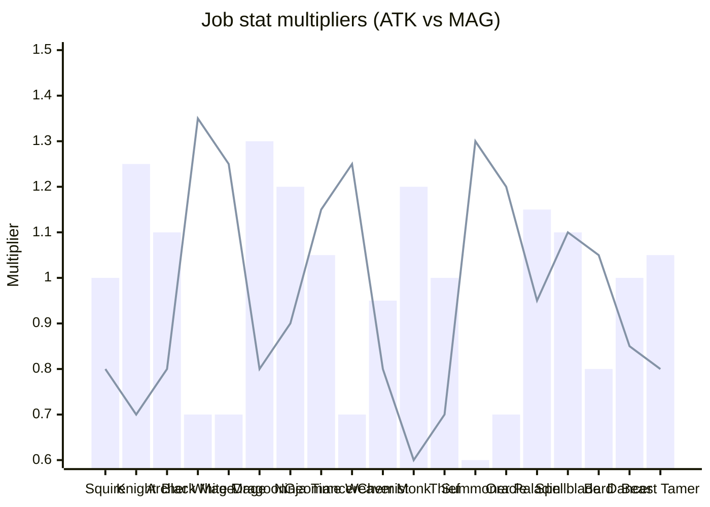
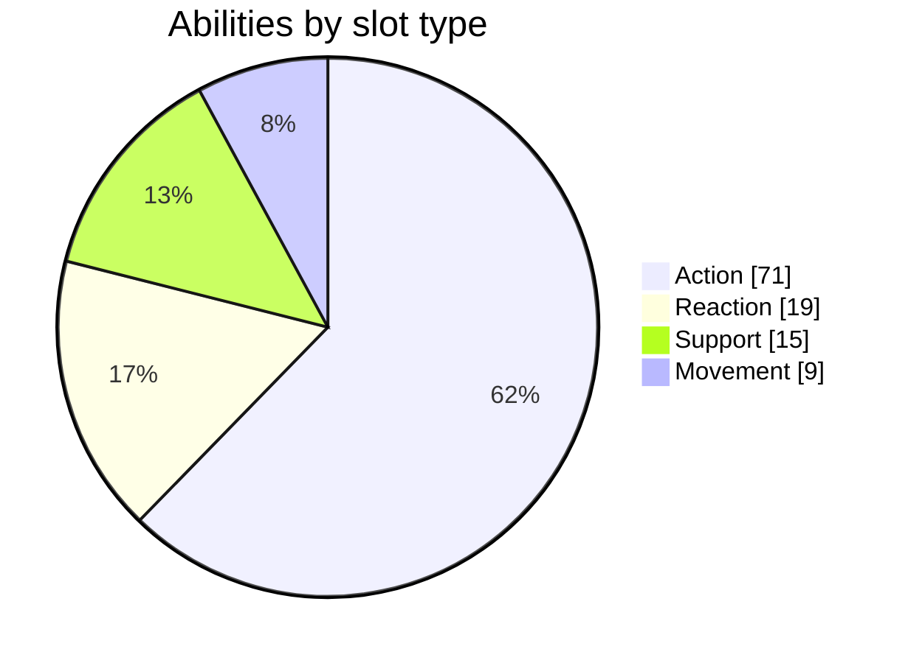
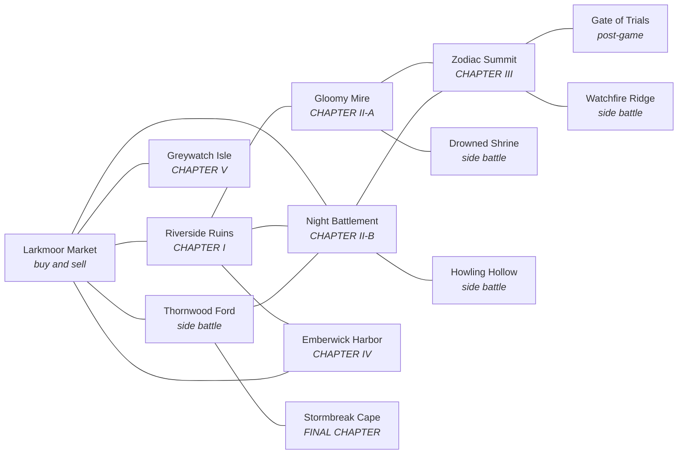

# Content Reference

> **Generated file — do not edit by hand.** Run `npm run docs:gen` after changing anything in `src/data/` or the Trials generator. CI fails if this file is out of date.

Every number here is read straight from the game data, so it always matches what ships.

**Contents:** [Jobs](#jobs) · [Job levels](#job-levels--requirements) · [Job mastery](#job-mastery) · [Abilities](#abilities) · [Monsters](#monsters) · [Status effects](#status-effects) · [Geomancy](#geomancy-terrain-spells) · [Items](#items) · [Supplies](#supplies) · [Shop](#shop--gil) · [World map](#world-map) · [Side battles](#side-battles) · [Difficulty](#difficulty) · [Armory](#armory--drops) · [Battlefields](#battlefields) · [Campaign](#campaign) · [Trials of the Zodiac](#trials-of-the-zodiac)

## Jobs

19 jobs. Stat multipliers scale a unit's base stats while it holds that job (base HP = 120 + 18 × level).

| Job | Role | Move | Jump | HP | MP | ATK | MAG | SPD | Abilities |
| :--- | :--- | :---: | :---: | :---: | :---: | :---: | :---: | :---: | :---: |
| **Squire** `squire` | Vanguard | 4 | 2 | 1.00× | 0.80× | 1.00× | 0.80× | 1.00× | 6 |
| **Knight** `knight` | Vanguard | 3 | 2 | 1.30× | 0.70× | 1.25× | 0.70× | 0.95× | 5 |
| **Archer** `archer` | Marksman | 3 | 3 | 0.95× | 0.80× | 1.10× | 0.80× | 1.05× | 5 |
| **Black Mage** `black_mage` | Mage | 3 | 2 | 0.80× | 1.40× | 0.70× | 1.35× | 0.95× | 7 |
| **White Mage** `white_mage` | Healer | 3 | 2 | 0.85× | 1.30× | 0.70× | 1.25× | 1.00× | 8 |
| **Dragoon** `dragoon` | Lancer | 3 | 4 | 1.20× | 0.80× | 1.30× | 0.80× | 1.00× | 4 |
| **Ninja** `ninja` | Skirmisher | 4 | 3 | 0.90× | 0.70× | 1.20× | 0.90× | 1.25× | 5 |
| **Geomancer** `geomancer` | Terramancer | 4 | 3 | 1.05× | 1.00× | 1.05× | 1.15× | 1.00× | 5 |
| **Time Weaver** `time_mage` | Chronomancer | 3 | 2 | 0.85× | 1.35× | 0.70× | 1.25× | 1.05× | 6 |
| **Chemist** `chemist` | Alchemist | 4 | 3 | 1.00× | 0.90× | 0.95× | 0.80× | 1.00× | 6 |
| **Monk** `monk` | Brawler | 4 | 3 | 1.20× | 0.60× | 1.20× | 0.60× | 1.05× | 6 |
| **Thief** `thief` | Rogue | 5 | 3 | 0.90× | 0.70× | 1.00× | 0.70× | 1.25× | 6 |
| **Summoner** `summoner` | Summoner | 3 | 2 | 0.80× | 1.50× | 0.60× | 1.30× | 0.90× | 10 |
| **Oracle** `oracle` | Hexer | 3 | 2 | 0.90× | 1.20× | 0.70× | 1.20× | 1.00× | 6 |
| **Paladin** `paladin` | Templar | 3 | 2 | 1.25× | 0.90× | 1.15× | 0.95× | 0.95× | 6 |
| **Spellblade** `spellblade` | Battlemage | 4 | 3 | 1.05× | 1.10× | 1.10× | 1.10× | 1.00× | 5 |
| **Bard** `bard` | Troubadour | 3 | 2 | 0.85× | 1.10× | 0.80× | 1.05× | 1.05× | 6 |
| **Dancer** `dancer` | Performer | 4 | 3 | 0.90× | 0.90× | 1.00× | 0.85× | 1.15× | 6 |
| **Beast Tamer** `tamer` | Tamer | 4 | 3 | 1.05× | 0.80× | 1.05× | 0.80× | 1.00× | 6 |

*Bars = ATK multiplier, line = MAG multiplier.*

## Job levels & requirements

A job levels up with the lifetime JP a unit earns in it (spending JP never lowers it).

| Job level | 1 | 2 | 3 | 4 | 5 | 6 | 7 | 8 (Master) |
| :--- | ---: | ---: | ---: | ---: | ---: | ---: | ---: | ---: |
| Lifetime JP | 0 | 100 | 250 | 450 | 700 | 1000 | 1400 | 1900 |

| Job | Requires |
| :--- | :--- |
| **Squire** | — (open to everyone) |
| **Knight** | Squire Lv 2 |
| **Archer** | Squire Lv 2 |
| **Black Mage** | — (open to everyone) |
| **White Mage** | — (open to everyone) |
| **Dragoon** | Knight Lv 2 |
| **Ninja** | Archer Lv 2 |
| **Geomancer** | — (open to everyone) |
| **Time Weaver** | Black Mage Lv 2 |
| **Chemist** | Squire Lv 2 |
| **Monk** | Squire Lv 3 |
| **Thief** | Archer Lv 2 |
| **Summoner** | White Mage Lv 2 + Black Mage Lv 2 |
| **Oracle** | Time Weaver Lv 2 |
| **Paladin** | Knight Lv 3 + White Mage Lv 2 |
| **Spellblade** | Knight Lv 2 + Black Mage Lv 2 |
| **Bard** | Archer Lv 2 + White Mage Lv 2 |
| **Dancer** | Thief Lv 2 + Monk Lv 2 |
| **Beast Tamer** | Archer Lv 2 + Chemist Lv 2 |

Every unit starts at Squire Lv 2. A unit created in an advanced job (a recruit, an enemy) is given the levels that job needs.

## Equipment rules

Each job uses its own weapon types (0.30.0). Shields, heavy armor and helms, and robes belong to some jobs; light clothes, caps, hats, circlets and every accessory suit anyone. Changing job takes off what the new job can't use. Tamed beasts wear only beast gear.

| Job | Can use |
| :--- | :--- |
| **Squire** | Swords, Daggers · Shields · Heavy armor & helms |
| **Knight** | Swords, Spears · Shields · Heavy armor & helms |
| **Archer** | Bows, Daggers |
| **Black Mage** | Staves & rods · Robes |
| **White Mage** | Staves & rods · Robes |
| **Dragoon** | Spears · Heavy armor & helms |
| **Ninja** | Daggers |
| **Geomancer** | Staves & rods, Swords · Heavy armor & helms · Robes |
| **Time Weaver** | Staves & rods · Robes |
| **Chemist** | Daggers, Staves & rods |
| **Monk** | Knuckles |
| **Thief** | Daggers, Knuckles |
| **Summoner** | Staves & rods · Robes |
| **Oracle** | Staves & rods · Robes |
| **Paladin** | Swords · Shields · Heavy armor & helms |
| **Spellblade** | Swords, Daggers · Shields · Robes |
| **Bard** | Bows, Staves & rods · Robes |
| **Dancer** | Daggers, Whips |
| **Beast Tamer** | Whips, Daggers, Bows |

## Job mastery

A permanent bonus for sticking with a job. A unit earns the first amount at job level 5 (700 lifetime JP) and the second, which replaces it, at level 8 (Master, 1900 JP). It keeps the bonus in every job, and bonuses from different jobs add up. Master also brings the job's **signature**: an action usable in any job, once per battle, for no MP, at +30 hit.

| Job | Lv 5 (Veteran) | Lv 8 (Master) | Signature | What it does | Reach |
| :--- | :--- | :--- | :--- | :--- | :--- |
| **Squire** | +10 HP | +25 HP | **Valiant Charge** `sig_valiant_charge` | Everything a squire learns, in one blow: heavy damage to an adjacent foe, and Breach. | range 1 |
| **Knight** | +15 HP | +35 HP | **Shield Wall** `sig_shield_wall` | Plants the shield and calls the line in: you and every ally within 2 tiles gain Protect. | around the user, area 2 |
| **Archer** | +1 ATK | +2 ATK | **Heartseeker** `sig_heartseeker` | A single arrow loosed with perfect stillness: very heavy damage up to 6 tiles away. | range 6 |
| **Black Mage** | +1 MAG | +2 MAG | **Meteor** `sig_meteor` | Calls down a burning star: heavy fire damage to every foe within 2 tiles of the target, up to 4 away. | range 4, area 2 |
| **White Mage** | +8 MP | +20 MP | **Benediction** `sig_benediction` | A blessing on the whole line: heals and cleanses every ally within 2 tiles of the target, up to 4 away. | range 4, area 2 |
| **Dragoon** | +1 Jump | +2 Jump | **Skyfall** `sig_skyfall` | A leap so high it lands like a falling tower: heavy damage to the target and every foe beside it, up to 3 away. | range 3, area 1 |
| **Ninja** | +4 Evasion | +8 Evasion | **Thousand Cuts** `sig_thousand_cuts` | Too fast to follow: very heavy damage to an adjacent foe. | range 1 |
| **Geomancer** | +6 MP | +15 MP | **Earthquake** `sig_earthquake` | The ground itself rises up: damage to every foe within 3 tiles of you. | around the user, area 3 |
| **Time Weaver** | +1 Speed | +2 Speed | **Chrono Surge** `sig_chrono_surge` | Speeds the whole battle line: you and every ally within 3 tiles gain Haste. | around the user, area 3 |
| **Chemist** | +8 HP | +20 HP | **Panacea** `sig_panacea` | Every vial at once: heals (from ATK) and cleanses you and every ally within 2 tiles. | around the user, area 2 |
| **Monk** | +1 ATK | +2 ATK | **Final Fist** `sig_final_fist` | Every ounce of ki in one strike: crushing damage to an adjacent foe. | range 1 |
| **Thief** | +3 Evasion | +6 Evasion | **Life Theft** `sig_life_theft` | Steals the one thing that can't be fenced: heavy damage to an adjacent foe, and you heal half of it. | range 1 |
| **Summoner** | +1 MAG | +2 MAG | **Celestial Call** `sig_celestial` | Summons a creature of pure light: heavy holy damage to every foe within 2 tiles of the target, up to 5 away. | range 5, area 2 |
| **Oracle** | +8 MP | +20 MP | **Doomsay** `sig_doomsay` | Speaks the end aloud: dark damage and Sleep on every foe within 1 tile of the target, up to 4 away. | range 4, area 1 |
| **Paladin** | +12 HP | +30 HP | **Sanctuary** `sig_sanctuary` | Hallows the ground: heals you and every ally within 2 tiles, and gives them Regen. | around the user, area 2 |
| **Spellblade** | +1 MAG | +2 MAG | **Runic Tempest** `sig_runic_tempest` | Every rune on the blade at once: heavy lightning damage (ATK) to the target and every foe beside it, up to 2 away. | range 2, area 1 |
| **Bard** | +8 MP | +20 MP | **Grand Finale** `sig_finale` | The last song of the night, sung once: heals you and every ally within 3 tiles, and gives them Haste. | around the user, area 3 |
| **Dancer** | +1 Speed | +2 Speed | **Last Dance** `sig_last_dance` | One dance nobody forgets: damage (ATK) and Slow to every foe within 2 tiles of you. | around the user, area 2 |
| **Beast Tamer** | +10 HP | +25 HP | **Stampede** `sig_stampede` | One call and the wild answers: a charging herd tramples a wide area up to 4 tiles away. Heavy damage (ATK) and Immobilize; beasts take more. | range 4, area 2 |

## Abilities

114 learnable abilities: 71 actions, 19 reactions, 15 supports, 9 movement. Every unit also has **Attack** (range 1, power 1; spears and bows extend its range).

### Squire

*The foundational warrior discipline. Balanced and versatile with basic survival techniques.*

| Ability | Slot | JP | MP | Range | Height | Area | Power | Element | Effect | Description |
| :--- | :--- | ---: | ---: | :---: | :---: | :---: | :---: | :--- | :--- | :--- |
| **Throw Stone** `sq_stone` | Action | 50 | 0 | 4 | 2 | — | 0.6 | physical | — | Hurls a loose rock at a distant target to chip damage. |
| **Focus** `sq_focus` | Action | 100 | 0 | 0 | 0 | — | — | physical | inflicts **focus**, self only | Channel concentration: physical damage +25% for 4 turns. |
| **Counter Tackle** `sq_counter` | Reaction | 120 | — | — | — | — | — | — | — | Retaliates with a blunt shoulder check when struck by melee attacks. |
| **JP Boost** `sq_jp_boost` | Support | 150 | — | — | — | — | — | — | — | Gain 50% additional Job Points from all battlefield actions. |
| **Move +1** `sq_move_plus` | Movement | 200 | — | — | — | — | — | — | — | Increases unit movement radius by 1 tile. |
| **Rally** `sq_rally` | Action | 180 | 0 | 1 | 1.5 | 1 | — | physical | inflicts **focus** | A battle cry: you and adjacent allies gain Focus (+25% physical damage) for 4 turns. |

### Knight

*Heavily armored protector proficient in breaking opponent equipment and holding defensive lines.*

| Ability | Slot | JP | MP | Range | Height | Area | Power | Element | Effect | Description |
| :--- | :--- | ---: | ---: | :---: | :---: | :---: | :---: | :--- | :--- | :--- |
| **Rend Armor** `kn_rend_armor` | Action | 150 | 5 | 1 | 1.5 | — | 1.1 | physical | inflicts **breach** | Shatters foe armor plating: Breach (+25% physical damage taken) for 3 turns. |
| **Shield Bash** `kn_shield_bash` | Action | 180 | 8 | 1 | 1.5 | — | 1.3 | physical | — | Slams shield into target, knocking them back and dealing physical shock. |
| **Weapon Guard** `kn_parry` | Reaction | 200 | — | — | — | — | — | — | — | Chance to deflect incoming front-facing physical attacks with blade. |
| **Armor Mastery** `kn_heavy_armor` | Support | 250 | — | — | — | — | — | — | — | Trained to fight in plate: HP from armor, helms and shields +50%. |
| **Bulwark** `kn_bulwark` | Action | 160 | 6 | 0 | 0 | — | — | physical | inflicts **protect**, self only | Brace behind your shield: Protect on yourself (-30% physical damage taken). |

### Archer

*Long-range marksman capitalizing on elevation advantages and calculated trick shots.*

| Ability | Slot | JP | MP | Range | Height | Area | Power | Element | Effect | Description |
| :--- | :--- | ---: | ---: | :---: | :---: | :---: | :---: | :--- | :--- | :--- |
| **Aim +2** `ar_aim` | Action | 100 | 0 | 5 | 3 | — | 1.4 | physical | — | Takes extra time to line up shot for devastating critical puncture. |
| **Leg Shot** `ar_leg_shot` | Action | 160 | 6 | 4 | 2.5 | — | 0.9 | physical | inflicts **immobilize** | Pinpoints tendon to immobilize enemy movement for 2 turns. |
| **Speed Save** `ar_speed_save` | Reaction | 200 | — | — | — | — | — | — | — | Boosts Speed stat whenever sustaining damage in battle. |
| **Jump +1** `ar_jump_plus` | Movement | 180 | — | — | — | — | — | — | — | Allows scaling higher ledges and cliffs effortlessly. |
| **Arrow Rain** `ar_arrow_rain` | Action | 220 | 10 | 5 | 3 | 1 | 0.7 | physical | — | Looses a volley that falls on the target and everyone beside it. |

### Black Mage

*Master of destructive elemental incantations spanning fire, frost, and lightning.*

| Ability | Slot | JP | MP | Range | Height | Area | Power | Element | Effect | Description |
| :--- | :--- | ---: | ---: | :---: | :---: | :---: | :---: | :--- | :--- | :--- |
| **Fire** `bm_fire` | Action | 80 | 10 | 4 | 2 | 1 | 1.3 | fire | — | Engulfs target tile and surrounding foes in searing flame. |
| **Blizzard** `bm_blizzard` | Action | 80 | 10 | 4 | 2 | 1 | 1.3 | ice | — | Summons chilling shards of ice to impale enemy formation. |
| **Thunder** `bm_thunder` | Action | 80 | 10 | 4 | 3.5 | 1 | 1.35 | lightning | — | Strikes target from high clouds with crackling lightning bolt. |
| **Poison Cloud** `bm_poison` | Action | 140 | 8 | 3 | 2 | — | 0.5 | dark | inflicts **poison** | Enshrouds foe in venomous miasma, dealing 10% max HP damage every turn. |
| **Arcane Retaliation** `bm_magic_counter` | Reaction | 200 | — | — | — | — | — | — | — | When struck, lashes back at the attacker with a burst of raw magic. |
| **Arcane Strength** `bm_arcane_strength` | Support | 250 | — | — | — | — | — | — | — | Increases all magical damage output by 25%. |
| **Firestorm** `bm_firestorm` | Action | 300 | 28 | 4 | 3 | 2 | 1.15 | fire | — | A sweeping blaze over a wide area (radius 2). |

### White Mage

*Devoted healer using sanctified incantations to mend wounds, cure status, and protect allies.*

| Ability | Slot | JP | MP | Range | Height | Area | Power | Element | Effect | Description |
| :--- | :--- | ---: | ---: | :---: | :---: | :---: | :---: | :--- | :--- | :--- |
| **Cure** `wm_cure` | Action | 70 | 8 | 4 | 2 | — | Heal 1.4 | holy | — | Restores health to an injured ally with warm holy light. |
| **Protect** `wm_protect` | Action | 120 | 12 | 3 | 2 | — | — | holy | inflicts **protect** | Erects an arcane barrier, softening physical blows by 30% for 3 turns. |
| **Raise** `wm_raise` | Action | 260 | 18 | 3 | 2 | — | — | holy | — | Calls a fallen ally back to their feet with a third of their HP. Bosses cannot be raised. |
| **Auto-Potion** `wm_auto_potion` | Reaction | 200 | — | — | — | — | — | — | — | Instantly drinks a restorative potion when taking direct damage. |
| **Regen Walk** `wm_regen_move` | Movement | 220 | — | — | — | — | — | — | — | Restores 10% of maximum HP on every tile movement step. |
| **Shell** `wm_shell` | Action | 120 | 8 | 4 | 2 | — | — | holy | inflicts **shell** | A ward against spells: Shell (-30% magic damage taken) for 3 turns. |
| **Purify** `wm_purify` | Action | 100 | 6 | 4 | 2 | — | — | holy | cleanses ailments | Washes away poison, blindness, silence, sleep, slow, binding and Breach. |
| **Healing Circle** `wm_heal_circle` | Action | 240 | 18 | 3 | 2 | 1 | Heal 1 | holy | — | Restores HP to the target and every ally beside it. |

### Dragoon

*Skyward knight wielding polearms. Masters of crushing vertical plunge attacks and draconic arts.*

| Ability | Slot | JP | MP | Range | Height | Area | Power | Element | Effect | Description |
| :--- | :--- | ---: | ---: | :---: | :---: | :---: | :---: | :--- | :--- | :--- |
| **Dragon Plunge** `dr_jump` | Action | 120 | 6 | 3 | 4 | — | 1.6 | physical | — | Leaps high into the skies and crashes down on target with crushing kinetic force. |
| **Dragon Breath** `dr_fire_breath` | Action | 180 | 14 | 2 | 2 | 1 | 1.3 | fire | — | Channels dragon wyrm spirit to spew cones of searing fire. |
| **Dragonheart** `dr_dragonheart` | Reaction | 250 | — | — | — | — | — | — | — | Survives a fatal blow with 1 HP and enters Reraise state. |
| **Ignore Elevation** `dr_ignore_height` | Movement | 350 | — | — | — | — | — | — | — | Allows scaling any sheer cliff or watchtower wall regardless of elevation height. |

### Ninja

*Lethal shadow operative boasting immense speed, evasion, shuriken throwing, and dual-wielding.*

| Ability | Slot | JP | MP | Range | Height | Area | Power | Element | Effect | Description |
| :--- | :--- | ---: | ---: | :---: | :---: | :---: | :---: | :--- | :--- | :--- |
| **Throw Shuriken** `ni_shuriken` | Action | 100 | 0 | 4 | 2.5 | — | 1.1 | physical | — | Flicks sharp four-pointed steel stars across distance to lacerate opponents. |
| **Reflexes / Vanish** `ni_shadow_clone` | Reaction | 220 | — | — | — | — | — | — | — | Splits into smoke decoys upon being targeted, granting 40% evasion against attacks. |
| **Dual Wield** `ni_dual_wield` | Support | 350 | — | — | — | — | — | — | — | Equips a weapon in both hands; basic attacks strike twice in rapid succession! |
| **Water Walk** `ni_water_walk` | Movement | 150 | — | — | — | — | — | — | — | Treads effortlessly on water surface and murky bogs without movement penalty. |
| **Smoke Bomb** `ni_smoke_bomb` | Action | 180 | 6 | 3 | 2.5 | 1 | — | dark | inflicts **blind** | A burst of choking smoke: Blind (-40% physical accuracy) on the target and foes beside it. |

### Geomancer

*Terramancer who draws power from the ground underfoot. The same spell becomes fire, ice or venom depending on where they stand.*

| Ability | Slot | JP | MP | Range | Height | Area | Power | Element | Effect | Description |
| :--- | :--- | ---: | ---: | :---: | :---: | :---: | :---: | :--- | :--- | :--- |
| **Elemental** `geo_elemental` | Action | 0 | 0 | 3 | 2.5 | — | 1.15 | physical | changes with terrain | Channels the terrain you stand on: grass = Hell Ivy (immobilize), stone = Rockslide, dirt = Sandstorm (slow), water = Torrent (ice), swamp = Quicksand (poison), wood = Wildfire (fire). |
| **Earth Slash** `geo_earth_slash` | Action | 160 | 8 | 2 | 2 | 1 | 1.1 | physical | — | Splits the ground in a shockwave that strikes the target and every foe beside it. |
| **Earthen Ward** `geo_earthen_ward` | Reaction | 180 | — | — | — | — | — | — | — | When struck while standing on stone, dirt or parapet, the ground hardens into armor (Protect for 3 turns). |
| **Attack Boost** `geo_attack_up` | Support | 220 | — | — | — | — | — | — | — | Increases all physical damage dealt by 20%. |
| **Mountain Stride** `geo_stride` | Movement | 200 | — | — | — | — | — | — | — | Sure-footed climbing: Jump +2. |

### Time Weaver

*Chronomancer manipulating space-time fabric to accelerate allies, slow foes, and bend gravity.*

| Ability | Slot | JP | MP | Range | Height | Area | Power | Element | Effect | Description |
| :--- | :--- | ---: | ---: | :---: | :---: | :---: | :---: | :--- | :--- | :--- |
| **Haste** `tm_haste` | Action | 120 | 12 | 4 | 2 | — | — | time | inflicts **haste** | Accelerates personal time flux, boosting Speed by +50% for 3 turns. |
| **Slow** `tm_slow` | Action | 120 | 12 | 4 | 2 | — | — | time | inflicts **slow** | Weaves temporal drag around foe, cutting their Speed by 33% for 3 turns. |
| **Gravity** `tm_gravity` | Action | 180 | 16 | 4 | 3 | — | 1.2 | time | — | Bends gravitational weight, shearing away 25% of target current HP directly. |
| **Critical Quick** `tm_critical_quick` | Reaction | 220 | — | — | — | — | — | — | — | When struck down to 35% HP or less, instantly charges CT to 100 to act next. |
| **Teleport** `tm_teleport` | Movement | 350 | — | — | — | — | — | — | — | Folds spacetime to instantly blink to any tile within range, bypassing cliffs and walls! |
| **Regen** `tm_regen` | Action | 140 | 10 | 4 | 2 | — | — | time | inflicts **regen** | Speeds the body's healing: Regen (8% HP at the start of each turn) for 4 turns. |

### Chemist

*Field medic and bomb-maker. Patches allies up for free, burns armour with acid and blinds foes with smoke, and makes every supply go further.*

| Ability | Slot | JP | MP | Range | Height | Area | Power | Element | Effect | Description |
| :--- | :--- | ---: | ---: | :---: | :---: | :---: | :---: | :--- | :--- | :--- |
| **Salve** `ch_salve` | Action | 60 | 0 | 3 | 2 | — | Heal 0.9 | physical | scales with ATK | Throws a herbal salve to an ally up to 3 tiles away: heals HP (from ATK). Free. |
| **Purge** `ch_purge` | Action | 90 | 4 | 3 | 2 | — | — | physical | cleanses ailments | A bitter tonic: lifts every ailment from an ally up to 3 tiles away. |
| **Acid Flask** `ch_acid_flask` | Action | 140 | 6 | 3 | 2.5 | — | 0.7 | physical | inflicts **breach** | Hurls a flask of acid up to 3 tiles: light damage, and Breach (+25% physical damage taken) for 3 turns. |
| **Smoke Bomb** `ch_smoke_bomb` | Action | 180 | 10 | 3 | 2.5 | 1 | — | physical | inflicts **blind** | A cloud of choking smoke: Blinds every foe within 1 tile of the target. |
| **Field Dressing** `ch_field_dressing` | Reaction | 200 | — | — | — | — | — | — | — | When a blow leaves you under half HP, bind the wound at once: recover 15% of max HP. |
| **Pharmacology** `ch_pharmacology` | Support | 250 | — | — | — | — | — | — | — | Items you use work 50% better (heal, MP, damage and revives) and reach 1 tile further. |

### Monk

*Bare-knuckle martial artist. Hits hard up close, throws chi at range, and heals the party without spending MP.*

| Ability | Slot | JP | MP | Range | Height | Area | Power | Element | Effect | Description |
| :--- | :--- | ---: | ---: | :---: | :---: | :---: | :---: | :--- | :--- | :--- |
| **Aura Wave** `mo_aura_wave` | Action | 60 | 0 | 3 | 2 | — | 0.85 | physical | — | Throws a blast of chi at a foe up to 3 tiles away. |
| **Chakra** `mo_chakra` | Action | 150 | 0 | 0 | 0 | 1 | Heal 0.7 | physical | cleanses ailments, scales with ATK | Breath and focus: you and adjacent allies recover HP (from ATK) and shake off ailments. Free. |
| **Pummel** `mo_pummel` | Action | 200 | 6 | 1 | 1.5 | — | 1.45 | physical | — | A flurry of heavy blows on an adjacent foe. |
| **Iron Will** `mo_iron_will` | Reaction | 200 | — | — | — | — | — | — | — | The first time you drop to half HP in a battle, you gain Focus and Protect. |
| **Brawler** `mo_brawler` | Support | 250 | — | — | — | — | — | — | — | Unarmed or knuckle Attacks deal +30% damage. |
| **Ki Flow** `mo_ki_flow` | Movement | 220 | — | — | — | — | — | — | — | Every tile walked restores 6% HP and MP (up to 30%). |

### Thief

*Fast and slippery. Steals gear straight off enemies, blinds and hobbles them, and strikes hardest from behind.*

| Ability | Slot | JP | MP | Range | Height | Area | Power | Element | Effect | Description |
| :--- | :--- | ---: | ---: | :---: | :---: | :---: | :---: | :--- | :--- | :--- |
| **Steal** `th_steal` | Action | 50 | 0 | 1 | 1.5 | — | — | physical | steals gear | Lifts a piece of gear off an adjacent foe and adds it to your armory. Easier from the side or behind. |
| **Sand Toss** `th_sand_toss` | Action | 120 | 0 | 2 | 2 | — | 0.35 | physical | inflicts **blind** | A handful of grit in the eyes: light damage and Blind (-40% physical accuracy). |
| **Hamstring** `th_hamstring` | Action | 180 | 4 | 1 | 1.5 | — | 0.9 | physical | inflicts **slow** | A low cut that slows the target for 3 turns. |
| **Quick Hands** `th_quick_hands` | Reaction | 200 | — | — | — | — | — | — | — | When struck, a 40% chance to gain Haste. |
| **Backstab** `th_backstab` | Support | 260 | — | — | — | — | — | — | — | Flank hits deal a further +15% and back hits +30%. |
| **Fleet Foot** `th_fleet` | Movement | 240 | — | — | — | — | — | — | — | Move +1 and Jump +1. |

### Summoner

*Calls elemental spirits that strike or mend a wide area. The biggest spells in the game, paid for with a deep MP pool.*

| Ability | Slot | JP | MP | Range | Height | Area | Power | Element | Effect | Description |
| :--- | :--- | ---: | ---: | :---: | :---: | :---: | :---: | :--- | :--- | :--- |
| **Salamander** `su_salamander` | Action | 120 | 24 | 4 | 3 | 2 | 1 | fire | — | Calls a fire spirit that scorches a wide area (radius 2). |
| **Undine** `su_undine` | Action | 160 | 24 | 4 | 3 | 2 | 1 | ice | — | Calls a water spirit whose freezing tide floods a wide area (radius 2). |
| **Storm Roc** `su_storm_roc` | Action | 220 | 28 | 4 | 3 | 2 | 1.1 | lightning | — | Calls a great thunderbird over a wide area (radius 2). |
| **Sylph** `su_sylph` | Action | 200 | 26 | 4 | 3 | 2 | Heal 0.7 | holy | inflicts **regen** | Calls a wind spirit that heals allies in a wide area and leaves them with Regen. |
| **Golem** `su_golem` | Action | 260 | 22 | 3 | 3 | 2 | — | physical | inflicts **protect** | Calls a stone guardian: Protect on every ally in a wide area. |
| **Cinderwing** `su_cinderwing` | Action | 450 | 36 | 4 | 3 | 2 | Heal 1 | holy | **lands next turn**, full force over the area, +30 hit, raises the fallen at 34% HP | Calls the firebird of rebirth. Arrives at the start of your next turn: heals allies in a wide area (radius 2) and raises the fallen there with a third of their HP. |
| **Tidewyrm** `su_tidewyrm` | Action | 520 | 40 | 4 | 3 | 3 | 1.25 | ice | inflicts **slow**, **lands next turn**, full force over the area, +30 hit | Calls a sea serpent. Arrives at the start of your next turn: a great wave over a very wide area (radius 3) that Slows whoever it hits. |
| **Elder Wyrm** `su_elder_wyrm` | Action | 640 | 48 | 5 | 3 | 2 | 1.35 | dark | **lands next turn**, full force over the area, +30 hit | Calls the oldest dragon under the mountains. Arrives at the start of your next turn: a starfire blast that hits every foe in a wide area (radius 2) at full force, up to 5 tiles away. |
| **Mana Spring** `su_mana_spring` | Reaction | 180 | — | — | — | — | — | — | — | When struck, recover 15% of max MP. |
| **Conserve** `su_conserve` | Support | 300 | — | — | — | — | — | — | — | Every MP cost is halved (rounded up). |

### Oracle

*Reader of omens who wins fights before they start: blinds, silences and lulls foes to sleep, and drains their life.*

| Ability | Slot | JP | MP | Range | Height | Area | Power | Element | Effect | Description |
| :--- | :--- | ---: | ---: | :---: | :---: | :---: | :---: | :--- | :--- | :--- |
| **Dim Sight** `or_dim_sight` | Action | 60 | 6 | 4 | 2.5 | — | — | dark | inflicts **blind** | Clouds the eyes: Blind (-40% physical accuracy) for 3 turns. |
| **Hush** `or_hush` | Action | 120 | 8 | 4 | 2.5 | — | — | dark | inflicts **silence** | Steals the voice: Silence (no MP abilities) for 3 turns. |
| **Lullaby** `or_lullaby` | Action | 200 | 14 | 4 | 2.5 | 1 | — | dark | inflicts **sleep** | Sings the target and foes beside it to sleep. Sleepers lose their turns until struck. |
| **Soul Drain** `or_soul_drain` | Action | 220 | 12 | 4 | 2.5 | — | 1 | dark | drains 50% | Dark magic that heals you for half the damage dealt. |
| **Hex Ward** `or_hex_ward` | Reaction | 200 | — | — | — | — | — | — | — | When struck, a 35% chance to Blind the attacker. |
| **Hex Mastery** `or_hex_mastery` | Support | 260 | — | — | — | — | — | — | — | Ailments you inflict land 20% more often. |

### Paladin

*An advanced job. A knight sworn to the light: strikes with holy steel, heals by touch and wards the line against spells.*

| Ability | Slot | JP | MP | Range | Height | Area | Power | Element | Effect | Description |
| :--- | :--- | ---: | ---: | :---: | :---: | :---: | :---: | :--- | :--- | :--- |
| **Holy Blade** `pa_holy_blade` | Action | 80 | 6 | 1 | 1.5 | — | 1.05 | holy | scales with ATK | A consecrated strike: holy damage from ATK that Protect and facing do not change. |
| **Lay on Hands** `pa_lay_on_hands` | Action | 120 | 8 | 1 | 1.5 | — | Heal 1.3 | holy | scales with ATK | Heals an adjacent ally (or yourself) with strength of arm rather than magic. |
| **Rebuke** `pa_rebuke` | Action | 180 | 10 | 3 | 2.5 | — | 0.45 | holy | inflicts **silence**, scales with ATK | A bolt of judgment up to 3 tiles away: light holy damage and Silence. |
| **Aegis** `pa_aegis` | Action | 160 | 10 | 1 | 1.5 | 1 | — | holy | inflicts **shell** | Raises a ward: Shell on you and adjacent allies. |
| **Divine Grace** `pa_divine_grace` | Reaction | 200 | — | — | — | — | — | — | — | When struck, a 30% chance to recover 15% of max HP. |
| **Zeal** `pa_zeal` | Support | 260 | — | — | — | — | — | — | — | Holy damage and healing you deal +20%. |

### Spellblade

*An advanced job. A duelist who channels spells through a sword: elemental strikes that hit with weapon strength.*

| Ability | Slot | JP | MP | Range | Height | Area | Power | Element | Effect | Description |
| :--- | :--- | ---: | ---: | :---: | :---: | :---: | :---: | :--- | :--- | :--- |
| **Flame Edge** `sb_flame_edge` | Action | 60 | 6 | 1 | 1.5 | — | 1.1 | fire | scales with ATK | Wreathes the blade in fire: fire damage from ATK. |
| **Frost Edge** `sb_frost_edge` | Action | 150 | 8 | 1 | 1.5 | — | 0.9 | ice | inflicts **slow**, scales with ATK | A freezing cut: ice damage from ATK, and Slow. |
| **Thunder Lunge** `sb_thunder_lunge` | Action | 180 | 8 | 2 | 2 | — | 1 | lightning | scales with ATK | A crackling thrust that reaches 2 tiles: lightning damage from ATK. |
| **Runic** `sb_runic` | Reaction | 200 | — | — | — | — | — | — | — | When struck by a spell, the blade drinks it in: recover 20% of max MP. |
| **Arcane Edge** `sb_arcane_edge` | Support | 260 | — | — | — | — | — | — | — | Your Attack carries your magic: bonus damage from MAG. |

### Bard

*A travelling singer whose songs carry over the din of battle. Holds a spot and keeps the squad hasted, healed and fierce for as long as the song lasts.*

| Ability | Slot | JP | MP | Range | Height | Area | Power | Element | Effect | Description |
| :--- | :--- | ---: | ---: | :---: | :---: | :---: | :---: | :--- | :--- | :--- |
| **Battle Hymn** `bd_battle_hymn` | Action | 80 | 6 | 0 | 2 | 2 | — | holy | inflicts **focus** | Song: you and allies within 2 tiles gain Focus (+25% physical damage). Plays again at the start of your next 3 turns while you hold your ground. |
| **Mending Air** `bd_mending_air` | Action | 140 | 10 | 0 | 2 | 2 | Heal 0.45 | holy | — | Song: heals you and allies within 2 tiles (from MAG), and again at the start of each of your next 3 turns while you hold your ground. |
| **Discord** `bd_discord` | Action | 180 | 10 | 4 | 3 | — | 0.8 | dark | inflicts **silence** | A jarring chord up to 4 tiles away: dark damage (MAG) and Silence. |
| **Quickening Ballad** `bd_quickening` | Action | 320 | 18 | 0 | 2 | 2 | — | time | inflicts **haste** | Song: you and allies within 2 tiles gain Haste, renewed at the start of each of your next 3 turns while you hold your ground. |
| **Healing Refrain** `bd_refrain` | Reaction | 200 | — | — | — | — | — | — | — | When a blow lands on you, hum through the pain: 50% chance to gain Regen. |
| **Resonance** `bd_resonance` | Support | 260 | — | — | — | — | — | — | — | Your songs and dances reach 1 tile further. |

### Dancer

*A blade-dancer in flowing silks. Dances in the thick of the enemy, cutting, blinding and slowing everyone around her each turn she keeps dancing.*

| Ability | Slot | JP | MP | Range | Height | Area | Power | Element | Effect | Description |
| :--- | :--- | ---: | ---: | :---: | :---: | :---: | :---: | :--- | :--- | :--- |
| **Blade Waltz** `dn_blade_waltz` | Action | 90 | 0 | 0 | 2 | 2 | 0.45 | physical | scales with ATK | Dance: every foe within 2 tiles takes a light cut (ATK), and again at the start of each of your next 3 turns while you hold your ground. Free. |
| **Feint** `dn_feint` | Action | 120 | 0 | 1 | 1.5 | — | 1 | physical | inflicts **breach** | A false step, then a real cut: damage to an adjacent foe and Breach (+25% physical damage taken). |
| **Veil of Silks** `dn_veil_of_silks` | Action | 150 | 8 | 0 | 2 | 2 | — | physical | inflicts **blind** | Dance: foes within 2 tiles are Blinded by whirling silks, again at the start of each of your next 3 turns while you hold your ground. |
| **Leaden Reel** `dn_leaden_reel` | Action | 280 | 14 | 0 | 2 | 2 | — | time | inflicts **slow** | Dance: foes within 2 tiles are Slowed, again at the start of each of your next 3 turns while you hold your ground. |
| **Captivate** `dn_captivate` | Reaction | 220 | — | — | — | — | — | — | — | When struck in melee, turn the blow into a dance: 35% chance the attacker falls asleep. |
| **Encore** `dn_encore` | Support | 240 | — | — | — | — | — | — | — | Your songs and dances play on for 2 more turns. |

### Beast Tamer

*An advanced job. A drover of wild things: wears a beast down, then wins it over. A tamed monster fights for you, and joins your squad if it lives to see the victory.*

| Ability | Slot | JP | MP | Range | Height | Area | Power | Element | Effect | Description |
| :--- | :--- | ---: | ---: | :---: | :---: | :---: | :---: | :--- | :--- | :--- |
| **Tame** `ta_tame` | Action | 80 | 8 | 2 | 2 | — | — | physical | — | Win over a monster up to 2 tiles away (never a boss). The more hurt it is, the likelier it gives in; easier asleep. It fights for you, and joins your squad if it lives to see the victory. |
| **Snare** `ta_snare` | Action | 110 | 0 | 3 | 3 | — | 0.6 | physical | inflicts **immobilize** | Throws a weighted net up to 3 tiles away: light damage (ATK) and Immobilize. Beasts get tangled more often. |
| **Treat** `ta_treat` | Action | 140 | 6 | 3 | 3 | — | Heal 0.7 | holy | — | Tosses an ally a trail treat up to 3 tiles away: restores HP. Twice as much for a beast. |
| **Soothe** `ta_soothe` | Action | 180 | 10 | 3 | 3 | — | — | physical | inflicts **sleep** | A low hum up to 3 tiles away that puts a foe to Sleep. People often shrug it off; beasts rarely do. |
| **Snarl** `ta_snarl` | Reaction | 200 | — | — | — | — | — | — | — | When struck in melee, snarl like a wolf: 35% chance the attacker is Slowed. |
| **Beast Lore** `ta_beast_lore` | Support | 240 | — | — | — | — | — | — | — | Knows where a beast is soft: +25% damage to monsters, and Tame works 15% more often. |

## Monsters

5 monsters: enemies, never a job a squad member can take up, though a Beast Tamer can tame one into the squad (0.28). They wear no gear, know all their actions from level 1, and have innate statuses and immunities instead of gear traits. Met at the Howling Hollow side battle, on Trials floors from 3 up, and in Workshop scenarios.

| Monster | Kind | Move | Jump | HP | MP | ATK | MAG | SPD | Starts with | Immune to |
| :--- | :--- | :---: | :---: | :---: | :---: | :---: | :---: | :---: | :--- | :--- |
| **Dire Wolf** `wolf` | Beast | 5 | 2 | 1.00× | 0.50× | 1.45× | 0.30× | 1.20× | — | — |
| **Wyvern** `wyvern` | Beast | 4 | 8 | 1.15× | 0.50× | 1.40× | 0.60× | 1.05× | — | immobilize |
| **Bog Ooze** `ooze` | Ooze | 3 | 1 | 1.45× | 0.40× | 1.15× | 0.50× | 0.80× | regen | poison, blind, sleep |
| **Marsh Wisp** `wisp` | Spirit | 4 | 8 | 1.05× | 1.40× | 0.85× | 1.30× | 1.15× | — | poison, sleep, immobilize |
| **Stonehide Brute** `brute` | Brute | 3 | 1 | 1.45× | 0.30× | 1.40× | 0.30× | 0.75× | protect | poison |

### Dire Wolf

*Hunts in packs. Fast on its feet, it closes in from the flank and bites hard; its howl spurs the pack on.*

| Ability | Slot | JP | MP | Range | Height | Area | Power | Element | Effect | Description |
| :--- | :--- | ---: | ---: | :---: | :---: | :---: | :---: | :--- | :--- | :--- |
| **Bite** `mon_bite` | Action | 0 | 0 | 1 | 2 | — | 1.1 | physical | — | Sinks its fangs in. |
| **Lunge** `mon_lunge` | Action | 0 | 0 | 2 | 2 | — | 0.9 | physical | — | Leaps at a foe two tiles away. |
| **Pack Howl** `mon_howl` | Action | 0 | 6 | 0 | 2 | 2 | — | physical | inflicts **focus** | Focus for the wolf and every ally within 2 tiles. |

### Wyvern

*A winged drake. It flies over walls and cliffs, swoops from above and stings with a venomous tail.*

| Ability | Slot | JP | MP | Range | Height | Area | Power | Element | Effect | Description |
| :--- | :--- | ---: | ---: | :---: | :---: | :---: | :---: | :--- | :--- | :--- |
| **Tail Sting** `mon_tail_sting` | Action | 0 | 0 | 1 | 2 | — | 0.9 | physical | inflicts **poison** | A venomous sting: damage and Poison. |
| **Swoop** `mon_swoop` | Action | 0 | 0 | 3 | 8 | — | 1.1 | physical | — | Dives on a foe up to 3 tiles away, from any height. |
| **Wing Gust** `mon_wing_gust` | Action | 0 | 6 | 2 | 2 | 1 | 0.7 | physical | — | A blast of wind over a small area, up to 2 tiles away. |

### Bog Ooze

*A slow, sticky mass from the mire. It seals its own wounds, eats through armor and holds what it touches.*

| Ability | Slot | JP | MP | Range | Height | Area | Power | Element | Effect | Description |
| :--- | :--- | ---: | ---: | :---: | :---: | :---: | :---: | :--- | :--- | :--- |
| **Acid Touch** `mon_acid` | Action | 0 | 0 | 1 | 2 | — | 0.85 | physical | inflicts **breach** | Burns through armor: damage and Breach. |
| **Engulf** `mon_engulf` | Action | 0 | 0 | 1 | 2 | — | 0.7 | physical | inflicts **immobilize** | Swallows a foe's legs: damage and Immobilize. |
| **Bog Spit** `mon_bog_spit` | Action | 0 | 6 | 3 | 2 | 1 | 0.55 | physical | inflicts **poison** | Spits muck over a small area up to 3 tiles away: damage and Poison. |

### Marsh Wisp

*A drifting light that leads travellers astray. Frail, but it burns from afar, lulls the unwary to sleep and feeds on life.*

| Ability | Slot | JP | MP | Range | Height | Area | Power | Element | Effect | Description |
| :--- | :--- | ---: | ---: | :---: | :---: | :---: | :---: | :--- | :--- | :--- |
| **Wisp Flame** `mon_wisp_flame` | Action | 0 | 4 | 4 | 3 | — | 1.25 | fire | — | Cold fire from up to 4 tiles away. |
| **Lure** `mon_lure` | Action | 0 | 14 | 2 | 3 | — | — | dark | inflicts **sleep** | A dancing light that may lull a foe up to 2 tiles away to Sleep. Easy to resist. |
| **Drain Light** `mon_drain_light` | Action | 0 | 10 | 3 | 3 | — | 1 | dark | drains 50% | Feeds on a foe's life: damage, and the wisp heals half of it. |

### Stonehide Brute

*A hulking thing of living rock. Slow, but it shrugs off blows, pounds the ground around it and hurls boulders.*

| Ability | Slot | JP | MP | Range | Height | Area | Power | Element | Effect | Description |
| :--- | :--- | ---: | ---: | :---: | :---: | :---: | :---: | :--- | :--- | :--- |
| **Smash** `mon_smash` | Action | 0 | 0 | 1 | 2 | — | 1.2 | physical | — | A crushing blow. |
| **Ground Pound** `mon_ground_pound` | Action | 0 | 0 | 0 | 2 | 1 | 0.8 | physical | inflicts **immobilize** | Hits every foe next to it: damage and Immobilize. |
| **Hurl Boulder** `mon_hurl_boulder` | Action | 0 | 4 | 4 | 3 | — | 0.95 | physical | — | Throws a rock at a foe up to 4 tiles away. |

## Status effects

| Status | Kind | Lasts (turns) | Effect |
| :--- | :--- | :---: | :--- |
| **haste** | Buff | 3 | Speed ×1.5 (bosses get a permanent Haste when enraged) |
| **slow** | Ailment | 3 | Speed ×0.67 (minimum 2) |
| **protect** | Buff | 3 | Physical damage taken ×0.7 |
| **immobilize** | Ailment | 2 | Move becomes 0 |
| **poison** | Ailment | 3 | Lose 10% max HP at the start of each turn |
| **focus** | Buff | 4 | Physical power ×1.25 |
| **shell** | Buff | 3 | Spell damage taken ×0.7 |
| **regen** | Buff | 4 | Recover 8% max HP at the start of each turn (Regen from gear lasts the whole battle) |
| **encore** | Buff | 4 |  |
| **calling** | Buff | 2 |  |
| **blind** | Ailment | 3 | Physical accuracy −40 |
| **silence** | Ailment | 3 | Abilities that cost MP are sealed |
| **sleep** | Ailment | 2 | Turns pass without acting; any damage wakes the unit, and sleepers cannot dodge (100% hit) |
| **breach** | Ailment | 3 | Physical damage taken ×1.25 |

Gear with a **guard** trait blocks the ailments it lists; cleansing abilities (Purify, Chakra) remove every ailment.

## Geomancy terrain spells

The Geomancer's **Elemental** becomes a different spell depending on the caster's tile.

| Caster stands on | Spell | Element | Status | Power scale |
| :--- | :--- | :--- | :--- | :---: |
| grass | **Hell Ivy** | dark | immobilize | 0.85× |
| stone | **Rockslide** | physical | — | 1.15× |
| parapet | **Rockslide** | physical | — | 1.15× |
| dirt | **Sandstorm** | physical | slow | 0.85× |
| water | **Torrent** | ice | — | 1.05× |
| swamp | **Quicksand** | dark | poison | 0.80× |
| wood | **Wildfire** | fire | — | 1.10× |

## Items

68 items across five gear slots.

### Weapon (24)

| Item | Type | Range | Stats | Traits | Price | How to get | Who |
| :--- | :--- | :---: | :--- | :--- | ---: | :--- | :--- |
| **Iron Broadsword** `iron_sword` | sword | 1 | ATTACK +4 | — | 100 | Starting gear | Squire, Knight, Geomancer, Paladin, Spellblade |
| **Platinum Blade** `platinum_blade` | sword | 1 | ATTACK +9, HP +15 | — | 350 | Choose "Storm the fortress inner sanctum for the final confrontation!" · Trials drop | Squire, Knight, Geomancer, Paladin, Spellblade |
| **Holy Dragon Lance** `dragon_lance` | spear | 2 | ATTACK +8, JUMP +1 | — | 400 | Starting gear | Knight, Dragoon |
| **Longbow of the Gale** `hunting_bow` | bow | 5 | ATTACK +6 | — | 250 | Starting gear | Archer, Bard, Beast Tamer |
| **Chrono Scepter** `chrono_rod` | staff | 1 | ATTACK +3, MAGIC +7, MP +20 | — | 300 | Starting gear | Black Mage, White Mage, Geomancer, Time Weaver, Chemist, Summoner, Oracle, Bard |
| **Twin Shadow Daggers** `assassin_daggers` | dagger | 1 | ATTACK +7, SPEED +1, EVASION +10 | — | 320 | Choose "Pursue the fleeing sorcerer into the Gloomy Mire!" · Trials drop | Squire, Archer, Ninja, Chemist, Thief, Spellblade, Dancer, Beast Tamer |
| **Gaia Staff** `gaia_staff` | staff | 1 | MAGIC +5, ATTACK +3, HP +10 | — | 300 | Win CHAPTER II-A · Trials drop | Black Mage, White Mage, Geomancer, Time Weaver, Chemist, Summoner, Oracle, Bard |
| **Windslayer Bow** `sniper_bow` | bow | 6 | ATTACK +7, SPEED +1 | — | 420 | Choose "Ascend to the Zodiac Summit for the final battle!" · Trials drop | Archer, Bard, Beast Tamer |
| **Zodiac Blade** `zodiac_blade` | sword | 1 | ATTACK +13, MAGIC +4, SPEED +1 | — | 900 | Win CHAPTER III | Squire, Knight, Geomancer, Paladin, Spellblade |
| **Iron Knuckles** `iron_knuckles` | knuckles | 1 | ATTACK +5 | — | 120 | Starting gear | Monk, Thief |
| **Tiger Claws** `tiger_claws` | knuckles | 1 | ATTACK +10, SPEED +1 | — | 480 | Trials drop | Monk, Thief |
| **Cutpurse Knife** `thief_knife` | dagger | 1 | ATTACK +5, SPEED +1, EVASION +5 | — | 140 | Starting gear | Squire, Archer, Ninja, Chemist, Thief, Spellblade, Dancer, Beast Tamer |
| **Drover's Whip** `drovers_whip` | whip | 2 | ATTACK +5, SPEED +1 | — | 260 | Starting gear | Dancer, Beast Tamer |
| **Moonfang** `moonfang` | dagger | 1 | ATTACK +9, SPEED +1, EVASION +12 | — | 520 | Choose "Ride for Emberwick Harbor and find out who is hunting the second seal!" · Trials drop | Squire, Archer, Ninja, Chemist, Thief, Spellblade, Dancer, Beast Tamer |
| **Halberd** `halberd` | spear | 2 | ATTACK +11 | — | 460 | Trials drop | Knight, Dragoon |
| **Dawnbringer** `dawn_blade` | sword | 1 | ATTACK +10, HP +10 | holy +25% | 640 | Win FINAL CHAPTER · Trials drop | Squire, Knight, Geomancer, Paladin, Spellblade |
| **Siege Crossbow** `siege_crossbow` | bow | 4 | ATTACK +11, SPEED -1 | — | 480 | Trials drop | Archer, Bard, Beast Tamer |
| **Flame Rod** `flame_rod` | staff | 1 | ATTACK +2, MAGIC +6 | fire +25% | 380 | Win CHAPTER I · Trials drop | Black Mage, White Mage, Geomancer, Time Weaver, Chemist, Summoner, Oracle, Bard |
| **Frost Rod** `frost_rod` | staff | 1 | ATTACK +2, MAGIC +6 | ice +25% | 380 | Trials drop | Black Mage, White Mage, Geomancer, Time Weaver, Chemist, Summoner, Oracle, Bard |
| **Storm Rod** `storm_rod` | staff | 1 | ATTACK +2, MAGIC +6 | lightning +25% | 380 | Trials drop | Black Mage, White Mage, Geomancer, Time Weaver, Chemist, Summoner, Oracle, Bard |
| **Sage's Staff** `sage_staff` | staff | 1 | MAGIC +9, MP +30 | guards silence | 560 | Trials drop | Black Mage, White Mage, Geomancer, Time Weaver, Chemist, Summoner, Oracle, Bard |
| **Runeblade** `runeblade` | sword | 1 | ATTACK +8, MAGIC +6, MP +15 | — | 560 | Win CHAPTER V · Trials drop | Squire, Knight, Geomancer, Paladin, Spellblade |
| **Starsteel Pike** `starsteel_pike` | spear | 2 | ATTACK +12, JUMP +1 | — | 780 | Wenna the Pedlar only | Knight, Dragoon |
| **Fordwarden's Bow** `fordwarden_bow` | bow | 5 | ATTACK +8, SPEED +1, EVASION +5 | — | 520 | First win at Thornwood Ford | Archer, Bard, Beast Tamer |

### Shield (5)

| Item | Kind | Stats | Traits | Price | How to get | Who |
| :--- | :--- | :--- | :--- | ---: | :--- | :--- |
| **Bronze Buckler** `buckler` | shield | EVASION +12 | — | 80 | Starting gear | Squire, Knight, Paladin, Spellblade |
| **Kite Shield** `kite_shield` | shield | EVASION +22, HP +15 | — | 220 | Choose "Rush to reinforce the garrison at Night Battlement!" · Trials drop | Squire, Knight, Paladin, Spellblade |
| **Aegis Barrier** `aegis_shield` | shield | EVASION +32, HP +30, MP +15 | — | 450 | Choose "Storm the fortress inner sanctum for the final confrontation!" · Trials drop | Squire, Knight, Paladin, Spellblade |
| **Mirror Shield** `mirror_shield` | shield | EVASION +18, MP +10 | starts with shell | 420 | Win CHAPTER II-B · Trials drop | Squire, Knight, Paladin, Spellblade |
| **Oathkeeper** `oath_shield` | shield | EVASION +20, HP +20 | guards sleep, blind | 500 | Win CHAPTER IV · Trials drop | Squire, Knight, Paladin, Spellblade |

### Head (9)

| Item | Kind | Stats | Traits | Price | How to get | Who |
| :--- | :--- | :--- | :--- | ---: | :--- | :--- |
| **Steel Bascinet** `iron_helm` | heavy | HP +30 | — | 120 | Starting gear | Squire, Knight, Dragoon, Geomancer, Paladin |
| **Pointed Wizard Hat** `wizard_hat` | light | HP +15, MP +25, MAGIC +3 | — | 150 | Starting gear | Anyone |
| **Shadow Headband** `shinobi_band` | light | HP +20, SPEED +1, EVASION +5 | — | 180 | Starting gear | Anyone |
| **Crystal Helm** `crystal_helm` | heavy | HP +30, MP +10, EVASION +3 | — | 380 | Win CHAPTER II-B · Trials drop | Squire, Knight, Dragoon, Geomancer, Paladin |
| **Leather Cap** `leather_cap` | light | HP +15 | — | 60 | Starting gear | Anyone |
| **Barbute** `barbute` | heavy | HP +45, ATTACK +2 | — | 340 | Trials drop | Squire, Knight, Dragoon, Geomancer, Paladin |
| **Sage's Circlet** `sage_circlet` | light | HP +10, MP +15, MAGIC +5 | — | 360 | Trials drop | Anyone |
| **Circlet of Clarity** `clarity_circlet` | light | HP +15, MP +10 | guards blind, silence, sleep | 440 | Trials drop | Anyone |
| **Watchfire Helm** `watchfire_helm` | heavy | HP +40 | guards sleep, blind | 480 | First win at Watchfire Ridge | Squire, Knight, Dragoon, Geomancer, Paladin |

### Body (13)

| Item | Kind | Stats | Traits | Price | How to get | Who |
| :--- | :--- | :--- | :--- | ---: | :--- | :--- |
| **Reinforced Hauberk** `chainmail` | heavy | HP +50 | — | 180 | Starting gear | Squire, Knight, Dragoon, Geomancer, Paladin |
| **Platinum Plate Mail** `platinum_armor` | heavy | HP +90, SPEED -1 | — | 450 | Choose "Rush to reinforce the garrison at Night Battlement!" · Trials drop | Squire, Knight, Dragoon, Geomancer, Paladin |
| **Astral Silk Robe** `silk_robe` | robe | HP +30, MP +45, MAGIC +5 | — | 260 | Starting gear | Black Mage, White Mage, Geomancer, Time Weaver, Summoner, Oracle, Spellblade, Bard |
| **Nightwalker Tunic** `shinobi_garb` | light | HP +35, SPEED +1, EVASION +12 | — | 300 | Starting gear | Anyone |
| **Wyrmscale Mail** `dragon_mail` | heavy | HP +55, ATTACK +2, EVASION +4 | — | 520 | Win CHAPTER III · Trials drop | Squire, Knight, Dragoon, Geomancer, Paladin |
| **Leather Vest** `leather_vest` | light | HP +25, EVASION +3 | — | 90 | Starting gear | Anyone |
| **Brawler's Gi** `brawler_gi` | light | HP +40, ATTACK +3, EVASION +6 | — | 380 | Trials drop | Anyone |
| **Summoner's Robe** `summoner_robe` | robe | HP +25, MP +60, MAGIC +6 | — | 440 | Trials drop | Black Mage, White Mage, Geomancer, Time Weaver, Summoner, Oracle, Spellblade, Bard |
| **Templar Mail** `templar_mail` | heavy | HP +75, SPEED -1 | starts with shell | 560 | Choose "Make for Stormbreak Cape and stop the Drowned Regent at the water's edge!" · Trials drop | Squire, Knight, Dragoon, Geomancer, Paladin |
| **Wolfpelt Mantle** `wolfpelt_mantle` | light | HP +25, EVASION +6, MOVE +1 | guards poison | 560 | First win at Howling Hollow | Anyone |
| **Hide Barding** `hide_barding` | beast | HP +30, ATTACK +1 | — | 200 | Starting gear of a job | Tamed beasts |
| **Chain Barding** `chain_barding` | beast | HP +50, ATTACK +2, EVASION -3 | — | 440 | Starting gear of a job | Tamed beasts |
| **Runed Barding** `runed_barding` | beast | HP +40, MP +15 | guards sleep, silence | 560 | Starting gear of a job | Tamed beasts |

### Accessory (17)

| Item | Kind | Stats | Traits | Price | How to get | Who |
| :--- | :--- | :--- | :--- | ---: | :--- | :--- |
| **Battle Greaves** `battle_boots` | light | JUMP +1 | — | 150 | Starting gear | Anyone |
| **Featherlight Boots** `feather_boots` | light | MOVE +1 | — | 350 | Starting gear | Anyone |
| **Hermes Slippers** `hermes_shoes` | light | SPEED +2 | — | 400 | Choose "Ascend to the Zodiac Summit for the final battle!" · Trials drop | Anyone |
| **Gauntlet of Might** `power_wrist` | light | ATTACK +4 | — | 200 | Win CHAPTER I · Trials drop | Anyone |
| **Ring of Arcana** `mage_ring` | light | MAGIC +4, MP +25 | — | 220 | Choose "Pursue the fleeing sorcerer into the Gloomy Mire!" · Trials drop | Anyone |
| **Zodiac Ribbon** `ribbon` | light | HP +20, MP +20, SPEED +1, EVASION +5 | guards poison, slow, immobilize, blind, silence, sleep, breach | 800 | Win CHAPTER III · Trials drop | Anyone |
| **Verdant Charm** `verdant_charm` | light | HP +10 | starts with regen | 600 | Win CHAPTER II-A · Trials drop | Anyone |
| **Warding Amulet** `warding_amulet` | light | HP +10 | starts with protect + shell | 520 | Choose "Sail for Greywatch Isle before the Tidecaller finds the seal!" · Trials drop | Anyone |
| **Purity Bangle** `purity_bangle` | light | HP +10 | guards poison, slow, immobilize, breach | 420 | Trials drop | Anyone |
| **Sprinter's Anklet** `sprinter_anklet` | light | MOVE +1, JUMP +1 | — | 620 | Trials drop | Anyone |
| **Berserker Band** `berserker_band` | light | ATTACK +7, EVASION -5 | — | 460 | Trials drop | Anyone |
| **Lucky Coin** `lucky_coin` | light | HP +10, EVASION +10 | guards blind | 380 | Wenna the Pedlar only | Anyone |
| **Wayfarer Boots** `wayfarer_boots` | light | MOVE +1, SPEED +1 | — | 760 | Wenna the Pedlar only | Anyone |
| **Chanting Censer** `chanting_censer` | light | MAGIC +4, MP +20 | guards silence | 540 | First win at Drowned Shrine | Anyone |
| **Leather Collar** `leather_collar` | beast | HP +20, EVASION +4 | — | 160 | Starting gear of a job | Tamed beasts |
| **Spiked Collar** `spiked_collar` | beast | ATTACK +5 | — | 320 | Starting gear of a job | Tamed beasts |
| **Glowstone Charm** `glowstone_charm` | beast | MAGIC +6, MP +15 | — | 340 | Starting gear of a job | Tamed beasts |

## Supplies

Used in battle with the **ITEM** command; one is spent each time. The squad shares them and can carry 9 of each. A new squad starts with 3 × Potion and 1 × Phoenix Feather. Items always hit and do a fixed amount.

| Supply | Effect | Reach | Area | Buy | Sell | Stocked |
| :--- | :--- | :---: | :---: | ---: | ---: | :--- |
| **Potion** `potion` | Restores 80 HP | 2 | — | 40 | 20 | Always |
| **Remedy** `remedy` | Cures every ailment | 2 | — | 60 | 30 | Always |
| **Blast Flask** `blast_flask` | 70 fire damage to each foe hit | 3 | 1 | 110 | 55 | After the first victory |
| **Ether** `ether` | Restores 40 MP | 2 | — | 120 | 60 | After the first victory |
| **Hi-Potion** `hi_potion` | Restores 200 HP | 2 | — | 150 | 75 | After the first victory |
| **Frost Flask** `frost_flask` | 45 ice damage to each foe hit | 3 | 1 | 160 | 80 | After the first victory |
| **Phoenix Feather** `phoenix_feather` | Raises a fallen ally at 25% HP | 2 | — | 250 | 125 | Always |
| **Elixir** `elixir` | Restores 9999 HP | 2 | — | 600 | 300 | After the first victory |

## Shop & gil

A new game starts with **300 gil**. A defeated enemy pays 20 + 10 × its level (×3 for a boss); winning adds 150 in the campaign or 100 + 20 × floor in the Trials. Stealing gear you already own fences it for half its price. Workshop battles pay nothing.

| Stage | Price cap | Items on the shelves |
| :--- | ---: | ---: |
| Before the first victory | 380 | 34 |
| Chapter I won | 480 | 48 |
| Chapter II won | 580 | 55 |
| Campaign cleared / Trials | none | 58 |

Never sold (won only): Zodiac Blade, Zodiac Ribbon, Wyrmscale Mail, Fordwarden's Bow, Chanting Censer, Watchfire Helm, Wolfpelt Mantle.

Trading happens at the market on the world map. It buys spare gear and supplies back for half price; gear a unit is wearing and the relics and trophies above can't be sold.

**Wenna the Pedlar**, a travelling merchant, sets up at a won battlefield or an open side-battle camp once the first battle is won, and moves to another after every win (story or side battle). She sells two things: one piece from the market's next shelf, early, at ×1.25 its price (until every shelf is open), and one of her own goods, which nobody else sells: Lucky Coin, Wayfarer Boots, Starsteel Pike. A ware bought stays on her blanket as sold until she moves on.

## World map

Where the squad stands between missions. Roads join the places; the squad walks the shortest way along them.

| Place | Kind | What happens there | Roads to |
| :--- | :--- | :--- | :--- |
| **Larkmoor Market** | market | Buy and sell gear and supplies | Riverside Ruins, Night Battlement, Thornwood Ford, Emberwick Harbor, Greywatch Isle |
| **Riverside Ruins** | mission | CHAPTER I: Ambush at Riverside Ruins | Larkmoor Market, Gloomy Mire, Night Battlement, Emberwick Harbor |
| **Gloomy Mire** | mission | CHAPTER II-A: The Sunken Crypts (Gloomy Mire) | Riverside Ruins, Zodiac Summit, Drowned Shrine |
| **Night Battlement** | mission | CHAPTER II-B: The Siege of Night Battlement | Larkmoor Market, Riverside Ruins, Zodiac Summit, Thornwood Ford, Howling Hollow |
| **Zodiac Summit** | mission | CHAPTER III: The Awakening at the Summit | Gloomy Mire, Night Battlement, Gate of Trials, Watchfire Ridge |
| **Gate of Trials** | trials | Enter the Trials of the Zodiac (after the story) | Zodiac Summit |
| **Emberwick Harbor** | mission | CHAPTER IV: Fire on the Water | Riverside Ruins, Larkmoor Market |
| **Greywatch Isle** | mission | CHAPTER V: The Greywatch Light | Larkmoor Market |
| **Stormbreak Cape** | mission | FINAL CHAPTER: The Drowned Regent | Thornwood Ford |
| **Thornwood Ford** | skirmish | Side battle: Thornwood Bandits | Larkmoor Market, Night Battlement, Stormbreak Cape |
| **Drowned Shrine** | skirmish | Side battle: Mire Cultists | Gloomy Mire |
| **Watchfire Ridge** | skirmish | Side battle: Night Raiders | Zodiac Summit |
| **Howling Hollow** | skirmish | Side battle: Wild Beasts | Night Battlement |

### Camp scenes

After each story battle but the last, the squad makes camp on the world map. Sitting by the fire plays a short scene, once per playthrough, and every squad member gains 30 JP in their current job.

| After | Scene | Speakers |
| :--- | :--- | :--- |
| CHAPTER I | Smoke on the River | Tobin, Corvin, Maren, Rowan |
| CHAPTER II-A | Bog Lights | Bria, Tobin, Corvin, Rowan |
| CHAPTER II-B | On the Ramparts | Maren, Bria, Tobin, Rowan |
| CHAPTER III | After the Seal | Rowan, Bria, Corvin, Maren |
| CHAPTER IV | The Charts | Sable, Rowan, Tobin, Maren |
| CHAPTER V | The Night Before the Cape | Bria, Corvin, Tobin, Sable, Rowan |

## Difficulty

Chosen at New Game and changeable from the Menu. Applies to every battle but Workshop scenarios.

| Difficulty | Enemy levels | Boss HP | Enemy raises per battle |
| :--- | :---: | :---: | :---: |
| **Easy** | -1 | ×0.7 | 0 |
| **Normal** | 0 | ×1 | 1 |
| **Hard** | +1 | ×1.15 | 2 |

## Side battles

Optional battles at places on the world map (⚑). They can be fought any number of times and never move the story on. Enemies are the squad's average level (rounded down), one level higher for each earlier win there up to +2, with a leader one level above the rest; four of them, five once the place is at full strength. A win pays the usual bounties plus 160 gil the first time and 80 after.

| Place | Trophy (first win) |
| :--- | :--- |
| **Thornwood Ford** | Fordwarden's Bow |
| **Drowned Shrine** | Chanting Censer |
| **Watchfire Ridge** | Watchfire Helm |
| **Howling Hollow** | Wolfpelt Mantle |

| Place | Battlefield | Enemies | Drawn from | Goal | Opens after |
| :--- | :--- | :--- | :--- | :--- | :--- |
| **Thornwood Ford** | Riverside Ruins | Thornwood Bandits | Cutpurse (Thief), Poacher (Archer), Footpad (Squire), Bruiser (Monk), Deserter (Knight) | Defeat every enemy | CHAPTER I |
| **Drowned Shrine** | Gloomy Mire | Mire Cultists | Hexer (Black Mage), Augur (Oracle), Caller (Summoner), Seer (Time Weaver), Acolyte (White Mage), Shade (Ninja) | Defeat every enemy | CHAPTER II-A or CHAPTER II-B or CHAPTER III |
| **Watchfire Ridge** | Night Battlement | Night Raiders | Raider (Knight), Lancer (Dragoon), Marksman (Archer), Shade (Ninja), Duelist (Spellblade), Warden (Geomancer) | Survive 6 rounds | CHAPTER II-A or CHAPTER II-B or CHAPTER III |
| **Howling Hollow** | Zodiac Summit | Wild Beasts | Pack Leader (Dire Wolf), Dire Wolf (Dire Wolf), Wyvern (Wyvern), Bog Ooze (Bog Ooze), Marsh Wisp (Marsh Wisp), Stonehide Brute (Stonehide Brute) | Defeat every enemy | CHAPTER I |

## Armory & drops

| Pool | Items |
| :--- | :--- |
| Starting armory (18) | Iron Broadsword, Holy Dragon Lance, Longbow of the Gale, Chrono Scepter, Bronze Buckler, Steel Bascinet, Pointed Wizard Hat, Shadow Headband, Reinforced Hauberk, Astral Silk Robe, Nightwalker Tunic, Battle Greaves, Featherlight Boots, Iron Knuckles, Cutpurse Knife, Leather Cap, Leather Vest, Drover's Whip |
| Trials rare drops (36) | Platinum Blade, Kite Shield, Aegis Barrier, Platinum Plate Mail, Hermes Slippers, Gauntlet of Might, Ring of Arcana, Twin Shadow Daggers, Gaia Staff, Windslayer Bow, Crystal Helm, Wyrmscale Mail, Zodiac Ribbon, Tiger Claws, Moonfang, Halberd, Dawnbringer, Siege Crossbow, Flame Rod, Frost Rod, Storm Rod, Sage's Staff, Mirror Shield, Barbute, Sage's Circlet, Circlet of Clarity, Brawler's Gi, Summoner's Robe, Templar Mail, Verdant Charm, Warding Amulet, Purity Bangle, Sprinter's Anklet, Berserker Band, Runeblade, Oathkeeper |

## Battlefields

| Map | Id | Size | Theme | Height range | Terrain mix | Impassable tiles | Squad deploys on |
| :--- | :--- | :---: | :--- | :---: | :--- | :---: | :--- |
| **Riverside Ruins** | `river_ruins` | 16×16 | day | 0.6–3.4 | grass 68%, stone 14%, water 11%, dirt 6%, wood 2% | 7 | (5, 14) (6, 14) (4, 13) (6, 13) (5, 15) (3, 14) |
| **Night Battlement** | `night_fortress` | 16×16 | night | 0.5–4.5 | stone 61%, parapet 17%, water 12%, dirt 9%, wood 1% | 4 | (6, 14) (8, 14) (7, 15) (5, 15) (9, 15) (7, 13) |
| **Gloomy Mire** | `gloomy_swamp` | 16×16 | swamp | 0.4–3 | swamp 41%, grass 36%, wood 14%, dirt 5%, stone 2%, water 2% | 5 | (6, 14) (7, 14) (8, 14) (7, 15) (6, 15) (8, 15) |
| **Zodiac Summit** | `zodiac_summit` | 16×16 | night | 1–5 | parapet 35%, grass 24%, stone 16%, dirt 12%, water 11%, wood 2% | 6 | (6, 14) (8, 14) (7, 15) (5, 15) (9, 15) (7, 13) |
| **Emberwick Harbor** | `ember_harbor` | 16×16 | day | 0.4–4 | stone 36%, wood 30%, water 27%, dirt 6% | 72 | (6, 14) (8, 14) (7, 15) (5, 15) (9, 15) (7, 13) |
| **Greywatch Isle** | `greywatch_isle` | 16×16 | night | 0.4–7 | water 44%, dirt 21%, stone 15%, grass 15%, parapet 5% | 90 | (6, 14) (8, 14) (7, 15) (5, 15) (9, 15) (7, 13) |
| **Stormbreak Cape** | `stormbreak_cape` | 16×16 | night | 0.4–5.4 | grass 27%, stone 23%, dirt 21%, parapet 18%, water 10%, wood 2% | 14 | (6, 14) (8, 14) (7, 15) (5, 15) (9, 15) (7, 13) |

## Campaign

```mermaid
flowchart LR
  chapter_1["CHAPTER I<br/>Ambush at Riverside Ruins<br/><i>Riverside Ruins</i>"]
  chapter_2a["CHAPTER II-A<br/>The Sunken Crypts (Gloomy Mire)<br/><i>Gloomy Mire</i>"]
  chapter_2b["CHAPTER II-B<br/>The Siege of Night Battlement<br/><i>Night Battlement</i>"]
  chapter_3["CHAPTER III<br/>The Awakening at the Summit<br/><i>Zodiac Summit</i>"]
  chapter_4["CHAPTER IV<br/>Fire on the Water<br/><i>Emberwick Harbor</i>"]
  chapter_5["CHAPTER V<br/>The Greywatch Light<br/><i>Greywatch Isle</i>"]
  chapter_6["FINAL CHAPTER<br/>The Drowned Regent<br/><i>Stormbreak Cape</i>"]
  epilogue(["Epilogue<br/>New Game+ / Trials"])
  chapter_1 -->|"Pursue the fleeing sorcerer into the Gloomy Mire"| chapter_2a
  chapter_1 -->|"Rush to reinforce the garrison at Night Battlement"| chapter_2b
  chapter_2a -->|"Ascend to the Zodiac Summit for the final battle"| chapter_3
  chapter_2b -->|"Storm the fortress inner sanctum for the final confrontation"| chapter_3
  chapter_3 -->|"Ride for Emberwick Harbor and find out who is hunting the second seal"| chapter_4
  chapter_4 -->|"Sail for Greywatch Isle before the Tidecaller finds the seal"| chapter_5
  chapter_5 -->|"Make for Stormbreak Cape and stop the Drowned Regent at the water's edge"| chapter_6
  chapter_6 --> epilogue
```

| Chapter | Map | Enemies | Boss | Recruit | Win reward | Branch rewards |
| :--- | :--- | :---: | :--- | :--- | :--- | :--- |
| **CHAPTER I**: Ambush at Riverside Ruins | Riverside Ruins | 5 | Bandit Chief (Knight L3) | — | Gauntlet of Might, Flame Rod | Ring of Arcana + Twin Shadow Daggers / Platinum Plate Mail + Kite Shield |
| **CHAPTER II-A**: The Sunken Crypts (Gloomy Mire) | Gloomy Mire | 6 | Arch-Warlock (Time Weaver L4) | Bria (Geomancer) | Gaia Staff, Verdant Charm | Hermes Slippers + Windslayer Bow |
| **CHAPTER II-B**: The Siege of Night Battlement | Night Battlement | 5 | Dragoon Commander (Dragoon L3) | Bria (Geomancer) | Crystal Helm, Mirror Shield | Aegis Barrier + Platinum Blade |
| **CHAPTER III**: The Awakening at the Summit | Zodiac Summit | 4 | Zodiac Champion (Dragoon L5) | — | Zodiac Blade, Zodiac Ribbon, Wyrmscale Mail | Moonfang |
| **CHAPTER IV**: Fire on the Water | Emberwick Harbor | 6 | Captain Varrow (Ninja L7) | Sable (Thief) | Oathkeeper | Warding Amulet |
| **CHAPTER V**: The Greywatch Light | Greywatch Isle | 6 | Tidecaller Maelis (Summoner L7) | — | Runeblade | Templar Mail |
| **FINAL CHAPTER**: The Drowned Regent | Stormbreak Cape | 7 | The Drowned Regent (Paladin L9) | — | Dawnbringer | — |

<b>CHAPTER I</b> enemy roster

| Enemy | Job | Level | Tile | Boss |
| :--- | :--- | :---: | :---: | :---: |
| Bandit Chief | Knight | 3 | (13, 2) | ★ |
| Rogue Warlock | Time Weaver | 3 | (12, 3) |  |
| Brigand Bowman | Archer | 3 | (14, 3) |  |
| Shadow Shinobi | Ninja | 3 | (5, 4) |  |
| Bridge Cutthroat | Thief | 2 | (3, 3) |  |

<b>CHAPTER II-A</b> enemy roster

| Enemy | Job | Level | Tile | Boss |
| :--- | :--- | :---: | :---: | :---: |
| Arch-Warlock | Time Weaver | 4 | (2, 0) | ★ |
| Bog Poisoner | Black Mage | 4 | (3, 1) |  |
| Swamp Shinobi | Ninja | 4 | (7, 4) |  |
| Mire Skirmisher | Ninja | 4 | (12, 2) |  |
| Bog Ooze | Bog Ooze | 4 | (9, 2) |  |
| Marsh Wisp | Marsh Wisp | 3 | (6, 7) |  |

<b>CHAPTER II-B</b> enemy roster

| Enemy | Job | Level | Tile | Boss |
| :--- | :--- | :---: | :---: | :---: |
| Dragoon Commander | Dragoon | 3 | (7, 1) | ★ |
| Rampart Sniper | Archer | 3 | (4, 8) |  |
| Tower Sniper | Archer | 3 | (10, 8) |  |
| Iron Vanguard | Knight | 3 | (7, 7) |  |
| War Wyvern | Wyvern | 3 | (8, 7) |  |

<b>CHAPTER III</b> enemy roster

| Enemy | Job | Level | Tile | Boss |
| :--- | :--- | :---: | :---: | :---: |
| Zodiac Champion | Dragoon | 5 | (7, 2) | ★ |
| Zealot Medic | White Mage | 4 | (8, 0) |  |
| Black Archmage | Black Mage | 4 | (10, 3) |  |
| Altar Guardian | Stonehide Brute | 3 | (9, 6) |  |

<b>CHAPTER IV</b> enemy roster

| Enemy | Job | Level | Tile | Boss |
| :--- | :--- | :---: | :---: | :---: |
| Captain Varrow | Ninja | 7 | (7, 1) | ★ |
| Corsair Mate | Spellblade | 6 | (9, 1) |  |
| Deck Gunner | Archer | 6 | (11, 0) |  |
| Bilge Ooze | Bog Ooze | 6 | (3, 4) |  |
| Corsair Brawler | Monk | 6 | (12, 5) |  |
| Ship Chanter | White Mage | 5 | (5, 1) |  |

<b>CHAPTER V</b> enemy roster

| Enemy | Job | Level | Tile | Boss |
| :--- | :--- | :---: | :---: | :---: |
| Tidecaller Maelis | Summoner | 7 | (7, 2) | ★ |
| Tower Acolyte | White Mage | 6 | (9, 1) |  |
| Tide Augur | Oracle | 6 | (5, 3) |  |
| Greywatch Sentinel | Knight | 6 | (7, 5) |  |
| Storm Wyvern | Wyvern | 6 | (10, 4) |  |
| Storm Hexer | Black Mage | 6 | (6, 1) |  |

<b>FINAL CHAPTER</b> enemy roster

| Enemy | Job | Level | Tile | Boss |
| :--- | :--- | :---: | :---: | :---: |
| The Drowned Regent | Paladin | 9 | (7, 1) | ★ |
| Drowned Chaplain | White Mage | 8 | (9, 1) |  |
| Drowned Wisp | Marsh Wisp | 7 | (5, 1) |  |
| Barrow Brute | Stonehide Brute | 8 | (7, 4) |  |
| Wraith Duelist | Spellblade | 8 | (3, 7) |  |
| Wraith Lancer | Dragoon | 8 | (12, 7) |  |
| Hourglass Seer | Time Weaver | 8 | (12, 3) |  |

## Trials of the Zodiac

Unlocked after the campaign. Each floor is generated from its number with a seeded RNG, so floor *N* is always the same battle. Enemy level = 3 + floor; a Warden boss appears every 5th floor; each clear drops one armory item you do not own yet.

| Floor | Seal | Map | Enemies | Level | Boss | Jobs |
| :---: | :--- | :--- | :---: | :---: | :---: | :--- |
| 1 | Seal of Aries | Riverside Ruins | 4 | 4 |  | Archer, Time Weaver |
| 2 | Seal of Taurus | Gloomy Mire | 4 | 5 |  | Black Mage, Dancer, Thief, Summoner |
| 3 | Seal of Gemini | Night Battlement | 4 | 6 |  | Spellblade, Stonehide Brute, Archer, Oracle |
| 4 | Seal of Cancer | Zodiac Summit | 4 | 7 |  | Dancer, Bard, Bog Ooze |
| 5 | Seal of Leo: The Warden Wakes | Riverside Ruins | 5 | 8 | ★ | Dragoon, Dancer, Bog Ooze, Ninja, Chemist |
| 6 | Seal of Virgo | Gloomy Mire | 5 | 9 |  | Bard, Oracle, Paladin, Dire Wolf, Time Weaver |
| 7 | Seal of Libra | Night Battlement | 5 | 10 |  | Paladin, Bard, Geomancer, Spellblade |
| 8 | Seal of Scorpio | Zodiac Summit | 5 | 11 |  | Black Mage, Dancer, Thief, Bog Ooze, Dire Wolf |
| 9 | Seal of Sagittarius | Riverside Ruins | 6 | 12 |  | Paladin, Summoner, Stonehide Brute, Spellblade, Bog Ooze, Marsh Wisp |
| 10 | Seal of Capricorn: The Warden Wakes | Gloomy Mire | 6 | 13 | ★ | Dragoon, Time Weaver, Summoner, Bog Ooze, Marsh Wisp, Ninja |
| 11 | Seal of Aquarius | Night Battlement | 6 | 14 |  | Knight, Marsh Wisp, Ninja, Dire Wolf, Wyvern |
| 12 | Seal of Pisces | Zodiac Summit | 6 | 15 |  | Thief, Paladin, Dragoon, Knight, Dire Wolf |
| 13 | Seal of Aries | Riverside Ruins | 6 | 16 |  | Spellblade, Dancer, Dire Wolf, White Mage, Wyvern, Ninja |
| 14 | Seal of Taurus | Gloomy Mire | 6 | 17 |  | Stonehide Brute, Time Weaver, Monk, Bog Ooze, Marsh Wisp |
| 15 | Seal of Gemini: The Warden Wakes | Night Battlement | 6 | 18 | ★ | Dragoon, Dancer, Ninja, Squire, Oracle, Bog Ooze |

*Floors continue forever; the table shows the first 15.*
