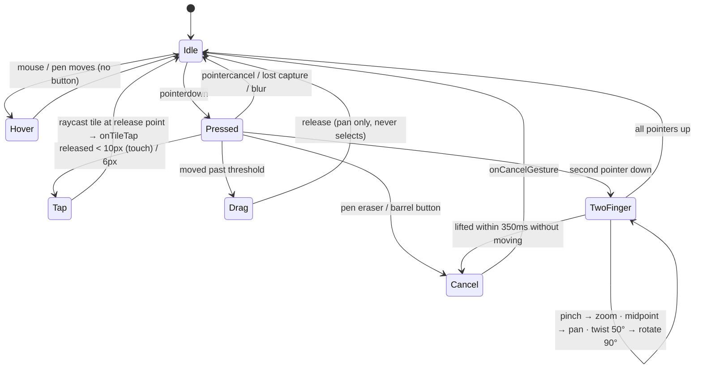
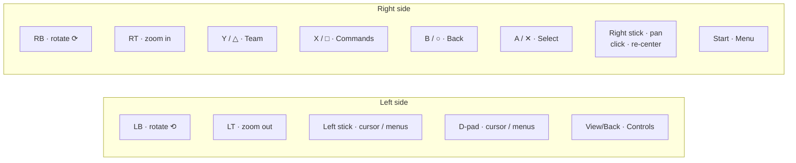
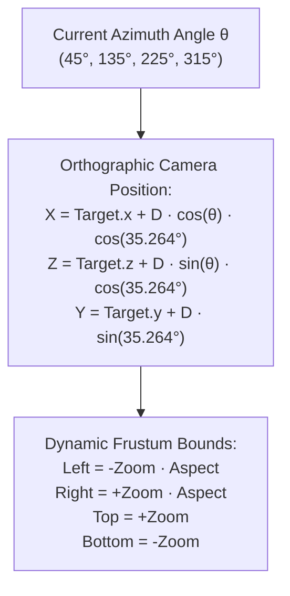
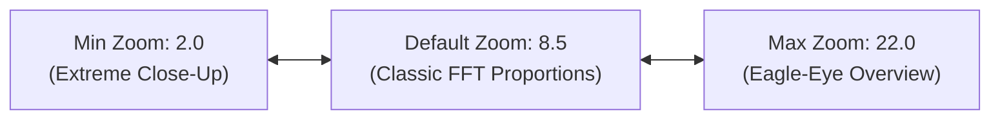

# Controls & Isometric Camera Specifications

This document outlines the camera mathematics, projection systems, and complete input mapping for **Chess RPG Tactics**.

---

## 1. Input Controls Reference Matrix (0.8.0)

Every action is reachable from **mouse, keyboard, touch, pen and controller**. All five feed one dispatcher in `src/main.ts` (`handleDirection`, `handleConfirm`, `cancelAction`). Canvas gestures live in `TacticsScene.setupInteractions()` (Pointer Events), controller polling in `src/input/GamepadInput.ts`, and menu focus movement in `src/input/FocusNav.ts`. The in-game **Controls** screen (`H`, the ? button, or View/Back on a controller) lists all of this and puts the card for your current input first.

| Action | Mouse / trackpad | Keyboard | Touch | Pen | Controller |
| :--- | :--- | :--- | :--- | :--- | :--- |
| Select tile / unit | Click | Arrows + `Enter`/`Space` | Tap | Tap | D-pad / left stick + **A** |
| Preview tile | Hover | Arrows | Tap | Hover | D-pad / left stick |
| Cancel / back | `CANCEL` / × buttons | `Esc` | Two-finger tap | Eraser or barrel button + tap | **B** |
| Command menu | Click | `1` Move · `2` Act · `3` Wait · `4`/`T` Auto · `5`/`I` Item · `1` again = Undo move | Tap | Tap | **X**, then d-pad + **A** |
| Move between menu buttons | — | Arrows, `Tab` | — | — | D-pad / left stick |
| Pan camera | Left-drag, right/middle-drag | `W` `A` `S` `D` | One-finger drag | Drag | Right stick |
| Zoom | Wheel, trackpad pinch | `+` / `-` | Pinch | — | **LT** out / **RT** in |
| Rotate 90° | Rotate buttons | `Q` / `E` | Two-finger twist (50°) | Rotate buttons | **LB** / **RB** |
| Re-center on active unit | Center button | `R` / `Home` | Center button | Center button | Click right stick (**R3**) |
| Team (jobs & gear) | Team button / STATUS | `J` | Team button | Team button | **Y** |
| Battle log | Log button | `L` | Log button | Log button | via Menu |
| Menu (map, sound, graphics, battle speed, save, load, Workshop) | Menu button | — | Menu button | Menu button | **Start** |
| Controls help | ? button | `H` / `?` | ? button | ? button | **View / Back** |
| World map: go to a place | Click it | Arrows to it, `Enter` | Tap it | Tap it | D-pad to it, **A** |
| World map: act there (march, shop, enter) | Panel button | `Enter` (focus lands on it after the walk) | Panel button | Panel button | **A** |

Notes:
* **Arrow keys and the d-pad are context-aware.** With a menu, modal, forecast or facing picker open (or a HUD button focused), they move focus between buttons. Otherwise they move the tile cursor. "Up" moves along the grid axis that points toward the top-right of the screen for the current camera angle.
* **Confirming on your own active unit** (Enter / A) while idle jumps focus into its command menu.
* A drag never counts as a tap: pointers must move less than 10px (touch) or 6px (mouse/pen) to select.
* The canvas sets `touch-action: none`, so the page itself never scrolls or browser-zooms during gestures. Interrupted gestures (`pointercancel`, lost capture, window blur) reset cleanly.
* Controllers use the standard Gamepad mapping (Xbox, PlayStation, Switch Pro, 8BitDo…). Held directions repeat after 320ms every 110ms. Crits and boss enrage trigger a short rumble where the browser supports it.
* Hotkey badges on the command buttons appear only while you're using a keyboard; the dialogue hint says "Tap", "Press A" or "Press Enter" to match your input.
* Modals trap `Tab`, restore focus when closed, and every HUD control has a visible gold focus ring.
* **The world map (0.15) is one more focus layer.** Its places are real buttons laid over the painted map, so arrows and the d-pad move between places and the top bar by position, the same way they move between menu buttons. After the squad walks somewhere, focus lands on that place's main action. The camera keys do nothing there.

### Workshop controls (0.10.0)

| Action | Mouse / touch / pen | Keyboard | Controller |
| :--- | :--- | :--- | :--- |
| Apply the current tool | Tap / click a tile | Arrows move the cursor, `Enter` applies | D-pad + **A** |
| Brush stroke (raise, lower, level, paint, block) | Drag across tiles (one undo step) | — | — |
| Pan while editing | Right/middle-drag, two fingers, or set *Drag on the map: Pans* | `W` `A` `S` `D` | Right stick |
| Move around the panel | Tap | `Tab`, arrows, `Enter` | **X** to enter the panel, d-pad + **A** |
| Leave the panel for the map | Tap the map | `Esc` | **B** |
| Close the Workshop | × button | `Esc` from the map | **B** from the map |
| Undo / redo | ↶ ↷ buttons | `Ctrl+Z` / `Ctrl+Y` (or `Ctrl+Shift+Z`) | ↶ ↷ buttons |
| Hide / show the panel | ▾ button | — | ▾ button |

Values are changed with ◀ ▶ steppers and segmented buttons rather than dropdowns or number fields, so a controller never needs a text cursor. Only names and dialogue need typing. On desktop the panel runs down the left side and the camera frustum shifts so the map stays centred in the free space; on phones it's a bottom sheet and the camera buttons move above it.

## 1b. Responsive Layout (0.8.0)

| Screen | Layout |
| :--- | :--- |
| Desktop (> 1100px) | Turn order top-left, Team/Log/Controls/Menu top-right, camera cluster on the right above the command menu, unit card bottom-left, tile info bottom-center. |
| Tablet / small laptop (≤ 1100px) | Tile info moves under the turn order; Team screen goes two-column. Icon-only top bar at ≤ 900px. |
| Phone portrait (≤ 700px) | Command bar across the bottom (thumb reach), unit card stacked above it, turn order as its own row, actions / forecast / log as bottom sheets, every modal full-screen. |
| Phone landscape (≤ 520px tall) | Unit card bottom-left, command rail bottom-right, camera row bottom-center, side sheets for actions and log. |

All edges respect iPhone/Android safe areas (`viewport-fit=cover`, `env(safe-area-inset-*)`), heights use `dvh`, and touch screens get 44px minimum targets. Portrait screens fit the camera zoom to the screen *width*, so phones see the whole battlefield instead of a narrow slice.

---

## 1c. How gestures are recognised

`TacticsScene.setupInteractions()` tracks every active pointer itself, so mouse, touch and pen share one state machine:

## 1d. Controller layout

| Constant (`GamepadInput.ts`) | Value | Meaning |
| :--- | :---: | :--- |
| `DEADZONE` | 0.5 | Stick travel needed to count as a direction |
| `PAN_DEADZONE` | 0.18 | Right-stick travel before panning |
| `REPEAT_DELAY` | 320ms | Hold before a direction starts repeating |
| `REPEAT_RATE` | 110ms | Repeat interval while held |

---

## 2. Orthographic Isometric Camera Mathematics

### Isometric Angles
* **Pitch Angle**: Fixed at $\arcsin(\tan(30^\circ)) \approx 35.264^\circ$. This preserves authentic 2:1 isometric tile proportions without geometric distortion.
* **Azimuth Rotation ($\theta$)**: Starts at $45^\circ$ ($\frac{\pi}{4}$ rad). Rotating left adds $\frac{\pi}{2}$; rotating right subtracts $\frac{\pi}{2}$.
* **Interpolation**: Camera rotation is updated every frame via exponential smoothing:
  $$\theta_{t} = \theta_{t} + (\theta_{\text{target}} - \theta_{t}) \times 0.16$$

---

## 3. Zoom Frustum Specifications

The camera view frustum is computed using:

$$\text{Half Height} = \text{Zoom Level}$$
$$\text{Half Width} = \text{Zoom Level} \times \frac{\text{Viewport Width}}{\text{Viewport Height}}$$

(On portrait screens the two are swapped so the shorter side sets the scale.) While the Workshop is open, the frustum is also shifted by the panel's share of the screen, so the map is centred in the space left beside a side panel or above a bottom sheet.

* **At Zoom 2.0**: The screen height captures only 4 world units, bringing character sprites up to hundreds of pixels tall, displaying retro pixel art details, weapon hilts, and facial profiles clearly.
* **At Zoom 8.5**: The minimum starting zoom. When a map loads, the camera centres on it and starts at `max(8.5, 0.62 × the longer side)`, about 9.9 for the 16×16 maps and 14.9 for a 24×24 Workshop map, so the whole field fits with breathing room.
* **At Zoom 22.0**: The entire map and surrounding backdrop fit comfortably inside any display aspect ratio.

---

## 4. World-Space Camera Pan Vectors

When dragging the mouse or pressing panning keys, the pan vectors are calculated relative to the camera's current rotation angle $\theta$:

$$\hat{u}_{\text{right}} = (-\sin \theta, \; 0, \; \cos \theta)$$

$$\hat{u}_{\text{forward}} = (-\cos \theta, \; 0, \; -\sin \theta)$$

$$\vec{T}_{\text{new}} = \vec{T}_{\text{target}} + \Delta x \cdot \hat{u}_{\text{right}} \cdot \text{scale} + \Delta y \cdot \hat{u}_{\text{forward}} \cdot \text{scale}$$

This guarantees that pressing **`W`** or dragging upward moves the view forward on the screen regardless of which 90° angle the camera is rotated to.
