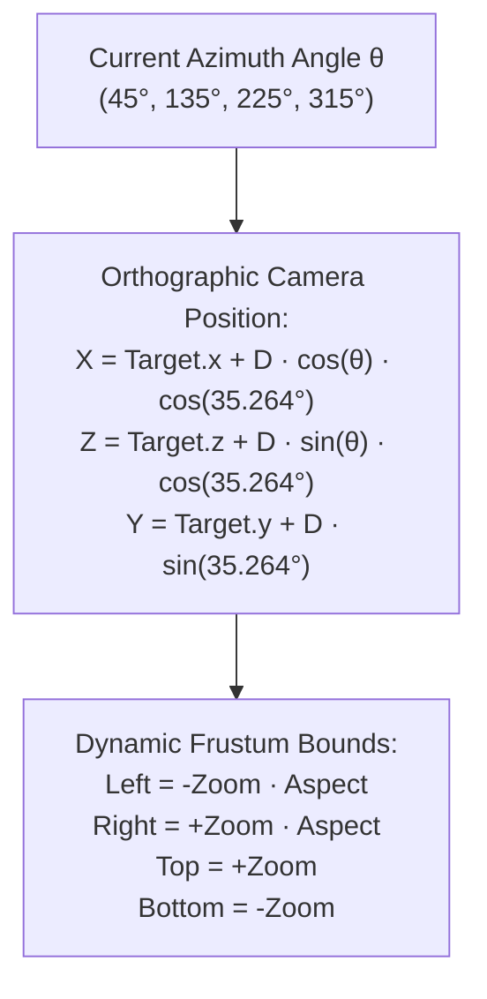
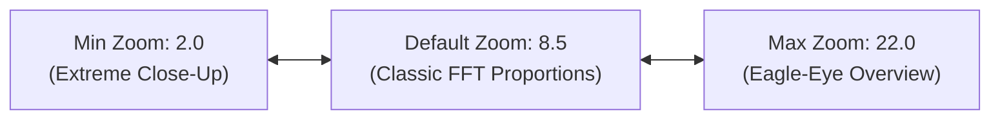

# Controls & Isometric Camera Specifications

This document outlines the camera mathematics, projection systems, and complete input mapping for **Chess RPG Tactics**.

---

## 1. Input Controls Reference Matrix

| Category | Input / Trigger | Action | Behavior & Context |
| :--- | :--- | :--- | :--- |
| **Camera Rotation** | **`Q`** key / `⟲ Q` button | Rotate $+90^\circ$ (Counter-Clockwise) | Smoothly pivots isometric view to the next quadrant. |
| **Camera Rotation** | **`E`** key / `⟳ E` button | Rotate $-90^\circ$ (Clockwise) | Smoothly pivots isometric view to the previous quadrant. |
| **Zoom In** | **Mouse Wheel Up** / **`+`** / **`=`** / `+` button | Zoom In (Macro View) | Extends camera down to `2.0` zoom level for close-up pixel art inspection. |
| **Zoom Out** | **Mouse Wheel Down** / **`-`** / **`_`** / `-` button | Zoom Out (Overview) | Expands camera up to `22.0` zoom level for broad tactical map view. |
| **Camera Pan** | **Right-Click Drag** / **Middle-Click Drag** | Pan Camera in World Space | Translates camera target smoothly across the terrain. |
| **Camera Pan** | **`W`** / **`S`** / **`A`** / **`D`** or **Arrow Keys** | Keyboard Camera Pan | Moves camera target forward, backward, left, or right. |
| **Camera Reset**| **`R`** / **`Home`** key | Center Camera on Active Unit | Glides camera focus directly onto the unit currently taking its turn. |
| **Tile Selection**| **Hover Cursor** | Highlight & Snap Cursor | Snaps 3D cursor bracket to terrain height level $(x, z, h)$. |
| **Inspection** | **Left-Click on Unit** (Idle mode) | Inspect Unit Card | Smoothly focuses camera on selected unit and updates HUD stats. |
| **Movement** | **Left-Click on Blue Tile** | Execute Move | Steps unit to valid path tile within Move and Jump constraints. |
| **Targeting** | **Left-Click on Red Tile** | Open Battle Forecast | Displays Hit %, Expected Damage, and Facing Advantage badge. |
| **Cancel** | **`Escape`** key / `CANCEL` button | Cancel Targeting / Submenu | Exits targeting mode and restores command menu. |

---

## 2. Orthographic Isometric Camera Mathematics

### Isometric Angles
* **Pitch Angle**: Fixed at $\arcsin(\tan(30^\circ)) \approx 35.264^\circ$. This preserves authentic 2:1 isometric tile proportions without geometric distortion.
* **Azimuth Rotation ($\theta$)**: Starts at $45^\circ$ ($\frac{\pi}{4}$ rad). Rotating left adds $\frac{\pi}{2}$; rotating right subtracts $\frac{\pi}{2}$.
* **Interpolation**: Camera rotation is updated every frame via exponential smoothing:
  $$\theta_{t} = \theta_{t} + (\theta_{\text{target}} - \theta_{t}) \times 0.16$$

---

## 3. Zoom Frustum Specifications

The camera view frustum is computed using:

$$\text{Half Height} = \text{Zoom Level}$$
$$\text{Half Width} = \text{Zoom Level} \times \frac{\text{Viewport Width}}{\text{Viewport Height}}$$

* **At Zoom 2.0**: The screen height captures only 4 world units, bringing character sprites up to hundreds of pixels tall, displaying retro pixel art details, weapon hilts, and facial profiles clearly.
* **At Zoom 8.5**: The screen balances the tactical 11x11 battlefield with ample breathing room, mirroring the PS1/PSP *War of the Lions* aesthetic.
* **At Zoom 22.0**: The entire map and surrounding backdrop fit comfortably inside any display aspect ratio.

---

## 4. World-Space Camera Pan Vectors

When dragging the mouse or pressing panning keys, the pan vectors are calculated relative to the camera's current rotation angle $\theta$:

$$\hat{u}_{\text{right}} = (-\sin \theta, \; 0, \; \cos \theta)$$

$$\hat{u}_{\text{forward}} = (-\cos \theta, \; 0, \; -\sin \theta)$$

$$\vec{T}_{\text{new}} = \vec{T}_{\text{target}} + \Delta x \cdot \hat{u}_{\text{right}} \cdot \text{scale} + \Delta y \cdot \hat{u}_{\text{forward}} \cdot \text{scale}$$

This guarantees that pressing **`W`** or dragging upward moves the view forward on the screen regardless of which 90° angle the camera is rotated to.
