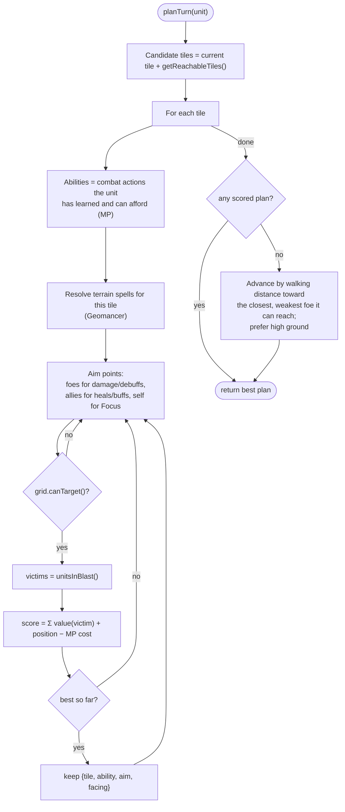

# Enemy AI (and AUTO)

`planTurn(unit, units, grid, opts)` in `src/core/EnemyAI.ts` decides a whole turn (options: `noRevive`, `caution`, `pouch`, see 0.31 below, `holdBack`, 0.45, and `zone` / `guardZone`, 0.48 and 0.53): where to stand, what to use, what to aim at, and which way to face. It's team-agnostic, so the same planner plays enemy turns and the player's **AUTO** command.

---

## 1. Search

The planner is exhaustive. Maps are 16×16 (Workshop maps up to 24×24), squads are 4–6 units, and a unit can only reach the tiles within its Move, so it simply tries everything.

Roughly *tiles × abilities × aim points*: about 30 × 5 × 6 ≈ 900 forecasts per turn, well under a millisecond each. The unit's position is moved temporarily for each candidate tile and always restored in a `finally` block.

---

## 2. Scoring

All values come from **forecasts** (expected values). The planner never rolls dice.

| Situation | Score per victim | Why |
| :--- | :--- | :--- |
| Damage | `min(damage, HP left) / maxHP × 100 × hit%` | Value is the *share* of HP removed, so chip damage on a healthy unit never beats finishing a wounded one |
| Likely KO (damage ≥ HP left) | `+120 × hit%` (+40 more on a boss) | Removing a unit is worth far more than damage |
| The target is a healer or buffer (0.20) | damage × 1.3, KO +30 more | `isSupportCaster()`: a heal, a raise, or Haste / Protect / Shell / Regen for others that it can still pay for and isn't silenced. Drop the medic first |
| Frontal physical blow on a Weapon Guard knight (0.20) | hit% × 0.7 | Weapon Guard parries 30% of frontal physical blows, so the side or back scores higher |
| Dual Wield | damage × 1.9 | Second strike |
| Damage that also inflicts a status | `+15 × hit%` if the target doesn't have it yet | |
| Pure Sleep | `55 × hit%` | Takes a unit out of the fight until someone hits it |
| Pure Haste / Slow | `45 × hit%` if not already applied | Tempo swings |
| Other pure statuses (Protect, Immobilize, Poison, Focus, Blind, Silence, Breach) | `35 × hit%` if not already applied | |
| Regen | `25 × hit%`, only if the ally is below 80% HP | |
| Shell / area Focus (Rally) | `15` / `18 × hit%` | Help less than a blow |
| Area buffs and debuffs | × 0.6 per victim | A buff aimed where it's needed beats a blanket |
| Protect, Shell or Focus with no foe within 5 tiles | skipped | Don't armour up miles from the fight |
| Ailment the target's gear guards against | skipped | It would be wasted |
| Silence on a unit with no MP abilities | skipped | |
| Cleanse | `+25` per ailment removed (`+40` for Sleep or Silence) | |
| Drain | `+ min(drained, HP missing) / maxHP × 60 × hit%` | Prefers draining when hurt |
| Hitting a sleeping unit | −10 | It wakes up |
| Steal | never chosen | The AI has nowhere to put stolen gear; Steal is the player's |
| Heal | `healed / maxHP × 100 × 1.3` (+20 on a boss), only if the ally is missing ≥ 25% HP | No wasted heals |
| Physical attack into Counter Tackle | −8 | Avoid feeding counters |

Then each plan gets small adjustments:

| Term | Value |
| :--- | :--- |
| High ground | `+0.5 × tile height` |
| Ending next to 2+ foes | −6 |
| MP spent | `−0.15 × MP cost` |
| Self-only buff (Bulwark, Focus) (0.20) | `−0.6 × walking distance to the nearest foe`, so it is cast on the way in |
| A performance (song or dance) (0.22) | ×1.4: it plays again on the next turns. Aimed at the performer's own tile, never range-checked |
| A Master signature (0.23) | −30: once a battle, so it waits for a group or a target that matters (only player units have them, so this shapes AUTO) |
| A grand summon (0.24) | ×0.7: it lands next turn and its targets can move. Cinderwing scores its heal and its raises together, and counts against the enemy raise cap |
| Standing where a foe's grand summon will land (0.24) | −30 per call (−50 on the fallback walk), so units get clear of the marked area |
| Still performing (0.22): moving, or any other action | −12 each, so a song isn't dropped for a small gain; with nothing worth doing, the performer stays put instead of advancing |

### Thinking a turn ahead (0.31)

`threatMap()` estimates, for every tile, how much damage the foes could do to the unit there on their next turns: each foe's best damaging action against it (expected damage × hit%, Dual Wield ×1.9), counted on every tile within that action's range (+ area) of anywhere the foe can walk to. Sleeping foes don't count, Immobilized ones strike only from where they stand, and foes this plan will likely KO (expected damage ≥ HP left at ≥ 70% hit) are **spared**: killing the knight that would have killed you is the point of two-ply thinking.

| Caution | Who | Effect on a plan's score |
| :--- | :--- | :--- |
| `false` | Enemies on Easy | None: the 0.30 planner |
| `'light'` | Enemies on Normal and in the Workshop | Only once the unit is **below half HP**: −30 (−45 for a healer or a boss) where the threat would likely finish it (threat ≥ HP after the action, counting a heal on itself) |
| `'full'` | Enemies on Hard; **AUTO** for your units | Always: the same −30 for a likely fall, otherwise `−threat / maxHP × 15`; the no-action walk also weighs the threat (×0.4 when below 40% HP), so a hurt unit with nothing to do hangs back |

A trade is still taken when it's worth more than the risk: a likely KO on a healer (+150) beats −45.

### Items (0.31)

Enemies may carry a **pouch** (`core/EnemyPouch.ts`), shown on their card as 🎒 with a count:

| | Easy | Normal | Hard |
| :--- | :---: | :---: | :---: |
| Bosses | — | Potion | Potion ×2 |
| Chemists | — | Potion ×2, Remedy | Potion ×2, Remedy, Phoenix Feather, Blast Flask (Lv 6+) |
| Everyone else (not monsters) | — | every third enemy: Potion | Potion |

Potions become Hi-Potions from level 9. Items are scored like the matching ability (a heal only when the ally is missing ≥ 25% HP, a feather like a raise, counting against the side's raise cap), **−6** so they're kept for when they matter. What fallen enemies never used is **salvaged** after a victory, up to the stack limit. AUTO never spends the squad's supplies.

Every plan ends **facing the closest foe** (0.20), the one most likely to strike next, so the unit doesn't leave its back open after moving. For a melee attack that foe is the target anyway.

### Walking distance (0.20)

`walkingDistances(grid, from, unit)` runs Dijkstra outward from a foe over walkable tiles, with steps no higher than the unit's Jump and water or swamp costing 2 (unless it has Water Walk). Units are ignored, since they move. The planner uses it twice:

- **When nothing is in reach,** it picks the foe it can actually walk to (closest by path, then lowest HP) and moves to the reachable tile with the shortest path left, preferring high ground on ties. Before 0.20 this used straight-line distance, which walked units into the foot of cliffs.
- **For self-buffs,** as above.

A foe that can't be reached at all (on a cliff top) falls back to straight-line distance plus 100, so it is only chosen when nothing else is reachable.

### AUTO holds back (0.45)

The squad's AUTO plans with `holdBack`:

- **On the walk,** a spot where the unit would likely fall counts in full, even for a healthy unit. Without `holdBack`, a healthy unit with nothing in reach weighs danger at a tenth on the walk. So a deadly tile cost about the same as three tiles of progress, and AUTO walked lone squad members into the enemy to be cut down before their next turn. In the balance sim, Sable did this first in every Chapter IV battle.
- **"Likely fall"** means the average threat, times `LETHAL_MARGIN` (1.3), reaches the unit's HP. The threat map weighs each blow by its hit chance and leaves out crits and blows from behind, so a spot where the average is 97% of the unit's HP almost always kills.

Enemies don't use `holdBack`: their caution stays as the difficulty sets it, and they keep pressing forward.

### Earthworks (0.54)

`scoreWorks` values a Sapper's barricade by the extra walking steps it costs each foe that could reach the ally beside it next turn (4 when it seals the ally off; ×1.5 for a hurt or spell-casting ally; at most 24). Raised ground is worth 10 under an ally who shoots or casts from 3 or more with a foe in reach, and nothing elsewhere: at first it scored under any ally, and the Sapper spent most turns raising ground that its allies walked off (ADR 0059). Undermine and Blasting Charge are scored as attacks.

### Hold zones: the squad rushes, the enemy guards (0.53)

With a Hold objective (`zone`, 0.48) a unit's walk heads for the zone first and the foes second, and it likes ending a turn on the zone (+20). Since 0.53 the enemy plans with `guardZone`: neither applies to it, so it fights as it would in any battle and the squad has to clear whoever happens to stand there. When both sides wanted the zone, every defender at Chapter II-B's gate walked off the walls and into it, and the chapter fell from 51% to 20% in the sim (19% when only units already on the zone stayed). Cinder Spring didn't move either way, and its 24 timeouts at Lv 6 went away.

---

## 3. Guarantees (covered by tests)

| Rule | Test in `tests/core.test.ts` |
| :--- | :--- |
| Damage never targets the caster's own team | `moves in and attacks a player in reach` |
| Finishes a wounded unit before chipping a healthy one | `prefers finishing a wounded foe` |
| Never buffs the player's units; heals wounded allies | `never casts buffs on the player team and heals wounded allies` |
| Never picks an ability it can't afford | `does not use abilities it cannot afford` |
| Walks around a cliff; water costs double; Water Walk ignores it | `tests/ai.test.ts`: `walking distance` |
| Ends its turn facing the closest foe | `tests/ai.test.ts`: `ends its turn facing the closest foe` |
| Heads for the gap instead of hugging a cliff | `tests/ai.test.ts`: `approaches along the path` |
| Values a frontal blow on a parrying knight less | `tests/ai.test.ts` |
| Shoots the unit that can still heal, given two identical targets | `tests/ai.test.ts` |
| AUTO doesn't spend a signature on a foe an ordinary blow finishes, but uses Meteor on a group | `tests/signatures.test.ts` |
| A Bard beside wounded allies sings, centred on itself; a performer still playing holds its ground, but breaks off for a clearly better blow | `tests/performers.test.ts` |
| Walks out of the area a foe's grand summon is about to land on; a veteran Summoner calls a grand summon on a crowd; never raises past the cap | `tests/summons.test.ts` |
| Threat map: marks a foe's reach, ignores sleepers, spares foes about to fall; a hurt archer shoots from out of reach (light and full caution); light caution leaves a healthy unit's plan unchanged | `tests/smarter-enemies.test.ts` |
| Drinks a Potion when hurt with nothing to hit, keeps it when healthy; a Phoenix Feather respects the raise cap; salvage stops at the stack limit | `tests/smarter-enemies.test.ts` |
| AUTO (`holdBack`) won't walk a healthy unit into a deadly spot with nothing to hit; without it, it walks on | `tests/hold-back.test.ts` |
| With `guardZone`, a unit walks as if there were no zone; without it, it heads for the zone | `tests/story-ground.test.ts` |
| A Sapper walls off a foe from a hurt ally in a corridor, raises ground under an engaged archer, never under a foe | `tests/sapper.test.ts` |

---

## 4. How enemies are built

| Layer | Source |
| :--- | :--- |
| Job, level, position | Chapter `enemyRoster` (`src/data/campaign.ts`) or `buildTrialFloor()` |
| Boss | `isBoss` → `JobSystem.makeBoss()`: +60% HP, +15% ATK/MAG, enrage at 50% HP |
| Monster (0.26) | A monster job: every action from level 1, no gear, innate statuses and immunities (`data/monsters.ts`) |
| Pouch (0.31) | `enemyPouch()` by difficulty, job, boss and roster position (see *Items* above) |
| Veteran kit (level ≥ 4) | Every action in their job (grand summons from level 6, 0.24), plus a job reaction/support (Knight parry, White Mage auto-potion, Black Mage Arcane Strength, Ninja Dual Wield, Dragoon Dragonheart, Geomancer Earthen Ward) |

---

## 5. Known limits

| Limit | Effect | Idea |
| :--- | :--- | :--- |
| One-turn horizon, plus a threat estimate (0.31) | Avoids walking into a likely KO and drinks a Potion when hurt, but doesn't set up combos with allies | Two-ply search on the best N plans. *Tried and shelved in 0.38:* scoring terms for teamwork (Breach and Slow worth more when allies can follow up, focus fire, softening a foe for an ally to finish) made no measurable difference in the balance sim, even at three times the weight ([ADR 0045](adr/0045-per-ability-effects.md)) |
| Knows only Counter Tackle and Weapon Guard (0.20) | Other reactions (Field Dressing, Auto-Potion) don't change its choices | Add terms as they matter |
| One raise per battle for the enemy side (0.17) | The first healer to act takes it, whoever fell | Let the planner hold it for the most valuable unit |
| Raises the fallen whenever it can (0.16) | A revive scores 110 + 2 × the fallen unit's level, about the same as a likely kill, so a healer with MP nearly always does it | Weigh the fallen unit's job and how exposed the tile is |
| AUTO never uses your items (0.31) | Enemies use their pouches, but AUTO won't spend the squad's supplies | An opt-in setting |
| Faces the closest foe, not the most dangerous one (0.20) | An archer two tiles further away may still get the back | Weigh each foe's damage, not just distance |
| The threat map is an estimate (0.31) | It ignores heights, facing and that foes rarely all converge on one unit. For AUTO a 1.3 margin covers crits and back attacks (0.45) | Count only the two strongest threats, or simulate their turns |

These are tracked on the [roadmap](ROADMAP.md).
