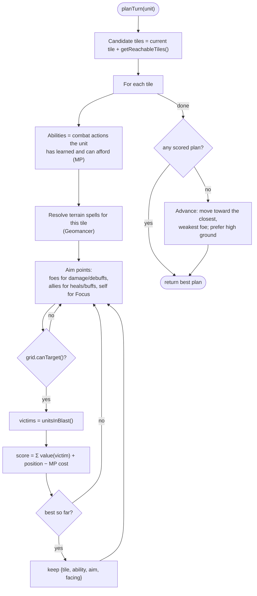

# Enemy AI (and AUTO)

`planTurn(unit, units, grid)` in `src/core/EnemyAI.ts` decides a whole turn: where to stand, what to use, what to aim at, and which way to face. It's team-agnostic, so the same planner plays enemy turns and the player's **AUTO** command.

---

## 1. Search

The planner is exhaustive. Maps are 16×16 (Workshop maps up to 24×24), squads are 4–6 units, and a unit can only reach the tiles within its Move, so it simply tries everything.

Roughly *tiles × abilities × aim points*: about 30 × 5 × 6 ≈ 900 forecasts per turn, well under a millisecond each. The unit's position is moved temporarily for each candidate tile and always restored in a `finally` block.

---

## 2. Scoring

All values come from **forecasts** (expected values). The planner never rolls dice.

| Situation | Score per victim | Why |
| :--- | :--- | :--- |
| Damage | `min(damage, HP left) / maxHP × 100 × hit%` | Value is the *share* of HP removed, so chip damage on a healthy unit never beats finishing a wounded one |
| Likely KO (damage ≥ HP left) | `+120 × hit%` (+40 more on a boss) | Removing a unit is worth far more than damage |
| Dual Wield | damage × 1.9 | Second strike |
| Damage that also inflicts a status | `+15 × hit%` if the target doesn't have it yet | |
| Pure Sleep | `55 × hit%` | Takes a unit out of the fight until someone hits it |
| Pure Haste / Slow | `45 × hit%` if not already applied | Tempo swings |
| Other pure statuses (Protect, Immobilize, Poison, Focus, Blind, Silence, Breach) | `35 × hit%` if not already applied | |
| Regen | `25 × hit%`, only if the ally is below 80% HP | |
| Shell / area Focus (Rally) | `15` / `18 × hit%` | Help less than a blow |
| Area buffs and debuffs | × 0.6 per victim | A buff aimed where it's needed beats a blanket |
| Protect, Shell or Focus with no foe within 5 tiles | skipped | Don't armour up miles from the fight |
| Ailment the target's gear guards against | skipped | It would be wasted |
| Silence on a unit with no MP abilities | skipped | |
| Cleanse | `+25` per ailment removed (`+40` for Sleep or Silence) | |
| Drain | `+ min(drained, HP missing) / maxHP × 60 × hit%` | Prefers draining when hurt |
| Hitting a sleeping unit | −10 | It wakes up |
| Steal | never chosen | The AI has nowhere to put stolen gear; Steal is the player's |
| Heal | `healed / maxHP × 100 × 1.3` (+20 on a boss), only if the ally is missing ≥ 25% HP | No wasted heals |
| Physical attack into Counter Tackle | −8 | Avoid feeding counters |

Then each plan gets small adjustments:

| Term | Value |
| :--- | :--- |
| High ground | `+0.5 × tile height` |
| Ending next to 2+ foes | −6 |
| MP spent | `−0.15 × MP cost` |

---

## 3. Guarantees (covered by tests)

| Rule | Test in `tests/core.test.ts` |
| :--- | :--- |
| Damage never targets the caster's own team | `moves in and attacks a player in reach` |
| Finishes a wounded unit before chipping a healthy one | `prefers finishing a wounded foe` |
| Never buffs the player's units; heals wounded allies | `never casts buffs on the player team and heals wounded allies` |
| Never picks an ability it can't afford | `does not use abilities it cannot afford` |

---

## 4. How enemies are built

| Layer | Source |
| :--- | :--- |
| Job, level, position | Chapter `enemyRoster` (`src/data/campaign.ts`) or `buildTrialFloor()` |
| Boss | `isBoss` → `JobSystem.makeBoss()`: +60% HP, +15% ATK/MAG, enrage at 50% HP |
| Veteran kit (level ≥ 4) | Every action in their job, plus a job reaction/support (Knight parry, White Mage auto-potion, Black Mage Arcane Strength, Ninja Dual Wield, Dragoon Dragonheart, Geomancer Earthen Ward) |

---

## 5. Known limits

| Limit | Effect | Idea |
| :--- | :--- | :--- |
| One-turn horizon | Doesn't set up combos or retreat to heal | Two-ply search on the best N plans |
| Ignores enemy reactions except Counter Tackle | Will hit a Weapon Guard knight from the front | Add expected-parry and counter terms |
| Doesn't value facing after moving | Can leave its back open | Score exposed backs against foes that can reach |
| AUTO uses the same weights | Plays aggressively for the player | Optional "careful" profile for AUTO |

These are tracked on the [roadmap](ROADMAP.md).
