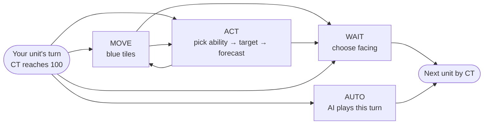
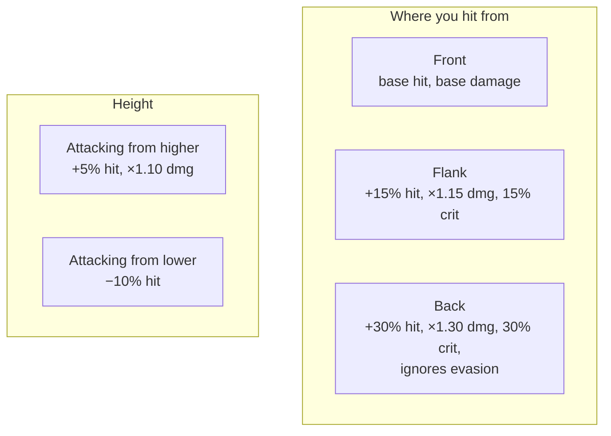
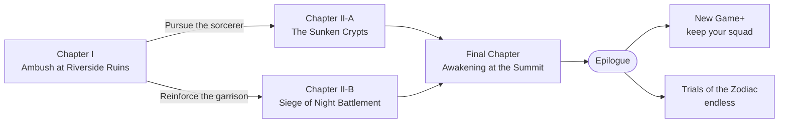
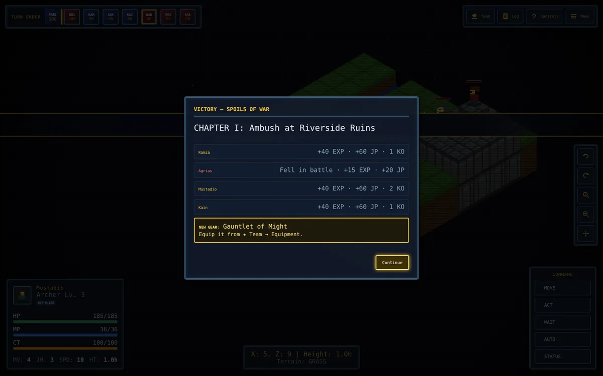
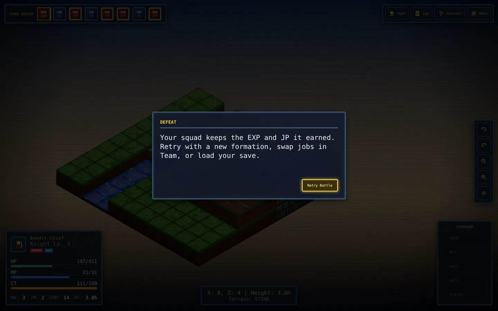
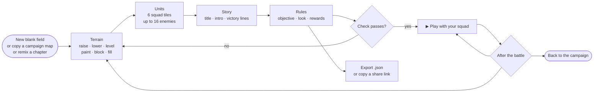

# Gameplay Guide

Everything a player needs: how a battle works, the campaign, the Trials, the Workshop, and tips. Exact numbers live in the [Content Reference](CONTENT_REFERENCE.md).

---

## 1. A battle in one picture

| Command | What it does | Tip |
| :--- | :--- | :--- |
| **MOVE** | Walk up to *Move* tiles; climb steps up to *Jump* height | Water and swamp cost 2 Move |
| **ACT** | Attack or use an ability; a **forecast** shows hit %, damage, facing and how many units an area spell catches | Spell *damage* ignores facing; physical hits from the back deal +30% |
| **WAIT** | End the turn and choose which way to face | Face the enemy: back attacks crit far more often |
| **AUTO** | The AI plays this unit's turn | Great for grinding the Trials |
| **STATUS** | Opens this unit's jobs and gear | |

**Turn order is by speed, not by team.** A turn where you only move *or* only act leaves CT at 20, and doing neither leaves it at 40, so you act again sooner. The turn-order strip shows the next 8 turns.

**What you see when you act:** every element has its own effect, so you can read a fight at a glance. Heals, buffs and ailments wrap the unit itself: it greys and regains its colour when healed, turns green when poisoned, trails after-images when Hasted.

---

## 2. Positioning

* **Bows and spells** need line-of-height: each ability has a height tolerance.
* **Area spells** (Fire, Blizzard, Thunder, Dragon Breath, Earth Slash) hit every foe within 1 tile; the edges take 60%. They never hit your own units.
* **Geomancers** change spell with the ground: stand on swamp for poison, on wood for fire, on grass to root a target in place. [Full table](CONTENT_REFERENCE.md#geomancy-terrain-spells).

---

## 3. The campaign

| Chapter | Battlefield | Boss | Joins you | You earn |
| :--- | :--- | :--- | :--- | :--- |
| I | Riverside Ruins | Bandit Chief | — | Gauntlet of Might, plus your branch reward |
| II-A | Gloomy Mire | Arch-Warlock | Bria (Geomancer) | Gaia Staff |
| II-B | Night Battlement | Dragoon Commander | Bria (Geomancer) | Crystal Helm |
| Final | Zodiac Summit | Zodiac Champion | — | Zodiac Blade, Zodiac Ribbon, Wyrmscale Mail |

Each branch choice also adds gear to your armory the moment you pick it ([details](CONTENT_REFERENCE.md#campaign)). The game autosaves at the start of every chapter.

### Bosses
Bosses have a gold outline in the turn order and a **BOSS** badge. At half HP they **enrage**: permanent Haste and +20% damage, and Slow or Immobilize is cleansed. Save your burst for after the enrage, or burn them down from full in one round.

---

## 4. Growing your squad

* Every action earns **EXP** and **JP**; winning adds more on the **Spoils of War** screen.
* 100 EXP is a level. JP is spent per job in **Team → Jobs → Learn abilities**.
* Mix jobs: equip another job's skillset as your **secondary action**, and any learned reaction, support or movement ability in the other slots (click the slot to cycle).
* New gear appears in **Team → Equipment** as soon as you win it.

---

## 5. Losing

You keep the EXP and JP earned during a lost battle. **Retry Battle** restarts it with your current squad, or **Load Save** goes back to your last save. Swapping jobs or gear between attempts often turns a loss around.

---

## 6. Trials of the Zodiac

Unlocked after the Final Chapter.

| Rule | Value |
| :--- | :--- |
| Floors | Endless; each floor is always the same battle (seeded) |
| Enemy level | 3 + floor |
| Enemies | 4, rising to 6 |
| Boss | A **Warden** every 5th floor |
| Reward | One armory item you don't own yet, per floor |
| Record | Best floor saved on this browser |

---

## 7. Playing on any device

| Device | How |
| :--- | :--- |
| Phone (portrait) | Command bar at the bottom; tap tiles, drag to pan, pinch to zoom, twist to rotate, two-finger tap to go back |
| Phone (landscape) | Unit card left, commands right, camera buttons bottom-center |
| Tablet + pen | Hover the pen to preview tiles; eraser or barrel button to go back |
| Keyboard | Arrows + Enter; `1`–`4` for commands; `Esc` back; `H` for help |
| Controller | D-pad + A; B back; X commands; Y Team; bumpers rotate; triggers zoom |

  
  

Press **H**, the **?** button, or **View/Back** on a controller in-game for the full list.

**Graphics:** Menu → Graphics cycles Auto, High, Medium and Low. Auto uses Medium on phones and High elsewhere, and lowers itself if the game starts to stutter.

---

## 8. The Workshop: build your own battles

Menu → **Workshop**. Everything saves in this browser as you work.

| Tab | What you do there |
| :--- | :--- |
| **Terrain** | Tap tiles, or drag across them, to raise or lower them by half a step, set them to a height (Level), paint terrain or block them; Fill repaints a whole area. A drag is one stroke: each tile changes once and one undo takes it all back. Brushes: 1×1, 3×3, 5×5. Undo/redo with ↶ ↷ or Ctrl+Z / Ctrl+Y. Pan with two fingers, the right mouse button or WASD, or set *Drag on the map* to *Pans*. |
| **Units** | **Squad** tiles are where your squad deploys, in squad order (up to 6). **Enemy** places an enemy with the name, job, level, facing and boss flag set below; tap an existing enemy to select and edit it. **Erase** removes either. |
| **Story** | Title, subtitle, author, and the dialogue before the battle and after victory. Each line has a speaker, a side, a portrait (Auto uses the hero's portrait when the speaker is Rowan, Maren, Tobin, Corvin or Bria) and text. |
| **Rules** | **Rout all** enemies; **Defeat the boss** (the rest flee when it falls); or **Survive** N rounds (a round ends once every unit has had a turn). Pick the look (daylight, night, swamp, summit) and up to six reward items. |
| **File** | The check, your library, new blank fields (8–24 tiles a side), copies of campaign maps and chapters, export/import `.json`, and **share links**: anyone who opens the link gets the scenario in their Workshop. |

**Rules of thumb for good scenarios:** keep 4–6 tiles of open ground between the squad and the first enemies; give archers and mages high ground to fight over; make at least one route melee units can walk (the check warns you otherwise); a single boss with 3–4 escorts at the squad's level is a fair fight.

**Controls:** tap or click tiles with the tool you picked. With a keyboard, Tab into the panel and use arrows and Enter; Esc steps back to the map, where arrows move the cursor and Enter applies the tool. On a controller, **B** steps out to the map, **A** applies the tool, **X** jumps back into the panel. On phones the panel is a bottom sheet; ▾ collapses it.

  
  

Workshop battles use your real squad, which keeps any EXP, JP and reward gear, but they never change your campaign progress or save slot.

---

## 9. Tips

1. **Face your enemies when you WAIT.** Back attacks are +30% damage with a 30% crit chance.
2. **Take the high ground** with archers and mages.
3. **Kill order matters more than damage.** The enemy AI focuses whoever it can finish, and so should you.
4. **Give Knights Weapon Guard and keep them facing forward.** Parries only work from the front.
5. **Don't bunch up** against Black Mages: area spells hit everything within 1 tile.
6. **Haste your best hitter.** An extra turn beats almost any single spell.
7. **Use AUTO** to speed through easy Trial floors, then take over for Warden floors.
