# Gameplay Guide

Everything a player needs: how a battle works, the campaign, the Trials, the Workshop, and tips. Exact numbers live in the [Content Reference](CONTENT_REFERENCE.md).

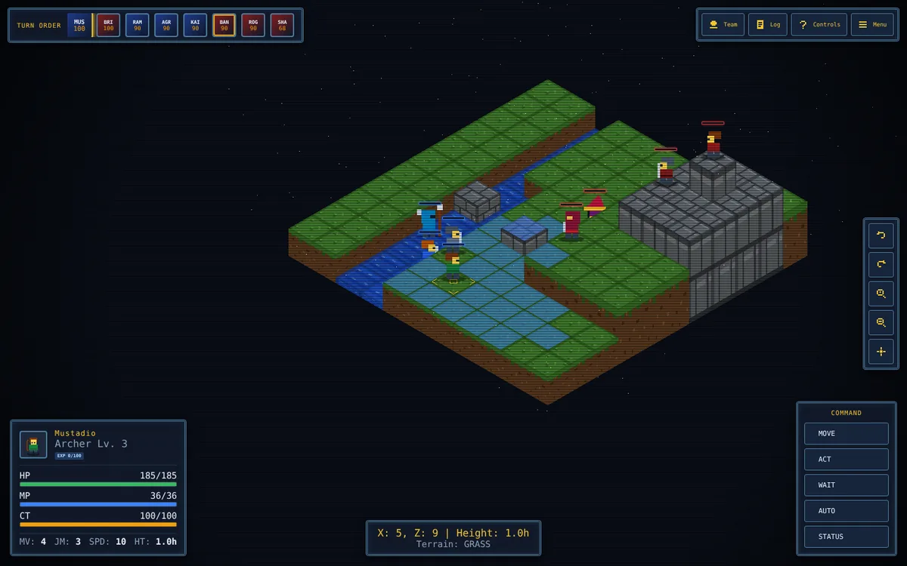

---

## 1. A battle in one picture

| Command | What it does | Tip |
| :--- | :--- | :--- |
| **MOVE** | Walk up to *Move* tiles; climb steps up to *Jump* height. Until the unit acts, the button reads **UNDO** and takes the move back | Water and swamp cost 2 Move |
| **ACT** | Attack or use an ability; a **forecast** shows hit %, damage, facing and how many units an area spell catches | Spell *damage* ignores facing; physical hits from the back deal +30% |
| **ITEM** | Use a supply instead of acting: heal, restore MP, cure ailments, raise a fallen ally, or throw a Blast Flask. Items never miss | A Potion heals the same in anyone's hands, so let your fighters carry the healing |
| **WAIT** | End the turn and choose which way to face | Face the enemy: back attacks crit far more often |
| **AUTO** | The AI plays this unit's turn | Great for grinding the Trials |
| **STATUS** | Opens this unit's jobs and gear | |

**New to this?** The first time each thing comes up, a short tip explains it. Tips never stop the game, and **Skip tips** turns them off (**Controls → Show tips again** brings them back). **Menu → Battle speed: Fast** halves the pauses once you know your way around, and **Menu → Text size** makes menus, panels and the log larger (Large or Larger).

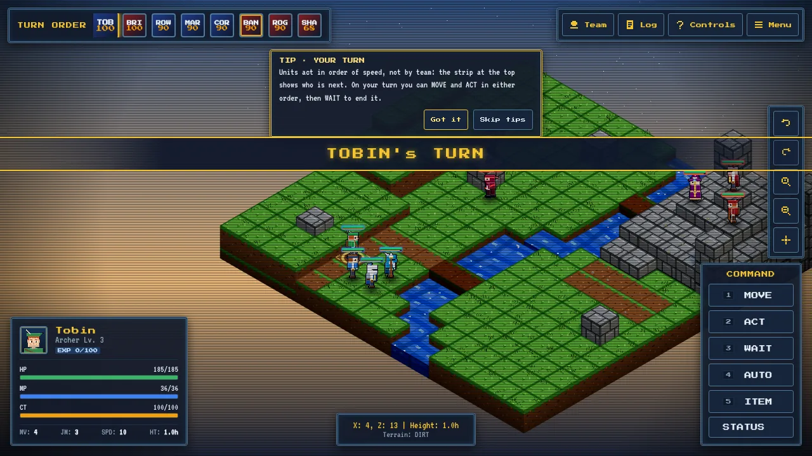

**Turn order is by speed, not by team.** A turn where you only move *or* only act leaves CT at 20, and doing neither leaves it at 40, so you act again sooner. The turn-order strip shows the next 8 turns.

**What you see when you act:** every element has its own effect, so you can read a fight at a glance. Heals, buffs and ailments wrap the unit itself: it greys and regains its colour when healed, turns green when poisoned, trails after-images when Hasted.

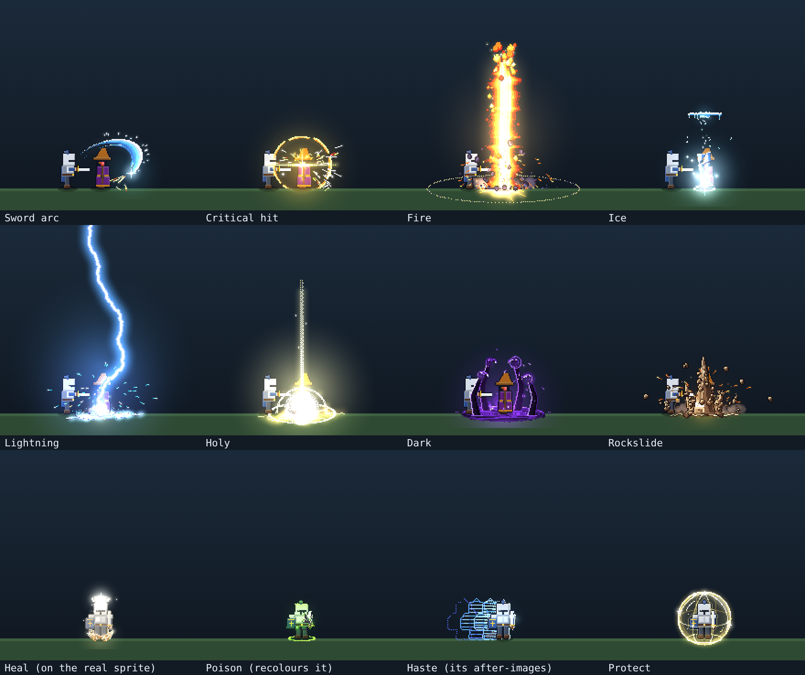

---

## 2. Positioning

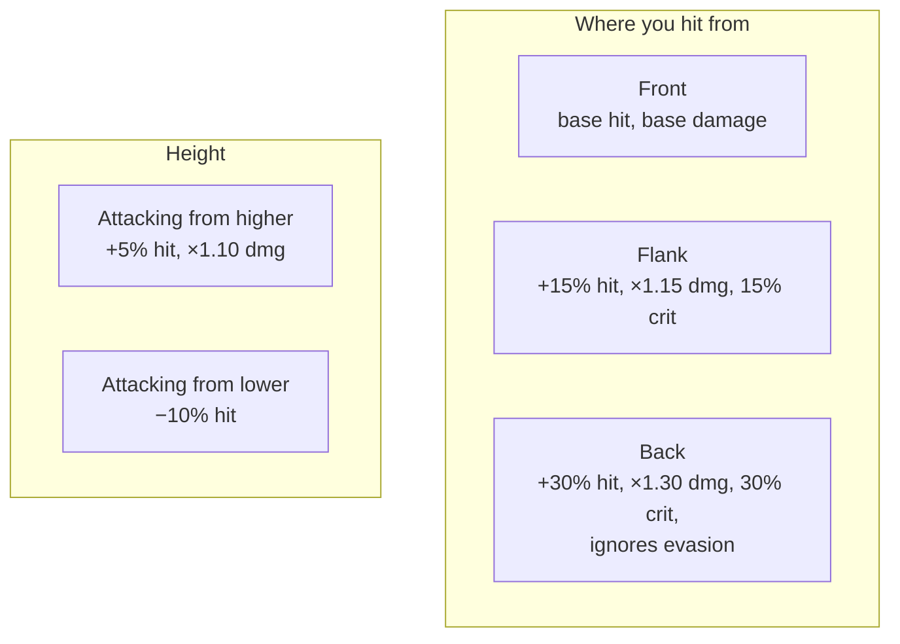

* **Bows and spells** need line-of-height: each ability has a height tolerance.
* **Area spells** (Fire, Blizzard, Thunder, Dragon Breath, Earth Slash) hit every foe within 1 tile; the edges take 60%. They never hit your own units.
* **Grand summons** (0.24) land a turn late: the area pulses with stripes (orange for an enemy's call) until the caller's next turn. Step out, or knock out, sleep or silence the caller to break it. Yours do the same to them.
* **Geomancers** change spell with the ground: stand on swamp for poison, on wood for fire, on grass to root a target in place. [Full table](CONTENT_REFERENCE.md#geomancy-terrain-spells).

---

## 3. The campaign

```mermaid
flowchart LR
    C1["Chapter I<br/>Ambush at Riverside Ruins"] -->|"Pursue the sorcerer"| C2a["Chapter II-A<br/>The Sunken Crypts"]
    C1 -->|"Reinforce the garrison"| C2b["Chapter II-B<br/>Siege of Night Battlement"]
    C2a --> C3["Chapter III<br/>Awakening at the Summit"]
    C2b --> C3
    C3 --> C4["Chapter IV<br/>Fire on the Water"]
    C4 --> C5["Chapter V<br/>The Greywatch Light"]
    C5 --> C6["Chapter VI<br/>The Drowned Regent"]
    C6 -->|"Take ship for the Far Shore"| C7["Chapter VII<br/>The Saltglass Shore"]
    C7 --> C8["Chapter VIII<br/>Frostfang Pass"]
    C8 --> C9["Chapter IX<br/>The Pale Heir"]
    C9 --> E(["Epilogue"])
    E --> NG["New Game+<br/>keep your squad"]
    E --> TR["Trials of the Zodiac<br/>endless"]
```

| Chapter | Battlefield | Boss | Joins you | You earn |
| :--- | :--- | :--- | :--- | :--- |
| I | Riverside Ruins | Bandit Chief | — | Gauntlet of Might, plus your branch reward |
| II-A | Gloomy Mire | Arch-Warlock | Bria (Geomancer) | Gaia Staff |
| II-B | Night Battlement | Dragoon Commander | Bria (Geomancer) | Crystal Helm |
| III | Zodiac Summit | Zodiac Champion | — | Zodiac Blade, Zodiac Ribbon, Wyrmscale Mail |
| IV | Emberwick Harbor | Captain Varrow | Sable (Thief) | Oathkeeper, plus Moonfang for marching |
| V | Greywatch Isle | Tidecaller Maelis | — | Runeblade, plus a Warding Amulet for marching |
| VI | Stormbreak Cape | The Drowned Regent | — | Dawnbringer, plus Templar Mail for marching |
| VII | Saltglass Shore | Herald Isaine | Kestrel (Beast Tamer) | Saltglass Blade, plus a Frostfang Mail for marching |
| VIII | Frostfang Pass | Marshal Hale | — | A Pale Pearl for marching |
| IX | The Drowned City | The Pale Heir | — | The Tidecrown (a relic) |

**Act II** (Chapters IV to VI) is one road with bigger fights, and each battlefield asks something different:

* **Emberwick Harbor:** the sea can't be crossed. Three piers lead to the corsair ship and a cross-pier joins them, so guard it or use it.
* **Greywatch Isle:** uphill all the way. The shallows on either side are slow but unwatched, and the healer by the tower door is worth reaching early.
* **Stormbreak Cape:** a chasm splits the climb. Go up one flank together, or send someone over the rope bridge.

If you finished the story before Act II existed, Chapter IV is waiting on your map and the Trials stay open.

**Act III** (0.34) crosses the sea. Once the Regent is beaten, **⛵ Sail to the Far Shore** at Emberwick Harbor; the ship lands you at the Anchorage, on a map of its own. The battlefields there have new ground:

* **Saltglass Shore:** dunes and a tidal channel. **Sand** is ordinary ground; the channel is crossed at one sandbar ford. The Court holds the old stone port in the north, and two monsters wait in the dunes and the wreck.
* **Frostfang Pass:** terraces climbing to a fort. **Snow** costs 2 movement for everyone, so keep to the road or the west ledge.
* **The Drowned City** (Chapter IX, the finale): pale streets between canals silted with weed (slow to wade), a plaza in the middle and a stair to the palace dais. The east canal has one bridge.
* Geomancers get two new spells: **Dust Devil** on sand (Blind) and **Whiteout** on snow (Slow).

Since 0.35 the ship's quartermaster at the Anchorage trades from Larkmoor Market's stock (**◆ Buy & sell**). To hire recruits, **⛵ Sail home** to Emberwick and walk to the market. Wenna the Pedlar stays in the realm. Chapter IX ends the story; the Trials and New Game+ stay open after it.

Each road also adds gear to your armory the moment you march down it ([details](CONTENT_REFERENCE.md#campaign)). The game autosaves at the start of every chapter and whenever you reach the world map.

### The world map

Between missions the squad stands on a map of the realm. Select a place to walk there along the roads; the panel beside the map says what you can do.

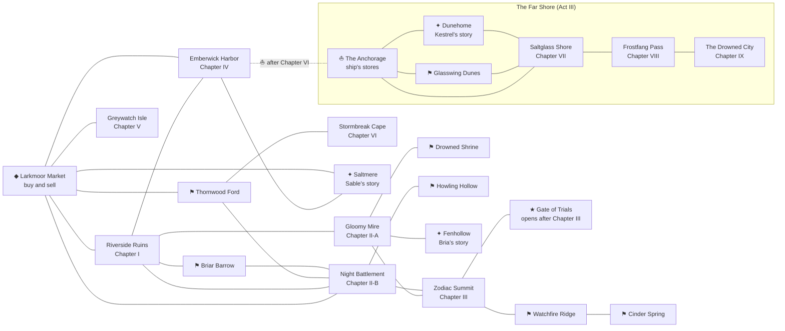

| On the map | Means |
| :--- | :--- |
| ⚔ red pin, pulsing | A battle you can march to. **March to battle** starts it |
| ✓ green pin | Won |
| 🔒 grey pin | Not open: the road you didn't take, or a place the story hasn't reached |
| ◆ Larkmoor Market | The only place to buy and sell |
| ⚑ orange pin | A **side battle**: optional, and it can be fought again |
| ✦ blue pin | A recruit's **side story** (0.43): appears once it opens, told once |
| ★ Gate of Trials | Sealed until Chapter III is won |
| 🎒 beside a pin | Wenna the Pedlar, the travelling merchant, is there |
| ⛵ harbour | Ships between Emberwick Harbor and the Anchorage on the Far Shore, once Chapter VI is won. The Anchorage also trades (0.35) |

* **The branch is a march.** After Chapter I both the Mire and the Battlement are open. Each shows its orders and the gear it brings. Marching down one closes the other for this playthrough. The Mire is the harder road (its orders say so): bog that slows you, poison, and wisps that put you to sleep. Bring Remedies.
* **Side battles** are for gil, EXP and JP, and for practice when the story gets hard. They never move the story on.

  | Place | Opens | Enemies | Goal | Trophy (first win) |
  | :--- | :--- | :--- | :--- | :--- |
  | Thornwood Ford | After Chapter I | Bandits: a trapper who hides snares (0.49), thieves, archers, brawlers | Defeat them all | Fordwarden's Bow (ATK +8, Speed +1, range 5) |
  | Drowned Shrine | After Chapter II | Cultists: mages, oracles, summoners, a necromancer (0.52) | Defeat them all | Chanting Censer (MAG +4, MP +20, no Silence) |
  | Watchfire Ridge | After Chapter II | Raiders: knights, dragoons, ninja, a sapper (0.54); in the rain (0.55) | Hold out for 6 rounds | Watchfire Helm (HP +40, no Sleep or Blind) |
  | Howling Hollow | After Chapter I | Monsters: wolves, a wyvern, oozes, wisps, a stone brute, a bog lurker (0.51) | Defeat them all | Wolfpelt Mantle (HP +25, Evasion +6, Move +1, no Poison) |
  | Briar Barrow (0.32) | After Chapter III | Monsters: bone knights, a basilisk, thornlings, a wisp, a frost sprite (0.51); in fog (0.55) | Defeat them all | Basilisk Eye (HP +15, MAG +4, Speed +1, no Immobilize or Slow) |
  | Glasswing Dunes (0.35, Far Shore) | After Chapter VII | Monsters: a wyvern, a basilisk, thornlings, jackals, a golem, a drowned sentry (five of them, not four) | Defeat them all | Glasswing Lance (ATK +14, Speed +1, Jump +1, range 2) |
  | Cinder Spring (0.48) | After Chapter IV | Ashen Zealots: an Ember Shaman, a pyromancer, monks, knights, archers, an emberback (0.51) (four, starting on the spring) | Hold the spring for 3 rounds, or defeat them all | Cinderwalk Charm (HP +20, MAG +3, Evasion +3, unharmed by embers and miasma) |

  Enemies are about your squad's level the first time and one level stronger after each win (up to two). Each win pays bounties plus 160 gil the first time and 80 after. The first win also brings the place's **trophy**, a piece of gear found nowhere else (it can't be sold).
* **Hazards and Hold** (0.48). Some ground works on whoever starts a turn on it, on either side: **embers** burn 10% of max HP, **miasma** poisons, and a **spring** heals 12% and washes Poison off. The tile panel names it. **Spells change it too** (0.50): a fire spell that hits an area leaves embers for 2 rounds, an ice spell that hits an area puts embers out for 3 (even a map's own), and Poison Cloud leaves miasma for 2. A **Hold** battle marks some ground with a bright rim: end its rounds with your squad on it and no foe on it (they needn't be in a row), or defeat every enemy. The rim turns green while you hold it, red while the enemy does. Enemies don't rush the ground: they fight as usual, so clear whoever stands on it.
* **Ground in the story** (0.53). The Gloomy Mire (II-A) has the warlock's miasma by his shrine, and a clean spring on the middle island. At Emberwick Harbor (IV) the end of the west pier and a warehouse on the quay are burning. **Chapter II-B is a Hold battle:** take Night Battlement's gate and hold it, with the ground just outside, for 3 rounds, or defeat them all. Its defenders dug **traps** on the approach: like a Ranger's, you won't see them until someone walks into one. Since 0.56 the later chapters have theirs too: **Greywatch Isle (V)** is a Hold battle on the terrace under the lighthouse; a well runs clean in the middle of **Stormbreak Cape (VI)**; the **Saltglass Shore (VII)** has white-hot glass on the sand and two buried traps; a hot spring steams on the road in **Frostfang Pass (VIII)**; and the **Drowned City (IX)**'s flooded flanks are full of miasma.
* **Weather** (0.55). A badge under the turn order names it; hover it for what it does. **Rain:** fire hits 25% softer and lightning 25% harder, and nothing burns. **Snow:** ice hits 25% harder and fire 15% softer, and everyone moves 1 less. **Fog:** a blow from more than 2 tiles away is 15 points less likely to land. Stormbreak Cape (VI) is fought in the rain and Frostfang Pass (VIII) in the snow; Watchfire Ridge has rain and Briar Barrow fog; Trials floors bring weather from floor 5; the Workshop's Rules tab sets it for your own battles. Bring lightning to the rain and ice to the snow, and close in when it's foggy.
* **Side stories** (0.43) are your story recruits' own chapters, at their home villages. One appears on the map once its recruit is in your squad and the story has moved on far enough. The recruit always fights it, taking a place in the party. It's told once per playthrough: a written battle with its own scenes, enemies at about your squad's level (never below a floor, the boss one level up), the usual bounties, and a **relic** of its own.

  | Place | Whose | Opens | Fight | Relic |
  | :--- | :--- | :--- | :--- | :--- |
  | Fenhollow | Bria | After Chapter III | The Mire Mother, an armour-eating ooze, with oozes, wisps and a thornling, on the spring | Fenhollow Spring-Stone (MAG +5, MP +20, HP +10, no Poison or Sleep) |
  | Saltmere | Sable | After Chapter V | First Mate Grell, a gunner, and the rest of Varrow's old crew, on the quay | Saltmere Coin (ATK +4, Speed +1, Evasion +8, no Blind) |
  | Dunehome (Far Shore) | Kestrel | After Chapter VII | Huntmaster Corra, a beast tamer, with trappers and a starved wolf Kestrel can win over | Dunehome Whistle (HP +20, Move +1, Jump +1, no Immobilize or Slow) |

  Each is won by defeating its boss; the rest flee. New Game+ tells them again.
* **Monsters** (0.26) fight differently from people. They wear no gear and know all their tricks from the start ([full table](CONTENT_REFERENCE.md#monsters)):

  | Monster | What to expect | Answer |
  | :--- | :--- | :--- |
  | Dire Wolf | Fast, hits hard, Lunges from 2 tiles; Pack Howl gives the pack Focus | Knights up front; Slow them |
  | Wyvern | Flies over walls and cliffs; Tail Sting poisons; can't be Immobilized | Remedies; archers |
  | Bog Ooze | Tough, regenerates, its Acid Touch opens armor (Breach) and Engulf holds you in place | Burst it down; spells |
  | Marsh Wisp | Frail at range but sends you to Sleep (Lure) and drains life | Rush it; it can't be poisoned or slept |
  | Stonehide Brute | Slow, starts behind Protect; Ground Pound hits everyone next to it | Don't crowd it; fight it from range |
  | Basilisk (0.32) | Heavy and hard to hurt; Stone Gaze roots you from 4 tiles, Dread Stare Slows; can't be Immobilized or Blinded | Spread out; Remedies; gang up on it |
  | Bone Knight (0.32) | Hits hard, Shield Bash Slows, Grave Chill hits a small area; no Poison, Sleep or Blind | Plain damage, and lots of it |
  | Thornling (0.32) | Regenerates; Thorn Lash poisons from 3 tiles, Pollen Cloud Blinds, Bramble Burst roots everyone next to it | Burst it down before it mends; don't crowd it |
  | Emberback (0.51) | Flame Spit and Kindle leave the ground burning; it basks in embers, which heal it | Ice puts the embers out; fight it off burning ground |
  | Frost Sprite (0.51) | Flies; Frost Bolt from 4 tiles, Rime Burst Slows; its cold puts out burning ground; no Slow, Sleep or Poison | Frail: rush it or shoot it |
  | Bog Lurker (0.51) | Tough; Venom Spit poisons and leaves miasma, which heals it; Drag Under holds you in place | Keep it off its miasma; Remedies |

  They live at the Howling Hollow (the last three at the Briar Barrow; a Basilisk and a Bone Knight also turn up in Act II since 0.33), turn up on Trials floors from 3 on (the Barrow's from 8), and from Chapter II every story battle has one or two (the squad warns you about them before the fight).
* **Tame them** (0.28). A **Beast Tamer** (Archer Lv 2 and Chemist Lv 2) can win a monster over with **Tame**, 2 tiles away. Wear it down first: an unhurt monster gives in 15% of the time, one nearly down up to 90%, and more if it's asleep (**Soothe** puts beasts to sleep easily) or you're behind it. Bosses can't be tamed. A tamed monster fights for you at once, under your orders. If it's still standing when you win, it **joins the squad** with a name of its own. Beasts know all their moves and never change jobs, but they level up like anyone; release one at the Barracks if you need the room. They wear only **beast gear** (0.29): barding on the body and a collar or charm, sold on the market's last shelf. Each new beast arrives in a Leather Collar. **Beast Lore** (+25% damage to monsters) is worth learning for anyone.
* **Wenna the Pedlar** follows the squad around the realm. Once the first battle is won she sets up beside a won battlefield or a side-battle camp, and moves on after every win. She sells two things: a piece the market won't stock until after the next chapter (early, for a quarter more), and one of her own goods that nobody else sells. Walk to her pin to buy.
* **Camp.** After each story battle the squad makes camp, and the panel offers **Sit by the fire**: a short talk between the squad, once per playthrough, worth 30 JP to everyone. Once you've seen one, **📖 Memories by the fire** (0.39) lists every camp night this save has seen, in story order, even from earlier playthroughs, to watch again (no JP the second time).
* **Team**, **Save** and **Menu** (sound, graphics, battle speed, load, the Workshop, title screen) are in the top bar. Team works everywhere; buying and selling only at the market.
* **Continue** on the title screen puts you back on the map where you stood.
* A brand-new game opens straight on Chapter I; the map appears once that battle is over.

### Bosses
Bosses have a gold outline in the turn order and a **BOSS** badge. At half HP they **enrage**: permanent Haste and +20% damage, and Slow or Immobilize is cleansed. Save your burst for after the enrage, or burn them down from full in one round.

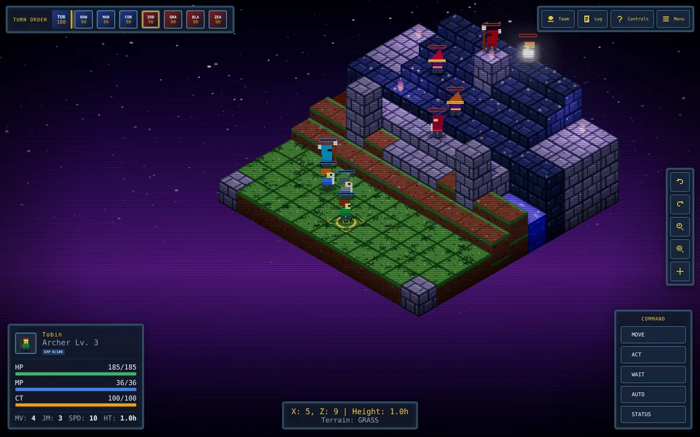

---

## 4. Growing your squad

* Every action earns **EXP** and **JP**; winning adds more on the **Spoils of War** screen.
* 100 EXP is a level. JP is spent per job in **Team → Jobs → Learn abilities**.
* **Master a job for a permanent bonus.** At job level 5 a unit earns a small bonus from that job and at level 8 (Master) a bigger one, and keeps it in every job: +25 HP from Squire, +2 ATK from Archer, +2 Speed from Time Weaver and so on ([full table](CONTENT_REFERENCE.md#job-mastery)). Bonuses from different jobs add up, so a well-travelled unit is stronger everywhere.

  

* **Jobs level up as you use them**, and job levels unlock new jobs. Open **Team → Jobs** to see every job, its level, and what a locked job (🔒) still needs. A level takes about a battle. Eleven advanced jobs, **Paladin**, **Spellblade**, **Bard**, **Dancer**, **Beast Tamer**, **Gunner**, **Dark Knight**, **Shaman**, **Ranger**, **Necromancer** and **Sapper**, each need two other jobs.
* **The Gunner** (0.36, Archer Lv 3 and Thief Lv 2) carries a gun: its shot reaches any tile in range however high or low, and high ground neither helps nor hurts it, so a gunner on the valley floor hits the archers on the cliff just as hard. Guns are the Gunner's alone: the **Flintlock Pistol** (reach 4), the **Long Musket** (reach 6) and the **Thunderlock Rifle** (reach 6, hits hardest) are on the market's weapon shelves. **Long Barrel** adds 2 to a gun's reach, and **Return Fire** shoots back at archers and casters in range. **Scattershot** hits everyone near the aim, your own side included.
* **The Dark Knight** (0.46, Knight Lv 3 and Black Mage Lv 2) pays for its techniques in HP, not MP. The menu shows each price; a technique never takes the last HP, and Silence can't stop it. **Soul Rend** drinks back most of what it deals, **Black Oath** buys Haste, and **Vengeance** makes it most dangerous below half HP, striking back at anyone next to it. **Blood Pact** halves every price. It fights with a sword or spear in heavy armor, with no shield.
* **The Shaman** (0.47, White Mage Lv 3 and Geomancer Lv 2) plants **totems** on the field. Each stands for 3 of the Shaman's turns and works on whoever starts a turn within 2 tiles of it, and once on everyone in reach when it goes down: **Mending** heals allies, **Warding** gives them Protect, **Binding** Slows foes and **Storm** strikes them with lightning. To plant one, pick a tile to see its reach, then pick it again. A Shaman keeps two at once, and they fade if it falls. Plant Binding or Storm where foes must stand to reach you, and Mending where your front line holds.
* **The Necromancer** (0.52, Black Mage Lv 3 and Oracle Lv 2) works with the fallen. While it acts, foes' bodies show ☠. **Raise Thrall** stands one up on your side with 40% of its HP for 3 of its turns; then it crumbles to dust and can't be raised again. **Corpse Burst** blows a body up, hurting everyone next to it (and using the body up). Pick a body to see the reach, then pick it again. **Dark Pact** makes thralls stronger and longer-lived. Bosses can't be raised. Beware enemy Necromancers: they can raise your fallen against you (they come back after the battle).
* **The Sapper** (0.54, Chemist Lv 3 and Geomancer Lv 2) reshapes the battlefield. **Barricade** puts a wooden wall on an empty tile for 3 rounds: nobody can walk through it, but arrows and spells still fly over. **Earthwork** raises a tile a step for the rest of the battle (your own too), so an archer gets high ground or a melee foe can no longer reach; it fills in water. **Undermine** hurts a foe and sinks the ground under it. **Blasting Charge** brings barricades down and leaves the ground burning. Pick a tile to see it, then pick it again. Point at a barricade to see how many rounds it has left.
* **The Ranger** (0.49, Archer Lv 3 and Thief Lv 2) hides **traps** on free ground within 3 tiles, and foes can't see them. The first foe to walk into one stops on it and is caught: a **Snare Trap** holds it (Immobilize), **Spikes** hurt, **Smoke** Blinds and **Slumber** gas puts it to sleep. A Ranger keeps three at once, and your own side walks over them safely. Put them where foes must walk to reach you: in a gap, at a bridge, in front of your mages. With **Ambush**, it also shoots whoever springs one within its reach. Enemy Rangers hide traps too; the log tells you when, but not where.
* **Spend your gil at Larkmoor Market** on the world map. Enemies pay bounties and every win pays a bonus. Gear you buy, anyone in the squad whose job can use it can equip. New stock arrives each time you win a chapter. In battle, **Team → Shop** shows the shelves but the market is closed.

  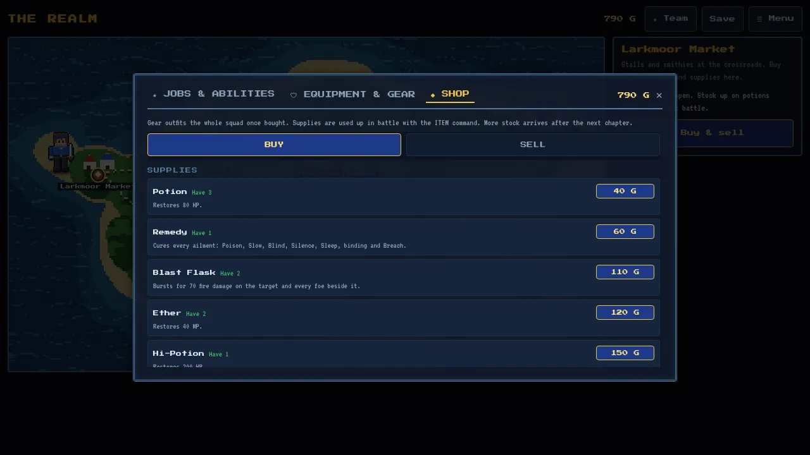

* **Hire recruits at the market** (0.25). Its recruiting board shows three hopefuls, about a level below your squad, for 200 G plus 90 a level (a quarter more for a job that needs others first). They arrive in their job with its gear, its first ability and some JP to spend. More jobs turn up on the board as the story goes on, and the board changes after every battle won.
* **Six fight; the barracks hold ten.** Once the squad has more than six, a **Choose your party** screen opens before each battle (and **Barracks** at the market lets you set it any time). Rowan leads and always goes; a story recruit fights the battle they join. Units in reserve keep everything and **train at camp** (0.37): after each win they earn half a share, +20 EXP and +30 JP in their current job, the same as a party member who fell. Survivors in the party earn +40 EXP, +60 JP and 10 EXP a KO. Hired units can be dismissed from the Barracks.
* **Sell what you don't need** at the market's SELL counter for half price. Gear someone is wearing has to come off first; the three relics are never sold.
* **Carry supplies.** Up to 9 of each, shared by the squad:

  | Supply | Price | Does | Reach |
  | :--- | ---: | :--- | :---: |
  | Potion | 40 G | Restores 80 HP | 2 |
  | Hi-Potion | 150 G | Restores 200 HP | 2 |
  | Ether | 120 G | Restores 40 MP | 2 |
  | Remedy | 60 G | Cures every ailment | 2 |
  | Phoenix Feather | 250 G | Raises a fallen ally at a quarter of their HP | 2 |
  | Blast Flask | 110 G | 70 fire damage to a target and every foe beside it | 3 |
  | Frost Flask | 160 G | 45 ice damage and Slow to a target and every foe beside it | 3 |
  | Elixir | 600 G | Restores every point of HP and MP | 2 |

  You start with 3 Potions and a Phoenix Feather. Hi-Potions, Ethers and Blast Flasks are stocked after your first victory, Frost Flasks after Chapter II and Elixirs after Chapter III.
* **Chemists make supplies go further.** A Chemist (open once a unit reaches Squire Lv 2) heals for free with Salve, cures with Purge, burns armour with Acid Flask and blinds a group with Smoke Bomb. Its support ability **Pharmacology**, which any unit can equip once learned, makes every item it uses 50% stronger and reach a tile further.
* **Master a job for its signature.** At job level 8 (Master) a unit earns that job's signature: a big action marked ★ in the ACT menu, usable in any job, once per battle, for no MP. A Monk master's Final Fist, a Geomancer's Earthquake or a Time Weaver's Chrono Surge (Haste for everyone near) can turn a fight. Team → Jobs names each job's signature next to its mastery bonus.
* **Bards and Dancers perform.** A Bard (Archer Lv 2 and White Mage Lv 2) sings: Battle Hymn, Mending Air and Quickening Ballad strengthen, heal or haste every ally within 2 tiles. A Dancer (Thief Lv 2 and Monk Lv 2) dances: Blade Waltz cuts, Veil of Silks blinds and Leaden Reel slows every foe within 2. A song or dance **plays again by itself at the start of the performer's next three turns** (♪ on the unit card) as long as they hold their ground: moving, or doing anything else, ends it. Park a Bard behind your front line, or send a Dancer into the middle of the enemy and keep her there.
* **A fallen ally isn't lost.** A ✝ marker with their name stays where they fell. Stand within 2 tiles, choose **ITEM → Phoenix Feather** and pick that tile. They rise with no statuses and wait for their next turn. A **White Mage** can learn **Raise**, which does the same from 3 tiles for 18 MP and brings them back with a third of their HP.
* **Enemy White Mages raise their dead too**, but only one per battle. Take them down first. Bosses can never be raised.
* Mix jobs: equip another job's skillset as your **secondary action**, and any learned reaction, support or movement ability in the other slots (click the slot to cycle).
* New gear appears in **Team → Equipment** as soon as you win it.
* **Each job has its own gear** (0.30). Weapons go by type, and shields, heavy armor and helms, and robes belong to some jobs: a Knight carries swords or spears, a shield and plate; a Black Mage, a staff or rod and a robe; a Monk, knuckles. Light clothes, caps, hats, circlets and every accessory suit anyone. **Team → Jobs** shows what each job can use, and **Team → Equipment** greys out what this unit can't wear, with who can. Changing job takes off what the new job can't use and puts on the best piece you own that it can ([full table](CONTENT_REFERENCE.md#equipment-rules)).
* **Thieves steal.** Put a Thief next to an enemy and use *Steal*: the piece of gear it takes goes straight into your armory (best from the side or behind; bosses hold on tight). It's the fastest way to get gear early.
* **Watch the statuses**: pips above each unit's HP bar (round = buff, square = ailment) and named badges on the unit card. Ailments: Poison, Slow, Immobilize, **Blind** (misses blows), **Silence** (no MP abilities), **Sleep** (loses turns until hit) and **Breach** (takes more physical damage). Buffs: Haste, Protect, Focus, **Shell** (takes less spell damage) and **Regen**. *Purify* (White Mage) and *Chakra* (Monk) clear every ailment.
* Some gear has a **trait**: the Verdant Charm gives Regen all battle, rods boost one element, and circlets and bangles ward off ailments. Read the item text in Team → Equipment.

---

## 5. Difficulty and saves

**Difficulty** is chosen when you start a new game, and can be changed any time from **Menu → Difficulty** (it applies from the next battle).

| | Enemy levels | Bosses | Enemy raises per battle | Enemy items (0.31) | Enemies think ahead (0.31) |
| :--- | :---: | :---: | :---: | :---: | :---: |
| **Easy** | one lower | 30% less HP | none | none | no |
| **Normal** | as designed | as designed | one | bosses, Chemists, every third enemy | once below half HP |
| **Hard** | one higher | 15% more HP | two | everyone (Chemists carry more) | always |

It covers story battles, side battles and the Trials; Workshop scenarios keep their author's levels.

**Saves** live in your browser, in three slots. The game saves itself to the slot you're playing at the start of each chapter and whenever you reach the world map; **Menu → Save game** saves now, to any slot. **Continue** on the title screen opens your most recent save, and **Load Game** lets you pick. To back a save up or move it to another browser or device, open **Save game** or **Load game**, choose **Export** on a slot (download the file, or copy the text), then on the other device use **Load game → Import a save…** and paste it or choose the file.

## 6. Losing

You keep the EXP and JP earned during a lost battle, and **the supplies you used in it are given back**. **Retry Battle** restarts it with your current squad, **World Map** falls back to the map (buy supplies, change jobs and gear, then march again: the battle waits), and **Load Save** goes back to your last save. Still stuck? Try a side battle or two, or set **Menu → Difficulty** to Easy.

---

## 7. Trials of the Zodiac

Unlocked once Chapter III is won. Enter at the **Gate of Trials** on the world map; after each floor choose **Next Trial** or step back out to the **World Map** to restock. New Game+ is offered at the Gate once the whole story is won.

| Rule | Value |
| :--- | :--- |
| Floors | Endless; each floor is always the same battle (seeded) |
| Enemy level | 3 + floor |
| Enemies | 4, rising to 6 |
| Boss | A **Warden** every 5th floor |
| Weather (0.55) | From floor 5, half the floors: rain, fog and snow in turn |
| Reward | One armory item you don't own yet, per floor |
| Record | Best floor saved on this browser |

---

## 8. Playing on any device

| Device | How |
| :--- | :--- |
| Phone (portrait) | Command bar at the bottom; tap tiles, drag to pan, pinch to zoom, twist to rotate, two-finger tap to go back |
| Phone (landscape) | Unit card left, commands right, camera buttons bottom-center |
| Tablet + pen | Hover the pen to preview tiles; eraser or barrel button to go back |
| Keyboard | Arrows + Enter; `1`–`4` for commands; `Esc` back; `H` for help |
| Controller | D-pad + A; B back; X commands; Y Team; bumpers rotate; triggers zoom |

  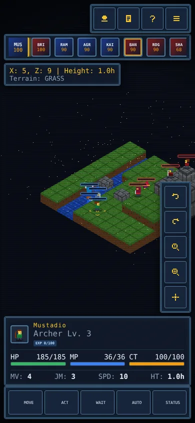
  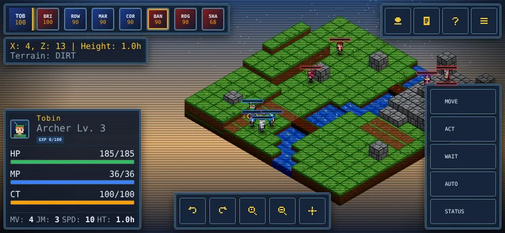

Press **H**, the **?** button, or **View/Back** on a controller in-game for the full list. **Change any of them there** (0.40): press a key or button on the list, then the new one. The cursor keys, Enter, Space, Esc, the d-pad, sticks and triggers stay fixed. Taking a key from another action gives that action your old key, so nothing is left unbound, and a controller button swaps with whichever action had it. **Reset controls to defaults** puts everything back. Bindings are kept per browser.

**Graphics:** Menu → Graphics cycles Auto, High, Medium and Low. Auto uses Medium on phones and High elsewhere, and lowers itself if the game starts to stutter.

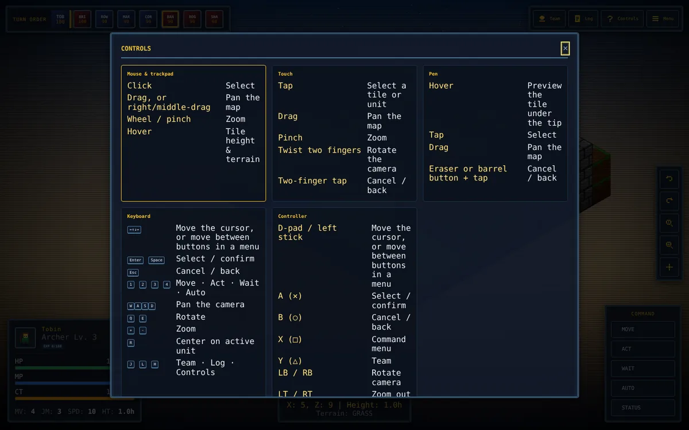

---

## 9. The Workshop: build your own battles

Menu → **Workshop**. Everything saves in this browser as you work.

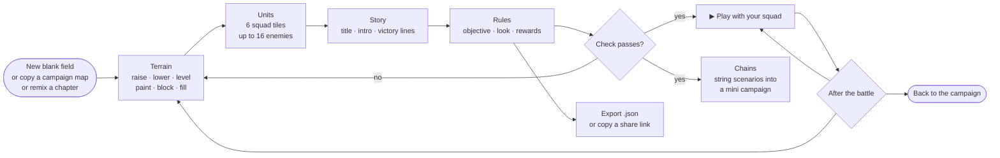

| Tab | What you do there |
| :--- | :--- |
| **Terrain** | Tap tiles, or drag across them, to raise or lower them by half a step, set them to a height (Level), paint terrain or block them; Fill repaints a whole area. **Ground** paints hazards, the hold zone, and (0.53) traps the enemy laid: its boss keeps them, and the squad can't see them in battle. A drag is one stroke: each tile changes once and one undo takes it all back. Brushes: 1×1, 3×3, 5×5. Undo/redo with ↶ ↷ or Ctrl+Z / Ctrl+Y. Pan with two fingers, the right mouse button or WASD, or set *Drag on the map* to *Pans*. |
| **Units** | **Squad** tiles are where your squad deploys, in squad order (up to 6). **Enemy** places an enemy with the name, job, level, facing and boss flag set below; tap an existing enemy to select and edit it. **Erase** removes either. |
| **Story** | Title, subtitle, author, and the dialogue before the battle and after victory. Each line has a speaker, a side, a portrait (Auto uses the hero's portrait when the speaker is Rowan, Maren, Tobin, Corvin or Bria) and text. |
| **Rules** | **Rout all** enemies; **Defeat the boss** (the rest flee when it falls); or **Survive** N rounds (a round ends once every unit has had a turn). Pick the look (daylight, night, swamp, summit) and up to six reward items. |
| **File** | The check, your library, new blank fields (8–24 tiles a side), copies of campaign maps and chapters, export/import `.json`, and **share links**: anyone who opens the link gets the scenario in their Workshop. Import and paste take chain files too. |
| **Chains** | String up to 8 scenarios into a **mini campaign**. Give it a title and opening words (shown before battle 1); add the scenario you're editing or any from your library; reorder or remove battles. A chain keeps its own copy of each battle, so later edits don't change it until you press *Update battles from the library*. Play it from the start or **continue** where you stopped: after each win the chain moves on and remembers where you are; a loss lets you retry that battle. Export it as one `.json`, or **copy a chain link** that carries every battle. |

**Rules of thumb for good scenarios:** keep 4–6 tiles of open ground between the squad and the first enemies; give archers and mages high ground to fight over; make at least one route melee units can walk (the check warns you otherwise); a single boss with 3–4 escorts at the squad's level is a fair fight.

**Controls:** tap or click tiles with the tool you picked. With a keyboard, Tab into the panel and use arrows and Enter; Esc steps back to the map, where arrows move the cursor and Enter applies the tool. On a controller, **B** steps out to the map, **A** applies the tool, **X** jumps back into the panel. On phones the panel is a bottom sheet; ▾ collapses it.

  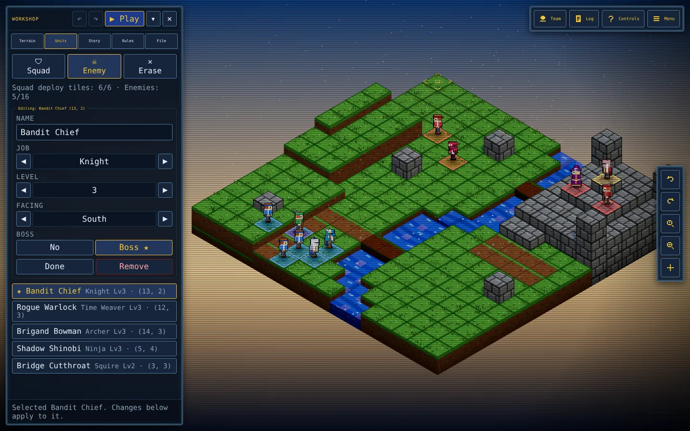
  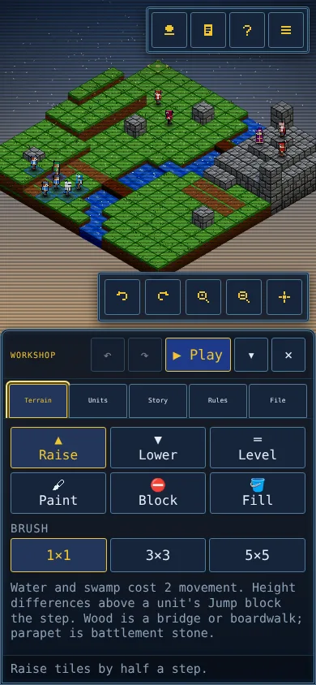

Workshop battles, chains included, use your real squad, which keeps any EXP, JP and reward gear, but they never change your campaign progress or save slot.

---

## 10. Tips

1. **Face your enemies when you WAIT.** Back attacks are +30% damage with a 30% crit chance.
2. **Take the high ground** with archers and mages.
3. **Kill order matters more than damage.** The enemy AI focuses whoever it can finish, and so should you. Since 0.31 a hurt enemy backs off or drinks a Potion (🎒 on its card shows what it carries): finish it before its turn, and you salvage what it didn't use.
4. **Give Knights Weapon Guard and keep them facing forward.** Parries only work from the front.
5. **Don't bunch up** against Black Mages: area spells hit everything within 1 tile.
6. **Haste your best hitter.** An extra turn beats almost any single spell.
7. **Use AUTO** to speed through easy Trial floors, then take over for Warden floors. AUTO never spends your supplies.
8. **Stuck? Train.** A side battle or two buys supplies and job levels, and a move you regret can be undone before you act.
9. **Pack for the fight.** Remedies for the Mire's poison, a Phoenix Feather for boss fights, and a Blast Flask to wake nothing by accident: it wakes sleeping enemies it hits.
10. **Read the stripes.** Pulsing striped tiles mean a grand summon is coming: get clear before the caller's next turn, or silence them.
