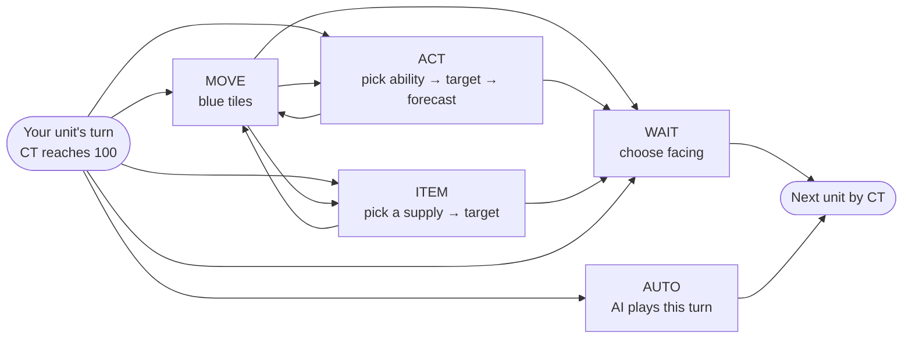
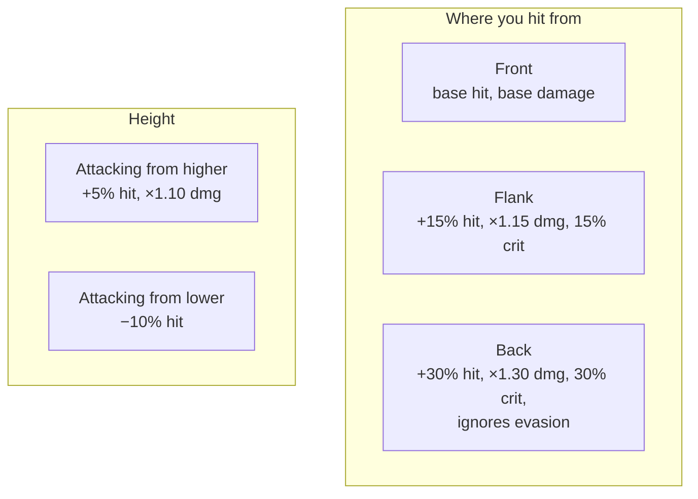
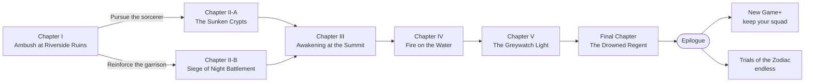
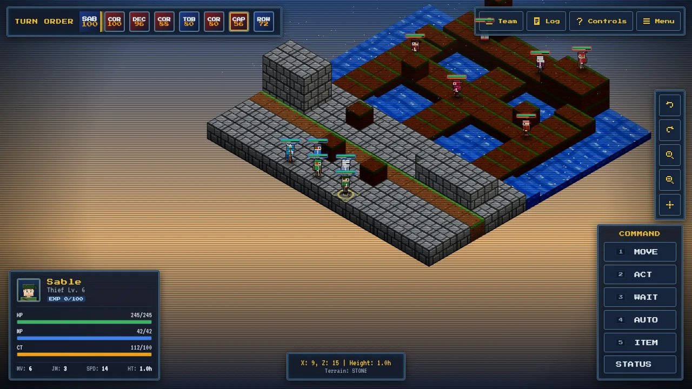
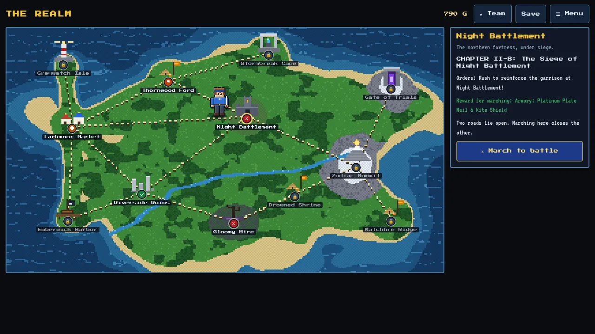
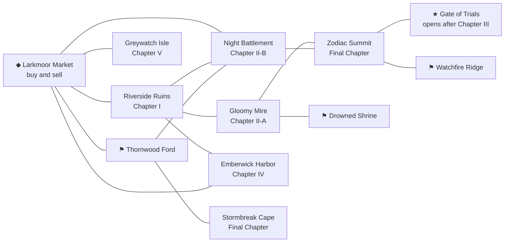
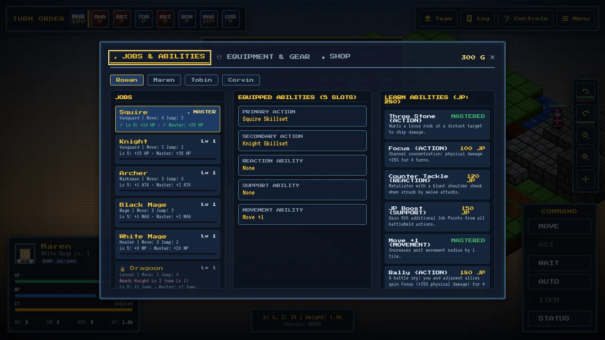
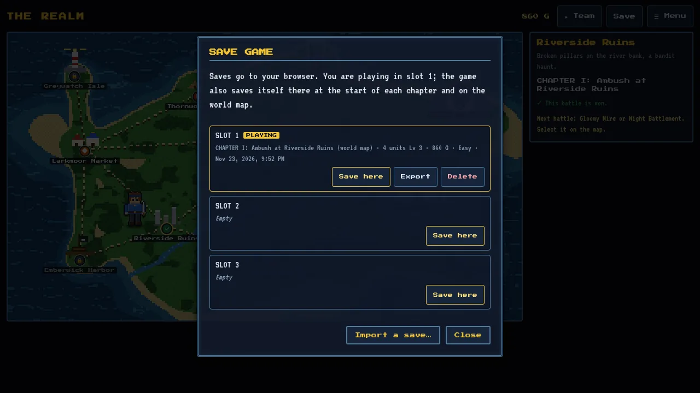

# Gameplay Guide

Everything a player needs: how a battle works, the campaign, the Trials, the Workshop, and tips. Exact numbers live in the [Content Reference](CONTENT_REFERENCE.md).

---

## 1. A battle in one picture

| Command | What it does | Tip |
| :--- | :--- | :--- |
| **MOVE** | Walk up to *Move* tiles; climb steps up to *Jump* height. Until the unit acts, the button reads **UNDO** and takes the move back | Water and swamp cost 2 Move |
| **ACT** | Attack or use an ability; a **forecast** shows hit %, damage, facing and how many units an area spell catches | Spell *damage* ignores facing; physical hits from the back deal +30% |
| **ITEM** | Use a supply instead of acting: heal, restore MP, cure ailments, raise a fallen ally, or throw a Blast Flask. Items never miss | A Potion heals the same in anyone's hands, so let your fighters carry the healing |
| **WAIT** | End the turn and choose which way to face | Face the enemy: back attacks crit far more often |
| **AUTO** | The AI plays this unit's turn | Great for grinding the Trials |
| **STATUS** | Opens this unit's jobs and gear | |

**New to this?** The first time each thing comes up, a short tip explains it. Tips never stop the game, and **Skip tips** turns them off (**Controls → Show tips again** brings them back). **Menu → Battle speed: Fast** halves the pauses once you know your way around, and **Menu → Text size** makes menus, panels and the log larger (Large or Larger).

**Turn order is by speed, not by team.** A turn where you only move *or* only act leaves CT at 20, and doing neither leaves it at 40, so you act again sooner. The turn-order strip shows the next 8 turns.

**What you see when you act:** every element has its own effect, so you can read a fight at a glance. Heals, buffs and ailments wrap the unit itself: it greys and regains its colour when healed, turns green when poisoned, trails after-images when Hasted.

---

## 2. Positioning

* **Bows and spells** need line-of-height: each ability has a height tolerance.
* **Area spells** (Fire, Blizzard, Thunder, Dragon Breath, Earth Slash) hit every foe within 1 tile; the edges take 60%. They never hit your own units.
* **Geomancers** change spell with the ground: stand on swamp for poison, on wood for fire, on grass to root a target in place. [Full table](CONTENT_REFERENCE.md#geomancy-terrain-spells).

---

## 3. The campaign

| Chapter | Battlefield | Boss | Joins you | You earn |
| :--- | :--- | :--- | :--- | :--- |
| I | Riverside Ruins | Bandit Chief | — | Gauntlet of Might, plus your branch reward |
| II-A | Gloomy Mire | Arch-Warlock | Bria (Geomancer) | Gaia Staff |
| II-B | Night Battlement | Dragoon Commander | Bria (Geomancer) | Crystal Helm |
| III | Zodiac Summit | Zodiac Champion | — | Zodiac Blade, Zodiac Ribbon, Wyrmscale Mail |
| IV | Emberwick Harbor | Captain Varrow | Sable (Thief) | Oathkeeper, plus Moonfang for marching |
| V | Greywatch Isle | Tidecaller Maelis | — | Runeblade, plus a Warding Amulet for marching |
| Final | Stormbreak Cape | The Drowned Regent | — | Dawnbringer, plus Templar Mail for marching |

**Act II** (Chapters IV to VI) is one road with bigger fights, and each battlefield asks something different:

* **Emberwick Harbor:** the sea can't be crossed. Three piers lead to the corsair ship and a cross-pier joins them, so guard it or use it.
* **Greywatch Isle:** uphill all the way. The shallows on either side are slow but unwatched, and the healer by the tower door is worth reaching early.
* **Stormbreak Cape:** a chasm splits the climb. Go up one flank together, or send someone over the rope bridge.

If you finished the story before Act II existed, Chapter IV is waiting on your map and the Trials stay open.

Each road also adds gear to your armory the moment you march down it ([details](CONTENT_REFERENCE.md#campaign)). The game autosaves at the start of every chapter and whenever you reach the world map.

### The world map

Between missions the squad stands on a map of the realm. Select a place to walk there along the roads; the panel beside the map says what you can do.

| On the map | Means |
| :--- | :--- |
| ⚔ red pin, pulsing | A battle you can march to. **March to battle** starts it |
| ✓ green pin | Won |
| 🔒 grey pin | Not open: the road you didn't take, or a place the story hasn't reached |
| ◆ Larkmoor Market | The only place to buy and sell |
| ⚑ orange pin | A **side battle**: optional, and it can be fought again |
| ★ Gate of Trials | Sealed until Chapter III is won |
| 🎒 beside a pin | Wenna the Pedlar, the travelling merchant, is there |

* **The branch is a march.** After Chapter I both the Mire and the Battlement are open. Each shows its orders and the gear it brings. Marching down one closes the other for this playthrough.
* **Side battles** are for gil, EXP and JP, and for practice when the story gets hard. They never move the story on.

  | Place | Opens | Enemies | Goal | Trophy (first win) |
  | :--- | :--- | :--- | :--- | :--- |
  | Thornwood Ford | After Chapter I | Bandits: thieves, archers, brawlers | Defeat them all | Fordwarden's Bow (ATK +8, Speed +1, range 5) |
  | Drowned Shrine | After Chapter II | Cultists: mages, oracles, summoners | Defeat them all | Chanting Censer (MAG +4, MP +20, no Silence) |
  | Watchfire Ridge | After Chapter II | Raiders: knights, dragoons, ninja | Hold out for 6 rounds | Watchfire Helm (HP +40, no Sleep or Blind) |

  Enemies are about your squad's level the first time and one level stronger after each win (up to two). Each win pays bounties plus 160 gil the first time and 80 after. The first win also brings the place's **trophy**, a piece of gear found nowhere else (it can't be sold).
* **Wenna the Pedlar** follows the squad around the realm. Once the first battle is won she sets up beside a won battlefield or a side-battle camp, and moves on after every win. She sells two things: a piece the market won't stock until after the next chapter (early, for a quarter more), and one of her own goods that nobody else sells. Walk to her pin to buy.
* **Camp.** After each story battle the squad makes camp, and the panel offers **Sit by the fire**: a short talk between the squad, once per playthrough, worth 30 JP to everyone.
* **Team**, **Save** and **Menu** (sound, graphics, battle speed, load, the Workshop, title screen) are in the top bar. Team works everywhere; buying and selling only at the market.
* **Continue** on the title screen puts you back on the map where you stood.
* A brand-new game opens straight on Chapter I; the map appears once that battle is over.

### Bosses
Bosses have a gold outline in the turn order and a **BOSS** badge. At half HP they **enrage**: permanent Haste and +20% damage, and Slow or Immobilize is cleansed. Save your burst for after the enrage, or burn them down from full in one round.

---

## 4. Growing your squad

* Every action earns **EXP** and **JP**; winning adds more on the **Spoils of War** screen.
* 100 EXP is a level. JP is spent per job in **Team → Jobs → Learn abilities**.
* **Master a job for a permanent bonus.** At job level 5 a unit earns a small bonus from that job and at level 8 (Master) a bigger one, and keeps it in every job: +25 HP from Squire, +2 ATK from Archer, +2 Speed from Time Weaver and so on ([full table](CONTENT_REFERENCE.md#job-mastery)). Bonuses from different jobs add up, so a well-travelled unit is stronger everywhere.

  

* **Jobs level up as you use them**, and job levels unlock new jobs. Open **Team → Jobs** to see every job, its level, and what a locked job (🔒) still needs. A level takes about a battle. Two advanced jobs, **Paladin** and **Spellblade**, each need two other jobs.
* **Spend your gil at Larkmoor Market** on the world map. Enemies pay bounties and every win pays a bonus. Gear you buy, the whole squad can equip. New stock arrives each time you win a chapter. In battle, **Team → Shop** shows the shelves but the market is closed.

  

* **Sell what you don't need** at the market's SELL counter for half price. Gear someone is wearing has to come off first; the three relics are never sold.
* **Carry supplies.** Up to 9 of each, shared by the squad:

  | Supply | Price | Does | Reach |
  | :--- | ---: | :--- | :---: |
  | Potion | 40 G | Restores 80 HP | 2 |
  | Hi-Potion | 150 G | Restores 200 HP | 2 |
  | Ether | 120 G | Restores 40 MP | 2 |
  | Remedy | 60 G | Cures every ailment | 2 |
  | Phoenix Feather | 250 G | Raises a fallen ally at a quarter of their HP | 2 |
  | Blast Flask | 110 G | 70 fire damage to a target and every foe beside it | 3 |
  | Frost Flask | 160 G | 45 ice damage and Slow to a target and every foe beside it | 3 |
  | Elixir | 600 G | Restores every point of HP and MP | 2 |

  You start with 3 Potions and a Phoenix Feather. Hi-Potions, Ethers and Blast Flasks are stocked after your first victory, Frost Flasks after Chapter II and Elixirs after Chapter III.
* **Chemists make supplies go further.** A Chemist (open once a unit reaches Squire Lv 2) heals for free with Salve, cures with Purge, burns armour with Acid Flask and blinds a group with Smoke Bomb. Its support ability **Pharmacology**, which any unit can equip once learned, makes every item it uses 50% stronger and reach a tile further.
* **A fallen ally isn't lost.** A ✝ marker with their name stays where they fell. Stand within 2 tiles, choose **ITEM → Phoenix Feather** and pick that tile. They rise with no statuses and wait for their next turn. A **White Mage** can learn **Raise**, which does the same from 3 tiles for 18 MP and brings them back with a third of their HP.
* **Enemy White Mages raise their dead too**, but only one per battle. Take them down first. Bosses can never be raised.
* Mix jobs: equip another job's skillset as your **secondary action**, and any learned reaction, support or movement ability in the other slots (click the slot to cycle).
* New gear appears in **Team → Equipment** as soon as you win it.
* **Thieves steal.** Put a Thief next to an enemy and use *Steal*: the piece of gear it takes goes straight into your armory (best from the side or behind; bosses hold on tight). It's the fastest way to get gear early.
* **Watch the statuses**: pips above each unit's HP bar (round = buff, square = ailment) and named badges on the unit card. Ailments: Poison, Slow, Immobilize, **Blind** (misses blows), **Silence** (no MP abilities), **Sleep** (loses turns until hit) and **Breach** (takes more physical damage). Buffs: Haste, Protect, Focus, **Shell** (takes less spell damage) and **Regen**. *Purify* (White Mage) and *Chakra* (Monk) clear every ailment.
* Some gear has a **trait**: the Verdant Charm gives Regen all battle, rods boost one element, and circlets and bangles ward off ailments. Read the item text in Team → Equipment.

---

## 5. Difficulty and saves

**Difficulty** is chosen when you start a new game, and can be changed any time from **Menu → Difficulty** (it applies from the next battle).

| | Enemy levels | Bosses | Enemy raises per battle |
| :--- | :---: | :---: | :---: |
| **Easy** | one lower | 30% less HP | none |
| **Normal** | as designed | as designed | one |
| **Hard** | one higher | 15% more HP | two |

It covers story battles, side battles and the Trials; Workshop scenarios keep their author's levels.

**Saves** live in your browser, in three slots. The game saves itself to the slot you're playing at the start of each chapter and whenever you reach the world map; **Menu → Save game** saves now, to any slot. **Continue** on the title screen opens your most recent save, and **Load Game** lets you pick. To back a save up or move it to another browser or device, open **Save game** or **Load game**, choose **Export** on a slot (download the file, or copy the text), then on the other device use **Load game → Import a save…** and paste it or choose the file.

## 6. Losing

You keep the EXP and JP earned during a lost battle, and **the supplies you used in it are given back**. **Retry Battle** restarts it with your current squad, **World Map** falls back to the map (buy supplies, change jobs and gear, then march again: the battle waits), and **Load Save** goes back to your last save. Still stuck? Try a side battle or two, or set **Menu → Difficulty** to Easy.

---

## 7. Trials of the Zodiac

Unlocked once Chapter III is won. Enter at the **Gate of Trials** on the world map; after each floor choose **Next Trial** or step back out to the **World Map** to restock. New Game+ is offered at the Gate once the whole story is won.

| Rule | Value |
| :--- | :--- |
| Floors | Endless; each floor is always the same battle (seeded) |
| Enemy level | 3 + floor |
| Enemies | 4, rising to 6 |
| Boss | A **Warden** every 5th floor |
| Reward | One armory item you don't own yet, per floor |
| Record | Best floor saved on this browser |

---

## 8. Playing on any device

| Device | How |
| :--- | :--- |
| Phone (portrait) | Command bar at the bottom; tap tiles, drag to pan, pinch to zoom, twist to rotate, two-finger tap to go back |
| Phone (landscape) | Unit card left, commands right, camera buttons bottom-center |
| Tablet + pen | Hover the pen to preview tiles; eraser or barrel button to go back |
| Keyboard | Arrows + Enter; `1`–`4` for commands; `Esc` back; `H` for help |
| Controller | D-pad + A; B back; X commands; Y Team; bumpers rotate; triggers zoom |

  
  

Press **H**, the **?** button, or **View/Back** on a controller in-game for the full list.

**Graphics:** Menu → Graphics cycles Auto, High, Medium and Low. Auto uses Medium on phones and High elsewhere, and lowers itself if the game starts to stutter.

---

## 9. The Workshop: build your own battles

Menu → **Workshop**. Everything saves in this browser as you work.

| Tab | What you do there |
| :--- | :--- |
| **Terrain** | Tap tiles, or drag across them, to raise or lower them by half a step, set them to a height (Level), paint terrain or block them; Fill repaints a whole area. A drag is one stroke: each tile changes once and one undo takes it all back. Brushes: 1×1, 3×3, 5×5. Undo/redo with ↶ ↷ or Ctrl+Z / Ctrl+Y. Pan with two fingers, the right mouse button or WASD, or set *Drag on the map* to *Pans*. |
| **Units** | **Squad** tiles are where your squad deploys, in squad order (up to 6). **Enemy** places an enemy with the name, job, level, facing and boss flag set below; tap an existing enemy to select and edit it. **Erase** removes either. |
| **Story** | Title, subtitle, author, and the dialogue before the battle and after victory. Each line has a speaker, a side, a portrait (Auto uses the hero's portrait when the speaker is Rowan, Maren, Tobin, Corvin or Bria) and text. |
| **Rules** | **Rout all** enemies; **Defeat the boss** (the rest flee when it falls); or **Survive** N rounds (a round ends once every unit has had a turn). Pick the look (daylight, night, swamp, summit) and up to six reward items. |
| **File** | The check, your library, new blank fields (8–24 tiles a side), copies of campaign maps and chapters, export/import `.json`, and **share links**: anyone who opens the link gets the scenario in their Workshop. |

**Rules of thumb for good scenarios:** keep 4–6 tiles of open ground between the squad and the first enemies; give archers and mages high ground to fight over; make at least one route melee units can walk (the check warns you otherwise); a single boss with 3–4 escorts at the squad's level is a fair fight.

**Controls:** tap or click tiles with the tool you picked. With a keyboard, Tab into the panel and use arrows and Enter; Esc steps back to the map, where arrows move the cursor and Enter applies the tool. On a controller, **B** steps out to the map, **A** applies the tool, **X** jumps back into the panel. On phones the panel is a bottom sheet; ▾ collapses it.

  
  

Workshop battles use your real squad, which keeps any EXP, JP and reward gear, but they never change your campaign progress or save slot.

---

## 10. Tips

1. **Face your enemies when you WAIT.** Back attacks are +30% damage with a 30% crit chance.
2. **Take the high ground** with archers and mages.
3. **Kill order matters more than damage.** The enemy AI focuses whoever it can finish, and so should you.
4. **Give Knights Weapon Guard and keep them facing forward.** Parries only work from the front.
5. **Don't bunch up** against Black Mages: area spells hit everything within 1 tile.
6. **Haste your best hitter.** An extra turn beats almost any single spell.
7. **Use AUTO** to speed through easy Trial floors, then take over for Warden floors. AUTO never spends your supplies.
8. **Stuck? Train.** A side battle or two buys supplies and job levels, and a move you regret can be undone before you act.
9. **Pack for the fight.** Remedies for the Mire's poison, a Phoenix Feather for boss fights, and a Blast Flask to wake nothing by accident: it wakes sleeping enemies it hits.
