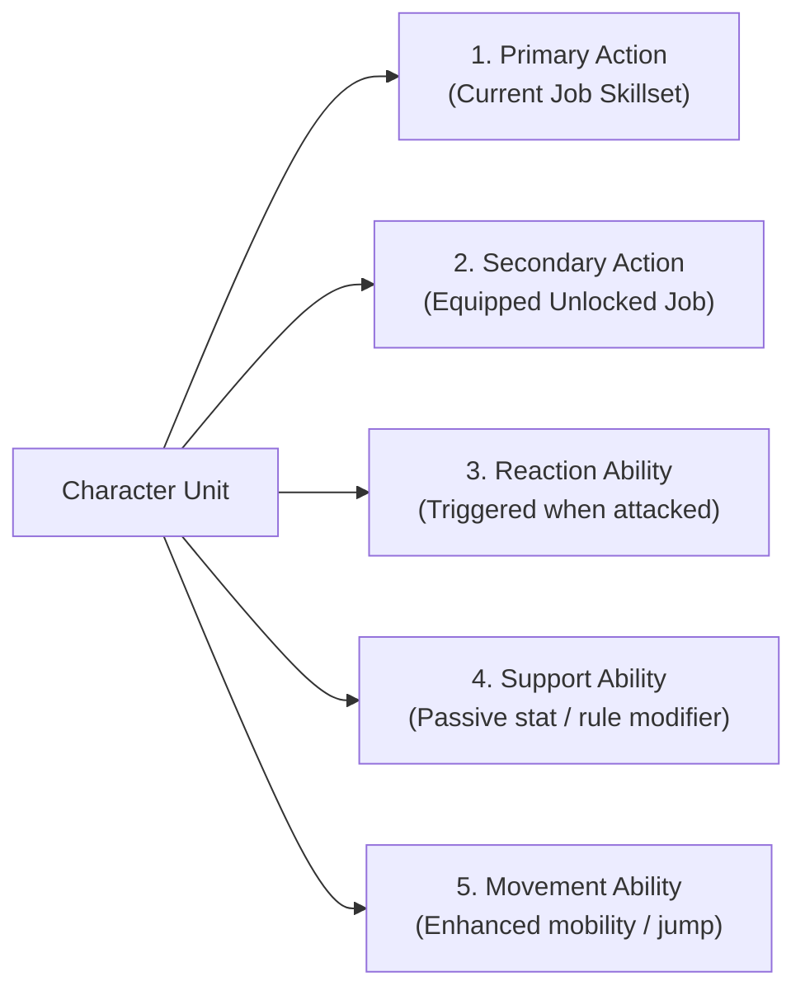
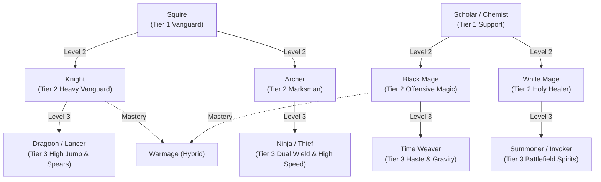

# Job & Ability System Specification

This document details the multi-class progression, 5-slot ability equipping model, and job roster for **Chess RPG Tactics**.

---

## 1. The 5-Slot Ability Architecture

Every character customizes their battlefield identity through five distinct ability slots, adhering to the classic *Final Fantasy Tactics* design pattern:

| Slot # | Category | Nature | Example |
| :---: | :--- | :--- | :--- |
| **1** | **Primary Action** | Fixed to current active job; gives access to all learned action commands in this class. | *Knight's "Arts of War"* |
| **2** | **Secondary Action** | Freely chosen from any other unlocked job to create hybrid builds. | *Black Mage's "Black Magic" equipped on a Knight* |
| **3** | **Reaction Ability** | Passive trigger that automatically activates upon sustaining damage or being targeted. | *Auto-Potion*, *Counter Tackle*, *Weapon Guard* |
| **4** | **Support Ability** | Always-active passive modifier that alters core rules, equipment rules, or damage output. | *Equip Heavy Armor*, *Arcane Strength*, *JP Boost* |
| **5** | **Movement Ability** | Directly modifies the unit's spatial navigation across the 3D elevation grid. | *Move +1*, *Jump +1*, *Regen Walk* |

---

## 2. Job Progression Tree

---

## 3. Job Class Database & Stat Multipliers

| Job | Role | Move | Jump | HP Mult | MP Mult | Atk Mult | Mag Mult | Spd Mult |
| :--- | :--- | :---: | :---: | :---: | :---: | :---: | :---: | :---: |
| **Squire** | Balanced Vanguard | 4 | 2 | $1.00\times$ | $0.80\times$ | $1.00\times$ | $0.80\times$ | $1.00\times$ |
| **Knight** | Armored Vanguard | 3 | 2 | $1.30\times$ | $0.70\times$ | $1.25\times$ | $0.70\times$ | $0.95\times$ |
| **Archer** | Ranged Marksman | 3 | 3 | $0.95\times$ | $0.80\times$ | $1.10\times$ | $0.80\times$ | $1.05\times$ |
| **Black Mage**| Elemental Blaster | 3 | 2 | $0.80\times$ | $1.40\times$ | $0.70\times$ | $1.35\times$ | $0.95\times$ |
| **White Mage**| Holy Healer | 3 | 2 | $0.85\times$ | $1.30\times$ | $0.70\times$ | $1.25\times$ | $1.00\times$ |

---

## 4. Ability Matrix & JP Costs

### Squire (Skillset: *Fundaments*)
* `Attack` (Action, Free, 1 Range, 1.5h): Basic weapon strike.
* `Throw Stone` (Action, 0 MP, 50 JP, 4 Range, 2.0h): Hurls a loose rock at long distance for chipping damage.
* `Focus` (Action, 0 MP, 100 JP, Self): Channels physical focus to permanently boost Attack for the battle.
* `Counter Tackle` (Reaction, 120 JP): Retaliates with shoulder check when struck by adjacent melee attacks.
* `JP Boost` (Support, 150 JP): Grants $+50\%$ additional Job Points from all battlefield actions.
* `Move +1` (Movement, 200 JP): Permanently increases unit movement radius by $+1$ tile.

### Knight (Skillset: *Arts of War*)
* `Rend Armor` (Action, 5 MP, 150 JP, 1 Range, 1.5h): Shatters foe armor plating, permanently reducing defense.
* `Shield Bash` (Action, 8 MP, 180 JP, 1 Range, 1.5h): Bludgeons target with heavy shield, dealing physical shock.
* `Weapon Guard` (Reaction, 200 JP): Grants chance to parry incoming front physical blows with equipped weapon.
* `Equip Heavy Armor` (Support, 250 JP): Allows non-knight classes to equip plate armor and heavy helms.

### Archer (Skillset: *Aim*)
* `Aim +2` (Action, 0 MP, 100 JP, 5 Range, 3.0h): Takes calculated aim for $1.4\times$ damage puncture.
* `Leg Shot` (Action, 6 MP, 160 JP, 4 Range, 2.5h): Targets tendon to immobilize enemy movement.
* `Speed Save` (Reaction, 200 JP): Increases unit Speed stat whenever sustaining damage in combat.
* `Jump +1` (Movement, 180 JP): Grants $+1$ Jump height, allowing scaling higher cliffs and obstacles.

### Black Mage (Skillset: *Black Magic*)
* `Fire` (Action, 10 MP, 80 JP, 4 Range, 2.0h, AOE 1): Engulfs target tile and surrounding foes in searing fire.
* `Blizzard` (Action, 10 MP, 80 JP, 4 Range, 2.0h, AOE 1): Summons frost shards to strike enemy formations.
* `Thunder` (Action, 10 MP, 80 JP, 4 Range, 3.5h, AOE 1): Calls down lightning with high vertical tolerance.
* `Arcane Strength` (Support, 250 JP): Amplifies all magical ability damage output by $+25\%$.

### White Mage (Skillset: *White Magic*)
* `Cure` (Action, 8 MP, 70 JP, 4 Range, 2.0h): Channels restorative holy light, recovering target ally HP.
* `Protect` (Action, 12 MP, 120 JP, 3 Range, 2.0h): Erects barrier, reducing physical damage received by $30\%$.
* `Auto-Potion` (Reaction, 200 JP): Automatically drinks a restorative potion when taking direct damage.
* `Regen Walk` (Movement, 220 JP): Restores $10\%$ max HP on every movement step.
