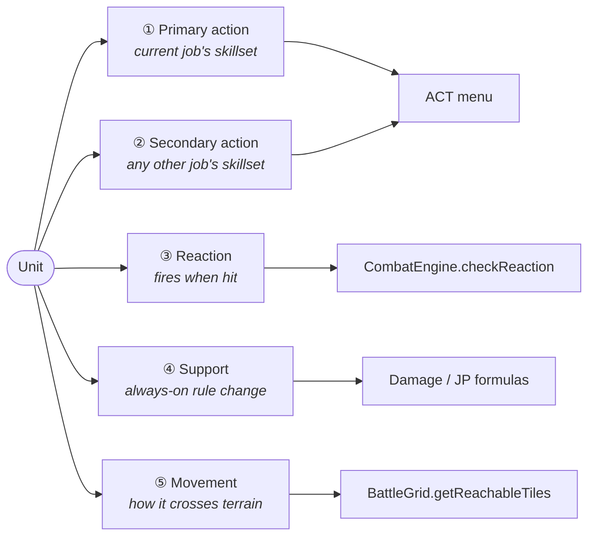
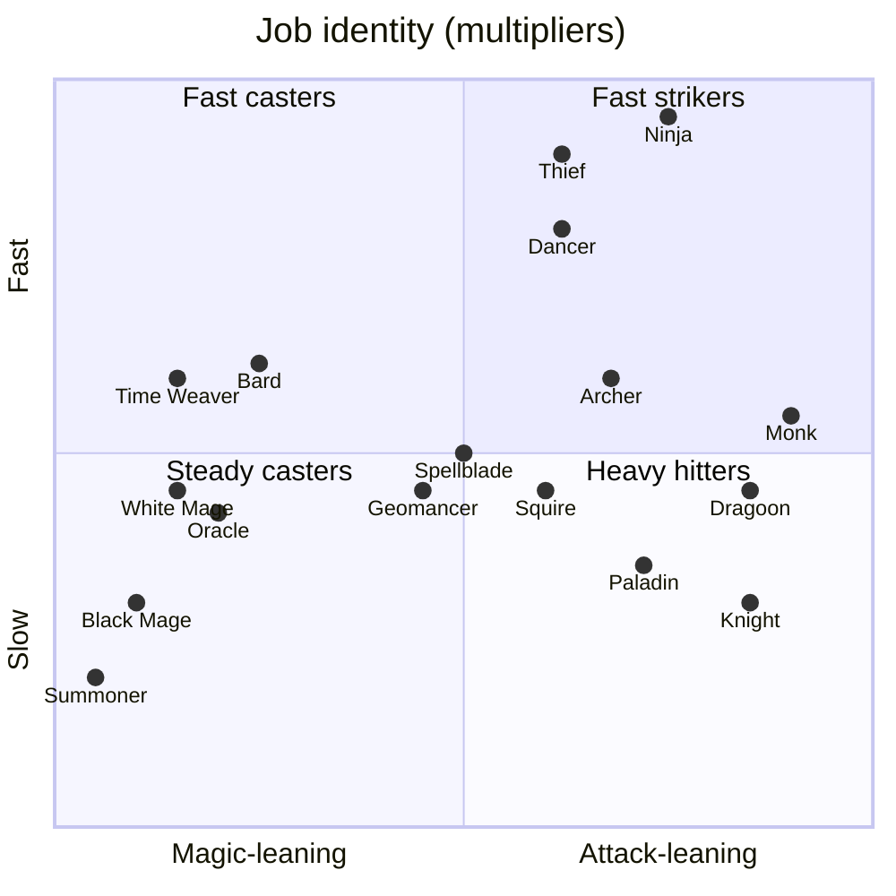
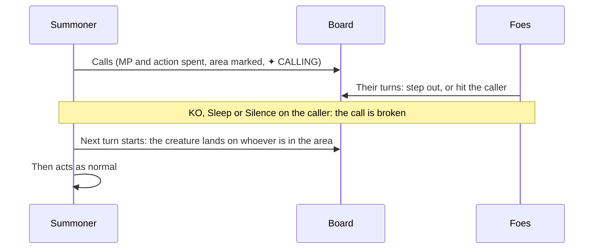
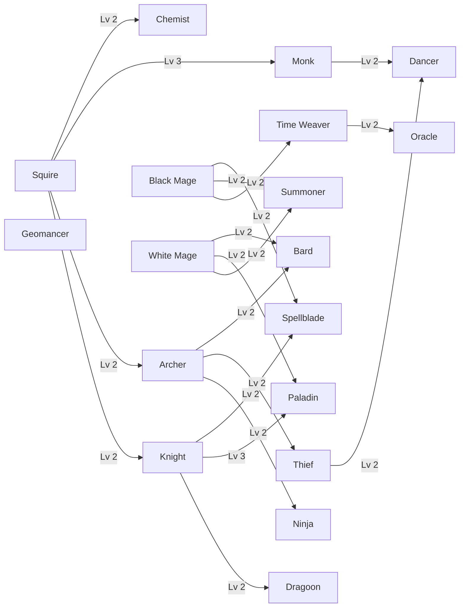
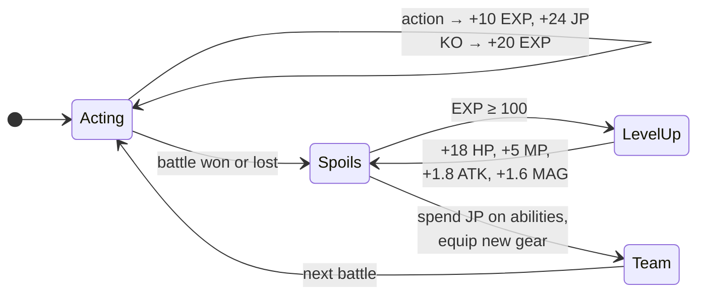
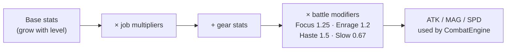

# Job & Ability System

How units grow: jobs, the five ability slots, JP, EXP, levels and gear. For the full numbers (every job, ability and item), see the generated **[Content Reference](CONTENT_REFERENCE.md)**.

**Code:** `src/core/JobSystem.ts` · `src/data/jobs.ts` · `src/data/items.ts` · `src/ui/UIManager.ts` (Team screen)

---

## 1. The five ability slots

Every unit builds its battlefield identity from five slots, after *Final Fantasy Tactics*.

| Slot | Comes from | When it matters | Examples |
| :---: | :--- | :--- | :--- |
| ① Primary | The unit's current job (fixed) | ACT menu | Knight → Rend Armor, Shield Bash |
| ② Secondary | Any job, cycled in **Team → Jobs** | ACT menu, alongside primary | Black Magic on a Knight |
| ③ Reaction | Any learned reaction | After taking a hit | Counter Tackle, Auto-Potion, Earthen Ward |
| ④ Support | Any learned support | Every damage/JP calculation | Arcane Strength, Attack Boost, JP Boost |
| ⑤ Movement | Any learned movement ability | Pathfinding and move range | Move +1, Teleport, Water Walk |

Only **learned** abilities can be equipped. Click (or press Enter / A on) a Reaction, Support or Movement slot to cycle through every passive the unit has learned from *any* job, plus None. Learning a passive equips it at once.

---

## 2. Jobs at a glance

| Job | Plays like | Signature tools |
| :--- | :--- | :--- |
| **Squire** | Flexible starter | Throw Stone (range 4), Focus, Counter Tackle, Move +1 |
| **Knight** | Front-line wall | Rend Armor, Shield Bash, Weapon Guard (parry) |
| **Archer** | Long-range damage | Aim +2, Leg Shot (immobilize), Speed Save |
| **Black Mage** | Area damage | Fire / Blizzard / Thunder (Area 1), Poison Cloud, Arcane Strength |
| **White Mage** | Healer | Cure, Protect, Auto-Potion, Regen Walk |
| **Dragoon** | Mobile bruiser | Dragon Plunge, Dragon Breath (Area 1), Dragonheart, Ignore Elevation |
| **Ninja** | Fastest unit | Throw Shuriken, Reflexes, Dual Wield, Water Walk |
| **Geomancer** | Terrain caster | Elemental (changes with the ground), Earth Slash, Earthen Ward |
| **Time Weaver** | Tempo control | Haste, Slow, Gravity, Regen, Critical Quick, Teleport |
| **Monk** *(0.13)* | Fist fighter and field medic | Aura Wave (range 3), Chakra (free area heal + cleanse, from ATK), Pummel, Iron Will, Brawler, Ki Flow |
| **Thief** *(0.13)* | Fast skirmisher | Steal (gear into your armory), Sand Toss (Blind), Hamstring (Slow), Quick Hands, Backstab, Fleet Foot |
| **Summoner** *(0.13)* | Radius-2 spells, each with its own creature on screen (0.24) | Salamander, Undine, Storm Roc, Sylph (heal + Regen), Golem (area Protect); grand summons (0.24): Cinderwing, Tidewyrm, Elder Wyrm; Mana Spring, Conserve |
| **Paladin** *(0.14, advanced)* | Holy front-liner | Holy Blade, Lay on Hands, Rebuke (Silence), Aegis (area Shell), Divine Grace, Zeal |
| **Spellblade** *(0.14, advanced)* | Elemental duelist | Flame Edge, Frost Edge (Slow), Thunder Lunge (reach 2), Runic, Arcane Edge |
| **Chemist** *(0.19)* | Field medic, bomb-maker | Salve (free heal from ATK, reach 3), Purge (cleanse), Acid Flask (Breach), Smoke Bomb (area Blind), Field Dressing (heals 15% when a blow leaves you under half HP), **Pharmacology** (items +50% and +1 reach) |
| **Oracle** *(0.13)* | Ailments | Dim Sight (Blind), Hush (Silence), Lullaby (area Sleep), Soul Drain, Hex Ward, Hex Mastery |
| **Bard** *(0.22, advanced)* | Performer: support | Songs that play again each turn: Battle Hymn (Focus), Mending Air (heal), Quickening Ballad (Haste); Discord (dark damage + Silence); Healing Refrain (Regen when hit); **Resonance** (performances reach +1) |
| **Dancer** *(0.22, advanced)* | Performer: disruption | Dances that play again each turn: Blade Waltz (free damage to every foe within 2), Veil of Silks (Blind), Leaden Reel (Slow); Feint (damage + Breach); Captivate (melee attackers may fall asleep); **Encore** (performances last 2 more turns) |

### Performances (0.22)

A Bard's song or a Dancer's dance fills the area around the performer (radius 2): songs reach the performer and allies, dances reach foes. Using one also gives the performer **Encore** (♪ on the unit card). At the start of each of their next three turns the performance plays again by itself, before they act, at no MP cost. It stops early if the performer moves, uses any other action (an item included), is put to sleep, is silenced, or falls. Undoing a move brings the performance back. Encores earn no JP or EXP.

| Support | Effect |
| :--- | :--- |
| Resonance (Bard) | Every performance reaches 1 tile further (radius 3) |
| Encore (Dancer) | Every performance plays 2 more turns (five in all) |

Both supports work on either job's performances, so a Bard who learned Encore keeps songs going longer, and a Dancer with Resonance dances wider. The rules are in `src/core/Performance.ts`.

### Summons and grand summons (0.24)

Every Summoner call brings its creature onto the battlefield: the camera comes in, the board darkens, and the damage lands with the creature's attack (Salamander's fire breath, Undine's wave, Storm Roc's lightning, Sylph's healing rain, Golem's shield, and the signature Celestial Call).

Three **grand summons** take a turn to arrive. They are marked ✦ in the ACT menu.

| Grand summon | JP | MP | Range | Area | Effect |
| :--- | ---: | ---: | ---: | ---: | :--- |
| Cinderwing | 450 | 36 | 4 | 2 | Heals allies (×1.0) and raises the fallen with 34% HP |
| Tidewyrm | 520 | 40 | 4 | 3 | Ice ×1.25 and Slow |
| Elder Wyrm | 640 | 48 | 5 | 2 | Dark ×1.35 |

A grand summon hits **everyone in the area at full force** (no splash falloff) and at +30 hit. Using one earns JP and EXP when it's called; a kill it makes when it lands earns its EXP then. Enemy Summoners call grand summons from level 6, and the AI steps out of the area of yours. The rules are in `src/core/Summons.ts`.

Older jobs gained an action each in 0.13: Squire *Rally*, Knight *Bulwark*, Archer *Arrow Rain*, Black Mage *Firestorm*, White Mage *Shell*, *Purify* and *Healing Circle*, Ninja *Smoke Bomb*, Time Weaver *Regen*. The Knight's support is now **Armor Mastery** (+50% HP from armor, helms and shields).

### Job levels and the job tree (0.14)

Each job a unit works in has a **job level** from 1 to 8 (Master), set by the lifetime JP earned in that job: 100 JP for Lv 2, 250 for Lv 3, then 450, 700, 1000, 1400 and 1900. Spending JP on abilities doesn't lower it. An action earns 24 JP and a won battle 60, so a level takes about one battle early on.

A job is **locked** until the unit has the job levels it requires. The Team screen lists every job with its level, a progress bar, and what a locked job still needs. Every unit starts at Squire Lv 2, so Knight and Archer are open from the start; a unit already in a job (a recruit, or one from an older save) keeps it.

### Job mastery (0.16)

Job levels 5 and 8 pay a permanent bonus. It is derived from the same lifetime JP as the job level, so nothing extra is stored and old saves get what they have already earned.

| Tier | Job level | Lifetime JP | Bonus |
| :--- | :---: | :---: | :--- |
| Veteran | 5 | 700 | The job's smaller amount |
| Master | 8 | 1900 | The job's full amount (it replaces Veteran's, it doesn't add to it) |

| Stat | Jobs (Veteran / Master) |
| :--- | :--- |
| HP | Squire +10 / +25 · Knight +15 / +35 · Paladin +12 / +30 · Chemist +8 / +20 |
| MP | White Mage +8 / +20 · Oracle +8 / +20 · Bard +8 / +20 · Geomancer +6 / +15 |
| ATK | Archer +1 / +2 · Monk +1 / +2 |
| MAG | Black Mage +1 / +2 · Summoner +1 / +2 · Spellblade +1 / +2 |
| Evasion | Ninja +4 / +8 · Thief +3 / +6 |
| Jump | Dragoon +1 / +2 |
| Speed | Time Weaver +1 / +2 · Dancer +1 / +2 |

#### Master signatures (0.23)

Mastering a job (level 8) also brings its **signature**: one action of the job's own, kept in every job like the stat bonus. It appears in the ACT menu with a ★ and costs no MP, but each can be used **once per battle**. Signatures are never learned with JP, still work under Silence, and get +30 hit (a once-a-battle blow shouldn't whiff). A unit that has mastered several jobs carries all their signatures.

| Job | Signature | Effect |
| :--- | :--- | :--- |
| Squire | Valiant Charge | Heavy blow to an adjacent foe (×2.0) + Breach |
| Knight | Shield Wall | Protect for you and allies within 2 |
| Archer | Heartseeker | Very heavy shot (×2.2), range 6 |
| Black Mage | Meteor | Heavy fire, area 2, range 4 |
| White Mage | Benediction | Big heal and cleanse, area 2, range 4 |
| Dragoon | Skyfall | Heavy damage, area 1, range 3, height 6 |
| Ninja | Thousand Cuts | Very heavy blow (×2.6) |
| Geomancer | Earthquake | Damage to every foe within 3 of you |
| Time Weaver | Chrono Surge | Haste for you and allies within 3 |
| Chemist | Panacea | Heal (from ATK) and cleanse you and allies within 2 |
| Monk | Final Fist | Crushing blow (×2.8) |
| Thief | Life Theft | Heavy blow (×1.7), heals you for half |
| Summoner | Celestial Call | Heavy holy damage, area 2, range 5 |
| Oracle | Doomsay | Dark damage and Sleep, area 1, range 4 |
| Paladin | Sanctuary | Heal and Regen for you and allies within 2 |
| Spellblade | Runic Tempest | Heavy lightning (ATK), area 1, range 2 |
| Bard | Grand Finale | Heal and Haste for you and allies within 3 (plays once; not a performance) |
| Dancer | Last Dance | Damage (ATK) and Slow on every foe within 2 of you |

They live in `src/data/signatures.ts`; `JobSystem.signaturesOf(unit)` lists the earned ones and `getCombatActionAbilities` adds those not yet used this battle (`Unit.usedSignatures`, cleared by `resetForBattle`). Centred signatures use the same "area around the caster" rule as performances (`isCentered`).

`JobSystem.masteryBonus(unit)` sums every tier the unit holds; `recalculateDerivedStats`, `getAttackPower` and `getMagicPower` add it after the current job's multipliers, so the bonus is the same whatever job the unit is in. `gainJp` returns `mastery: "+15 HP"` on the gain that reaches a tier. Enemies are created with job levels of 3 at most, so they have none.

`JobSystem.canChangeJob` is the single check; `gainJp` reports level-ups and the jobs they unlock, and `grantPrerequisites` gives units created in an advanced job the levels it needs.

---

## 3. Growth: EXP, levels and JP

| Source | EXP | JP (current job) |
| :--- | ---: | ---: |
| Any action | 10 | 24 (36 with JP Boost) |
| Action that scores a KO | +20 | — |
| Battle won, unit survived | 40 + 10/KO | 60 |
| Battle won, unit fell | 15 + 10/KO | 20 |
| Battle lost | — (EXP/JP earned during the fight is kept) | — |

* **100 EXP = 1 level.** Speed rises by 1 every third level (`8 + ⌊level / 3⌋`).
* **JP belongs to a job.** Points earned as a Knight buy Knight abilities only.
* **Persistence:** levels, JP, learned abilities, equipped slots and gear carry over between chapters, into New Game+ and into the Trials.

---

## 4. Effective stats

`JobSystem.getAttackPower()` and `getMagicPower()` are the only places that combine these. Battle modifiers never write to `baseStats`, so nothing stacks across battles.

---

## 5. Gear and the armory

| Slot | Affects | Notes |
| :--- | :--- | :--- |
| Weapon | ATK / MAG, **range** | Spears reach 2, bows 5–6; range replaces Attack's range of 1 |
| Shield | HP, evasion | Evasion above 5 lowers front/flank physical hit chance |
| Head | HP, MP, evasion | |
| Body | HP, ATK | |
| Accessory | Anything | Speed, Move, Jump, MP… |

Weapon types: swords, spears (range 2), bows (4–6), staves and rods, daggers, and **knuckles** (0.13; the Monk's *Brawler* adds +30% to unarmed or knuckle Attacks).

### Traits (0.13)

Some gear carries a **trait** on top of its stats (`Item.traits`):

| Trait | What it does | Examples |
| :--- | :--- | :--- |
| `startStatus` | The wearer starts every battle with these statuses. Regen from gear lasts the whole battle; the rest run their normal course | Verdant Charm (Regen), Warding Amulet (Protect + Shell), Mirror Shield and Templar Mail (Shell) |
| `boost` | +25% to the wearer's spells of that element (holy also boosts healing) | Flame / Frost / Storm Rod, Dawnbringer (holy) |
| `guard` | Those ailments can't be inflicted on the wearer; the enemy AI won't waste turns trying | Circlet of Clarity (Blind, Silence, Sleep), Purity Bangle (Poison, Slow, binding, Breach), Sage's Staff (Silence), Zodiac Ribbon (all) |

### Steal

The Thief's **Steal** takes one piece of an adjacent foe's gear (accessory first, then head, weapon, shield, body) and adds it to your armory if you don't have one. The foe loses its stats. It's harder than a blow (−25 hit, −45 against a boss) and, like any attack, easier from the side or behind. Gear stolen in a battle is listed on the spoils screen.

### Gil and the market (0.14, 0.15)

| Source | Gil |
| :--- | :--- |
| New game | 300 |
| Defeated enemy | 20 + 10 × level (×3 for a boss) |
| Battle won | +150 (campaign), +100 + 20 × floor (Trials) |
| Stealing gear you already own | half its price |
| Selling at the market (0.15) | half its price |
| Workshop battles | none |

**Larkmoor Market** on the world map sells gear for the armory; one purchase outfits the whole squad. (Team → Shop shows the shelves anywhere, but trades only at the market.) The shelves grow with the campaign, the moment each chapter is won: items up to 380 gil before the first victory, 480 after Chapter I, 580 after Chapter II, and everything after the campaign is cleared or in the Trials. The Zodiac Blade, Zodiac Ribbon and Wyrmscale Mail are never sold. Rules live in `src/core/Economy.ts`.

**Selling (0.15).** The market's SELL counter pays half price for spare gear and supplies. An item leaves the armory when sold, so `gearSaleBlock` refuses anything a squad member is wearing ("Worn by Rowan") and the three relics.

### Supplies (0.15)

Consumables are not gear: they sit in a shared inventory (`Record<id, count>`, at most 9 of each), are bought and sold at the market, and are used in battle with the **ITEM** command. A new squad carries 3 Potions and a Phoenix Feather. [Full table](CONTENT_REFERENCE.md#supplies); how they resolve is in [Combat](COMBAT_SYSTEM.md#9-items-0150).

The gear tab lists only items in the squad's **armory**. You start with 17 items. Chapter wins, branch choices and Trials drops add more ([where each item comes from](CONTENT_REFERENCE.md#items)). Any number of units can equip the same item.
