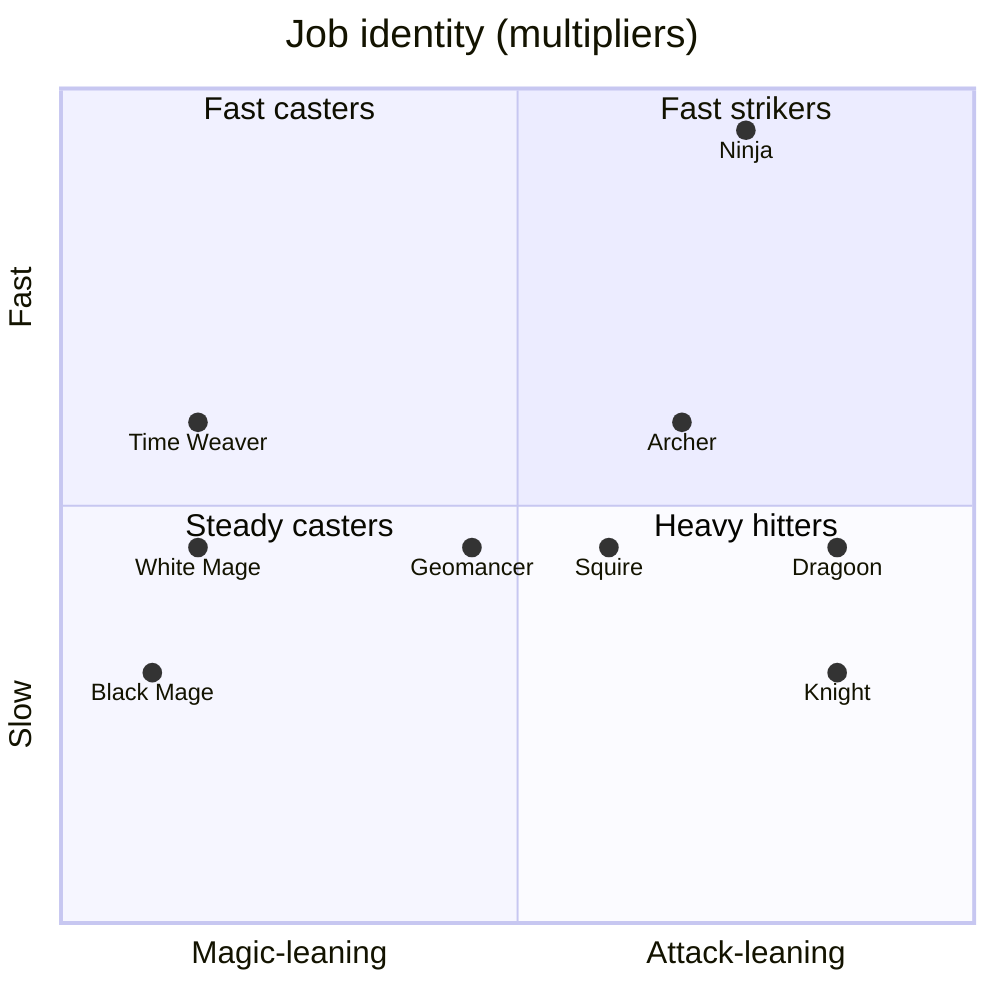
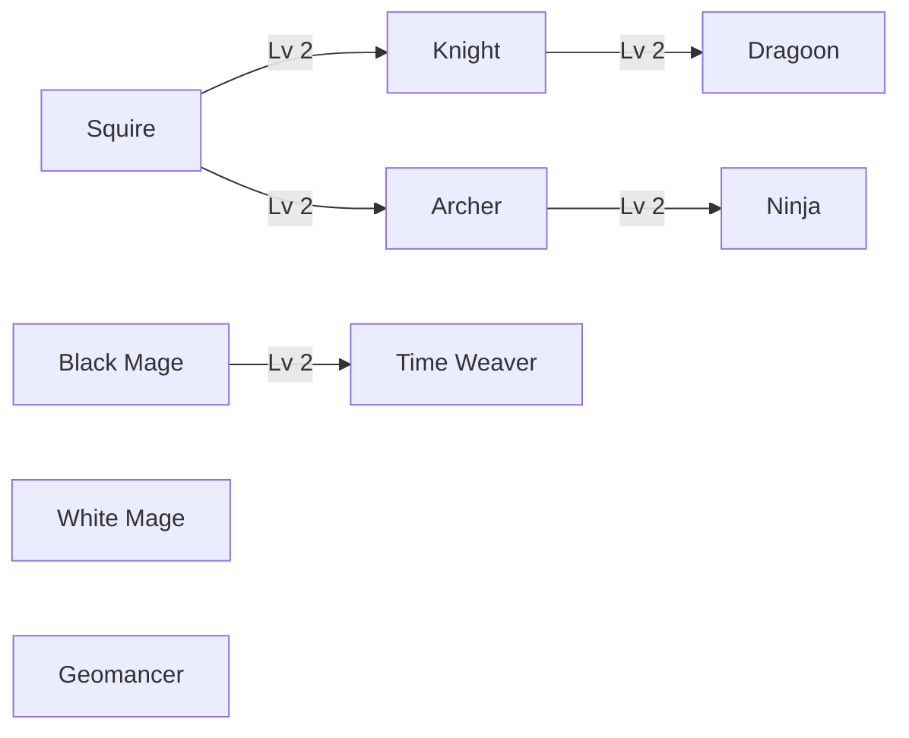
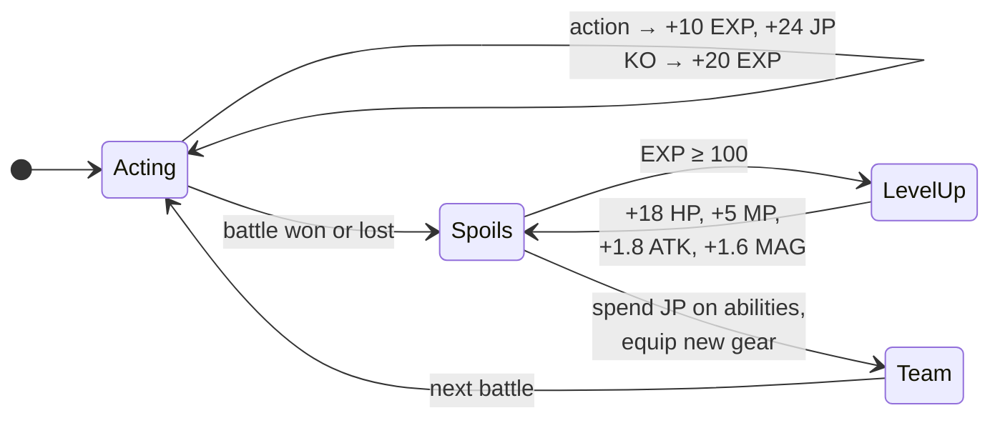
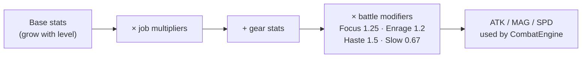

# Job & Ability System

How units grow: jobs, the five ability slots, JP, EXP, levels and gear. For the full numbers (every job, ability and item), see the generated **[Content Reference](CONTENT_REFERENCE.md)**.

**Code:** `src/core/JobSystem.ts` · `src/data/jobs.ts` · `src/data/items.ts` · `src/ui/UIManager.ts` (Team screen)

---

## 1. The five ability slots

Every unit builds its battlefield identity from five slots, after *Final Fantasy Tactics*.

| Slot | Comes from | When it matters | Examples |
| :---: | :--- | :--- | :--- |
| ① Primary | The unit's current job (fixed) | ACT menu | Knight → Rend Armor, Shield Bash |
| ② Secondary | Any job, cycled in **Team → Jobs** | ACT menu, alongside primary | Black Magic on a Knight |
| ③ Reaction | Any learned reaction | After taking a hit | Counter Tackle, Auto-Potion, Earthen Ward |
| ④ Support | Any learned support | Every damage/JP calculation | Arcane Strength, Attack Boost, JP Boost |
| ⑤ Movement | Any learned movement ability | Pathfinding and move range | Move +1, Teleport, Water Walk |

Only **learned** abilities can be equipped. Click (or press Enter / A on) a Reaction, Support or Movement slot to cycle through every passive the unit has learned from *any* job, plus None. Learning a passive equips it at once.

---

## 2. Jobs at a glance

| Job | Plays like | Signature tools |
| :--- | :--- | :--- |
| **Squire** | Flexible starter | Throw Stone (range 4), Focus, Counter Tackle, Move +1 |
| **Knight** | Front-line wall | Rend Armor, Shield Bash, Weapon Guard (parry) |
| **Archer** | Long-range damage | Aim +2, Leg Shot (immobilize), Speed Save |
| **Black Mage** | Area damage | Fire / Blizzard / Thunder (Area 1), Poison Cloud, Arcane Strength |
| **White Mage** | Healer | Cure, Protect, Auto-Potion, Regen Walk |
| **Dragoon** | Mobile bruiser | Dragon Plunge, Dragon Breath (Area 1), Dragonheart, Ignore Elevation |
| **Ninja** | Fastest unit | Throw Shuriken, Reflexes, Dual Wield, Water Walk |
| **Geomancer** | Terrain caster | Elemental (changes with the ground), Earth Slash, Earthen Ward |
| **Time Weaver** | Tempo control | Haste, Slow, Gravity, Critical Quick, Teleport |

### Prerequisites (defined, not yet enforced)

`src/data/jobs.ts` declares which job unlocks which, but **the Team screen currently lets any unit switch to any job**. Enforcing this tree is on the [roadmap](ROADMAP.md).

---

## 3. Growth: EXP, levels and JP

| Source | EXP | JP (current job) |
| :--- | ---: | ---: |
| Any action | 10 | 24 (36 with JP Boost) |
| Action that scores a KO | +20 | — |
| Battle won, unit survived | 40 + 10/KO | 60 |
| Battle won, unit fell | 15 + 10/KO | 20 |
| Battle lost | — (EXP/JP earned during the fight is kept) | — |

* **100 EXP = 1 level.** Speed rises by 1 every third level (`8 + ⌊level / 3⌋`).
* **JP belongs to a job.** Points earned as a Knight buy Knight abilities only.
* **Persistence:** levels, JP, learned abilities, equipped slots and gear carry over between chapters, into New Game+ and into the Trials.

---

## 4. Effective stats

`JobSystem.getAttackPower()` and `getMagicPower()` are the only places that combine these. Battle modifiers never write to `baseStats`, so nothing stacks across battles.

---

## 5. Gear and the armory

| Slot | Affects | Notes |
| :--- | :--- | :--- |
| Weapon | ATK / MAG, **range** | Spears reach 2, bows 5–6; range replaces Attack's range of 1 |
| Shield | HP, evasion | Evasion above 5 lowers front/flank physical hit chance |
| Head | HP, MP, evasion | |
| Body | HP, ATK | |
| Accessory | Anything | Speed, Move, Jump, MP… |

The gear tab lists only items in the squad's **armory**. You start with 13 items. Chapter wins, branch choices and Trials drops add more ([where each item comes from](CONTENT_REFERENCE.md#items)). Any number of units can equip the same item.
