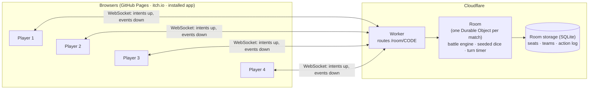
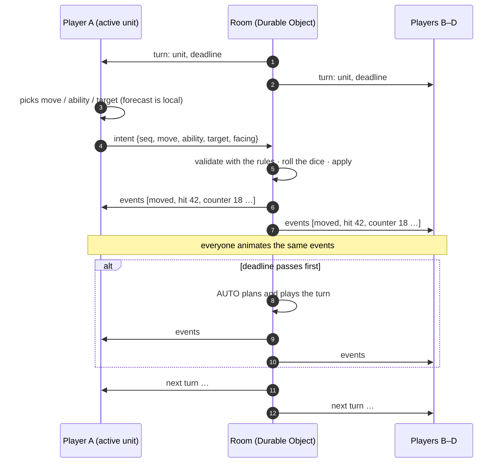
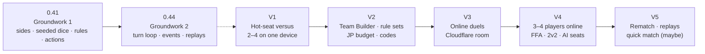

# Online Versus: plan

A plan for **2 to 4 players battling each other online**. Each player brings their campaign squad, a preset team, or a team built on a fixed JP budget. The server runs on Cloudflare.

> **Status: later.** Versus itself isn't scheduled. What *is* under way is the groundwork in the game's code (section 4), so versus can be added without tearing the battle code apart. Part 1 shipped in 0.41 ([ADR 0046](adr/0046-battle-engine-groundwork.md)). This page is a proposal; once a part ships, its design decision becomes an ADR and this page is updated.

---

## 1. What players get

- **Modes**
  - **Duel**: 1 vs 1.
  - **Free-for-all**: 3 or 4 players, last side standing.
  - **Teams**: 2 vs 2. Allies can't hurt each other, and a side's buffs and heals reach its ally.
- **Private rooms with a code.** The host creates a room, gets a six-letter code (e.g. `KX7RQM`) and shares it. Friends type it in or open the link. The first versions have no accounts and no public matchmaking; a player just picks a display name.
- **Three ways to bring a team.** The host picks which are allowed:

  | Source | What it is | Fair? |
  | :--- | :--- | :--- |
  | **Preset team** | One of about eight hand-built teams shipped with the game (e.g. a knight wall, a mage circle, a beast pack) | Yes: same for everyone |
  | **Built team** | Made in the new **Team Builder** with the room's budget: units, level, **JP to spend**, gil for gear | Yes: the server checks every team against the budget |
  | **Campaign squad** | Your saved party exactly as it is, or scaled to the room's level with **level sync** | Friendly matches only: a save lives in the player's browser and can be edited |

- **Turn timer.** The host picks one (30 s, 60 s, 2 min, or none for friends). When it runs out, that unit's turn plays on **AUTO**, the same planner as the AUTO button.
- **Disconnects don't end the match.** A player who drops has a grace period to come back (the same link and browser rejoin their seat). Until then, or for good, AUTO plays their units. Empty seats can also be filled with AI before the match.
- **Hot-seat versus on one device** comes first, before anything goes online. It's useful by itself and proves the rules.

---

## 2. How it works

### 2.1 The server decides, the browsers draw

- **One Durable Object per room.** Cloudflare creates it when the first player joins the room code and routes every player of that room to the same instance. It is the single source of truth: seats, teams, the battle state and the action log.
- **Players send intents, not results.** An intent says "this unit moves to (5, 9)", "casts Fira at (7, 3)", "waits facing north". The room checks it with the **same rules code the game uses** (whose turn it is, reachable tiles, range, MP), rolls the dice, applies it, and sends everyone the resulting **events**: moved, hit for 42, crit, Poison, counter, KO. Each browser plays the events with the animations it has today.
- **Why not have each browser simulate the battle (lockstep)?** It would need even less server, but the dice would be predictable from the shared seed, a modified client could fake results, and a player who rejoins would have to replay the whole match. Tactics battles send a few messages per turn, so running them on the server costs next to nothing.
- **Nothing is hidden on a tactics board**, so every player gets the same events and the server needs no per-player views.
- **WebSocket Hibernation.** Between messages the room can be put to sleep while the sockets stay open. Cloudflare doesn't bill duration for a room that can hibernate, and a turn-based match spends most of its time waiting for someone to think. The turn timer is a Durable Object **alarm**, which wakes the room when time runs out.

### 2.2 One turn, online

The **forecast** (hit %, damage) stays local. It's the same formula, so it shows the same numbers; only the roll happens on the server.

### 2.3 Messages

| Direction | Message | Carries |
| :--- | :--- | :--- |
| Browser → room | `hello` | room code, name, rejoin token (if any), game version |
| | `team` | the chosen team, as a team code |
| | `ready` / `settings` | ready flag; host only: mode, map, budget, timer, allowed team sources |
| | `intent` | sequence number + move / act / wait / facing |
| | `forfeit` | |
| Room → browser | `lobby` | seats, names, readiness, settings |
| | `start` | map, starting units, turn order (the dice seed stays on the server) |
| | `turn` | active unit, owner, deadline |
| | `events` | what happened, in order |
| | `sync` | the full current state (for rejoining, or after a missed message) |
| | `end` | winner(s), match summary |
| | `error` | why an intent was refused (e.g. "out of range") |

The game version travels in `hello`. A room only accepts players on the same rules version, so a browser with an old cached build is told to reload.

---

## 3. Teams and the JP budget

### 3.1 Team codes

Every team (preset, built, or exported from a save) is stored in one format: units with their job, level, JP earned per job, learned abilities, equipped abilities and gear. It travels as a **team code**, compressed the same way Workshop share links are (`#t=…`). That means teams can also be saved, copied and posted outside the game.

The server never trusts a team code. It rebuilds every unit with `JobSystem` and runs `validateTeam(team, rules)`. Any team that fails is refused with the reason: unknown job, ability not learned, prerequisites not met, over budget, gear not allowed.

### 3.2 Rule sets: everything is a setting

A match is played under a **rule set**: one object the host edits in the lobby. Rule sets can be saved, named, shared as a code (`#r=…`, like team codes) and picked from presets ("Classic duel", "Four-way brawl", "Leader hunt", "Low-level scramble"). The same object drives hot-seat and online play. The server validates it once, then every rule reads from it, so a new setting is one field plus the code that honours it.

**Players and sides**

| Setting | Default | Choices |
| :--- | :---: | :--- |
| Seats | 2 | 2–4, each a person or an AI (Easy / Normal / Hard) |
| Alliances | none | Any grouping: 1v1, 1v1v1(v1), 2v2, 2v1, 3v1, 2v1v1 |
| Friendly fire | off | Off (area spells skip allies) / on |
| Handicap | none | Per seat: extra or fewer units, level ±, JP ± |

**Teams**

| Setting | Default | Choices |
| :--- | :---: | :--- |
| Team sources allowed | preset + built | Any mix of preset, built, campaign |
| Units per player | 4 | 1–6 |
| Unit level | 8 | 1–20, or "as built" |
| Level sync for campaign squads | on | On / off |
| JP budget | 1,500 per unit | Per unit, or one pool per team; 0–10,000 |
| Gil for gear | 3,000 per team | 0–50,000; or "starter gear only" / "anything" |
| Gear tiers | all | Up to a shop tier; relics on / off |
| Jobs | all | Allow or ban each job; monsters on / off |
| Abilities | all | Ban individual abilities |
| Duplicate jobs | allowed | Allowed / max 2 / unique |
| Supplies | 3 | 0–10 per team; which supplies are allowed |

**Battle**

| Setting | Default | Choices |
| :--- | :---: | :--- |
| Map | pick | Any versus map, any Workshop map with side zones, or random |
| Deployment | fixed zones | Fixed zones / place your units in your zone before the start |
| Victory | last side standing | Last side standing / **Leader** (KO the other side's chosen leader, the chess checkmate) / most KOs or most HP after a round cap / hold the centre for N rounds |
| Round cap | none | None or 10–50 rounds, with a tiebreak |
| Raise | on | On / off / once per unit |
| Grand summons, signatures | on | On / off each |
| Steal, Tame | steal on (for the match only), tame off | On / off each |
| Weather and terrain spells | map's | Map's / off |
| Starting CT | normal | Normal / random / slowest side first |

**Clock**

| Setting | Default | Choices |
| :--- | :---: | :--- |
| Turn timer | 60 s | None / 15–300 s per unit turn |
| Time bank | none | A chess clock per player (e.g. 10 min) that tops up a slow turn |
| On timeout | AUTO | AUTO / wait in place |
| Disconnect grace | 2 min | 0–10 min, then AUTO or forfeit |

### 3.3 Spending JP the campaign way

The builder uses the campaign's own rules, so there's nothing new to learn:

1. Put JP into a job. That's JP *earned* there, so it raises the job level and unlocks the next jobs in the tree exactly as in the campaign: e.g. Squire level 2 for Knight, then Knight level 2 for Dragoon. Mastery bonuses count too.
2. Spend that job's JP on its abilities (`learnAbility`, same costs).
3. Pick the main job, secondary skillset, reaction, support and movement from what's learned.

The budget counter shows JP left per unit. **Reaching an advanced job costs budget**: a unit that wants to be a Dragoon pays for the Squire and Knight levels on the way, so specialists cost depth. For scale: abilities cost 0–640 JP (median 180), and a job reaches Master at 1,900 JP earned.

**Campaign squads and level sync.** With level sync on, a campaign unit keeps its jobs, learned abilities and gear, but its level is set to the room's level. With it off, the squad plays exactly as saved.

### 3.4 Defaults to settle

Some abilities assume a campaign around them. Each is a setting (above); these are the proposed defaults, to check in hot-seat play:

| Thing | Proposal |
| :--- | :--- |
| **Steal** (Thief) | Takes the gear off for this match only; nothing is kept |
| **Tame** (Beast Tamer) | Off in versus at first. A tamed monster switching sides could be fun later |
| **Grand summons**, **signatures** | Allowed; a host option to ban |
| **Boss rules** (enrage) | Off: there are no bosses in versus |
| **Raise / KO counters** | As in the campaign |
| **Gil, EXP, JP, loot** | None awarded. A versus match never changes a save |

---

## 4. Work needed in the game first

The biggest job isn't the server; it's the rules.

| Today | Needed for versus |
| :--- | :--- |
| `performAction()` in `main.ts` mixes rules with animation: it waits on effects while it resolves hits | A headless **battle engine** in `src/core`: `state + intent → events`, with no DOM and no waiting. `main.ts` plays the events. The Durable Object runs the same engine |
| Dice are `Math.random` by default (`CombatEngine.executeAttack`, `Scenario`) | One **seeded RNG** owned by the battle, passed everywhere |
| Two sides, `Team = 'player' \| 'enemy'` (7 uses in `src/core`, 37 in `main.ts`) | **Sides 0–3 plus alliances**: `isFoe(a, b)` everywhere that asks "enemy?" (AI targeting, area spells, heals, reactions, victory) |
| `EnemyAI.planTurn` plays "the enemy" | AI plays **any side**: AUTO, timeouts, disconnects and AI seats |
| Maps have one deployment zone (south) | **2–4 deployment zones** per versus map: corners for four players, opposite edges for duels. The Workshop gains a "side zone" tool |
| The balance sim re-implements a simpler battle (no reactions) | The sim runs the real engine. That's a free win: balance numbers become more honest |

The first two are worth doing even if online play never ships: the game gets replays, a truthful balance sim and tests that cover whole battles.

**Groundwork, part 1 (0.41, done):**
- Sides go through `isFoe` / `isAlly`, with room for alliances.
- One seeded RNG per battle.
- A `BattleRules` object (campaign rules today; the rule set above later).
- Action resolution (`resolveAction`) moves into `src/core`, used by both the game and the balance sim.

**Part 2 (0.44, done, [ADR 0049](adr/0049-battle-engine-turn-loop.md)):**
- The turn loop (turn start, end of turn, victory) lives in `core/Battle.ts`: `nextTurn()`, `check(intent)`, `apply(intent)`.
- The engine writes every step to an event log.
- A whole battle replays from its seed and intents, event for event.

**Part 3 (with V1):** the game drives its turns from the engine's events instead of its own loop.

---

## 5. Releases

Groundwork comes first and ships as ordinary releases between the game's other work. The versus releases (V1–V5) aren't scheduled; they get version numbers when they start.

| Step | Release | What ships | Size |
| :---: | :--- | :--- | :---: |
| **0.41** | **Groundwork 1** | `isFoe` / `isAlly`; a seeded RNG per battle; `BattleRules`; `resolveAction` in `src/core`, used by `main.ts` (which only presents) and by the balance sim. No visible change. **Test:** the same seed resolves an action the same way | M |
| **0.44** | **Groundwork 2** | Turn start (calls, encores, poison), end of turn and victory in `src/core/Battle.ts`; `apply(intent)` with `check`, and an event log; the balance sim on the engine. **Test:** a recorded battle replayed from its seed and intents gives the same events | L |
| **V1** | **Hot-seat versus** | The game drives its turns from the engine's events (groundwork part 3). "Versus" on the title screen: 2–4 players on one device or controller, preset teams, preset rule sets. Side colours (ring + banner), "Player 2's turn" handover screen, every victory condition, AI seats. Two or three versus maps with corner zones | M |
| **V2** | **Team Builder and rule sets** | Build teams to a budget; preset teams in the same format; export a campaign squad; the rule-set editor; team and rule codes to save and share; `validateTeam` and `validateRules` with tests for every rule | M |
| **V3** | **Online duels** | `server/` folder: Worker + Room Durable Object (`wrangler`), deployed by a GitHub Action. Create/join by code, lobby, ready check, turn timer by alarm, rejoin by token, version check. Two players | L |
| **V4** | **Up to four online** | Free-for-all, alliances and AI seats online; AUTO on timeout and disconnect; forfeits | M |
| **V5** | **Polish** | Rematch; match summary; replays (the action log, downloadable, played back with the engine); rate limits and name filtering. Maybe a quick-match queue (one more Durable Object) | M |

**Later, if it catches on:** accounts and rankings (needs sign-in and a durable database such as D1), asynchronous matches (a room already keeps state for days; a turn could be played whenever, with a notification), spectators, a public room list.

---

## 6. Cloudflare setup and cost

- **What's needed:**
  - A Cloudflare account, free to start.
  - One Worker plus one Durable Object class with the **SQLite backend**, which is available on the Workers Free plan.
  - A `CLOUDFLARE_API_TOKEN` secret in the GitHub repo so the deploy Action can publish the server.
- **Address:** `chess-rpg-versus.<account>.workers.dev` to start, or a subdomain like `versus.jeremyanderson.tech` if that domain's DNS moves to Cloudflare.
- **Free plan limits** (per day, reset at 00:00 UTC):
  - 100,000 Durable Object requests.
  - 13,000 GB-s of duration.
  - Going over makes further requests fail; you aren't charged.
  - Incoming WebSocket messages count 20 to 1 toward requests, and outgoing messages are free.
  - A match of a few hundred messages is a tiny slice, so hobby-scale play should fit for free. V3 measures it.
- **Paid plan,** if it ever grows: $5 a month base, then $0.15 per million requests and $12.50 per million GB-s.
- **Where it runs:** the same code serves the GitHub Pages build, the itch.io build and the installed app.
  - The room accepts WebSocket connections only from known origins: `cptnope.github.io`, itch's game host `html-classic.itch.zone`, `jeremyanderson.tech`, and localhost for development.
  - itch allows a browser game to reach an outside server over HTTPS/WSS; **V3 starts with a spike that proves a socket opens from the itch embed**.

---

## 7. Risks

| Risk | How it's handled |
| :--- | :--- |
| Pulling rules out of a 2,857-line `main.ts` breaks the campaign | Groundwork ships in two parts with no new features; resolver tests, replay tests and the 8 play-tests guard it |
| Four-player free-for-all ganging up on the leader, long matches | Hot-seat (V1) is the place to tune it; the rule set has the dials: unit count, timer, round cap, victory condition |
| Campaign squads are wildly uneven | Level sync, and preset/built teams as the default; campaign squads are opt-in per room |
| A modified browser cheats | The server validates every intent and every team and rolls every die. The browser only draws |
| Itch or a school network blocks the socket | Spike first (V3); the GitHub Pages build is the fallback link |
| Free-plan limits reached | Requests fail rather than bill. Watch the dashboard; the paid plan is $5 a month |
| Players on different builds | Version check on `hello`; an out-of-date browser is asked to reload |

---

## 8. Open questions

1. **Cloudflare account and domain** (when V3 starts): use `workers.dev` to start, or put `jeremyanderson.tech`'s DNS on Cloudflare for `versus.jeremyanderson.tech`?
2. **Default rule set:** 4 units, level 8, 1,500 JP each, 3,000 gil is a first guess. Hot-seat play will settle it.
3. **Preset teams:** about eight, themed by the campaign's factions (Thornwood bandits, Mire cultists, Night raiders, the Pale Heir's court …)?
