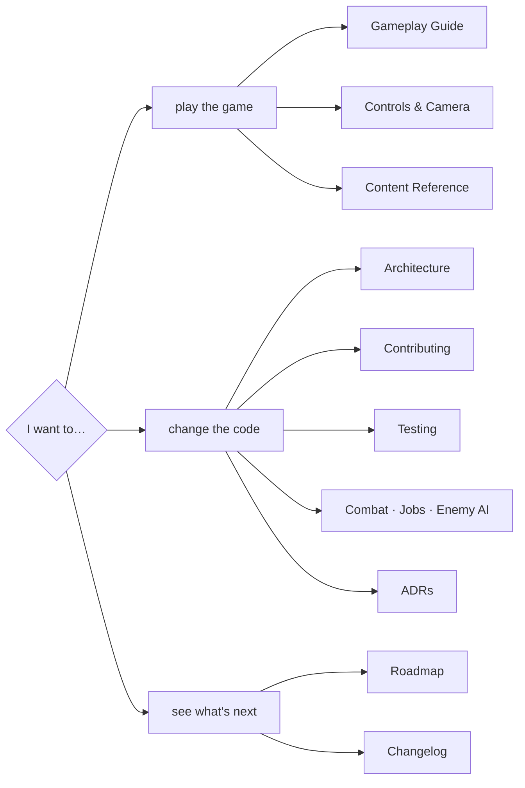

# Documentation

Start with whichever box describes you.

---

## Guides

| Guide | For | What's inside |
| :--- | :--- | :--- |
| **[Gameplay Guide](GAMEPLAY_GUIDE.md)** | Players | Commands, items, positioning, the campaign and world map, the market, bosses, growth, Trials, devices, tips |
| **[Controls & Camera](CONTROLS_AND_CAMERA.md)** | Players · devs | Full input matrix for mouse, keyboard, touch, pen and controller; gesture state machine; responsive breakpoints; camera math |
| **[Content Reference](CONTENT_REFERENCE.md)** | Players · designers | *Generated from the game data:* every job, ability, status, item, supply, map, world-map place, chapter and Trial floor |
| **[Architecture](ARCHITECTURE.md)** | Developers | Module map, game state machine, turn sequence, action pipeline, input flow, data model, saves, build |
| **[Combat System](COMBAT_SYSTEM.md)** | Developers · designers | CT clock, facing geometry, height, damage formulas, terrain costs, bosses, reactions, hit resolution, items |
| **[Job & Ability System](JOB_SYSTEM.md)** | Developers · designers | Five slots, jobs at a glance, prerequisites, EXP/JP/levels, effective stats, armory |
| **[Enemy AI](ENEMY_AI.md)** | Developers | Planner search, scoring table, guarantees, known limits |
| **[Testing](TESTING.md)** | Developers | CI layers, unit test map, browser play-tests, release checklist |
| **[Roadmap](ROADMAP.md)** | Everyone | Release timeline, Now / Next / Later, impact vs effort, known issues |
| **[Online Versus](ONLINE_VERSUS.md)** | Everyone | The plan for 2–4 player online battles on Cloudflare: modes, team building with a JP budget, server design, releases, cost |
| **[Contributing](../CONTRIBUTING.md)** | Developers | Setup, workflow, recipes for abilities, jobs, maps, chapters, items and UI |
| **[Changelog](../CHANGELOG.md)** | Everyone | Every release |

---

## Architectural Decision Records

```mermaid
timeline
    title ADRs by release
    0.1.0 : 0001 Vite + Three.js : 0002 CT turns : 0003 Five slots : 0004 Pixel sprites : 0005 Height pathfinding : 0006 Pages CI
    0.3.0 : 0007 Synth audio : 0008 Multi-map themes
    0.4.0 : 0009 Map editor : 0010 Equipment : 0011 Branching campaign
    0.5.x : 0012 VFX and HUD overlays : 0013 Performance
    0.6.0 : 0014 Reactions, BGM, log, saves
    0.7.0 : 0015 Action pipeline, AI, progression, Trials
    0.8.0 : 0016 Multi-device input, responsive HUD
    0.9.0 : 0017 Lighting, atmosphere and quality tiers
    0.10.0 : 0018 Workshop scenarios, 16x16 maps, character art
    0.11.0 : 0019 Pixel-art effects, path walking, balance sim
    0.12.0 : 0020 itch.io distribution
    0.13.0 : 0021 Ability flags, statuses, gear traits
    0.14.0 : 0022 Job tree, gil economy
    0.15.0 : 0023 Items, world map, market
    0.16.0 : 0024 Side battles, mastery, onboarding
    0.17.0 : 0025 Act II
    0.18.0 : 0026 Difficulty, save slots
    0.19.0 : 0027 Chemist, installable app
    0.20.0 : 0028 Smarter foes, text size
    0.21.0 : 0029 Merchant, camp scenes, trophies
    0.22.0 : 0030 Bard, Dancer, performances
    0.23.0 : 0031 Master signatures
    0.24.0 : 0032 Summons and grand summons
    0.25.0 : 0033 Recruiting and the party
    0.26.0 : 0034 Monsters
    0.27.0 : 0035 Monsters in the story
    0.28.0 : 0036 Beast Tamer
    0.29.0 : 0037 Beast gear
    0.30.0 : 0038 Equipment rules
    0.31.0 : 0039 Smarter enemies
    0.32.0 : 0040 More monsters
    0.34.0 : 0041 Act III, the Far Shore
    0.35.0 : 0042 Act III's finale
    0.36.0 : 0043 The Gunner
    0.37.0 : 0044 Reserve training
    0.38.0 : 0045 Effects per ability
    0.41.0 : 0046 Battle-engine groundwork
```

| # | Decision | Release |
| :---: | :--- | :---: |
| [0001](adr/0001-vite-threejs-isometric-engine.md) | Vite + TypeScript + Three.js for a 2.5D isometric engine | 0.1.0 |
| [0002](adr/0002-ct-speed-tick-turn-system.md) | Speed-based CT turns instead of team turns | 0.1.0 |
| [0003](adr/0003-five-slot-ability-architecture.md) | Five-slot ability equipping | 0.1.0 |
| [0004](adr/0004-billboard-pixel-art-sprites.md) | Procedural pixel-art textures and directional billboards | 0.1.0 |
| [0005](adr/0005-height-jump-pathfinding.md) | Height-constrained Dijkstra pathfinding | 0.1.0 |
| [0006](adr/0006-github-actions-pages-deployment.md) | GitHub Actions deploy to GitHub Pages | 0.1.0 |
| [0007](adr/0007-web-audio-api-sound-synthesizer.md) | Web Audio retro sound synthesis | 0.3.0 |
| [0008](adr/0008-multi-map-theme-architecture.md) | Multi-map generator and thematic lighting | 0.3.0 |
| [0009](adr/0009-in-game-3d-map-editor.md) | In-game 3D map editor (superseded by 0018) | 0.4.0 |
| [0010](adr/0010-equipment-and-inventory-architecture.md) | Five-slot equipment and weapon range | 0.4.0 |
| [0011](adr/0011-branching-campaign-state-machine.md) | Branching campaign and dialogue engine | 0.4.0 |
| [0012](adr/0012-vfx-particles-and-projected-hud.md) | VFX, camera shake, projected overlays (spell particles replaced by 0019) | 0.5.0 |
| [0013](adr/0013-engine-performance-and-memory-pooling.md) | Performance, pooling, decoupled animation loop | 0.5.1 |
| [0014](adr/0014-reactions-bgm-combat-log-persistence.md) | Reactions, procedural BGM, battle log, saves | 0.6.0 |
| [0015](adr/0015-action-pipeline-ai-progression-trials.md) | Unified action pipeline, planning AI, persistent squad, Trials | 0.7.0 |
| [0016](adr/0016-multi-device-input-and-responsive-hud.md) | Multi-device input and responsive HUD | 0.8.0 |
| [0017](adr/0017-lighting-atmosphere-and-quality-tiers.md) | Lighting, atmosphere, merged terrain and quality tiers | 0.9.0 |
| [0018](adr/0018-workshop-scenarios-and-character-art.md) | Workshop scenarios, 16×16 battlefields, procedural character art (supersedes 0009) | 0.10.0 |
| [0020](adr/0020-itch-io-distribution.md) | Distributing on itch.io from the same build: package checks, bundled fonts, title screen, platform detection, butler | 0.12.0 |
| [0021](adr/0021-data-driven-abilities-statuses-and-gear-traits.md) | Data-driven ability flags, statuses and gear traits for the Monk, Thief, Summoner and Oracle; one source for veteran kits | 0.13.0 |
| [0022](adr/0022-job-tree-and-gil-economy.md) | Job levels from lifetime JP, an enforced job tree, a shared-armory shop with price-cap tiers, status pips | 0.14.0 |
| [0027](adr/0027-chemist-and-installable-app.md) | A support ability as the one place items get stronger; ailment-carrying flasks; a build-generated service worker that precaches one version and never runs inside itch | 0.19.0 |
| [0028](adr/0028-smarter-foes-and-text-size.md) | Walking distance for the planner's approach, parry and support-target terms, a lighter Chapter III found by isolating roster changes in the sim; one CSS variable behind every font size | 0.20.0 |
| [0029](adr/0029-world-map-events.md) | A merchant derived from progress rather than saved, with only her current visit's sales kept; camp scenes in the ordinary dialogue box over an inert map; trophies as relics, back-filled for old saves | 0.21.0 |
| [0030](adr/0030-bard-dancer-performances.md) | Performances as an area around the performer that replays at turn start through the normal action path; Encore as a status; ending rules in one module | 0.22.0 |
| [0031](adr/0031-master-signatures.md) | A signature per job earned at Master, kept in every job, once per battle; derived from lifetime JP so saves need nothing new | 0.23.0 |
| [0032](adr/0032-summons.md) | Each summon's creature drawn as an effect over the board; grand summons mark the area and land on the caller's next turn | 0.24.0 |
| [0033](adr/0033-recruiting-and-the-party.md) | A seeded recruiting board at the market; a barracks of ten and a party of six picked before battle, the leader always in | 0.25.0 |
| [0035](adr/0035-monsters-in-the-story.md) | Monsters replace story enemies of similar strength, checked chapter by chapter with the sim; natural stats stand in for gear | 0.27.0 |
| [0036](adr/0036-beast-tamer.md) | Tame wins a hurt monster over on the spot; survivors join the squad as beasts that keep their job and wear no gear | 0.28.0 |
| [0037](adr/0037-beast-gear.md) | Beasts wear only beast gear (barding and a collar), people never do; one `canEquip` rule; sold on its own market shelf | 0.29.0 |
| [0040](adr/0040-more-monsters.md) | Basilisk, Bone Knight and Thornling at a new side battle and the deeper Trials, tuned with the sim against the other side battles | 0.32.0 |
| [0041](adr/0041-act-three-the-far-shore.md) | Act III ships in parts: a second world map across the sea, sand and snow, Kestrel, and two chapters tuned against Chapter VI | 0.34.0 |
| [0042](adr/0042-act-three-finale.md) | Chapter IX ends the act in the Drowned City; the ship's stores trade at the Anchorage; a side battle sized for the shore (`SkirmishDef.size`) | 0.35.0 |
| [0043](adr/0043-gunner.md) | The Gunner: shots that ignore height (`Ability.ignoresHeight`), guns for the Gunner alone, Return Fire and Long Barrel | 0.36.0 |
| [0044](adr/0044-reserve-training.md) | The reserve trains at camp: half a share of each win, the same as a party member who fell | 0.37.0 |
| [0045](adr/0045-per-ability-effects.md) | Arrows and shots in flight, swings per weapon, area bursts; the AI teamwork experiment that changed nothing, shelved | 0.38.0 |
| [0046](adr/0046-battle-engine-groundwork.md) | Groundwork for versus: sides and alliances (`isFoe`), one seeded RNG per battle, `BattleRules`, and the action resolver in `src/core`, shared by the game and the balance sim | 0.41.0 |
| [0039](adr/0039-smarter-enemies.md) | A threat map lets the planner think a turn ahead (light on Normal, full on Hard and AUTO); enemies carry item pouches by role; leftovers are salvaged | 0.31.0 |
| [0038](adr/0038-equipment-rules.md) | Each job has weapon types and armor weights it can use; starting gear complies, so balance holds; job changes swap gear; old saves fixed on load | 0.30.0 |
| [0034](adr/0034-monsters.md) | Monsters are jobs flagged `monster`, with innate statuses and immunities instead of gear, their own art, and player job lists filtered | 0.26.0 |
| [0026](adr/0026-difficulty-and-save-slots.md) | Difficulty as three dials on enemies only; three slots with slot 1 on the old key; imports treated as untrusted; refunds on defeat; the Gate after Act I | 0.18.0 |
| [0025](adr/0025-act-two.md) | A second act as data on the existing chapter graph; finished saves continue; one enemy raise per battle; how Act II was balanced | 0.17.0 |
| [0024](adr/0024-side-battles-mastery-and-onboarding.md) | Generated, replayable side battles as a fourth battle mode; mastery derived from lifetime JP; revive as an ability flag the AI can use; non-blocking tips, undo and battle speed | 0.16.0 |
| [0023](adr/0023-items-world-map-and-market.md) | Consumables resolved as abilities by the one engine, a world map as the hub between missions (branch by marching), trading only at the market, selling | 0.15.0 |
| [0019](adr/0019-pixel-art-effects-and-path-walking.md) | Pixel-art battle effects (pixelfx), path walking, Workshop strokes, balance sim (replaces 0012's spell particles) | 0.11.0 |

New ADRs use the template in [Contributing](../CONTRIBUTING.md#adr-template).

---

## Keeping docs current

| Doc | Kept current by |
| :--- | :--- |
| Content Reference | `npm run docs:gen`; CI fails if it's stale |
| Everything else | Updated in the same PR as the change (see the [definition of done](ROADMAP.md#5-definition-of-done-any-roadmap-item)) |
| Screenshots in `docs/images/` | Re-captured when the HUD changes visibly |
