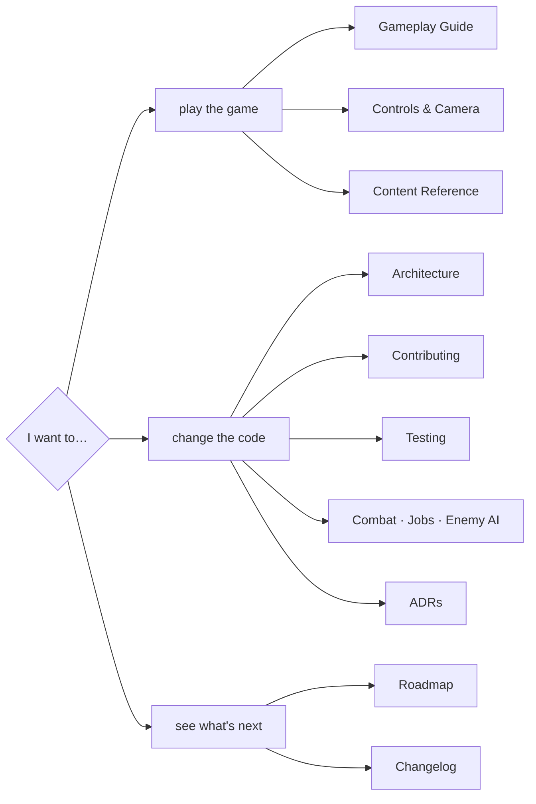
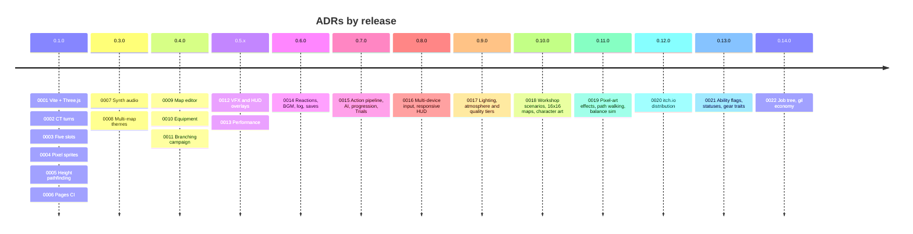

# Documentation

Start with whichever box describes you.

---

## Guides

| Guide | For | What's inside |
| :--- | :--- | :--- |
| **[Gameplay Guide](GAMEPLAY_GUIDE.md)** | Players | Commands, positioning, campaign map, bosses, growth, Trials, devices, tips |
| **[Controls & Camera](CONTROLS_AND_CAMERA.md)** | Players · devs | Full input matrix for mouse, keyboard, touch, pen and controller; gesture state machine; responsive breakpoints; camera math |
| **[Content Reference](CONTENT_REFERENCE.md)** | Players · designers | *Generated from the game data:* every job, ability, status, item, map, chapter and Trial floor |
| **[Architecture](ARCHITECTURE.md)** | Developers | Module map, game state machine, turn sequence, action pipeline, input flow, data model, saves, build |
| **[Combat System](COMBAT_SYSTEM.md)** | Developers · designers | CT clock, facing geometry, height, damage formulas, terrain costs, bosses, reactions, hit resolution |
| **[Job & Ability System](JOB_SYSTEM.md)** | Developers · designers | Five slots, jobs at a glance, prerequisites, EXP/JP/levels, effective stats, armory |
| **[Enemy AI](ENEMY_AI.md)** | Developers | Planner search, scoring table, guarantees, known limits |
| **[Testing](TESTING.md)** | Developers | CI layers, unit test map, browser play-tests, release checklist |
| **[Roadmap](ROADMAP.md)** | Everyone | Release timeline, Now / Next / Later, impact vs effort, known issues |
| **[Contributing](../CONTRIBUTING.md)** | Developers | Setup, workflow, recipes for abilities, jobs, maps, chapters, items and UI |
| **[Changelog](../CHANGELOG.md)** | Everyone | Every release |

---

## Architectural Decision Records

| # | Decision | Release |
| :---: | :--- | :---: |
| [0001](adr/0001-vite-threejs-isometric-engine.md) | Vite + TypeScript + Three.js for a 2.5D isometric engine | 0.1.0 |
| [0002](adr/0002-ct-speed-tick-turn-system.md) | Speed-based CT turns instead of team turns | 0.1.0 |
| [0003](adr/0003-five-slot-ability-architecture.md) | Five-slot ability equipping | 0.1.0 |
| [0004](adr/0004-billboard-pixel-art-sprites.md) | Procedural pixel-art textures and directional billboards | 0.1.0 |
| [0005](adr/0005-height-jump-pathfinding.md) | Height-constrained Dijkstra pathfinding | 0.1.0 |
| [0006](adr/0006-github-actions-pages-deployment.md) | GitHub Actions deploy to GitHub Pages | 0.1.0 |
| [0007](adr/0007-web-audio-api-sound-synthesizer.md) | Web Audio retro sound synthesis | 0.3.0 |
| [0008](adr/0008-multi-map-theme-architecture.md) | Multi-map generator and thematic lighting | 0.3.0 |
| [0009](adr/0009-in-game-3d-map-editor.md) | In-game 3D map editor (superseded by 0018) | 0.4.0 |
| [0010](adr/0010-equipment-and-inventory-architecture.md) | Five-slot equipment and weapon range | 0.4.0 |
| [0011](adr/0011-branching-campaign-state-machine.md) | Branching campaign and dialogue engine | 0.4.0 |
| [0012](adr/0012-vfx-particles-and-projected-hud.md) | VFX, camera shake, projected overlays (spell particles replaced by 0019) | 0.5.0 |
| [0013](adr/0013-engine-performance-and-memory-pooling.md) | Performance, pooling, decoupled animation loop | 0.5.1 |
| [0014](adr/0014-reactions-bgm-combat-log-persistence.md) | Reactions, procedural BGM, battle log, saves | 0.6.0 |
| [0015](adr/0015-action-pipeline-ai-progression-trials.md) | Unified action pipeline, planning AI, persistent squad, Trials | 0.7.0 |
| [0016](adr/0016-multi-device-input-and-responsive-hud.md) | Multi-device input and responsive HUD | 0.8.0 |
| [0017](adr/0017-lighting-atmosphere-and-quality-tiers.md) | Lighting, atmosphere, merged terrain and quality tiers | 0.9.0 |
| [0018](adr/0018-workshop-scenarios-and-character-art.md) | Workshop scenarios, 16×16 battlefields, procedural character art (supersedes 0009) | 0.10.0 |
| [0020](adr/0020-itch-io-distribution.md) | Distributing on itch.io from the same build: package checks, bundled fonts, title screen, platform detection, butler | 0.12.0 |
| [0021](adr/0021-data-driven-abilities-statuses-and-gear-traits.md) | Data-driven ability flags, statuses and gear traits for the Monk, Thief, Summoner and Oracle; one source for veteran kits | 0.13.0 |
| [0022](adr/0022-job-tree-and-gil-economy.md) | Job levels from lifetime JP, an enforced job tree, a shared-armory shop with price-cap tiers, status pips | 0.14.0 |
| [0019](adr/0019-pixel-art-effects-and-path-walking.md) | Pixel-art battle effects (pixelfx), path walking, Workshop strokes, balance sim (replaces 0012's spell particles) | 0.11.0 |

New ADRs use the template in [Contributing](../CONTRIBUTING.md#adr-template).

---

## Keeping docs current

| Doc | Kept current by |
| :--- | :--- |
| Content Reference | `npm run docs:gen`; CI fails if it's stale |
| Everything else | Updated in the same PR as the change (see the [definition of done](ROADMAP.md#5-definition-of-done-any-roadmap-item)) |
| Screenshots in `docs/images/` | Re-captured when the HUD changes visibly |
