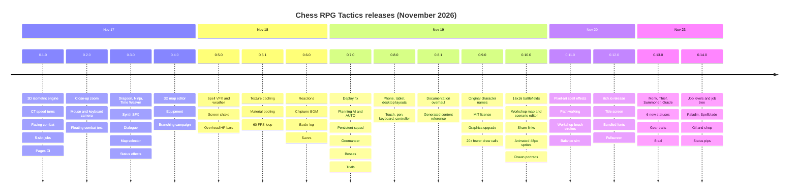
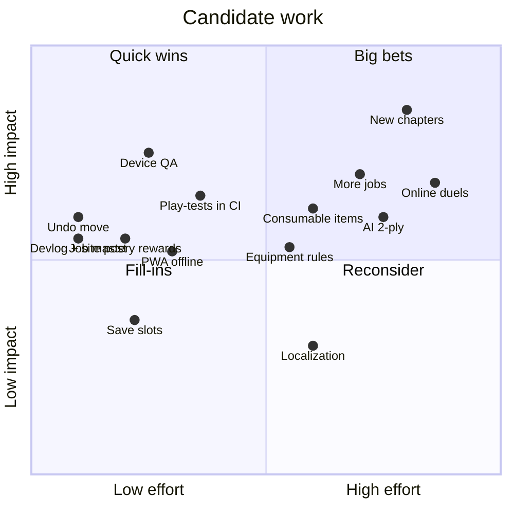
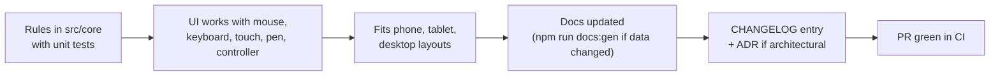

# Roadmap

Where Chess RPG Tactics has been, what's known to be rough, and where it could go next.

> **Everything under "Next" and "Later" is a proposal, not a promise.** Priorities change with playtesting. Shipped work is recorded in the [Changelog](../CHANGELOG.md); design decisions in the [ADRs](README.md#architectural-decision-records).

---

## 1. Shipped so far

| Version | Theme | Highlights |
| :--- | :--- | :--- |
| 0.1–0.3 | Foundations | Isometric engine, CT turns, facing, 8 jobs, audio, dialogue, status effects |
| 0.4 | Content systems | Map editor, gear, branching campaign |
| 0.5 | Feel | VFX, weather, screen shake, performance pass |
| 0.6 | Depth | Reactions, music, battle log, saves (shipped without a changelog entry; see ADR 0014) |
| 0.7 | Make it a game | Deploy fix, AI, progression, Geomancer, bosses, spoils, Trials, 28 tests |
| 0.8 | Play anywhere | Responsive HUD; mouse, keyboard, touch, pen and controller |
| 0.8.1 | Documentation | Rewritten guides, roadmap, generated content reference, docs check in CI |
| 0.9 | Own it, polish it | Original names, MIT license, lighting/sky/water/torches/bloom, quality tiers, merged terrain |
| 0.14 | Progression | Job levels and an enforced job tree, Paladin and Spellblade (15 jobs, 86 abilities), gil and a shop that grows with the campaign, status pips over units, readable HP bars |
| 0.13 | Bigger squad | Monk, Thief, Summoner and Oracle (13 jobs, 75 abilities), Shell / Regen / Blind / Silence / Sleep / Breach, 25 new items with traits, Steal, Rend Armor and Armor Mastery fixed |
| 0.12 | Ship it | itch.io release (HTML5 zip, store page, butler publishing), title screen, fullscreen, bundled fonts, iframe-safe input |
| 0.11 | Feel | Pixel-art spell and hit effects (pixelfx) wrapping the real sprites, units walk their path, Workshop brush strokes, Chapter II-B rebalanced with a headless balance sim |
| 0.10 | Make your own | 16×16 battlefields, the Workshop (map + scenario editor with objectives, library, share links), animated 48px sprites, drawn portraits |

---

## 2. Now / Next / Later

```mermaid
flowchart LR
    subgraph NOW["Now (0.15)"]
        direction TB
        N1["Job mastery rewards"]
        N2["Real-device QA:<br/>iOS Safari, Android, real pads"]
        N3["Commit the Playwright<br/>play-test suite to CI"]
        N4["Devlog + site post<br/>for the itch release"]
    end
    subgraph NEXT["Next (0.16 – 0.18)"]
        direction TB
        X1["Equipment rules:<br/>weapon types per job"]
        X2["Consumable items:<br/>potions, remedies"]
        X3["Smarter AI:<br/>reactions, facing, 2-ply"]
        X4["Undo move"]
        X5["Multiple save slots"]
        X6["Installable PWA, offline"]
    end
    subgraph LATER["Later (1.0+)"]
        direction TB
        L1["Chapter IV+ campaign arc"]
        L2["More jobs: Paladin, Bard,<br/>Dancer; a Revive spell"]
        L3["Workshop: community<br/>scenario gallery"]
        L4["Remappable controls"]
        L5["Localization"]
        L6["Async online duels"]
        L7["Effects for every ability<br/>(per-weapon arcs, projectiles)"]
    end
    NOW --> NEXT --> LATER
```

### Now (0.15): finish and ship what exists

| Item | Why | Size | Notes |
| :--- | :--- | :---: | :--- |
| **Job mastery rewards** | Job levels 4–8 unlock nothing yet | S | A small permanent bonus or a mastery ability per job at Master |
| **Real-device QA** | 0.8.0 input was verified in Chromium with synthesized events only | S | iPhone Safari (gestures, safe areas), Android Chrome, iPad + Pencil, Xbox/PlayStation pads |
| **Play-test suite in CI** | Device matrix, input and campaign bots exist but aren't committed | M | Add Playwright as a dev dependency; run headless in Actions |
| **Devlog** | Tell people what's new | S | itch devlog for 0.13 and 0.14 (the site's project page is live) |

### Next (0.16 – 0.18): depth

| Item | Why | Size |
| :--- | :--- | :---: |
| **Equipment rules**: weapon and armor types per job | Every job can wear everything; Armor Mastery (0.13) could become "wear plate as any job" once rules exist | M |
| **Consumables** (potions, remedies, a revive) and an Item command | Gil has little to buy once the armory is full | M |
| **AI: reactions and facing** | AI ignores Weapon Guard and leaves its back open ([details](ENEMY_AI.md#5-known-limits)) | M |
| **AI: two-ply look-ahead** | Lets enemies set up combos and retreat to heal | L |
| **Undo move** (before acting) | Standard tactics-game comfort | S |
| **Multiple save slots** + export/import | One slot is fragile | S |
| **PWA**: install, offline | Play on phones without a connection | S |
| **Battle speed setting** | Fast mode exists for tests (`?fast`); expose it | S |

### Later (1.0+): breadth

| Item | Size |
| :--- | :---: |
| Campaign Chapters IV–VI with new maps and a third recruit | L |
| More jobs (Paladin, Bard, Dancer) and a Revive spell (needs dead units to be targetable) | L |
| Enemies that steal from you (needs a way to win it back) | S |
| Workshop: a browsable gallery of shared scenarios (needs a small back end); scenario chains (mini campaigns) | M |
| Remappable keyboard and controller bindings | M |
| Localization (strings out of code) | M |
| Asynchronous online duels (exchange turns via a back end) | XL |
| Effects per ability, not just per element: arrows and thrown stones in flight, spear thrusts, a chain lightning for area spells (more pixelfx effects are available) | M |
| Workshop: place props (trees, crates) and per-tile decorations; multi-wave enemies; ally guests | M |

---

## 3. Impact vs effort

---

## 4. Known issues & tech debt

| Area | Issue | Impact | Plan |
| :--- | :--- | :---: | :--- |
| Rules | Speed Save's +2 Speed is lost at the unit's next end of turn (stats are recalculated) | Low | Make it a status |
| Code | `main.ts` (1.5k lines) and `UIManager.ts` (1k lines) are large | Medium | Split battle flow, spoils/chapters and input into modules |
| QA | Input verified only in Chromium with synthetic events | Medium | Now (device QA) |
| QA | High-quality graphics frame rate not yet measured on real GPUs (CI has none); Auto steps down if slow | Medium | Now (device QA) |
| QA | Browser play-tests not in CI | Medium | Now |
| A11y | Font sizes are fixed px; no text-size setting | Low | Next |
| Workshop | Shared scenarios live in links and files only; there's no gallery | Low | Later |
| Balance | `npm run balance` ignores reactions and gear, so its numbers are relative; the Final Chapter is near 0% on pure AUTO (as in 0.9) and needs re-geared or hands-on play | Low | Tune after real playtests |

---

## 5. Definition of done (any roadmap item)

