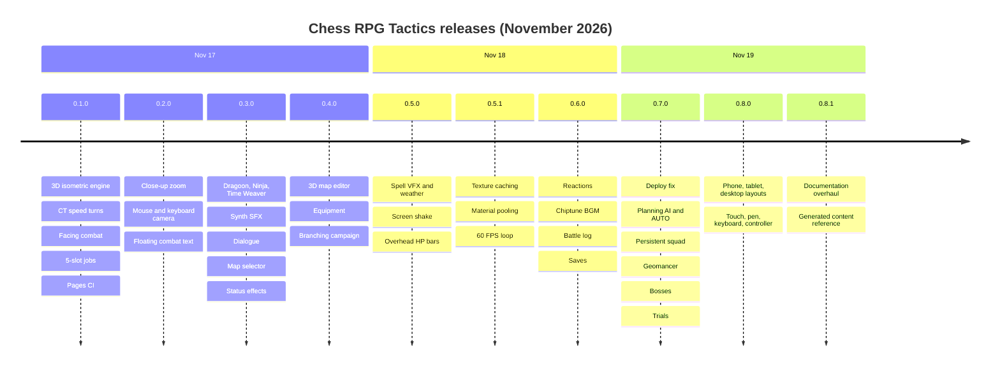
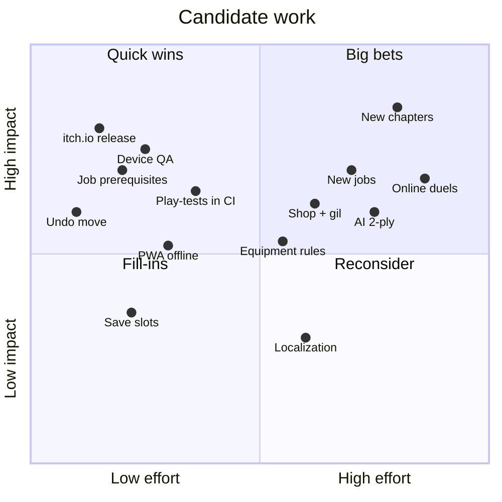
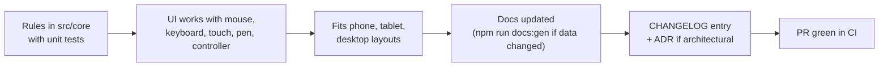

# Roadmap

Where Chess RPG Tactics has been, what's known to be rough, and where it could go next.

> **Everything under "Next" and "Later" is a proposal, not a promise.** Priorities change with playtesting. Shipped work is recorded in the [Changelog](../CHANGELOG.md); design decisions in the [ADRs](README.md#architectural-decision-records).

---

## 1. Shipped so far

| Version | Theme | Highlights |
| :--- | :--- | :--- |
| 0.1–0.3 | Foundations | Isometric engine, CT turns, facing, 8 jobs, audio, dialogue, status effects |
| 0.4 | Content systems | Map editor, gear, branching campaign |
| 0.5 | Feel | VFX, weather, screen shake, performance pass |
| 0.6 | Depth | Reactions, music, battle log, saves (shipped without a changelog entry; see ADR 0014) |
| 0.7 | Make it a game | Deploy fix, AI, progression, Geomancer, bosses, spoils, Trials, 28 tests |
| 0.8 | Play anywhere | Responsive HUD; mouse, keyboard, touch, pen and controller |
| 0.8.1 | Documentation | Rewritten guides, roadmap, generated content reference, docs check in CI |

---

## 2. Now / Next / Later

```mermaid
flowchart LR
    subgraph NOW["Now (0.9)"]
        direction TB
        N1["Job prerequisites enforced"]
        N2["Real-device QA:<br/>iOS Safari, Android, real pads"]
        N3["Commit the Playwright<br/>play-test suite to CI"]
        N4["Release on itch.io<br/>free + donations"]
    end
    subgraph NEXT["Next (0.10 – 0.12)"]
        direction TB
        X1["Equipment rules:<br/>Equip Heavy Armor works"]
        X2["Shop + gil economy"]
        X3["Smarter AI:<br/>reactions, facing, 2-ply"]
        X4["Undo move"]
        X5["Multiple save slots"]
        X6["Installable PWA, offline"]
    end
    subgraph LATER["Later (1.0+)"]
        direction TB
        L1["Chapter IV+ campaign arc"]
        L2["New jobs: Monk, Summoner, Thief"]
        L3["Share custom maps by link"]
        L4["Remappable controls"]
        L5["Localization"]
        L6["Async online duels"]
    end
    NOW --> NEXT --> LATER
```

### Now (0.9): finish and ship what exists

| Item | Why | Size | Notes |
| :--- | :--- | :---: | :--- |
| **Enforce job prerequisites** | The tree is in `jobs.ts` but any unit can take any job, which flattens progression | S | Lock jobs in the Team screen until the required job level; show the requirement |
| **Job levels** | Prerequisites need a job level; today only JP exists | S | Job level from total JP earned in a job |
| **Real-device QA** | 0.8.0 input was verified in Chromium with synthesized events only | S | iPhone Safari (gestures, safe areas), Android Chrome, iPad + Pencil, Xbox/PlayStation pads |
| **Play-test suite in CI** | Device matrix, input and campaign bots exist but aren't committed | M | Add Playwright as a dev dependency; run headless in Actions |
| **itch.io release** | Reach players | S | HTML5 zip build, cover art, free with donations; project post on jeremyanderson.tech |

### Next (0.10 – 0.12): depth

| Item | Why | Size |
| :--- | :--- | :---: |
| **Equipment rules**: heavy armor and weapon types per job; *Equip Heavy Armor* does something | The support ability is a no-op today, and every job can wear everything | M |
| **Shop and gil** | Items have prices that nothing uses; gives Trials rewards a second outlet | M |
| **AI: reactions and facing** | AI ignores Weapon Guard and leaves its back open ([details](ENEMY_AI.md#5-known-limits)) | M |
| **AI: two-ply look-ahead** | Lets enemies set up combos and retreat to heal | L |
| **Undo move** (before acting) | Standard tactics-game comfort | S |
| **Multiple save slots** + export/import | One slot is fragile | S |
| **PWA**: install, offline | Play on phones without a connection | S |
| **Battle speed setting** | Fast mode exists for tests (`?fast`); expose it | S |

### Later (1.0+): breadth

| Item | Size |
| :--- | :---: |
| Campaign Chapters IV–VI with new maps and a third recruit | L |
| New jobs (Monk, Summoner, Thief) with new reactions | L |
| Share editor maps by URL; play custom maps as skirmishes | M |
| Remappable keyboard and controller bindings | M |
| Localization (strings out of code) | M |
| Asynchronous online duels (exchange turns via a back end) | XL |

---

## 3. Impact vs effort

---

## 4. Known issues & tech debt

| Area | Issue | Impact | Plan |
| :--- | :--- | :---: | :--- |
| Rules | Job prerequisites defined but not enforced | Medium | Now |
| Rules | *Equip Heavy Armor* support has no effect | Low | Next (equipment rules) |
| Rules | Item `price` unused | Low | Next (shop) |
| Rules | Speed Save's +2 Speed is lost at the unit's next end of turn (stats are recalculated) | Low | Make it a status |
| Balance | Final Chapter is hard for a squad that never re-gears; AUTO-only play needs retries | Low | Tune after real playtests |
| Code | `main.ts` (1.3k lines) and `UIManager.ts` (1k lines) are large | Medium | Split battle flow, spoils/chapters and input into modules |
| Code | Map editor changes aren't persisted to the save | Low | Wire `SaveManager.saveCustomMap` into the editor |
| QA | Input verified only in Chromium with synthetic events | Medium | Now (device QA) |
| QA | Browser play-tests not in CI | Medium | Now |
| A11y | Font sizes are fixed px; no text-size setting | Low | Next |
| Content | Dialogue portraits are emoji, not art | Low | Later (portrait sprites) |
| Repo | No LICENSE file, so reuse terms are unclear | Low | Choose a license before the itch.io release |

---

## 5. Definition of done (any roadmap item)

