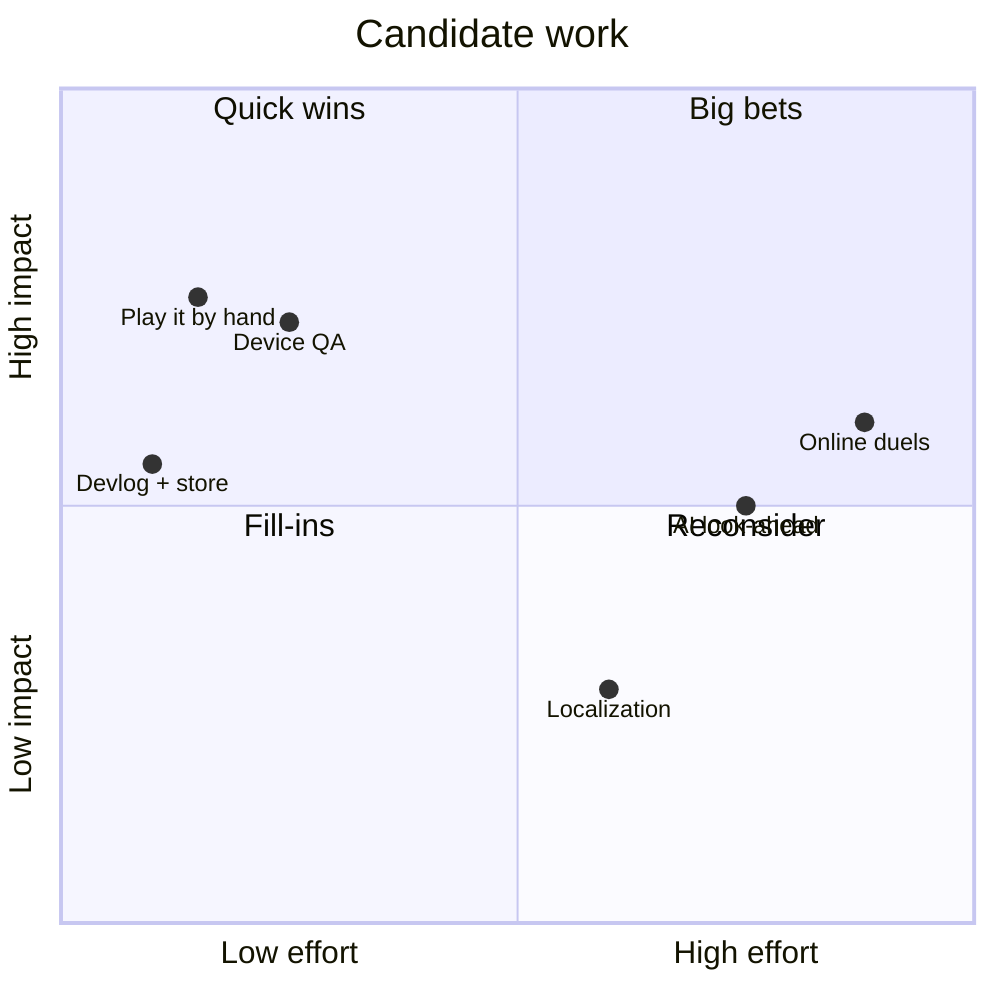
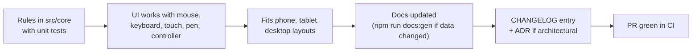

# Roadmap

Where Chess RPG Tactics has been, what's known to be rough, and where it could go next.

> **Everything under "Next" and "Later" is a proposal, not a promise.** Priorities change with playtesting. Shipped work is recorded in the [Changelog](../CHANGELOG.md); design decisions in the [ADRs](README.md#architectural-decision-records).

---

## 1. Shipped so far

```mermaid
timeline
    title Chess RPG Tactics releases (November 2026)
    section Nov 17
        0.1.0 : 3D isometric engine : CT speed turns : Facing combat : 5-slot jobs : Pages CI
        0.2.0 : Close-up zoom : Mouse and keyboard camera : Floating combat text
        0.3.0 : Dragoon, Ninja, Time Weaver : Synth SFX : Dialogue : Map selector : Status effects
        0.4.0 : 3D map editor : Equipment : Branching campaign
    section Nov 18
        0.5.0 : Spell VFX and weather : Screen shake : Overhead HP bars
        0.5.1 : Texture caching : Material pooling : 60 FPS loop
        0.6.0 : Reactions : Chiptune BGM : Battle log : Saves
    section Nov 19
        0.7.0 : Deploy fix : Planning AI and AUTO : Persistent squad : Geomancer : Bosses : Trials
        0.8.0 : Phone, tablet, desktop layouts : Touch, pen, keyboard, controller
        0.8.1 : Documentation overhaul : Generated content reference
        0.9.0 : Original character names : MIT license : Graphics upgrade : 20x fewer draw calls
        0.10.0 : 16x16 battlefields : Workshop map and scenario editor : Share links : Animated 48px sprites : Drawn portraits
    section Nov 20
        0.11.0 : Pixel-art spell effects : Path walking : Workshop brush strokes : Balance sim
        0.12.0 : itch.io release : Title screen : Bundled fonts : Fullscreen
    section Nov 23
        0.13.0 : Monk, Thief, Summoner, Oracle : 6 new statuses : Gear traits : Steal
        0.14.0 : Job levels and job tree : Paladin, Spellblade : Gil and shop : Status pips
        0.15.0 : Items in battle : World map between missions : Market, buy and sell : Haste effect fix
        0.16.0 : Side battles : Job mastery : Raise : Undo move, battle speed, tips
        0.17.0 : Act II, Chapters IV to VI : Three battlefields : Sable joins : Enemy raise cap
        0.18.0 : Easy, Normal, Hard : Three save slots, export and import : Supplies refunded on defeat : Trials after Chapter III
        0.19.0 : Chemist job : Frost Flask, Elixir : Installable app, plays offline
        0.20.0 : Enemies path, face and focus healers : Chapter III rebalanced : Text size
        0.21.0 : Travelling merchant : Camp scenes : Side-battle trophies
        0.22.0 : Bard and Dancer : Performances that play each turn : Encore and Resonance
        0.23.0 : Master signatures for all 18 jobs
        0.24.0 : Summons on screen : Grand summons that land next turn
        0.25.0 : Recruiting board : Barracks of ten : Choose your party of six
        0.26.0 : Monsters : Howling Hollow side battle : Beasts in the Trials
        0.27.0 : Monsters in every story chapter from II : Natural stats for monsters
        0.28.0 : Beast Tamer job : Tame monsters : Beasts join the squad
        0.29.0 : Beast gear: barding and collars
        0.30.0 : Equipment rules per job
        0.31.0 : Enemies think a turn ahead : Enemies use items
        0.32.0 : Basilisk, Bone Knight, Thornling : The Briar Barrow
        0.33.0 : A Basilisk and a Bone Knight in Act II
        0.34.0 : Act III begins : The Far Shore : Sand and snow
        0.35.0 : Act III's finale : The Drowned City : Glasswing Dunes : Ship's stores
        0.36.0 : The Gunner (20 jobs)
        0.36.1 : Gunner Speed fix
        0.37.0 : Reserve training
        0.38.0 : Effects per ability
        0.39.0 : Memories by the fire
        0.40.0 : Remappable controls
        0.41.0 : Battle-engine groundwork
        0.42.0 : Scenario chains
        0.43.0 : Recruit side stories
        0.44.0 : Engine groundwork 2
        0.45.0 : Balance pass
        0.46.0 : The Dark Knight (21 jobs)
        0.47.0 : The Shaman and totems (22 jobs)
        0.48.0 : Hazards, hold zones, Cinder Spring
        0.49.0 : The Ranger and hidden traps (23 jobs)
        0.50.0 : Spells change the ground
        0.51.0 : Emberback, Frost Sprite, Bog Lurker
        0.52.0 : The Necromancer and thralls (24 jobs)
        0.53.0 : Ground in the story
        0.54.0 : The Sapper and earthworks (25 jobs)
        0.55.0 : Weather
        0.56.0 : Ground in Acts II and III
```

| Version | Theme | Highlights |
| :--- | :--- | :--- |
| 0.1–0.3 | Foundations | Isometric engine, CT turns, facing, 8 jobs, audio, dialogue, status effects |
| 0.4 | Content systems | Map editor, gear, branching campaign |
| 0.5 | Feel | VFX, weather, screen shake, performance pass |
| 0.6 | Depth | Reactions, music, battle log, saves (shipped without a changelog entry; see ADR 0014) |
| 0.7 | Make it a game | Deploy fix, AI, progression, Geomancer, bosses, spoils, Trials, 28 tests |
| 0.8 | Play anywhere | Responsive HUD; mouse, keyboard, touch, pen and controller |
| 0.8.1 | Documentation | Rewritten guides, roadmap, generated content reference, docs check in CI |
| 0.9 | Own it, polish it | Original names, MIT license, lighting/sky/water/torches/bloom, quality tiers, merged terrain |
| 0.56 | Ground in Acts II and III | Greywatch Isle is a Hold battle; a well in the rain on Stormbreak Cape, saltglass and buried traps on the Saltglass Shore, a hot spring in Frostfang Pass, foul air in the Drowned City |
| 0.55 | Weather | Rain (fire weaker, lightning stronger, nothing burns), snow (ice stronger, Move −1) and fog (blows from afar miss more) in Chapters VI and VIII, two side battles, deep Trials floors and the Workshop |
| 0.54 | The Sapper | A new advanced job (Chemist 3 + Geomancer 2; 25 jobs) that reshapes the map: barricades, earth raised or dug out, demolition charges; a Raider Sapper at Watchfire Ridge; chapters carry their own ground, so 0.53's no longer leaks into other battles |
| 0.53 | Ground in the story | Chapter II-B is a Hold battle at the gate, with traps the defenders laid; miasma and a clean spring in the Gloomy Mire; Emberwick Harbor burns; the enemy guards a zone instead of rushing it; the Workshop paints traps |
| 0.52 | The Necromancer | A new advanced job (Black Mage 3 + Oracle 2; 24 jobs) who raises fallen foes as thralls for 3 turns (then they crumble for good) and bursts bodies; enemy Necromancers can raise your fallen; a Grave Cultist at the Drowned Shrine |
| 0.51 | Creatures of fire, frost and bog | Emberback, Frost Sprite and Bog Lurker: each makes its own ground, and two thrive on it (healed, not hurt); in three side battles and the deep Trials; tameable |
| 0.50 | Spells change the ground | Fire area spells leave embers for 2 rounds, ice puts embers out (even a map's own, for a while), Poison Cloud leaves miasma; the AI weighs it; first-time tips for burning ground and traps |
| 0.49 | The Ranger | A new advanced job (Archer 3 + Thief 2; 23 jobs) who hides traps the other side can't see: the first foe to walk into one stops there and is snared, spiked, smoked or put to sleep; a Bandit Trapper at Thornwood Ford |
| 0.48 | Hazards and hold zones | Embers, miasma and healing springs on the ground; a Hold objective; the Cinder Spring side battle on a new caldera map; a Ground tool and Hold objective in the Workshop |
| 0.47 | The Shaman | A new advanced job (White Mage 3 + Geomancer 2; 22 jobs) that plants totems: the first effects that stay on the field, pulsing on whoever starts a turn near them (Mending, Warding, Binding, Storm, the Ancestral signature); the AI plants them and steps around them |
| 0.46 | The Dark Knight | A new advanced job (Knight 3 + Black Mage 2; 21 jobs): techniques paid in HP, which Silence can't stop; Shadow Blade, Soul Rend, Dread, Night Ring, Black Oath, Vengeance, Blood Pact, the Eclipse signature; a like-for-like job sweep (`SWAP`) |
| 0.45 | Balance pass | AUTO holds back (Chapter IV's drop was AUTO walking lone units into deadly spots); Chapter V's wyvern and two Mire enemies down a level; a job sweep and why it doesn't rank jobs yet |
| 0.44 | Engine groundwork 2 | No visible change: the turn loop and victory check in `core/Battle.ts`, events, whole-battle replays; the balance sim on the engine (and Chapter IV flagged) |
| 0.43 | Recruit side stories | Bria, Sable and Kestrel each get a chapter at their home village: written scenes, a boss, foes at the squad's level, a relic each |
| 0.42 | Scenario chains | Mini campaigns from Workshop scenarios: the Chains tab, play in order with progress kept, `#c=` links and chain files |
| 0.41 | Battle-engine groundwork | No visible change: sides and alliances, one seeded RNG per battle, battle rules, and the action resolver moved into `src/core` and shared with the balance sim; the first step toward [online versus](ONLINE_VERSUS.md) |
| 0.40 | Remappable controls | Every key and controller button on the Controls screen can be changed (the cursor keys, Enter, Space, Esc, d-pad, sticks and triggers stay fixed); clashes swap rather than unbind; kept per browser |
| 0.39 | Memories by the fire | Camp scenes seen in any playthrough of a save can be watched again from the world map, in story order (no JP the second time) |
| 0.38 | Effects per ability | Arrows and bullets fly from shooter to target (muzzle flash, a shotgun fan for Scattershot); spears thrust, fists uppercut, whips crack, beasts claw, the Brute smashes; ice and lightning area spells burst over the area; Jump, Flash Powder and the Gunner's rounds have their own looks. An AI teamwork experiment for Hard was measured, changed nothing, and was shelved |
| 0.37 | Reserve training | Units left out of the party train at camp: half a share of every win (+20 EXP, +30 JP), the same as a party member who fell (raised from 15 EXP and 20 JP); a RESERVE row on the spoils screen |
| 0.36.1 | Gunner Speed | The Gunner's Speed now matches the Archer's: one point decided who fired first in Chapter VII, where the Gunner squad had been losing far more |
| 0.36 | The Gunner | A new advanced job (Archer 3 + Thief 2; 20 jobs, 121 abilities): guns reach any height in range and high ground neither helps nor hurts the shot; Steady Shot, Hobble Shot, Flash Powder, Breaching Round, Scattershot, Return Fire, Long Barrel, the Thunder Volley signature; three guns |
| 0.35 | Act III's finale | Chapter IX in the Drowned City against the Pale Heir, with its own closing screen; the Glasswing Dunes side battle; the ship's quartermaster trades at the Anchorage; camp scenes after Chapters VIII and IX; the Tidecrown, the Glasswing Lance and the Pale Pearl |
| 0.34 | Act III begins | Sail from Emberwick to the Far Shore, a second world map; Chapter VII (Saltglass Shore) and VIII (Frostfang Pass) on sand and snow; Kestrel the Beast Tamer joins; two new pieces of gear; Dust Devil and Whiteout for Geomancers |
| 0.33 | Beasts in Act II | A Cliff Basilisk in Chapter V and a Drowned Knight in the Final Chapter, each swapped in for the enemy that kept the chapter's simulated difficulty closest |
| 0.32 | New beasts | Basilisk, Bone Knight and Thornling, with their own art; the Briar Barrow side battle and its relic, the Basilisk Eye; deeper Trials floors; all tameable |
| 0.31 | Smarter enemies | Enemies weigh what you could do to them next turn (hurt ones on Normal, everyone on Hard) and carry Potions and more by role; 🎒 on their card; salvage what they didn't use |
| 0.30 | Gear by job | Each job uses its own weapon types, and shields, heavy armor and robes belong to some jobs; job changes swap gear for the best you own; the Team screen and market show who can use what |
| 0.29 | Beast gear | Six pieces of barding and collars only tamed beasts can wear, on their own market shelf; every new beast arrives in a Leather Collar |
| 0.28 | Beast Tamer | The Beast Tamer (19 jobs, 114 abilities): Tame wins a hurt monster over to fight for you, and survivors join the squad as named beasts that wear no gear; Snare, Treat, Soothe, Snarl, Beast Lore and the Stampede signature; the Drover's Whip |
| 0.27 | Into the story | A monster in every story battle from Chapter II, each introduced in the dialogue; monsters get natural stats in place of gear; Lure toned down; every chapter checked against the balance sim |
| 0.26 | Monsters | Five monsters with bodies and abilities of their own (Dire Wolf, Wyvern, Bog Ooze, Marsh Wisp, Stonehide Brute); the Howling Hollow side battle and its trophy; monsters on Trials floors from 3; Workshop enemies |
| 0.25 | Recruits | A recruiting board at the market (three hopefuls, new after each win, more jobs as the story goes on); a barracks of ten; choose a party of six before each battle; dismiss hires |
| 0.24 | Summons | Every summon's creature drawn over the battlefield (Salamander, Undine, Storm Roc, Sylph, Golem, Celestial Call); three grand summons (Cinderwing, Tidewyrm, Elder Wyrm) that mark their area and land on the caller's next turn; the Chapter V boss calls one |
| 0.23 | Signatures | Mastering a job brings its signature: 18 once-a-battle actions, kept in every job |
| 0.22 | Encore | The Bard and the Dancer (18 jobs, 105 abilities); songs and dances that play again each turn the performer holds its ground; two new reactions; job changes can't leave HP above the maximum |
| 0.21 | On the road | Wenna the Pedlar, a travelling merchant with early gear and goods of her own; six camp scenes between story battles; a trophy for the first win at each side battle; 6 new items (60) |
| 0.20 | Smarter foes | Enemies walk the real path round cliffs, face their foes, respect Weapon Guard and drop healers first; Chapter III rebalanced (0% → about 30–60% in the sim); a text-size setting |
| 0.19 | Kit and reach | The Chemist (16 jobs, 93 abilities) with Pharmacology for supplies, Frost Flask and Elixir (8 supplies), an installable app that plays offline |
| 0.18 | Choices for the player | Easy / Normal / Hard, three save slots with export and import, a lost battle returns its supplies, the Trials open after Chapter III |
| 0.17 | A second act | Chapters IV to VI on three new battlefields (harbor piers, a lighthouse rock, a cliff altar), a third recruit, six battles per playthrough; finished saves continue; enemies raise once per battle |
| 0.16 | Room to grow | Three replayable side battles on the map, permanent job mastery bonuses at job level 5 and 8, the White Mage's Raise (used by the AI too), undo move, a Fast battle speed, first-battle tips |
| 0.15 | A world between battles | The Item command and six supplies (a revive among them), a world map where the story branch is a march and defeat is a retreat, Larkmoor Market with buy and sell, the Haste effect back on the unit |
| 0.14 | Progression | Job levels and an enforced job tree, Paladin and Spellblade (15 jobs, 86 abilities), gil and a shop that grows with the campaign, status pips over units, readable HP bars |
| 0.13 | Bigger squad | Monk, Thief, Summoner and Oracle (13 jobs, 75 abilities), Shell / Regen / Blind / Silence / Sleep / Breach, 25 new items with traits, Steal, Rend Armor and Armor Mastery fixed |
| 0.12 | Ship it | itch.io release (HTML5 zip, store page, butler publishing), title screen, fullscreen, bundled fonts, iframe-safe input |
| 0.11 | Feel | Pixel-art spell and hit effects (pixelfx) wrapping the real sprites, units walk their path, Workshop brush strokes, Chapter II-B rebalanced with a headless balance sim |
| 0.10 | Make your own | 16×16 battlefields, the Workshop (map + scenario editor with objectives, library, share links), animated 48px sprites, drawn portraits |

---

## 2. Now / Next / Later

*Reviewed for 0.56.0. The game now has a three-act campaign across two world maps, side battles, a market, items, mastery, difficulty, save slots and an installable offline build; most of what's left is depth for players who stay, and checks only a person can make.*

```mermaid
flowchart LR
    subgraph NOW["Now (0.28): needs a person"]
        direction TB
        N1["Play the campaign by hand:<br/>Chapter III, Act II"]
        N2["Real-device QA:<br/>iOS Safari, Android, pads"]
        N3["Install the app on a phone;<br/>play offline"]
        N4["Devlog + store update"]
    end
    subgraph NEXT["Next (0.46 –): new jobs"]
        direction TB
        X5["New jobs"]
        X6["A fair job comparison"]
        X1["AI: simulate foe turns"]
    end
    subgraph LATER["Later (1.0+): breadth"]
        direction TB
        L4["Workshop gallery"]
        L6["Localization"]
        L7["Online versus, 2–4 players<br/>(groundwork from 0.41)"]
    end
    NOW --> NEXT --> LATER
```

### Now (0.28): checks that need a person

| Item | Why | Size | Notes |
| :--- | :--- | :---: | :--- |
| **Play the campaign by hand** | Act II, difficulty and 0.20's Chapter III change were tuned by an AI-versus-AI sim with a starter-geared squad | S | One run on Normal, one on Easy; note where it drags (Chapter V is the lowest in the sim now); judge whether a summon's 2–3 s show wears thin (a skip setting is a small follow-up) |
| **Real-device QA** | Input has only been verified in Chromium with synthesized events | S | iPhone Safari (gestures, safe areas), Android Chrome, iPad + Pencil, Xbox/PlayStation pads |
| **Install the app and play offline** | 0.19's offline build was tested in headless Chrome only | S | Android Chrome (Install app), iPhone Safari (Share → Add to Home Screen), desktop Chrome/Edge |
| **Devlog and store update** | Devlogs for 0.13 to 0.23 are posted; 0.24's summons need one, with a clip | S | A short GIF of a grand summon would show the job best |

### Next (0.57 –): new jobs and ground

The engine groundwork is done (0.41, 0.44) and the chapters had a balance pass on it (0.45). The Dark Knight (0.46) and the Shaman (0.47) came next, tuned with a like-for-like sweep (`SWAP=p1:<job>` for melee, `p3` for the back line). Totems (0.47) let tiles carry effects, 0.48 put hazards and hold zones on maps, 0.49 added traps hidden from the other side, 0.50 let spells burn, douse and poison the ground, 0.51 brought monsters that make it and thrive on it, the Necromancer (0.52) put the fallen back to work, 0.53 brought hazards, a hold and traps into the story, the Sapper (0.54) changes the map's shape, weather (0.55) changes the elements and the ground, and 0.56 gave every later chapter ground of its own.

| Item | Why | Size |
| :--- | :--- | :---: |
| **More new jobs** | The Dark Knight (0.46) added HP costs, the Shaman (0.47) totems on the field, the Necromancer (0.52) thralls, the Sapper (0.54) earthworks | M |
| **Mirror duels** | `SWAP` (0.46) compares jobs like for like, but each chapter rewards different things (ADR 0051). Duels on flat ground would rank raw strength | S |
| **AI: a real second ply** | Since 0.31 enemies avoid likely KOs and use items. Scoring terms for combos with allies were tried in 0.38 and changed nothing in the sim; simulating the squad's real replies is the remaining idea, if hand play shows Hard is too easy ([details](ENEMY_AI.md#5-known-limits)) | L |

### Later (1.0+): breadth

| Item | Size |
| :--- | :---: |
| Enemies that steal from you (needs a way to win it back) | S |
| Workshop: a browsable gallery of shared scenarios (needs a small back end); scenario chains (mini campaigns); props and multi-wave enemies | M |
| Localization (strings out of code) | M |
| **Online versus for 2–4 players** on Cloudflare: duels, free-for-all and 2v2, with preset, built (JP budget) or campaign teams. Every match setting is configurable (a rule set). The code groundwork starts in 0.41; the versus releases come later: [Online Versus](ONLINE_VERSUS.md) | XL |

---

## 3. Impact vs effort

---

## 4. Known issues & tech debt

| Area | Issue | Impact | Plan |
| :--- | :--- | :---: | :--- |
| Progression | Master takes 1,900 lifetime JP in one job (about 20 battles in it), so signatures are a late-game reward; whether that pace feels right needs a hand play-through | Low | Now (play it by hand) |
| Balance | The Mire (II-A) and Chapter III are still the sim's low points (Mire 5 / 9 / 27%, III 3 / 9 / 11% at levels 3–5, Normal). The Mire's orders now say it's the harder road | Medium | A hand play-through decides (Now) |
| Balance | Act II and the difficulty settings are tuned by simulation only (AI against AI, starter gear, no items) | Medium | Now (play it by hand) |
| QA | Input verified only in Chromium with synthetic events | Medium | Now (device QA) |
| QA | High-quality graphics frame rate not yet measured on real GPUs (CI has none); Auto steps down if slow | Medium | Now (device QA) |
| QA | Browser play-tests in CI cover the main flows only (8 checks); each release's new features are still checked by hand-run scripts | Low | Add a check per feature as it lands |
| App | The offline build is tested in headless Chrome only; iOS installs from Safari's Share menu (no Install button there) | Low | Now (install on a phone) |
| App | An installed app picks up a new version on the next launch after it downloads, not instantly | Low | Fine for now |
| Code | `main.ts` (2.8k lines) and `UIManager.ts` (1.2k lines) are large. Action resolution moved out in 0.41 | Medium | Part 2 of the engine groundwork moves turn start, end of turn and victory to `src/core`; then saves, the map host and input |
| Rules | Speed Save's +2 Speed is lost at the unit's next end of turn (stats are recalculated) | Low | Make it a status |
| A11y | Text size scales every UI label of 22px or less; the large title art keeps its size | Low | Fine for now |
| Saves | Export downloads may be blocked inside the itch.io embed; Copy works there | Low | Fine for now |
| Tips | First-battle tips are remembered per device, not per save, and don't show controller glyphs | Low | Fine for now |
| World map | Workshop battles and the battlefield picker sit outside the map; New Game starts in Chapter I without showing it | Low | Fine for now |
| Workshop | Shared scenarios live in links and files only; there's no gallery | Low | Later |
| World map | The merchant has three goods of her own, so late in the game she runs out | Low | Later |
| World map | The Far Shore's ship's stores sell the market's stock, but hiring still means sailing home to Larkmoor | Low | Fine for now |
| Balance | Side-battle rosters are drawn at random per level and visit, and a draw heavy in wyverns is far harder than the rest (the Glasswing Dunes: 87–100% on a first visit, 10–40% at full heat in the sim) | Low | Revisit after a hand play-through |
| Balance | Chapter VIII lost a seventh enemy in tuning: any seventh unit took it to about 5% in the sim, so the pass fort holds six | Low | Revisit after a hand play-through |
| Art | The itch banner image still says "Fifteen jobs" | Low | Regenerate with the next store update |

---

## 5. Definition of done (any roadmap item)

