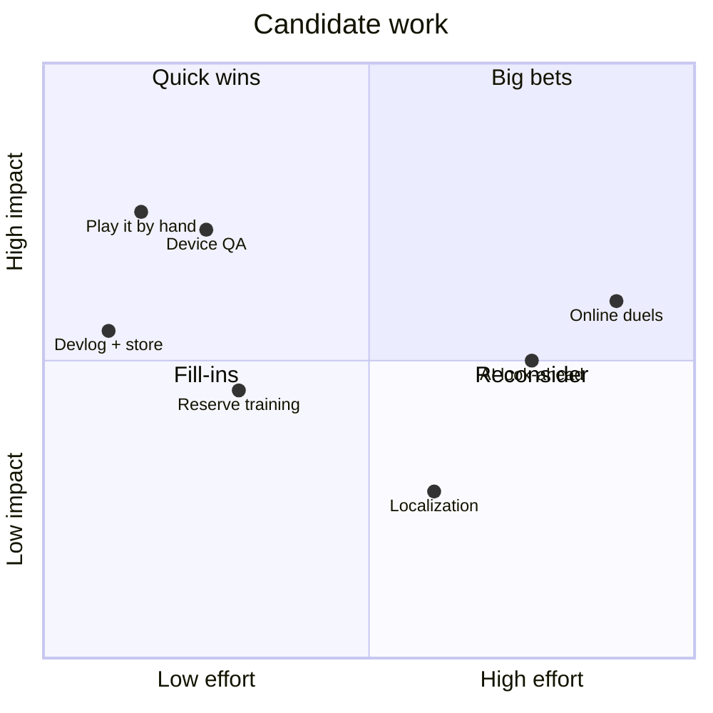
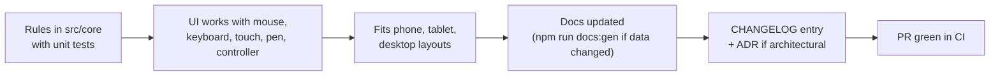

# Roadmap

Where Chess RPG Tactics has been, what's known to be rough, and where it could go next.

> **Everything under "Next" and "Later" is a proposal, not a promise.** Priorities change with playtesting. Shipped work is recorded in the [Changelog](../CHANGELOG.md); design decisions in the [ADRs](README.md#architectural-decision-records).

---

## 1. Shipped so far

```mermaid
timeline
    title Chess RPG Tactics releases (November 2026)
    section Nov 17
        0.1.0 : 3D isometric engine : CT speed turns : Facing combat : 5-slot jobs : Pages CI
        0.2.0 : Close-up zoom : Mouse and keyboard camera : Floating combat text
        0.3.0 : Dragoon, Ninja, Time Weaver : Synth SFX : Dialogue : Map selector : Status effects
        0.4.0 : 3D map editor : Equipment : Branching campaign
    section Nov 18
        0.5.0 : Spell VFX and weather : Screen shake : Overhead HP bars
        0.5.1 : Texture caching : Material pooling : 60 FPS loop
        0.6.0 : Reactions : Chiptune BGM : Battle log : Saves
    section Nov 19
        0.7.0 : Deploy fix : Planning AI and AUTO : Persistent squad : Geomancer : Bosses : Trials
        0.8.0 : Phone, tablet, desktop layouts : Touch, pen, keyboard, controller
        0.8.1 : Documentation overhaul : Generated content reference
        0.9.0 : Original character names : MIT license : Graphics upgrade : 20x fewer draw calls
        0.10.0 : 16x16 battlefields : Workshop map and scenario editor : Share links : Animated 48px sprites : Drawn portraits
    section Nov 20
        0.11.0 : Pixel-art spell effects : Path walking : Workshop brush strokes : Balance sim
        0.12.0 : itch.io release : Title screen : Bundled fonts : Fullscreen
    section Nov 23
        0.13.0 : Monk, Thief, Summoner, Oracle : 6 new statuses : Gear traits : Steal
        0.14.0 : Job levels and job tree : Paladin, Spellblade : Gil and shop : Status pips
        0.15.0 : Items in battle : World map between missions : Market, buy and sell : Haste effect fix
        0.16.0 : Side battles : Job mastery : Raise : Undo move, battle speed, tips
        0.17.0 : Act II, Chapters IV to VI : Three battlefields : Sable joins : Enemy raise cap
        0.18.0 : Easy, Normal, Hard : Three save slots, export and import : Supplies refunded on defeat : Trials after Chapter III
        0.19.0 : Chemist job : Frost Flask, Elixir : Installable app, plays offline
        0.20.0 : Enemies path, face and focus healers : Chapter III rebalanced : Text size
        0.21.0 : Travelling merchant : Camp scenes : Side-battle trophies
        0.22.0 : Bard and Dancer : Performances that play each turn : Encore and Resonance
        0.23.0 : Master signatures for all 18 jobs
        0.24.0 : Summons on screen : Grand summons that land next turn
        0.25.0 : Recruiting board : Barracks of ten : Choose your party of six
        0.26.0 : Monsters : Howling Hollow side battle : Beasts in the Trials
        0.27.0 : Monsters in every story chapter from II : Natural stats for monsters
        0.28.0 : Beast Tamer job : Tame monsters : Beasts join the squad
        0.29.0 : Beast gear: barding and collars
        0.30.0 : Equipment rules per job
        0.31.0 : Enemies think a turn ahead : Enemies use items
        0.32.0 : Basilisk, Bone Knight, Thornling : The Briar Barrow
        0.33.0 : A Basilisk and a Bone Knight in Act II
        0.34.0 : Act III begins : The Far Shore : Sand and snow
        0.35.0 : Act III's finale : The Drowned City : Glasswing Dunes : Ship's stores
        0.36.0 : The Gunner (20 jobs)
        0.36.1 : Gunner Speed fix
```

| Version | Theme | Highlights |
| :--- | :--- | :--- |
| 0.1–0.3 | Foundations | Isometric engine, CT turns, facing, 8 jobs, audio, dialogue, status effects |
| 0.4 | Content systems | Map editor, gear, branching campaign |
| 0.5 | Feel | VFX, weather, screen shake, performance pass |
| 0.6 | Depth | Reactions, music, battle log, saves (shipped without a changelog entry; see ADR 0014) |
| 0.7 | Make it a game | Deploy fix, AI, progression, Geomancer, bosses, spoils, Trials, 28 tests |
| 0.8 | Play anywhere | Responsive HUD; mouse, keyboard, touch, pen and controller |
| 0.8.1 | Documentation | Rewritten guides, roadmap, generated content reference, docs check in CI |
| 0.9 | Own it, polish it | Original names, MIT license, lighting/sky/water/torches/bloom, quality tiers, merged terrain |
| 0.36.1 | Gunner Speed | The Gunner's Speed now matches the Archer's: one point decided who fired first in Chapter VII, where the Gunner squad had been losing far more |
| 0.36 | The Gunner | A new advanced job (Archer 3 + Thief 2; 20 jobs, 121 abilities): guns reach any height in range and high ground neither helps nor hurts the shot; Steady Shot, Hobble Shot, Flash Powder, Breaching Round, Scattershot, Return Fire, Long Barrel, the Thunder Volley signature; three guns |
| 0.35 | Act III's finale | Chapter IX in the Drowned City against the Pale Heir, with its own closing screen; the Glasswing Dunes side battle; the ship's quartermaster trades at the Anchorage; camp scenes after Chapters VIII and IX; the Tidecrown, the Glasswing Lance and the Pale Pearl |
| 0.34 | Act III begins | Sail from Emberwick to the Far Shore, a second world map; Chapter VII (Saltglass Shore) and VIII (Frostfang Pass) on sand and snow; Kestrel the Beast Tamer joins; two new pieces of gear; Dust Devil and Whiteout for Geomancers |
| 0.33 | Beasts in Act II | A Cliff Basilisk in Chapter V and a Drowned Knight in the Final Chapter, each swapped in for the enemy that kept the chapter's simulated difficulty closest |
| 0.32 | New beasts | Basilisk, Bone Knight and Thornling, with their own art; the Briar Barrow side battle and its relic, the Basilisk Eye; deeper Trials floors; all tameable |
| 0.31 | Smarter enemies | Enemies weigh what you could do to them next turn (hurt ones on Normal, everyone on Hard) and carry Potions and more by role; 🎒 on their card; salvage what they didn't use |
| 0.30 | Gear by job | Each job uses its own weapon types, and shields, heavy armor and robes belong to some jobs; job changes swap gear for the best you own; the Team screen and market show who can use what |
| 0.29 | Beast gear | Six pieces of barding and collars only tamed beasts can wear, on their own market shelf; every new beast arrives in a Leather Collar |
| 0.28 | Beast Tamer | The Beast Tamer (19 jobs, 114 abilities): Tame wins a hurt monster over to fight for you, and survivors join the squad as named beasts that wear no gear; Snare, Treat, Soothe, Snarl, Beast Lore and the Stampede signature; the Drover's Whip |
| 0.27 | Into the story | A monster in every story battle from Chapter II, each introduced in the dialogue; monsters get natural stats in place of gear; Lure toned down; every chapter checked against the balance sim |
| 0.26 | Monsters | Five monsters with bodies and abilities of their own (Dire Wolf, Wyvern, Bog Ooze, Marsh Wisp, Stonehide Brute); the Howling Hollow side battle and its trophy; monsters on Trials floors from 3; Workshop enemies |
| 0.25 | Recruits | A recruiting board at the market (three hopefuls, new after each win, more jobs as the story goes on); a barracks of ten; choose a party of six before each battle; dismiss hires |
| 0.24 | Summons | Every summon's creature drawn over the battlefield (Salamander, Undine, Storm Roc, Sylph, Golem, Celestial Call); three grand summons (Cinderwing, Tidewyrm, Elder Wyrm) that mark their area and land on the caller's next turn; the Chapter V boss calls one |
| 0.23 | Signatures | Mastering a job brings its signature: 18 once-a-battle actions, kept in every job |
| 0.22 | Encore | The Bard and the Dancer (18 jobs, 105 abilities); songs and dances that play again each turn the performer holds its ground; two new reactions; job changes can't leave HP above the maximum |
| 0.21 | On the road | Wenna the Pedlar, a travelling merchant with early gear and goods of her own; six camp scenes between story battles; a trophy for the first win at each side battle; 6 new items (60) |
| 0.20 | Smarter foes | Enemies walk the real path round cliffs, face their foes, respect Weapon Guard and drop healers first; Chapter III rebalanced (0% → about 30–60% in the sim); a text-size setting |
| 0.19 | Kit and reach | The Chemist (16 jobs, 93 abilities) with Pharmacology for supplies, Frost Flask and Elixir (8 supplies), an installable app that plays offline |
| 0.18 | Choices for the player | Easy / Normal / Hard, three save slots with export and import, a lost battle returns its supplies, the Trials open after Chapter III |
| 0.17 | A second act | Chapters IV to VI on three new battlefields (harbor piers, a lighthouse rock, a cliff altar), a third recruit, six battles per playthrough; finished saves continue; enemies raise once per battle |
| 0.16 | Room to grow | Three replayable side battles on the map, permanent job mastery bonuses at job level 5 and 8, the White Mage's Raise (used by the AI too), undo move, a Fast battle speed, first-battle tips |
| 0.15 | A world between battles | The Item command and six supplies (a revive among them), a world map where the story branch is a march and defeat is a retreat, Larkmoor Market with buy and sell, the Haste effect back on the unit |
| 0.14 | Progression | Job levels and an enforced job tree, Paladin and Spellblade (15 jobs, 86 abilities), gil and a shop that grows with the campaign, status pips over units, readable HP bars |
| 0.13 | Bigger squad | Monk, Thief, Summoner and Oracle (13 jobs, 75 abilities), Shell / Regen / Blind / Silence / Sleep / Breach, 25 new items with traits, Steal, Rend Armor and Armor Mastery fixed |
| 0.12 | Ship it | itch.io release (HTML5 zip, store page, butler publishing), title screen, fullscreen, bundled fonts, iframe-safe input |
| 0.11 | Feel | Pixel-art spell and hit effects (pixelfx) wrapping the real sprites, units walk their path, Workshop brush strokes, Chapter II-B rebalanced with a headless balance sim |
| 0.10 | Make your own | 16×16 battlefields, the Workshop (map + scenario editor with objectives, library, share links), animated 48px sprites, drawn portraits |

---

## 2. Now / Next / Later

*Reviewed for 0.36.1. The game now has a three-act campaign across two world maps, side battles, a market, items, mastery, difficulty, save slots and an installable offline build; most of what's left is depth for players who stay, and checks only a person can make.*

```mermaid
flowchart LR
    subgraph NOW["Now (0.28): needs a person"]
        direction TB
        N1["Play the campaign by hand:<br/>Chapter III, Act II"]
        N2["Real-device QA:<br/>iOS Safari, Android, pads"]
        N3["Install the app on a phone;<br/>play offline"]
        N4["Devlog + store update"]
    end
    subgraph NEXT["Next (0.36 – 0.38): depth"]
        direction TB
        X0["Reserve training"]
        X1["AI: combos with allies;<br/>simulate foe turns"]
    end
    subgraph LATER["Later (1.0+): breadth"]
        direction TB
        L4["Workshop gallery"]
        L5["Remappable controls"]
        L6["Localization"]
        L7["Async online duels"]
    end
    NOW --> NEXT --> LATER
```

### Now (0.28): checks that need a person

| Item | Why | Size | Notes |
| :--- | :--- | :---: | :--- |
| **Play the campaign by hand** | Act II, difficulty and 0.20's Chapter III change were tuned by an AI-versus-AI sim with a starter-geared squad | S | One run on Normal, one on Easy; note where it drags (Chapter V is the lowest in the sim now); judge whether a summon's 2–3 s show wears thin (a skip setting is a small follow-up) |
| **Real-device QA** | Input has only been verified in Chromium with synthesized events | S | iPhone Safari (gestures, safe areas), Android Chrome, iPad + Pencil, Xbox/PlayStation pads |
| **Install the app and play offline** | 0.19's offline build was tested in headless Chrome only | S | Android Chrome (Install app), iPhone Safari (Share → Add to Home Screen), desktop Chrome/Edge |
| **Devlog and store update** | Devlogs for 0.13 to 0.23 are posted; 0.24's summons need one, with a clip | S | A short GIF of a grand summon would show the job best |

### Next (0.36 – 0.38): depth

| Item | Why | Size |
| :--- | :--- | :---: |
| **Reserve training** | Units in reserve earn nothing (0.25); if a big squad falls behind in hand play, a share of the spoils for the reserve | S |
| **AI: combos and a real second ply** | Since 0.31 enemies avoid likely KOs and use items; next they could set up combos with allies (Slow then strike) and simulate the squad's replies instead of estimating them ([details](ENEMY_AI.md#5-known-limits)) | L |

### Later (1.0+): breadth

| Item | Size |
| :--- | :---: |
| Enemies that steal from you (needs a way to win it back) | S |
| Workshop: a browsable gallery of shared scenarios (needs a small back end); scenario chains (mini campaigns); props and multi-wave enemies | M |
| Remappable keyboard and controller bindings | M |
| Localization (strings out of code) | M |
| Asynchronous online duels (exchange turns via a back end) | XL |
| Effects per ability, not just per element: arrows in flight, spear thrusts, chain lightning (summons have theirs since 0.24) | M |

---

## 3. Impact vs effort

---

## 4. Known issues & tech debt

| Area | Issue | Impact | Plan |
| :--- | :--- | :---: | :--- |
| Progression | Master takes 1,900 lifetime JP in one job (about 20 battles in it), so signatures are a late-game reward; whether that pace feels right needs a hand play-through | Low | Now (play it by hand) |
| Balance | The balance sim doesn't play encores, so Bards and Dancers (Trials only, on the enemy side) count for less there than in play | Low | Fine for now |
| Balance | Act II and the difficulty settings are tuned by simulation only (AI against AI, starter gear, no items) | Medium | Now (play it by hand) |
| Balance | Chapter V is the lowest chapter in the simulation (under 15% at squad level 7–9 on Normal). The sim is pessimistic (no gear upgrades, no items), so a hand play-through decides whether it needs the Chapter III treatment | Medium | Now |
| QA | Input verified only in Chromium with synthetic events | Medium | Now (device QA) |
| QA | High-quality graphics frame rate not yet measured on real GPUs (CI has none); Auto steps down if slow | Medium | Now (device QA) |
| QA | Browser play-tests in CI cover the main flows only (8 checks); each release's new features are still checked by hand-run scripts | Low | Add a check per feature as it lands |
| App | The offline build is tested in headless Chrome only; iOS installs from Safari's Share menu (no Install button there) | Low | Now (install on a phone) |
| App | An installed app picks up a new version on the next launch after it downloads, not instantly | Low | Fine for now |
| Code | `main.ts` (2.3k lines) and `UIManager.ts` (1.2k lines) are large | Medium | Split battle flow, saves, the map host and input into modules |
| Rules | Speed Save's +2 Speed is lost at the unit's next end of turn (stats are recalculated) | Low | Make it a status |
| A11y | Text size scales every UI label of 22px or less; the large title art keeps its size | Low | Fine for now |
| Saves | Export downloads may be blocked inside the itch.io embed; Copy works there | Low | Fine for now |
| Tips | First-battle tips are remembered per device, not per save, and don't show controller glyphs | Low | Fine for now |
| World map | Workshop battles and the battlefield picker sit outside the map; New Game starts in Chapter I without showing it | Low | Fine for now |
| Workshop | Shared scenarios live in links and files only; there's no gallery | Low | Later |
| World map | Camp scenes play once per playthrough with no way to watch them again; the merchant has three goods of her own, so late in the game she runs out | Low | More with Act III |
| World map | The Far Shore's ship's stores sell the market's stock, but hiring still means sailing home to Larkmoor | Low | Fine for now |
| Balance | Side-battle rosters are drawn at random per level and visit, and a draw heavy in wyverns is far harder than the rest (the Glasswing Dunes: 87–100% on a first visit, 10–40% at full heat in the sim) | Low | Revisit after a hand play-through |
| Balance | Chapter VIII lost a seventh enemy in tuning: any seventh unit took it to about 5% in the sim, so the pass fort holds six | Low | Revisit after a hand play-through |
| Art | The itch banner image still says "Fifteen jobs" | Low | Regenerate with the next store update |

---

## 5. Definition of done (any roadmap item)

