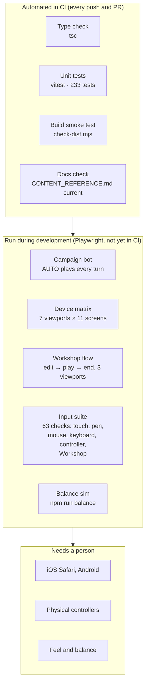

# Testing

What is tested, how to run it, and what still needs a human.

---

## 1. Test layers

| Layer | Command | Runs in CI | What it catches |
| :--- | :--- | :---: | :--- |
| Type check + build | `npm run build` | ✅ | Type errors, broken imports |
| Unit tests | `npm test` | ✅ | Rule regressions (combat, AI, pathing, data) |
| Build smoke test | `npm run test:build` | ✅ | Missing assets in `dist/`; the service worker listing a file that isn't there; a manifest icon missing |
| Docs check | `npm run docs:check` | ✅ | Data changed without regenerating the Content Reference |
| Browser play-tests | Playwright scripts (see §3) | ❌ | Runtime errors, layout collisions, broken gestures |

---

## 2. Unit tests (`tests/core.test.ts`, `tests/scenario.test.ts`, `tests/jobs-gear.test.ts`, `tests/progression.test.ts`, `tests/items-world.test.ts`, `tests/side-mastery.test.ts`, `tests/slots-difficulty.test.ts`, `tests/chemist.test.ts`)

All 233 tests import `src/core` and `src/data` directly in Node. No browser is needed.

| Group | Tests | Guards against |
| :--- | :---: | :--- |
| **Data integrity** | 6 | Engine code referencing an ability id that doesn't exist (the bug that silently disabled three reactions before 0.7.0); chapters pointing at missing maps, items or chapters; enemies or deploy tiles on unwalkable tiles; bad armory ids; maps under 16×16; any campaign or Trials (floors 1–20) enemy that melee units can't walk to from the deploy zone |
| **Combat** | 9 | Gear not counting; balance (2–6 hits per same-level basic attack, no spell one-shots); facing math; area splash falloff; reactions firing; Focus being temporary; boss enrage once; Dragonheart once per battle |
| **Progression** | 2 | Level-up math; passive cycling only offering learned abilities |
| **Grid** | 7 | Range/height/self-target rule; water costs; enemies blocking and allies not standable; Teleport; walking paths are adjacent, climbable, within Move, avoid enemies, and none for teleporters |
| **Geomancy** | 1 | Terrain → spell mapping |
| **Enemy AI** | 4 | Never hitting its own team; finishing wounded foes; healing allies, never buffing players; never casting unaffordable spells |
| **Trials** | 3 | Determinism; walkable unique spawns; boss every 5th floor; drops never repeat owned items |
| **Turn manager** | 1 | Speed order; timeline prediction doesn't mutate state |
| **Jobs and gear (0.13)** | 30 | The four new jobs' kits; status bookkeeping (every status is a buff or an ailment); Breach, Shell, Blind, Silence, Sleep (skips turns, wakes on damage, wears off) and Regen; cleanse, drain, ATK-scaled healing, Steal (order, odds, bosses); Conserve; the new reactions and supports; gear guard, start-status and element-boost traits; old-save JP migration; the AI never Steals or wastes ailments on guarded targets |
| **Progression (0.14)** | 21 | Job levels from lifetime JP (spending never lowers them); `gainJp` level-ups and unlocks; the job tree (real jobs, no cycles, base jobs open, advanced jobs locked, units created in a job meet its needs, a held job is never locked, old-save migration); shop tiers, relics never sold, bounties, chapter payouts in range, resale; Paladin and Spellblade rules (ATK-scaled elemental strikes, Zeal, Arcane Edge, Runic, Divine Grace) |
| **Items, market and world map (0.15)** | 24 | Supplies are well formed and never clash with ability ids; items always land, do fixed amounts, draw no reaction; Ether, Remedy, Phoenix Feather (only the fallen, clean slate, quarter HP) and Blast Flask (wakes sleepers, spares allies); saved inventories are clamped; worn gear and relics can't be sold; every chapter has a place on the map and every place a road; one battle open on a new game, two after Chapter I, the other road closes once you march, nothing open after the finale; old saves get a sensible cleared list; the next shelf opens when a chapter is won |
| **Side battles, mastery and Raise (0.16)** | 15 | Every side-battle place has a map, jobs, a spot on the world map and a road, and no two places sit on top of each other; they open with the story and never show as cleared; enemy level follows the squad and stops rising at the cap; the generated fight is repeatable, on walkable unshared tiles, with no boss; payouts don't beat the story's; saved win counts are clamped. Every job has a mastery bonus; tiers are earned once, at job level 5 and 8; bonuses follow the unit across jobs and add up; enemies have none. Raise always works on the fallen, never on the living, a boss, or a tile someone stands on; the planner casts it when it can pay |
| **Act II (0.17)** | 4 | The story runs from the Summit through one road to a single finale; a squad that finished the first act finds Chapter IV open and nothing behind it reopened; on each new battlefield every enemy can be reached from the deployment tiles by a unit with Jump 2, nobody deploys on anybody else, and there are six deployment tiles; enemy levels rise chapter by chapter with one boss each |
| **Difficulty and saves (0.18)** | 10 | Easy → Normal → Hard on every dial, Normal unchanged; enemy levels shift and never drop below 1; boss HP scales and nobody else's; slot 1 is the old save key; slots are independent, Continue finds the newest, New Game the first empty; bad slot numbers write nothing; an exported save imports back intact; non-saves and oversized files are refused with a readable message; a hostile file loses its HTML names, unknown jobs, abilities, items, prototype keys and out-of-range numbers |
| **Chemist and supplies (0.19)** | 8 | The Chemist opens at Squire Lv 2 with four actions, a reaction and a support; Salve heals for free from 3 tiles; Purge cleanses; Acid Flask breaches; Smoke Bomb blinds foes only; Field Dressing fires only when a blow leaves the unit under half HP; Pharmacology multiplies Potion, Ether, Blast Flask and Phoenix Feather by 1.5; Chemists appear in the Trials; a Frost Flask damages and Slows foes only, and not the fallen; an Elixir fills HP and MP |
| **Smarter foes and text size (0.20)** | 10 | Walking distance goes round a cliff, never onto it; water costs double unless the unit water-walks; a plan ends facing the closest foe; a unit with nothing in reach heads for the gap rather than hugging the cliff; a frontal blow on a Weapon Guard knight scores lower; healers and buffers are spotted (not knights with Bulwark, not when silenced or out of MP) and shot first given two identical targets; the Summit keeps one boss and no Haste caster; text size cycles and ignores junk; every UI font size in the stylesheet scales |
| **Recruiting (0.25)** | 11 | A board of three, the same for a visit and new after a win; no repeated job or name, no squad member's name; jobs open by chapter; level a step below the squad and the price formula; hired slots marked on their own board only; a hire's job, gear, first ability and JP; every job hireable; ids stay unique; the party: everyone while the squad fits, then the leader, required recruits and the pick, six at most; saves keep ten units, a clean party and hires; no recruit name belongs to the story |
| **Summons (0.24)** | 14 | Every Summoner call and Celestial Call names a creature with an effect; grand summons are charged, cost the most, hit at full force; enemies get them from level 6; a call lands once, at the start of the caller's next turn; Sleep, Silence or a KO break it; Raise and a new battle clear it; its marked area is clipped to the board; only a foe's damaging call counts as danger; +30 hit; Cinderwing heals the living and raises the fallen; the AI walks out of a marked area, calls a grand summon on a crowd, and keeps to the raise cap; every effect draws through its whole duration |
| **Master signatures (0.23)** | 10 | One per job, free, never learned with JP, findable by id; earned only at Master, one level short gives nothing, and kept in every job; once per battle, back the next battle; usable under Silence; centred ones reach foes or allies around the user; Panacea heals and cleanses, Sanctuary heals and gives Regen; each hits harder than the job's plain attack; +30 hit; AUTO keeps one for a group rather than a foe a plain blow finishes |
| **Bard, Dancer and performances (0.22)** | 16 | Both jobs have four actions, a reaction and a support, mastery and a veteran reaction, and open only once their two parent jobs are at Lv 2; the six performances are range 0 with an area (songs help, dances harm); a song reaches the performer and allies within 2 and a dance only foes; Resonance adds a tile; a performance plays three more turns then stops, five with Encore; Sleep, Silence, falling or stopping ends it; Encore is a buff that cleansing leaves alone, and a new battle clears it; a performance deals its full effect; an enemy Bard sings centred on itself, a performer holds its ground unless a clearly better blow is there; Healing Refrain and Captivate fire as described; both jobs appear in the Trials; a job change never leaves HP or MP above the new maximum |
| **World map events (0.21)** | 16 | The merchant stays away until a battle is won, sets up only at won battlefields or open side-battle camps, moves after every win (story or side) and visits every stop in turn; she sells one next-shelf piece at ×1.25 and one of her own goods, never relics, trophies or what the squad owns; a ware bought stays sold until she moves; her goods aren't on the market's shelves or in the Trials, and can be sold back; saved sales are sanitised. Each side battle has its own trophy, never sold or dropped; old saves are owed exactly the trophies they earned. One camp scene per story battle but the last, spoken only by squad members with portraits; the earliest unseen plays, once; old saves get one scene, not a backlog; imports keep the list; `__proto__` can't pass as a won chapter |
| **Workshop scenarios** | 11 | Blank and remixed scenarios are playable; scenarios become chapters without sharing state; validation errors and warnings; hostile JSON (huge sizes, `__proto__` job ids, control characters, duplicate tiles, unknown items) is clamped or dropped; old editor maps import; share links round-trip under 4 KB and damaged links fail cleanly |

Randomness is injectable: `CombatEngine.executeAttack(forecast, rng)` takes an `rng` so tests force hits, misses and crits.

---

## 3. Browser play-tests

These scripts ran during 0.7–0.8 development against `npm run preview` with `?debug&fast`. `?debug` exposes the game as `window.__tactics`; `?fast` speeds animations up about 8×.

| Script | What it does | Last result |
| :--- | :--- | :--- |
| **Campaign bot** | Clicks through dialogue, presses AUTO every turn, takes either branch, retries on defeat, continues into the Trials | 0.10.0 on 16×16 maps: Chapter I → II-A → Final → Trials 1–3, 4 retries in total (AUTO only), zero console errors |
| **Device matrix** | Loads 7 viewports (375×667 to 1920×1080, touch on for phones and tablets) and opens 11 screens; measures off-screen panels, overlapping HUD panels, and touch targets under 40px | No off-screen panels, no unintended overlaps, no small targets |
| **Input suite** (run on Low graphics, since CI machines have no GPU) | CDP multi-touch (tap, drag, pinch, twist, two-finger tap), pen pointer events (hover, tap, barrel button, drag), mouse (wheel, left/right drag, click), a full keyboard-only turn, a full turn on an emulated standard gamepad, the Workshop driven by keyboard and controller only (open, navigate, place, undo, close and resume the battle), and Workshop brush strokes by mouse and by touch (each tile once, one undo step, panning still pans) | 63 / 63 |
| **Workshop flow** | Desktop, phone portrait and phone landscape: open from the menu, sculpt with a brush, undo, switch every tab, set a title and objective, play, win via the boss objective, spoils, end screen, back to the campaign | No console errors on all three |
| **Items and world map** (0.15) | Uses every item through the Item menu and forecast; raises a fallen ally; wins Chapter I and lands on the map; buys and sells at the market (and is refused away from it and in battle); saves on the map and continues onto it; marches by keyboard; loses and falls back to the map; finishes the story, enters the Trials from the gate and steps back out; opens the Workshop from the map and returns; loads a 0.14 save. Then the map, Item menu and both shop counters at 390×844, 844×390 and 820×1180 with touch | No console errors; nothing off screen; no touch target under 40px; the road not taken stays closed after a reload |
| **Side battles and comfort** (0.16) | First-turn, move and undo tips appear in order; a move is undone with key 1 and the sprite returns; battle speed toggles and is stored; Raise is cast through the action menu and forecast; a mastery tier raises max HP and shows ticked in Team; after Chapter I only Thornwood Ford is open; a side battle is fought, won (bonus paid, win counted), fought again a level higher, lost and left for the map; a reload during it resumes on the map; the story march still works afterwards. Then tips, Menu, Team and the nine-place map at 390×844, 844×390 and 820×1180 with touch | No console errors; tips overlap no control; the Menu fits or scrolls; no place name leaves the map; the Fight button is on screen |
| **Act II** (0.17) | From a finished first act: the map shows Emberwick Harbor open; marches to each new chapter in turn, checks the recruit joined and the road reward arrived, lets AUTO play real rounds on each new battlefield, wins, and reaches the epilogue with the Trials open; loads a 0.14 Trials save and finds Chapter IV waiting. Then the twelve-place map at 390×844, 844×390 and 820×1180 | No console errors; no overlapping or off-map place names |
| **Difficulty and saves** (0.18) | New Game asks for a difficulty and writes slot 1 at once; Hard shifts enemy levels; two potions used then a defeat gives them back; Menu → Difficulty changes it; Save game to an empty slot, over another (confirm, cancel), export (text and a real download), delete (confirm); a bad import shows an error; an import carrying an HTML name loads as plain text and runs nothing; Continue and Load Game on the title; the Gate opens after Chapter III without New Game+; New Game with all slots full asks which to replace. Then the new-game, slot and export screens at 390×844 and 844×390 | No console errors; the modal scrolls on short screens; no button off screen or under 40px |
| **Recruiting** (0.25) | At the market the board lists three hopefuls with a sprite, job, level, a line and a price; hiring three takes the gil and marks them Hired; Barracks shows 7/10, Rowan LEADS, a full party disables Reserve → In party; dismissing asks first and removes the unit; marching to Chapter IV with seven opens Choose your party, notes Sable joining, and deploys six with the other two in reserve. Desktop and phone portrait | No console errors |
| **Summons** (0.24) | A Summoner casts Salamander: the camera comes in, the lizard breathes fire over three foes and all take damage. Tidewyrm: ACT lists the three ✦ grand summons (Lands next turn); the forecast says LANDS NEXT TURN; the caster shows ✦ CALLING and the area pulses violet; on the caster's next turn the serpent lands, damaging and Slowing those still inside. In a run where the foes knocked the caller out, the log said the call was broken | No console errors |
| **Master signatures** (0.23) | A unit masters the Geomancer by JP: the log names Earthquake; Team → Jobs shows "Master: +15 MP + ★ Earthquake"; back in the Squire job, ACT lists ★ Earthquake (ONCE, Master · once per battle · Around you · Area 3); it hits the three foes around the unit at 98% and is gone from the list for the rest of the battle. Desktop and phone portrait | No console errors |
| **Bard and Dancer** (0.22) | Team lists both jobs locked with what they need; a unit becomes a Bard, its sprite and the four actions show (performances say "Around you · Area 2 · repeats 3 turns"); Battle Hymn highlights the area, a tile in it confirms, Focus lands on the Bard and nearby allies and the unit card shows ♪ 3; on the Bard's next turn the hymn plays again by itself; moving ends it and UNDO brings it back. A Dancer's Blade Waltz hits the foes around her. Then every sprite view, attack frame and portrait of both jobs, player and enemy, on one sheet | No console errors |
| **World map events** (0.21) | Chapter I won: the camp box shows; Sit by the fire is pressed by keyboard; the map is inert behind the scene and arrow keys don't walk it; four lines play by Enter; everyone gains 30 JP; the scene is saved as seen and focus returns to the map. The merchant's pin and hint show; walking there lists two wares; buying her own good costs its price, is saved, and leaves it marked Sold; the market's shelves don't list her goods. Thornwood Ford won twice: the trophy comes the first time only and the panel shows it won. An old save with wins and no trophy gets it, and one camp scene. Then the camp box and merchant at 390×844 and 844×390 | No console errors; no button wider than the panel |
| **Text size and smarter foes** (0.20) | Menu → Text size cycles Normal → Large → Larger → Normal, stores the choice and keeps it across a reload; at Larger the battle HUD, action list, Team, world map and market at 1280×720, 390×844 and 844×390, and the title screen, have no clipped labels; unit HP bars no longer show through open panels; then every earlier release script again (0.16 to 0.19) | No console errors; no label wider than its button |
| **Chemist, supplies and offline** (0.19) | The Chemist appears in Team → Jobs, unlocked at Squire Lv 2 with its mastery line; a unit becomes one, its four actions show, Pharmacology gives a Potion reach 3 and +120 HP in the forecast and on use; a Frost Flask hits two foes for 68 and Slows both; an Elixir fills HP and MP; the market sells both new supplies after Chapter III. Offline: the production build served locally, the worker registered, the network cut, the page reloaded: the title screen loads with its fonts and a new game starts | No console errors |

Committing these to the repo and running them in CI is on the [roadmap](ROADMAP.md).

---

## 3a. Inside itch.io's iframe

Before an itch upload, the build is served on one origin and embedded in a mock store page on another, as itch does, at 1280×720 on desktop and on a phone. Checks: the title screen and bundled fonts load; Fullscreen is offered when the iframe allows it; New Game starts the intro; arrow keys, Space, Page Down and End inside the game don't scroll the page; `localStorage` survives a reload inside the frame; nothing is requested from another site; no errors. 0.12.0 passes all of them, and the keyboard-only title flow (arrows + Enter, Quit to title) works.

## 3b. Balance yardstick (`npm run balance`)

`scripts/balance-sim.ts` plays each campaign chapter headless with the squad on AUTO against the enemy AI, using the game's own turn order, planner and combat engine, and prints the squad's win rate at levels 3–5. A run of 30 battles per chapter takes a few seconds; pass a count, chapters and levels to narrow it (`npm run balance -- 100 chapter_2b 3,4`), or a JSON roster override to try a change without editing data.

It leaves out reactions, gear upgrades and human play, so read it relatively: compare versions, and keep branch choices in the same range. Since 0.13.0 it gives veteran enemies their passives, as the game does (`JobSystem.equipVeteranPassives`).

| Chapter | 0.11.0 (60 each): L3 / L4 / L5 | 0.12.0 (100 each) | 0.13.0 (100 each) |
| :--- | :---: | :---: | :---: |
| I | 67% / 72% / 87% | 64% / 74% / 76% | 65% / 73% / 68% |
| II-A | 10% / 22% / 33% | 9% / 24% / 27% | 16% / 25% / 25% |
| II-B | 17% / 52% / 65% | 19% / 46% / 64% | 25% / 56% / 70% |
| Final | 0% / 0% / 2% | 1% / 0% / 5% | 0% / 3% / 4% |

0.13.0 swapped Chapter I's Bridge Cutthroat to a Thief and one of Chapter II-B's gate Knights to a Monk; both stay within run-to-run noise.

The Final Chapter is near 0% on pure AUTO in 0.9 as well; the campaign bot clears it with the gear it has collected by then, after a few retries.

---

## 4. Manual checklist (before a release)

| ✔ | Check |
| :---: | :--- |
| ☐ | iPhone Safari, portrait and landscape: tap, drag, pinch, twist; nothing under the notch or home bar |
| ☐ | Android Chrome: same gestures; back gesture doesn't leave the game |
| ☐ | iPad + Apple Pencil: hover preview, tap, barrel/eraser cancel (where supported) |
| ☐ | Xbox and PlayStation controllers over USB and Bluetooth: connect banner, every button, rumble |
| ☐ | Keyboard only: play a full battle without touching the mouse |
| ☐ | Screen reader spot-check: command buttons, dialogs and the banner are announced |
| ☐ | `prefers-reduced-motion`: shake is subtle, the banner fades instead of sliding |
| ☐ | Save, reload the page, load: squad, armory and chapter restored |
| ☐ | Save on the world map, reload, Continue: back on the map at the same place with the same purse and supplies |
| ☐ | Export a slot on one device, import it on another (phone ↔ desktop), load it |
| ☐ | Download a save file from inside the itch.io page (the embed may block downloads; Copy should still work) |
| ☐ | Install the app (Android Chrome: Menu → Install app; iPhone: Safari Share → Add to Home Screen), turn on airplane mode, open it and play a battle |
| ☐ | After a new release, open the installed app twice: the second launch runs the new version |
| ☐ | World map on a phone in both orientations: every place can be tapped, the March button is on screen |
| ☐ | Use each item once in battle; raise a fallen ally with a Phoenix Feather |
| ☐ | New browser profile: the tips appear once each during Chapter I and never cover a button you need |
| ☐ | Move, UNDO, move elsewhere, act: the unit ends where you last put it |
| ☐ | Win a side battle twice: the second visit is a level harder and pays the smaller bonus |
| ☐ | Play the Final Chapter with a re-geared squad: hard but fair |
