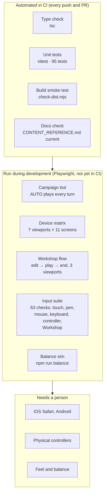

# Testing

What is tested, how to run it, and what still needs a human.

---

## 1. Test layers

| Layer | Command | Runs in CI | What it catches |
| :--- | :--- | :---: | :--- |
| Type check + build | `npm run build` | ✅ | Type errors, broken imports |
| Unit tests | `npm test` | ✅ | Rule regressions (combat, AI, pathing, data) |
| Build smoke test | `npm run test:build` | ✅ | Missing assets in `dist/` |
| Docs check | `npm run docs:check` | ✅ | Data changed without regenerating the Content Reference |
| Browser play-tests | Playwright scripts (see §3) | ❌ | Runtime errors, layout collisions, broken gestures |

---

## 2. Unit tests (`tests/core.test.ts`, `tests/scenario.test.ts`, `tests/jobs-gear.test.ts`, `tests/progression.test.ts`)

All 95 tests import `src/core` and `src/data` directly in Node. No browser is needed.

| Group | Tests | Guards against |
| :--- | :---: | :--- |
| **Data integrity** | 6 | Engine code referencing an ability id that doesn't exist (the bug that silently disabled three reactions before 0.7.0); chapters pointing at missing maps, items or chapters; enemies or deploy tiles on unwalkable tiles; bad armory ids; maps under 16×16; any campaign or Trials (floors 1–20) enemy that melee units can't walk to from the deploy zone |
| **Combat** | 9 | Gear not counting; balance (2–6 hits per same-level basic attack, no spell one-shots); facing math; area splash falloff; reactions firing; Focus being temporary; boss enrage once; Dragonheart once per battle |
| **Progression** | 2 | Level-up math; passive cycling only offering learned abilities |
| **Grid** | 7 | Range/height/self-target rule; water costs; enemies blocking and allies not standable; Teleport; walking paths are adjacent, climbable, within Move, avoid enemies, and none for teleporters |
| **Geomancy** | 1 | Terrain → spell mapping |
| **Enemy AI** | 4 | Never hitting its own team; finishing wounded foes; healing allies, never buffing players; never casting unaffordable spells |
| **Trials** | 3 | Determinism; walkable unique spawns; boss every 5th floor; drops never repeat owned items |
| **Turn manager** | 1 | Speed order; timeline prediction doesn't mutate state |
| **Jobs and gear (0.13)** | 30 | The four new jobs' kits; status bookkeeping (every status is a buff or an ailment); Breach, Shell, Blind, Silence, Sleep (skips turns, wakes on damage, wears off) and Regen; cleanse, drain, ATK-scaled healing, Steal (order, odds, bosses); Conserve; the new reactions and supports; gear guard, start-status and element-boost traits; old-save JP migration; the AI never Steals or wastes ailments on guarded targets |
| **Progression (0.14)** | 21 | Job levels from lifetime JP (spending never lowers them); `gainJp` level-ups and unlocks; the job tree (real jobs, no cycles, base jobs open, advanced jobs locked, units created in a job meet its needs, a held job is never locked, old-save migration); shop tiers, relics never sold, bounties, chapter payouts in range, resale; Paladin and Spellblade rules (ATK-scaled elemental strikes, Zeal, Arcane Edge, Runic, Divine Grace) |
| **Workshop scenarios** | 11 | Blank and remixed scenarios are playable; scenarios become chapters without sharing state; validation errors and warnings; hostile JSON (huge sizes, `__proto__` job ids, control characters, duplicate tiles, unknown items) is clamped or dropped; old editor maps import; share links round-trip under 4 KB and damaged links fail cleanly |

Randomness is injectable: `CombatEngine.executeAttack(forecast, rng)` takes an `rng` so tests force hits, misses and crits.

---

## 3. Browser play-tests

These scripts ran during 0.7–0.8 development against `npm run preview` with `?debug&fast`. `?debug` exposes the game as `window.__tactics`; `?fast` speeds animations up about 8×.

| Script | What it does | Last result |
| :--- | :--- | :--- |
| **Campaign bot** | Clicks through dialogue, presses AUTO every turn, takes either branch, retries on defeat, continues into the Trials | 0.10.0 on 16×16 maps: Chapter I → II-A → Final → Trials 1–3, 4 retries in total (AUTO only), zero console errors |
| **Device matrix** | Loads 7 viewports (375×667 to 1920×1080, touch on for phones and tablets) and opens 11 screens; measures off-screen panels, overlapping HUD panels, and touch targets under 40px | No off-screen panels, no unintended overlaps, no small targets |
| **Input suite** (run on Low graphics, since CI machines have no GPU) | CDP multi-touch (tap, drag, pinch, twist, two-finger tap), pen pointer events (hover, tap, barrel button, drag), mouse (wheel, left/right drag, click), a full keyboard-only turn, a full turn on an emulated standard gamepad, the Workshop driven by keyboard and controller only (open, navigate, place, undo, close and resume the battle), and Workshop brush strokes by mouse and by touch (each tile once, one undo step, panning still pans) | 63 / 63 |
| **Workshop flow** | Desktop, phone portrait and phone landscape: open from the menu, sculpt with a brush, undo, switch every tab, set a title and objective, play, win via the boss objective, spoils, end screen, back to the campaign | No console errors on all three |

Committing these to the repo and running them in CI is on the [roadmap](ROADMAP.md).

---

## 3a. Inside itch.io's iframe

Before an itch upload, the build is served on one origin and embedded in a mock store page on another, as itch does, at 1280×720 on desktop and on a phone. Checks: the title screen and bundled fonts load; Fullscreen is offered when the iframe allows it; New Game starts the intro; arrow keys, Space, Page Down and End inside the game don't scroll the page; `localStorage` survives a reload inside the frame; nothing is requested from another site; no errors. 0.12.0 passes all of them, and the keyboard-only title flow (arrows + Enter, Quit to title) works.

## 3b. Balance yardstick (`npm run balance`)

`scripts/balance-sim.ts` plays each campaign chapter headless with the squad on AUTO against the enemy AI, using the game's own turn order, planner and combat engine, and prints the squad's win rate at levels 3–5. A run of 30 battles per chapter takes a few seconds; pass a count, chapters and levels to narrow it (`npm run balance -- 100 chapter_2b 3,4`), or a JSON roster override to try a change without editing data.

It leaves out reactions, gear upgrades and human play, so read it relatively: compare versions, and keep branch choices in the same range. Since 0.13.0 it gives veteran enemies their passives, as the game does (`JobSystem.equipVeteranPassives`).

| Chapter | 0.11.0 (60 each): L3 / L4 / L5 | 0.12.0 (100 each) | 0.13.0 (100 each) |
| :--- | :---: | :---: | :---: |
| I | 67% / 72% / 87% | 64% / 74% / 76% | 65% / 73% / 68% |
| II-A | 10% / 22% / 33% | 9% / 24% / 27% | 16% / 25% / 25% |
| II-B | 17% / 52% / 65% | 19% / 46% / 64% | 25% / 56% / 70% |
| Final | 0% / 0% / 2% | 1% / 0% / 5% | 0% / 3% / 4% |

0.13.0 swapped Chapter I's Bridge Cutthroat to a Thief and one of Chapter II-B's gate Knights to a Monk; both stay within run-to-run noise.

The Final Chapter is near 0% on pure AUTO in 0.9 as well; the campaign bot clears it with the gear it has collected by then, after a few retries.

---

## 4. Manual checklist (before a release)

| ✔ | Check |
| :---: | :--- |
| ☐ | iPhone Safari, portrait and landscape: tap, drag, pinch, twist; nothing under the notch or home bar |
| ☐ | Android Chrome: same gestures; back gesture doesn't leave the game |
| ☐ | iPad + Apple Pencil: hover preview, tap, barrel/eraser cancel (where supported) |
| ☐ | Xbox and PlayStation controllers over USB and Bluetooth: connect banner, every button, rumble |
| ☐ | Keyboard only: play a full battle without touching the mouse |
| ☐ | Screen reader spot-check: command buttons, dialogs and the banner are announced |
| ☐ | `prefers-reduced-motion`: shake is subtle, the banner fades instead of sliding |
| ☐ | Save, reload the page, load: squad, armory and chapter restored |
| ☐ | Play the Final Chapter with a re-geared squad: hard but fair |
