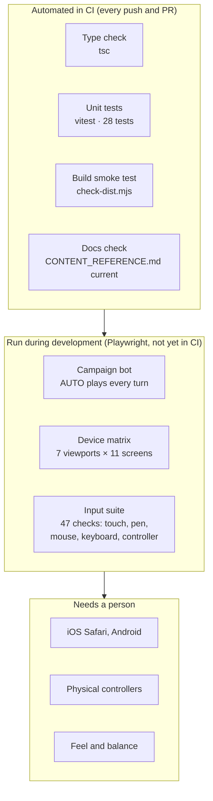

# Testing

What is tested, how to run it, and what still needs a human.

---

## 1. Test layers

| Layer | Command | Runs in CI | What it catches |
| :--- | :--- | :---: | :--- |
| Type check + build | `npm run build` | ✅ | Type errors, broken imports |
| Unit tests | `npm test` | ✅ | Rule regressions (combat, AI, pathing, data) |
| Build smoke test | `npm run test:build` | ✅ | Missing assets in `dist/` |
| Docs check | `npm run docs:check` | ✅ | Data changed without regenerating the Content Reference |
| Browser play-tests | Playwright scripts (see §3) | ❌ | Runtime errors, layout collisions, broken gestures |

---

## 2. Unit tests (`tests/core.test.ts`)

All 28 tests import `src/core` and `src/data` directly in Node. No browser is needed.

| Group | Tests | Guards against |
| :--- | :---: | :--- |
| **Data integrity** | 4 | Engine code referencing an ability id that doesn't exist (the bug that silently disabled three reactions before 0.7.0); chapters pointing at missing maps, items or chapters; enemies or deploy tiles on unwalkable tiles; bad armory ids |
| **Combat** | 9 | Gear not counting; balance (2–6 hits per same-level basic attack, no spell one-shots); facing math; area splash falloff; reactions firing; Focus being temporary; boss enrage once; Dragonheart once per battle |
| **Progression** | 2 | Level-up math; passive cycling only offering learned abilities |
| **Grid** | 4 | Range/height/self-target rule; water costs; enemies blocking and allies not standable; Teleport |
| **Geomancy** | 1 | Terrain → spell mapping |
| **Enemy AI** | 4 | Never hitting its own team; finishing wounded foes; healing allies, never buffing players; never casting unaffordable spells |
| **Trials** | 3 | Determinism; walkable unique spawns; boss every 5th floor; drops never repeat owned items |
| **Turn manager** | 1 | Speed order; timeline prediction doesn't mutate state |

Randomness is injectable: `CombatEngine.executeAttack(forecast, rng)` takes an `rng` so tests force hits, misses and crits.

---

## 3. Browser play-tests

These scripts ran during 0.7–0.8 development against `npm run preview` with `?debug&fast`. `?debug` exposes the game as `window.__tactics`; `?fast` speeds animations up about 8×.

| Script | What it does | Last result |
| :--- | :--- | :--- |
| **Campaign bot** | Clicks through dialogue, presses AUTO every turn, takes either branch, retries on defeat, continues into the Trials | Cleared Chapter I → II-A / II-B → Final → Trials 1–5, zero console errors |
| **Device matrix** | Loads 7 viewports (375×667 to 1920×1080, touch on for phones and tablets) and opens 11 screens; measures off-screen panels, overlapping HUD panels, and touch targets under 40px | No off-screen panels, no unintended overlaps, no small targets |
| **Input suite** | CDP multi-touch (tap, drag, pinch, twist, two-finger tap), pen pointer events (hover, tap, barrel button, drag), mouse (wheel, left/right drag, click), a full keyboard-only turn, and a full turn on an emulated standard gamepad | 47 / 47 |

Committing these to the repo and running them in CI is on the [roadmap](ROADMAP.md).

---

## 4. Manual checklist (before a release)

| ✔ | Check |
| :---: | :--- |
| ☐ | iPhone Safari, portrait and landscape: tap, drag, pinch, twist; nothing under the notch or home bar |
| ☐ | Android Chrome: same gestures; back gesture doesn't leave the game |
| ☐ | iPad + Apple Pencil: hover preview, tap, barrel/eraser cancel (where supported) |
| ☐ | Xbox and PlayStation controllers over USB and Bluetooth: connect banner, every button, rumble |
| ☐ | Keyboard only: play a full battle without touching the mouse |
| ☐ | Screen reader spot-check: command buttons, dialogs and the banner are announced |
| ☐ | `prefers-reduced-motion`: shake is subtle, the banner fades instead of sliding |
| ☐ | Save, reload the page, load: squad, armory and chapter restored |
| ☐ | Play the Final Chapter with a re-geared squad: hard but fair |
